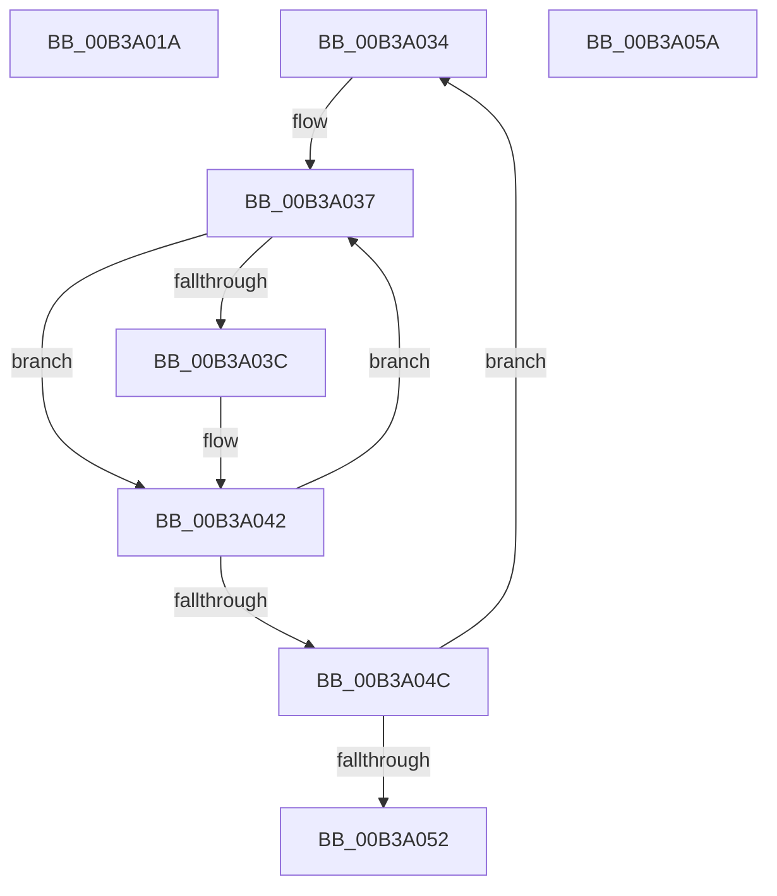

# sub_00B3A01A

- RVA: `0x00B3A01A`–`0x00B3A062` (길이 `72` bytes)
- VA: `0x0000000140B3A01A`
- 실행 섹션: `PAGE`
- PDB 이름 있음: `아니요`; PDB Function 태그: `아니요`
- unwind 정보 RVA: `0x000AD998`
- 디코드: `17`개 명령, `72/72` bytes 표시
- 미해석 바이트: `0` (있으면 어셈블리에 `.byte`로 보존)

> 이 문서는 커널 이미지의 기계어와 PDB 기호를 분석해 생성했습니다. 4번과 5번은 함수 원형과 자료형을 바이너리 사용 방식에서 추정한 C 해석이며 원본 소스 복구 결과는 아닙니다.

## 1. Dependencies

- 직접 호출 지점: **0**; 고유 호출 대상: **0**
- 직접 호출자로 확인된 함수: **0**
- RIP 상대 이미지 참조: **0**

### Outgoing calls
- 직접 디코드된 call 명령이 없습니다.

### Direct callers
- 이 함수 시작 RVA로 연결되는 직접 call은 확인되지 않았습니다. 간접 호출은 완전히 역산할 수 없습니다.

### Static image references
- 디코드된 RIP-relative 메모리 참조가 없습니다.

## 2. Other-region calls and transfers

- 다른 실행 섹션으로 향하는 call: **0**
- call이 아닌 외부 분기/꼬리 이동: **3**
  - `0x00B3A02F` → [PopConfigureHeteroPolicies + 0xE1](../A3/PopConfigureHeteroPolicies_function_00A35B30.md) (`tail-transfer`)
  - `0x00B3A055` → [PopConfigureHeteroPolicies + 0x294](../A3/PopConfigureHeteroPolicies_function_00A35B30.md) (`tail-transfer`)
  - `0x00B3A05D` → [PopConfigureHeteroPolicies + 0x446](../A3/PopConfigureHeteroPolicies_function_00A35B30.md) (`tail-transfer`)

## 3. Assembly (complete function range)

```asm
00B3A01A  C7 45 EC 0A 00 00 00            mov dword ptr [rbp - 0x14], 0xa
00B3A021  C7 45 F0 50 14 00 00            mov dword ptr [rbp - 0x10], 0x1450
00B3A028  C7 45 F4 33 00 00 00            mov dword ptr [rbp - 0xc], 0x33
00B3A02F  E9 DD BB EF FF                  jmp 0x140a35c11
00B3A034  49 8B CF                        mov rcx, r15
00B3A037  83 38 03                        cmp dword ptr [rax], 3
00B3A03A  75 06                           jne 0x140b3a042
00B3A03C  C7 00 04 00 00 00               mov dword ptr [rax], 4
00B3A042  48 83 C0 04                     add rax, 4
00B3A046  48 83 E9 01                     sub rcx, 1
00B3A04A  75 EB                           jne 0x140b3a037
00B3A04C  48 83 EA 01                     sub rdx, 1
00B3A050  75 E2                           jne 0x140b3a034
00B3A052  8B 55 B0                        mov edx, dword ptr [rbp - 0x50]
00B3A055  E9 6A BD EF FF                  jmp 0x140a35dc4
00B3A05A  41 8A F8                        mov dil, r8b
00B3A05D  E9 14 BF EF FF                  jmp 0x140a35f76
```

## 4. C-style interpretation (structured pseudocode)

```c
__int64 __fastcall sub_00B3A01A(__int64 a1, __int64 a2, unsigned __int8 a3)
{
    *(unsigned int *)(v_rbp - 20) = 10;
    *(unsigned int *)(v_rbp - 16) = 0x1450ULL;
    *(unsigned int *)(v_rbp - 12) = 51;
}
```

## 5. (Beta) C Style

```c
int64_t sub_00B3A01A(int64_t Arg1, int64_t Arg2, uint8_t Arg3)
{
    *(uint32_t *)(local_rbp - 0x14) = 10;
    *(uint32_t *)(local_rbp - 0x10) = 0x1450ULL;
    *(uint32_t *)(local_rbp - 0xC) = 51;
}
```

## 6. Execution-region graph

[열기: 2D/3D 그래프와 함수 탐색 컨트롤 패널](../../../control-panel.html?section=page&rva=0x00B3A01A&view=graph)

- 2D 그래프는 위에서 아래로 흐르고, 3D 그래프는 빈 공간을 드래그해 회전합니다. Shift+드래그는 이동, 휠은 확대·축소, 함수 노드 선택은 대상 보고서 이동입니다.

### Static fallback


