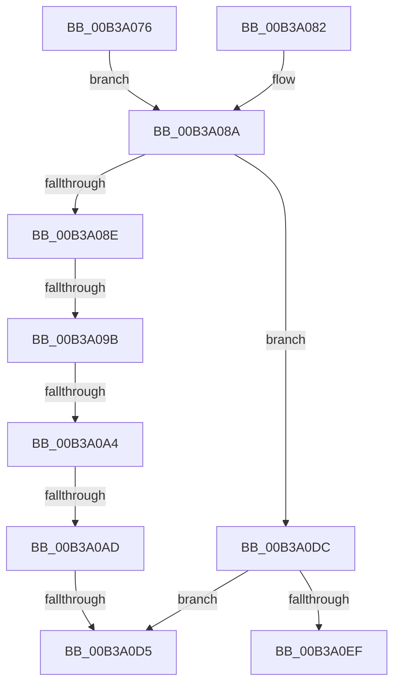

# sub_00B3A076

- RVA: `0x00B3A076`–`0x00B3A106` (길이 `144` bytes)
- VA: `0x0000000140B3A076`
- 실행 섹션: `PAGE`
- PDB 이름 있음: `아니요`; PDB Function 태그: `아니요`
- unwind 정보 RVA: `0x000ADB94`
- 디코드: `38`개 명령, `144/144` bytes 표시
- 미해석 바이트: `0` (있으면 어셈블리에 `.byte`로 보존)

> 이 문서는 커널 이미지의 기계어와 PDB 기호를 분석해 생성했습니다. 4번과 5번은 함수 원형과 자료형을 바이너리 사용 방식에서 추정한 C 해석이며 원본 소스 복구 결과는 아닙니다.

## 1. Dependencies

- 직접 호출 지점: **5**; 고유 호출 대상: **5**
- 직접 호출자로 확인된 함수: **0**
- RIP 상대 이미지 참조: **1**

### Outgoing calls
- `0x00B3A07B` → [SiGetEfiSystemDevice](../82/SiGetEfiSystemDevice_function_00827C68.md) (function, `0x00827C68`)
- `0x00B3A085` → [SiGetBiosSystemDisk](../82/SiGetBiosSystemDisk_function_00828590.md) (function, `0x00828590`)
- `0x00B3A0C8` → [SiGetBootDeviceName](../A3/SiGetBootDeviceName_function_00A378FC.md) (function, `0x00A378FC`)
- `0x00B3A0E4` → [SiTranslateSymbolicLink](../A3/SiTranslateSymbolicLink_function_00A37BE4.md) (function, `0x00A37BE4`)
- `0x00B3A0F4` → [ExFreePoolWithTag](../../poolcode/B8/ExFreePoolWithTag_function_00B82870.md) (function, `0x00B82870`)

### Direct callers
- 이 함수 시작 RVA로 연결되는 직접 call은 확인되지 않았습니다. 간접 호출은 완전히 역산할 수 없습니다.

### Static image references
- `0x00B3A0BF` → RVA `0x00B0CE90` (` ?? ::NNGAKEGL::`string'`; read)

## 2. Other-region calls and transfers

- 다른 실행 섹션으로 향하는 call: **1**
  - `0x00B3A0F4` → [ExFreePoolWithTag](../../poolcode/B8/ExFreePoolWithTag_function_00B82870.md) (`PAGE` → `POOLCODE`)
- call이 아닌 외부 분기/꼬리 이동: **6**
  - `0x00B3A095` → [SiGetSystemDisk + 0x74](../A3/SiGetSystemDisk_function_00A376F0.md) (`tail-transfer`)
  - `0x00B3A09E` → [SiGetSystemDisk + 0x74](../A3/SiGetSystemDisk_function_00A376F0.md) (`tail-transfer`)
  - `0x00B3A0A7` → [SiGetSystemDisk + 0x74](../A3/SiGetSystemDisk_function_00A376F0.md) (`tail-transfer`)
  - `0x00B3A0CF` → [SiGetSystemDisk + 0x74](../A3/SiGetSystemDisk_function_00A376F0.md) (`tail-transfer`)
  - `0x00B3A0D7` → [SiGetSystemDisk + 0x74](../A3/SiGetSystemDisk_function_00A376F0.md) (`tail-transfer`)
  - `0x00B3A101` → [SiGetSystemDisk + 0x74](../A3/SiGetSystemDisk_function_00A376F0.md) (`tail-transfer`)

## 3. Assembly (complete function range)

```asm
00B3A076  4C 8B C7                        mov r8, rdi
00B3A079  33 C9                           xor ecx, ecx
00B3A07B  E8 E8 DB CE FF                  call 0x140827c68
00B3A080  EB 08                           jmp 0x140b3a08a
00B3A082  48 8B CF                        mov rcx, rdi
00B3A085  E8 06 E5 CE FF                  call 0x140828590
00B3A08A  85 C0                           test eax, eax
00B3A08C  79 4E                           jns 0x140b3a0dc
00B3A08E  8B D8                           mov ebx, eax
00B3A090  3D 51 04 00 C0                  cmp eax, 0xc0000451
00B3A095  0F 85 C9 D6 EF FF               jne 0x140a37764
00B3A09B  40 84 ED                        test bpl, bpl
00B3A09E  0F 84 C0 D6 EF FF               je 0x140a37764
00B3A0A4  83 FE 02                        cmp esi, 2
00B3A0A7  0F 85 B7 D6 EF FF               jne 0x140a37764
00B3A0AD  48 89 7C 24 28                  mov qword ptr [rsp + 0x28], rdi
00B3A0B2  4C 8D 4C 24 60                  lea r9, [rsp + 0x60]
00B3A0B7  41 B0 01                        mov r8b, 1
00B3A0BA  C6 44 24 20 01                  mov byte ptr [rsp + 0x20], 1
00B3A0BF  48 8D 15 CA 2D FD FF            lea rdx, [rip - 0x2d236]
00B3A0C6  33 C9                           xor ecx, ecx
00B3A0C8  E8 2F D8 EF FF                  call 0x140a378fc
00B3A0CD  85 C0                           test eax, eax
00B3A0CF  0F 88 8F D6 EF FF               js 0x140a37764
00B3A0D5  33 DB                           xor ebx, ebx
00B3A0D7  E9 88 D6 EF FF                  jmp 0x140a37764
00B3A0DC  48 8B 0F                        mov rcx, qword ptr [rdi]
00B3A0DF  48 8D 54 24 68                  lea rdx, [rsp + 0x68]
00B3A0E4  E8 FB DA EF FF                  call 0x140a37be4
00B3A0E9  8B D8                           mov ebx, eax
00B3A0EB  85 C0                           test eax, eax
00B3A0ED  78 E6                           js 0x140b3a0d5
00B3A0EF  48 8B 0F                        mov rcx, qword ptr [rdi]
00B3A0F2  33 D2                           xor edx, edx
00B3A0F4  E8 77 87 04 00                  call 0x140b82870
00B3A0F9  48 8B 44 24 68                  mov rax, qword ptr [rsp + 0x68]
00B3A0FE  48 89 07                        mov qword ptr [rdi], rax
00B3A101  E9 5E D6 EF FF                  jmp 0x140a37764
```

## 4. C-style interpretation (structured pseudocode)

```c
__int64 __fastcall sub_00B3A076(int a1, __int64 a2, __int64 a3, __int64 a4, __int64 a5, __int64 a6, __int64 a7, __int64 a8, __int64 a9, __int64 a10, __int64 a11, __int64 a12, __int64 a13)
{
    __int64 result;
    __int64 v_rbx;
    unsigned __int8 v_stack_p20;
    unsigned __int64 v_stack_p28;

    a1 = 0;
    result = SiGetEfiSystemDevice(a1, a2, v_rdi, a4);
    goto loc_00B3A08A;
loc_00B3A08A:
    if (!sign_flag) goto loc_00B3A0DC;
    v_stack_p28 = v_rdi;
    v_stack_p20 = 1;
    a1 = 0;
    result = SiGetBootDeviceName(a1, v_rip - 184886, 1, a12);
loc_00B3A0D5:
    v_rbx = 0;
loc_00B3A0DC:
    result = SiTranslateSymbolicLink(*(unsigned __int64 *)(v_rdi), a13, 1, a12);
    if (sign_flag) goto loc_00B3A0D5;
    a2 = 0;
    result = ExFreePoolWithTag(*(unsigned __int64 *)(v_rdi), a2, 1, a12);
    *(unsigned __int64 *)(v_rdi) = a13;
}
```

## 5. (Beta) C Style

```c
int64_t sub_00B3A076(int32_t Arg1, int64_t Arg2, int64_t Arg3, int64_t Arg4, uint64_t Arg5, uint64_t Arg6, uint64_t Arg7, uint64_t Arg8, uint64_t Arg9, uint64_t Arg10, uint64_t Arg11, int64_t Arg12, int64_t Arg13)
{
    int64_t result;
    int64_t local_rbx;
    uint8_t v_stack_p20;
    uint64_t v_stack_p28;

    Arg1 = 0;
    result = SiGetEfiSystemDevice(Arg1, Arg2, local_rdi, Arg4);
    goto loc_00B3A08A;
loc_00B3A08A:
    if (!sign_flag) goto loc_00B3A0DC;
    v_stack_p28 = local_rdi;
    v_stack_p20 = 1;
    Arg1 = 0;
    result = SiGetBootDeviceName(Arg1, v_rip - 184886, 1, Arg12);
loc_00B3A0D5:
    local_rbx = 0;
loc_00B3A0DC:
    result = SiTranslateSymbolicLink(*(uint64_t *)(local_rdi), Arg13, 1, Arg12);
    if (sign_flag) goto loc_00B3A0D5;
    Arg2 = 0;
    result = ExFreePoolWithTag(*(uint64_t *)(local_rdi), Arg2, 1, Arg12);
    *(uint64_t *)(local_rdi) = Arg13;
}
```

## 6. Execution-region graph

[열기: 2D/3D 그래프와 함수 탐색 컨트롤 패널](../../../control-panel.html?section=page&rva=0x00B3A076&view=graph)

- 2D 그래프는 위에서 아래로 흐르고, 3D 그래프는 빈 공간을 드래그해 회전합니다. Shift+드래그는 이동, 휠은 확대·축소, 함수 노드 선택은 대상 보고서 이동입니다.

### Static fallback


