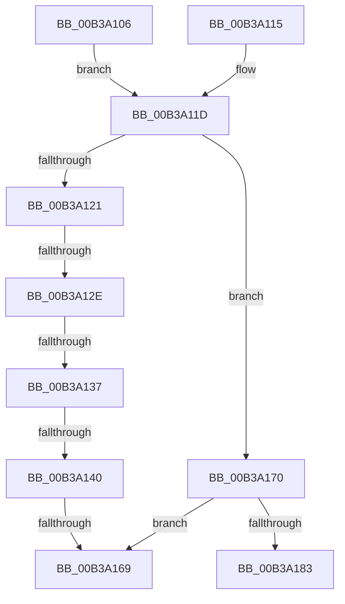

# sub_00B3A106

- RVA: `0x00B3A106`–`0x00B3A19A` (길이 `148` bytes)
- VA: `0x0000000140B3A106`
- 실행 섹션: `PAGE`
- PDB 이름 있음: `아니요`; PDB Function 태그: `아니요`
- unwind 정보 RVA: `0x000ADBA4`
- 디코드: `38`개 명령, `148/148` bytes 표시
- 미해석 바이트: `0` (있으면 어셈블리에 `.byte`로 보존)

> 이 문서는 커널 이미지의 기계어와 PDB 기호를 분석해 생성했습니다. 4번과 5번은 함수 원형과 자료형을 바이너리 사용 방식에서 추정한 C 해석이며 원본 소스 복구 결과는 아닙니다.

## 1. Dependencies

- 직접 호출 지점: **5**; 고유 호출 대상: **5**
- 직접 호출자로 확인된 함수: **0**
- RIP 상대 이미지 참조: **1**

### Outgoing calls
- `0x00B3A10E` → [SiGetEfiSystemDevice](../82/SiGetEfiSystemDevice_function_00827C68.md) (function, `0x00827C68`)
- `0x00B3A118` → [SiGetBiosSystemPartition](../82/SiGetBiosSystemPartition_function_008286C0.md) (function, `0x008286C0`)
- `0x00B3A15C` → [SiGetBootDeviceName](../A3/SiGetBootDeviceName_function_00A378FC.md) (function, `0x00A378FC`)
- `0x00B3A178` → [SiTranslateSymbolicLink](../A3/SiTranslateSymbolicLink_function_00A37BE4.md) (function, `0x00A37BE4`)
- `0x00B3A188` → [ExFreePoolWithTag](../../poolcode/B8/ExFreePoolWithTag_function_00B82870.md) (function, `0x00B82870`)

### Direct callers
- 이 함수 시작 RVA로 연결되는 직접 call은 확인되지 않았습니다. 간접 호출은 완전히 역산할 수 없습니다.

### Static image references
- `0x00B3A152` → RVA `0x00B0CE90` (` ?? ::NNGAKEGL::`string'`; read)

## 2. Other-region calls and transfers

- 다른 실행 섹션으로 향하는 call: **1**
  - `0x00B3A188` → [ExFreePoolWithTag](../../poolcode/B8/ExFreePoolWithTag_function_00B82870.md) (`PAGE` → `POOLCODE`)
- call이 아닌 외부 분기/꼬리 이동: **6**
  - `0x00B3A128` → [SiGetFirmwareSystemPartition + 0x50](../A3/SiGetFirmwareSystemPartition_function_00A377A0.md) (`tail-transfer`)
  - `0x00B3A131` → [SiGetFirmwareSystemPartition + 0x50](../A3/SiGetFirmwareSystemPartition_function_00A377A0.md) (`tail-transfer`)
  - `0x00B3A13A` → [SiGetFirmwareSystemPartition + 0x50](../A3/SiGetFirmwareSystemPartition_function_00A377A0.md) (`tail-transfer`)
  - `0x00B3A163` → [SiGetFirmwareSystemPartition + 0x50](../A3/SiGetFirmwareSystemPartition_function_00A377A0.md) (`tail-transfer`)
  - `0x00B3A16B` → [SiGetFirmwareSystemPartition + 0x50](../A3/SiGetFirmwareSystemPartition_function_00A377A0.md) (`tail-transfer`)
  - `0x00B3A195` → [SiGetFirmwareSystemPartition + 0x50](../A3/SiGetFirmwareSystemPartition_function_00A377A0.md) (`tail-transfer`)

## 3. Assembly (complete function range)

```asm
00B3A106  4C 8B C7                        mov r8, rdi
00B3A109  B9 01 00 00 00                  mov ecx, 1
00B3A10E  E8 55 DB CE FF                  call 0x140827c68
00B3A113  EB 08                           jmp 0x140b3a11d
00B3A115  48 8B CF                        mov rcx, rdi
00B3A118  E8 A3 E5 CE FF                  call 0x1408286c0
00B3A11D  85 C0                           test eax, eax
00B3A11F  79 4F                           jns 0x140b3a170
00B3A121  8B D8                           mov ebx, eax
00B3A123  3D 51 04 00 C0                  cmp eax, 0xc0000451
00B3A128  0F 85 C2 D6 EF FF               jne 0x140a377f0
00B3A12E  40 84 ED                        test bpl, bpl
00B3A131  0F 84 B9 D6 EF FF               je 0x140a377f0
00B3A137  83 FE 02                        cmp esi, 2
00B3A13A  0F 85 B0 D6 EF FF               jne 0x140a377f0
00B3A140  48 89 7C 24 28                  mov qword ptr [rsp + 0x28], rdi
00B3A145  4C 8D 4C 24 60                  lea r9, [rsp + 0x60]
00B3A14A  41 B0 01                        mov r8b, 1
00B3A14D  C6 44 24 20 01                  mov byte ptr [rsp + 0x20], 1
00B3A152  48 8D 15 37 2D FD FF            lea rdx, [rip - 0x2d2c9]
00B3A159  8D 4E FF                        lea ecx, [rsi - 1]
00B3A15C  E8 9B D7 EF FF                  call 0x140a378fc
00B3A161  85 C0                           test eax, eax
00B3A163  0F 88 87 D6 EF FF               js 0x140a377f0
00B3A169  33 DB                           xor ebx, ebx
00B3A16B  E9 80 D6 EF FF                  jmp 0x140a377f0
00B3A170  48 8B 0F                        mov rcx, qword ptr [rdi]
00B3A173  48 8D 54 24 68                  lea rdx, [rsp + 0x68]
00B3A178  E8 67 DA EF FF                  call 0x140a37be4
00B3A17D  8B D8                           mov ebx, eax
00B3A17F  85 C0                           test eax, eax
00B3A181  78 E6                           js 0x140b3a169
00B3A183  48 8B 0F                        mov rcx, qword ptr [rdi]
00B3A186  33 D2                           xor edx, edx
00B3A188  E8 E3 86 04 00                  call 0x140b82870
00B3A18D  48 8B 44 24 68                  mov rax, qword ptr [rsp + 0x68]
00B3A192  48 89 07                        mov qword ptr [rdi], rax
00B3A195  E9 56 D6 EF FF                  jmp 0x140a377f0
```

## 4. C-style interpretation (structured pseudocode)

```c
__int64 __fastcall sub_00B3A106(__int64 a1, __int64 a2, __int64 a3, __int64 a4, __int64 a5, __int64 a6, __int64 a7, __int64 a8, __int64 a9, __int64 a10, __int64 a11, __int64 a12, __int64 a13)
{
    __int64 result;
    __int64 v_rbx;
    unsigned __int8 v_stack_p20;
    unsigned __int64 v_stack_p28;

    result = SiGetEfiSystemDevice(1, a2, v_rdi, a4);
    goto loc_00B3A11D;
loc_00B3A11D:
    if (!sign_flag) goto loc_00B3A170;
    v_stack_p28 = v_rdi;
    v_stack_p20 = 1;
    result = SiGetBootDeviceName(v_rsi - 1, v_rip - 185033, 1, a12);
loc_00B3A169:
    v_rbx = 0;
loc_00B3A170:
    result = SiTranslateSymbolicLink(*(unsigned __int64 *)(v_rdi), a13, 1, a12);
    if (sign_flag) goto loc_00B3A169;
    a2 = 0;
    result = ExFreePoolWithTag(*(unsigned __int64 *)(v_rdi), a2, 1, a12);
    *(unsigned __int64 *)(v_rdi) = a13;
}
```

## 5. (Beta) C Style

```c
int64_t sub_00B3A106(int64_t Arg1, int64_t Arg2, int64_t Arg3, int64_t Arg4, uint64_t Arg5, uint64_t Arg6, uint64_t Arg7, uint64_t Arg8, uint64_t Arg9, uint64_t Arg10, uint64_t Arg11, int64_t Arg12, int64_t Arg13)
{
    int64_t result;
    int64_t local_rbx;
    uint8_t v_stack_p20;
    uint64_t v_stack_p28;

    result = SiGetEfiSystemDevice(1, Arg2, local_rdi, Arg4);
    goto loc_00B3A11D;
loc_00B3A11D:
    if (!sign_flag) goto loc_00B3A170;
    v_stack_p28 = local_rdi;
    v_stack_p20 = 1;
    result = SiGetBootDeviceName(local_rsi - 1, v_rip - 185033, 1, Arg12);
loc_00B3A169:
    local_rbx = 0;
loc_00B3A170:
    result = SiTranslateSymbolicLink(*(uint64_t *)(local_rdi), Arg13, 1, Arg12);
    if (sign_flag) goto loc_00B3A169;
    Arg2 = 0;
    result = ExFreePoolWithTag(*(uint64_t *)(local_rdi), Arg2, 1, Arg12);
    *(uint64_t *)(local_rdi) = Arg13;
}
```

## 6. Execution-region graph

[열기: 2D/3D 그래프와 함수 탐색 컨트롤 패널](../../../control-panel.html?section=page&rva=0x00B3A106&view=graph)

- 2D 그래프는 위에서 아래로 흐르고, 3D 그래프는 빈 공간을 드래그해 회전합니다. Shift+드래그는 이동, 휠은 확대·축소, 함수 노드 선택은 대상 보고서 이동입니다.

### Static fallback


