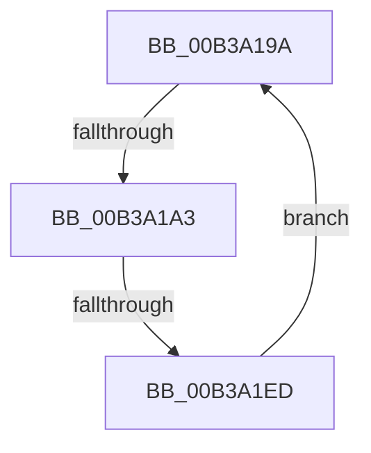

# sub_00B3A19A

- RVA: `0x00B3A19A`–`0x00B3A1F5` (길이 `91` bytes)
- VA: `0x0000000140B3A19A`
- 실행 섹션: `PAGE`
- PDB 이름 있음: `아니요`; PDB Function 태그: `아니요`
- unwind 정보 RVA: `0x000ADCEC`
- 디코드: `19`개 명령, `91/91` bytes 표시
- 미해석 바이트: `0` (있으면 어셈블리에 `.byte`로 보존)

> 이 문서는 커널 이미지의 기계어와 PDB 기호를 분석해 생성했습니다. 4번과 5번은 함수 원형과 자료형을 바이너리 사용 방식에서 추정한 C 해석이며 원본 소스 복구 결과는 아닙니다.

## 1. Dependencies

- 직접 호출 지점: **1**; 고유 호출 대상: **1**
- 직접 호출자로 확인된 함수: **0**
- RIP 상대 이미지 참조: **0**

### Outgoing calls
- `0x00B3A1CF` → [MiReplaceRotateWithDemandZero](../A7/MiReplaceRotateWithDemandZero_function_00A7C010.md) (function, `0x00A7C010`)

### Direct callers
- 이 함수 시작 RVA로 연결되는 직접 call은 확인되지 않았습니다. 간접 호출은 완전히 역산할 수 없습니다.

### Static image references
- 디코드된 RIP-relative 메모리 참조가 없습니다.

## 2. Other-region calls and transfers

- 다른 실행 섹션으로 향하는 call: **0**
- call이 아닌 외부 분기/꼬리 이동: **2**
  - `0x00B3A19D` → [MmRotatePhysicalView + 0x11E](../A3/MmRotatePhysicalView_function_00A37FE0.md) (`tail-transfer`)
  - `0x00B3A1E7` → [MmRotatePhysicalView + 0x11E](../A3/MmRotatePhysicalView_function_00A37FE0.md) (`tail-transfer`)

## 3. Assembly (complete function range)

```asm
00B3A19A  48 85 FF                        test rdi, rdi
00B3A19D  0F 84 5B DF EF FF               je 0x140a380fe
00B3A1A3  4C 8B 8C 24 A0 00 00 00         mov r9, qword ptr [rsp + 0xa0]
00B3A1AB  48 8D 84 24 80 00 00 00         lea rax, [rsp + 0x80]
00B3A1B3  48 83 A4 24 80 00 00 00 00      and qword ptr [rsp + 0x80], 0
00B3A1BC  4C 8B C7                        mov r8, rdi
00B3A1BF  48 89 44 24 28                  mov qword ptr [rsp + 0x28], rax
00B3A1C4  48 8B D6                        mov rdx, rsi
00B3A1C7  48 8B CD                        mov rcx, rbp
00B3A1CA  4C 89 74 24 20                  mov qword ptr [rsp + 0x20], r14
00B3A1CF  E8 3C 1E F4 FF                  call 0x140a7c010
00B3A1D4  8B D8                           mov ebx, eax
00B3A1D6  48 8B 84 24 80 00 00 00         mov rax, qword ptr [rsp + 0x80]
00B3A1DE  4C 03 E0                        add r12, rax
00B3A1E1  81 FB 19 00 00 40               cmp ebx, 0x40000019
00B3A1E7  0F 84 11 DF EF FF               je 0x140a380fe
00B3A1ED  48 2B F8                        sub rdi, rax
00B3A1F0  48 03 F0                        add rsi, rax
00B3A1F3  EB A5                           jmp 0x140b3a19a
```

## 4. C-style interpretation (structured pseudocode)

```c
__int64 __fastcall sub_00B3A19A(__int64 a1, __int64 a2, __int64 a3, __int64 a4, __int64 a5, __int64 a6, __int64 a7, __int64 a8, __int64 a9, __int64 a10, __int64 a11, __int64 a12, __int64 a13, __int64 a14, __int64 a15, __int64 a16, __int64 a17, __int64 a18, __int64 a19, __int64 a20)
{
    __int64 result;
    __int64 v_r12;
    __int64 v_rdi;
    __int64 v_rsi;
    unsigned __int64 v_stack_p20;
    unsigned __int64 v_stack_p28;

    v_stack_p28 = a16;
    v_stack_p20 = v_r14;
    result = MiReplaceRotateWithDemandZero(v_rbp, v_rsi, v_rdi, a20);
    v_r12 = (v_r12) + (a16);
    v_rdi = (v_rdi) - (a16);
    v_rsi = (v_rsi) + (a16);
    goto loc_00B3A19A;
}
```

## 5. (Beta) C Style

```c
int64_t sub_00B3A19A(int64_t Arg1, int64_t Arg2, int64_t Arg3, int64_t Arg4, uint64_t Arg5, uint64_t Arg6, uint64_t Arg7, uint64_t Arg8, uint64_t Arg9, uint64_t Arg10, uint64_t Arg11, uint64_t Arg12, uint64_t Arg13, uint64_t Arg14, uint64_t Arg15, int64_t Arg16, uint64_t Arg17, uint64_t Arg18, uint64_t Arg19, int64_t Arg20)
{
    int64_t result;
    int64_t local_r12;
    int64_t local_rdi;
    int64_t local_rsi;
    uint64_t v_stack_p20;
    uint64_t v_stack_p28;

    v_stack_p28 = Arg16;
    v_stack_p20 = local_r14;
    result = MiReplaceRotateWithDemandZero(local_rbp, local_rsi, local_rdi, Arg20);
    local_r12 = (local_r12) + (Arg16);
    local_rdi = (local_rdi) - (Arg16);
    local_rsi = (local_rsi) + (Arg16);
    goto loc_00B3A19A;
}
```

## 6. Execution-region graph

[열기: 2D/3D 그래프와 함수 탐색 컨트롤 패널](../../../control-panel.html?section=page&rva=0x00B3A19A&view=graph)

- 2D 그래프는 위에서 아래로 흐르고, 3D 그래프는 빈 공간을 드래그해 회전합니다. Shift+드래그는 이동, 휠은 확대·축소, 함수 노드 선택은 대상 보고서 이동입니다.

### Static fallback


