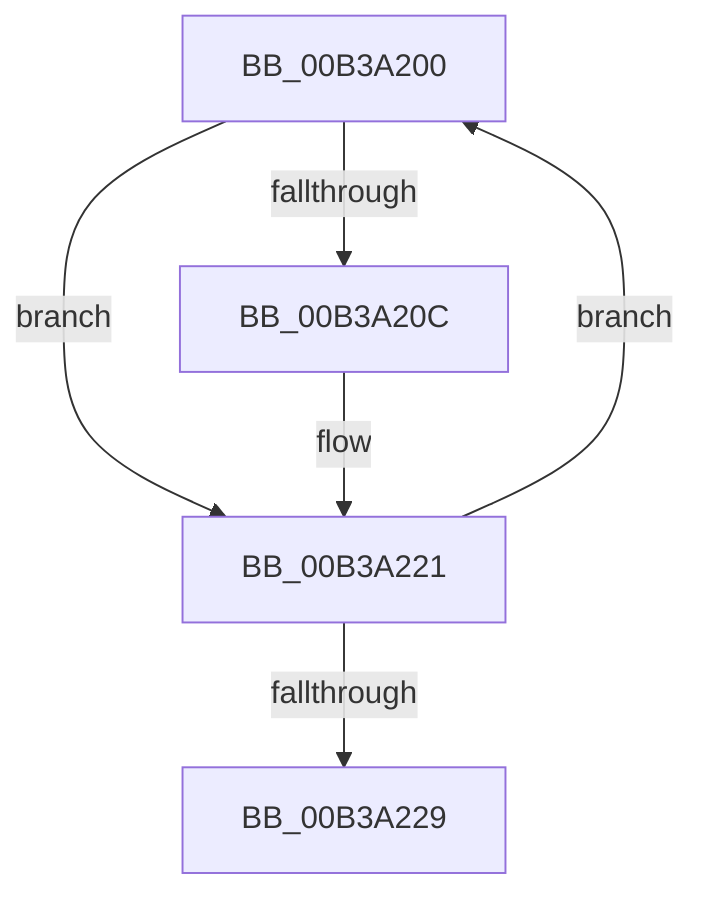

# sub_00B3A200

- RVA: `0x00B3A200`–`0x00B3A22E` (길이 `46` bytes)
- VA: `0x0000000140B3A200`
- 실행 섹션: `PAGE`
- PDB 이름 있음: `아니요`; PDB Function 태그: `아니요`
- unwind 정보 RVA: `0x000ADD5C`
- 디코드: `14`개 명령, `46/46` bytes 표시
- 미해석 바이트: `0` (있으면 어셈블리에 `.byte`로 보존)

> 이 문서는 커널 이미지의 기계어와 PDB 기호를 분석해 생성했습니다. 4번과 5번은 함수 원형과 자료형을 바이너리 사용 방식에서 추정한 C 해석이며 원본 소스 복구 결과는 아닙니다.

## 1. Dependencies

- 직접 호출 지점: **2**; 고유 호출 대상: **2**
- 직접 호출자로 확인된 함수: **0**
- RIP 상대 이미지 참조: **0**

### Outgoing calls
- `0x00B3A203` → [MiIsPfn](../../text/46/MiIsPfn_function_00462450.md) (function, `0x00462450`)
- `0x00B3A219` → [MiDereferenceIoPages](../../text/2A/MiDereferenceIoPages_function_002AB1B0.md) (function, `0x002AB1B0`)

### Direct callers
- 이 함수 시작 RVA로 연결되는 직접 call은 확인되지 않았습니다. 간접 호출은 완전히 역산할 수 없습니다.

### Static image references
- 디코드된 RIP-relative 메모리 참조가 없습니다.

## 2. Other-region calls and transfers

- 다른 실행 섹션으로 향하는 call: **2**
  - `0x00B3A203` → [MiIsPfn](../../text/46/MiIsPfn_function_00462450.md) (`PAGE` → `.text`)
  - `0x00B3A219` → [MiDereferenceIoPages](../../text/2A/MiDereferenceIoPages_function_002AB1B0.md) (`PAGE` → `.text`)
- call이 아닌 외부 분기/꼬리 이동: **1**
  - `0x00B3A229` → [MiRotateToFrameBufferNoCopy + 0x1DA](../A3/MiRotateToFrameBufferNoCopy_function_00A38530.md) (`tail-transfer`)

## 3. Assembly (complete function range)

```asm
00B3A200  48 8B 0E                        mov rcx, qword ptr [rsi]
00B3A203  E8 48 82 92 FF                  call 0x140462450
00B3A208  85 C0                           test eax, eax
00B3A20A  75 15                           jne 0x140b3a221
00B3A20C  48 8B 16                        mov rdx, qword ptr [rsi]
00B3A20F  B8 01 00 00 00                  mov eax, 1
00B3A214  44 8B C0                        mov r8d, eax
00B3A217  8B C8                           mov ecx, eax
00B3A219  E8 92 0F 77 FF                  call 0x1402ab1b0
00B3A21E  41 03 DE                        add ebx, r14d
00B3A221  48 83 C6 08                     add rsi, 8
00B3A225  85 DB                           test ebx, ebx
00B3A227  75 D7                           jne 0x140b3a200
00B3A229  E9 DC E4 EF FF                  jmp 0x140a3870a
```

## 4. C-style interpretation (structured pseudocode)

```c
__int64 __fastcall sub_00B3A200(void)
{
    __int64 result;
    __int64 v_rbx;
    __int64 v_rsi;

    result = MiIsPfn(*(unsigned __int64 *)(v_rsi), a2, a3, a4);
    if ((unsigned int)(result) == 0) {
        a2 = *(unsigned __int64 *)(v_rsi);
        result = 1;
        a3 = (unsigned int)(result);
        a1 = (unsigned int)(result);
        result = MiDereferenceIoPages(a1, a2, a3, a4);
        v_rbx = (unsigned int)((v_rbx) + ((unsigned int)(v_r14)));
    }
    v_rsi = (v_rsi) + (8);
    if ((unsigned int)(v_rbx) != 0) goto loc_00B3A200;
}
```

## 5. (Beta) C Style

```c
void sub_00B3A200(void)
{
    int64_t result;
    int64_t local_rbx;
    int64_t local_rsi;

    result = MiIsPfn(*(uint64_t *)(local_rsi), a2, a3, a4);
    if ((uint32_t)(result) == 0) {
        a2 = *(uint64_t *)(local_rsi);
        result = 1;
        a3 = (uint32_t)(result);
        a1 = (uint32_t)(result);
        result = MiDereferenceIoPages(a1, a2, a3, a4);
        local_rbx = (uint32_t)((local_rbx) + ((uint32_t)(local_r14)));
    }
    local_rsi = (local_rsi) + (8);
    if ((uint32_t)(local_rbx) != 0) goto loc_00B3A200;
}
```

## 6. Execution-region graph

[열기: 2D/3D 그래프와 함수 탐색 컨트롤 패널](../../../control-panel.html?section=page&rva=0x00B3A200&view=graph)

- 2D 그래프는 위에서 아래로 흐르고, 3D 그래프는 빈 공간을 드래그해 회전합니다. Shift+드래그는 이동, 휠은 확대·축소, 함수 노드 선택은 대상 보고서 이동입니다.

### Static fallback


