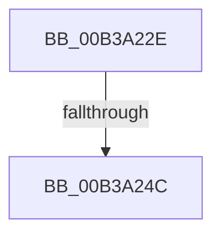

# sub_00B3A22E

- RVA: `0x00B3A22E`–`0x00B3A29A` (길이 `108` bytes)
- VA: `0x0000000140B3A22E`
- 실행 섹션: `PAGE`
- PDB 이름 있음: `아니요`; PDB Function 태그: `아니요`
- unwind 정보 RVA: `0x000ADE20`
- 디코드: `21`개 명령, `108/108` bytes 표시
- 미해석 바이트: `0` (있으면 어셈블리에 `.byte`로 보존)

> 이 문서는 커널 이미지의 기계어와 PDB 기호를 분석해 생성했습니다. 4번과 5번은 함수 원형과 자료형을 바이너리 사용 방식에서 추정한 C 해석이며 원본 소스 복구 결과는 아닙니다.

## 1. Dependencies

- 직접 호출 지점: **2**; 고유 호출 대상: **2**
- 직접 호출자로 확인된 함수: **0**
- RIP 상대 이미지 참조: **2**

### Outgoing calls
- `0x00B3A23F` → [tlgKeywordOn](../../text/42/tlgKeywordOn_function_0042EAA0.md) (function, `0x0042EAA0`)
- `0x00B3A28F` → [tlgWriteTransfer_EtwWriteTransfer](../../text/42/tlgWriteTransfer_EtwWriteTransfer_function_004260E0.md) (function, `0x004260E0`)

### Direct callers
- 이 함수 시작 RVA로 연결되는 직접 call은 확인되지 않았습니다. 간접 호출은 완전히 역산할 수 없습니다.

### Static image references
- `0x00B3A238` → RVA `0x00E06ED8` (`.data`; read)
- `0x00B3A281` → RVA `0x000554A0` (`.rdata`; read)

## 2. Other-region calls and transfers

- 다른 실행 섹션으로 향하는 call: **2**
  - `0x00B3A23F` → [tlgKeywordOn](../../text/42/tlgKeywordOn_function_0042EAA0.md) (`PAGE` → `.text`)
  - `0x00B3A28F` → [tlgWriteTransfer_EtwWriteTransfer](../../text/42/tlgWriteTransfer_EtwWriteTransfer_function_004260E0.md) (`PAGE` → `.text`)
- call이 아닌 외부 분기/꼬리 이동: **2**
  - `0x00B3A246` → [ExpGetSystemFirmwareTableInformation + 0xCA](../A3/ExpGetSystemFirmwareTableInformation_function_00A38A2C.md) (`tail-transfer`)
  - `0x00B3A295` → [ExpGetSystemFirmwareTableInformation + 0xCA](../A3/ExpGetSystemFirmwareTableInformation_function_00A38A2C.md) (`tail-transfer`)

## 3. Assembly (complete function range)

```asm
00B3A22E  48 BA 00 00 00 00 00 20 00 00   movabs rdx, 0x200000000000
00B3A238  48 8D 0D 99 CC 2C 00            lea rcx, [rip + 0x2ccc99]
00B3A23F  E8 5C 48 8F FF                  call 0x14042eaa0
00B3A244  84 C0                           test al, al
00B3A246  0F 84 AA E8 EF FF               je 0x140a38af6
00B3A24C  8B 03                           mov eax, dword ptr [rbx]
00B3A24E  89 44 24 30                     mov dword ptr [rsp + 0x30], eax
00B3A252  48 8D 44 24 30                  lea rax, [rsp + 0x30]
00B3A257  48 89 44 24 58                  mov qword ptr [rsp + 0x58], rax
00B3A25C  C7 44 24 60 04 00 00 00         mov dword ptr [rsp + 0x60], 4
00B3A264  83 64 24 64 00                  and dword ptr [rsp + 0x64], 0
00B3A269  48 8D 44 24 38                  lea rax, [rsp + 0x38]
00B3A26E  48 89 44 24 28                  mov qword ptr [rsp + 0x28], rax
00B3A273  C7 44 24 20 03 00 00 00         mov dword ptr [rsp + 0x20], 3
00B3A27B  45 33 C9                        xor r9d, r9d
00B3A27E  45 33 C0                        xor r8d, r8d
00B3A281  48 8D 15 18 B2 51 FF            lea rdx, [rip - 0xae4de8]
00B3A288  48 8D 0D 49 CC 2C 00            lea rcx, [rip + 0x2ccc49]
00B3A28F  E8 4C BE 8E FF                  call 0x1404260e0
00B3A294  90                              nop
00B3A295  E9 5C E8 EF FF                  jmp 0x140a38af6
```

## 4. C-style interpretation (structured pseudocode)

```c
__int64 __fastcall sub_00B3A22E(__int64 a1, __int64 a2, int a3, int a4, __int64 a5, __int64 a6, __int64 a7)
{
    __int64 result;
    unsigned int v_stack_p20;
    unsigned __int64 v_stack_p28;
    unsigned int v_stack_p30;
    unsigned __int64 v_stack_p58;
    unsigned int v_stack_p60;
    unsigned int v_stack_p64;

    result = tlgKeywordOn(v_rip + 2935961, a2, a3, a4);
    v_stack_p30 = (unsigned int)((unsigned int)(*(unsigned int *)(v_rbx)));
    v_stack_p58 = a6;
    v_stack_p60 = 4;
    v_stack_p28 = a7;
    v_stack_p20 = 3;
    a4 = 0;
    a3 = 0;
    result = tlgWriteTransfer_EtwWriteTransfer(v_rip + 2935881, v_rip - 11423208, a3, a4);
}
```

## 5. (Beta) C Style

```c
int64_t sub_00B3A22E(int64_t Arg1, int64_t Arg2, int32_t Arg3, int32_t Arg4, uint64_t Arg5, int64_t Arg6, int64_t Arg7)
{
    int64_t result;
    uint32_t v_stack_p20;
    uint64_t v_stack_p28;
    uint32_t v_stack_p30;
    uint64_t v_stack_p58;
    uint32_t v_stack_p60;
    uint32_t v_stack_p64;

    result = tlgKeywordOn(v_rip + 2935961, Arg2, Arg3, Arg4);
    v_stack_p30 = (uint32_t)((uint32_t)(*(uint32_t *)(local_rbx)));
    v_stack_p58 = Arg6;
    v_stack_p60 = 4;
    v_stack_p28 = Arg7;
    v_stack_p20 = 3;
    Arg4 = 0;
    Arg3 = 0;
    result = tlgWriteTransfer_EtwWriteTransfer(v_rip + 2935881, v_rip - 11423208, Arg3, Arg4);
}
```

## 6. Execution-region graph

[열기: 2D/3D 그래프와 함수 탐색 컨트롤 패널](../../../control-panel.html?section=page&rva=0x00B3A22E&view=graph)

- 2D 그래프는 위에서 아래로 흐르고, 3D 그래프는 빈 공간을 드래그해 회전합니다. Shift+드래그는 이동, 휠은 확대·축소, 함수 노드 선택은 대상 보고서 이동입니다.

### Static fallback


