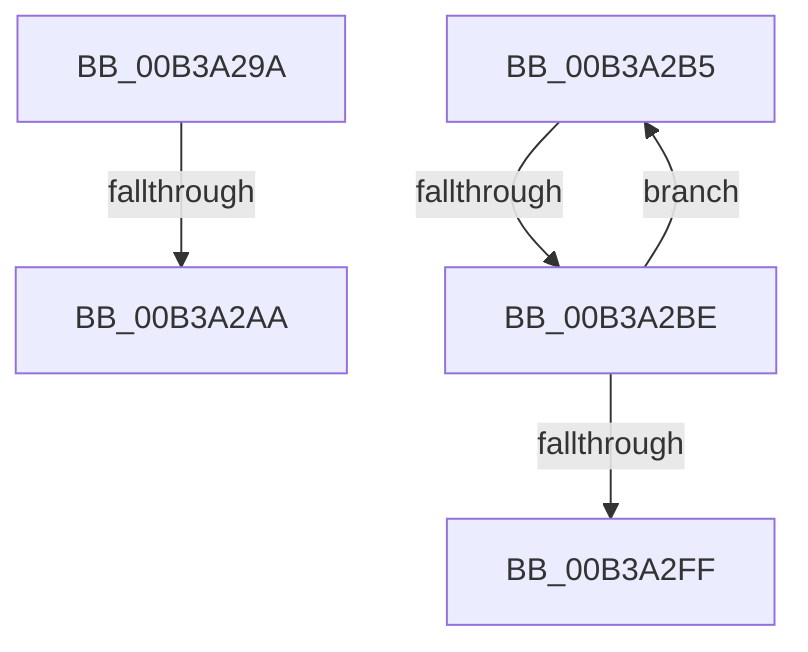

# sub_00B3A29A

- RVA: `0x00B3A29A`–`0x00B3A304` (길이 `106` bytes)
- VA: `0x0000000140B3A29A`
- 실행 섹션: `PAGE`
- PDB 이름 있음: `아니요`; PDB Function 태그: `아니요`
- unwind 정보 RVA: `0x000ADE6C`
- 디코드: `26`개 명령, `106/106` bytes 표시
- 미해석 바이트: `0` (있으면 어셈블리에 `.byte`로 보존)

> 이 문서는 커널 이미지의 기계어와 PDB 기호를 분석해 생성했습니다. 4번과 5번은 함수 원형과 자료형을 바이너리 사용 방식에서 추정한 C 해석이며 원본 소스 복구 결과는 아닙니다.

## 1. Dependencies

- 직접 호출 지점: **2**; 고유 호출 대상: **2**
- 직접 호출자로 확인된 함수: **0**
- RIP 상대 이미지 참조: **3**

### Outgoing calls
- `0x00B3A2AA` → [PopPlTraceLogPowerPlane](../../text/5D/PopPlTraceLogPowerPlane_function_005DDFB4.md) (function, `0x005DDFB4`)
- `0x00B3A2ED` → [EtwWrite](../../text/41/EtwWrite_function_0041C720.md) (function, `0x0041C720`)

### Direct callers
- 이 함수 시작 RVA로 연결되는 직접 call은 확인되지 않았습니다. 간접 호출은 완전히 역산할 수 없습니다.

### Static image references
- `0x00B3A29A` → RVA `0x00F070C0` (`.data`; read)
- `0x00B3A2C6` → RVA `0x00F0B408` (`.data`; read)
- `0x00B3A2CD` → RVA `0x000227E0` (`.rdata`; read)

## 2. Other-region calls and transfers

- 다른 실행 섹션으로 향하는 call: **2**
  - `0x00B3A2AA` → [PopPlTraceLogPowerPlane](../../text/5D/PopPlTraceLogPowerPlane_function_005DDFB4.md) (`PAGE` → `.text`)
  - `0x00B3A2ED` → [EtwWrite](../../text/41/EtwWrite_function_0041C720.md) (`PAGE` → `.text`)
- call이 아닌 외부 분기/꼬리 이동: **4**
  - `0x00B3A2A4` → [PopDiagTraceControlCallback + 0x1B0](../A3/PopDiagTraceControlCallback_function_00A38CB0.md) (`tail-transfer`)
  - `0x00B3A2B0` → [PopDiagTraceControlCallback + 0x1B0](../A3/PopDiagTraceControlCallback_function_00A38CB0.md) (`tail-transfer`)
  - `0x00B3A2B8` → [PopDiagTraceControlCallback + 0x115](../A3/PopDiagTraceControlCallback_function_00A38CB0.md) (`tail-transfer`)
  - `0x00B3A2FF` → [PopDiagTraceControlCallback + 0x115](../A3/PopDiagTraceControlCallback_function_00A38CB0.md) (`tail-transfer`)

## 3. Assembly (complete function range)

```asm
00B3A29A  48 8B 0D 1F CE 3C 00            mov rcx, qword ptr [rip + 0x3cce1f]
00B3A2A1  48 85 C9                        test rcx, rcx
00B3A2A4  0F 84 B6 EB EF FF               je 0x140a38e60
00B3A2AA  E8 05 3D AA FF                  call 0x1405ddfb4
00B3A2AF  90                              nop
00B3A2B0  E9 AB EB EF FF                  jmp 0x140a38e60
00B3A2B5  4D 3B F5                        cmp r14, r13
00B3A2B8  0F 83 07 EB EF FF               jae 0x140a38dc5
00B3A2BE  41 8B 5E 0C                     mov ebx, dword ptr [r14 + 0xc]
00B3A2C2  48 8D 45 E0                     lea rax, [rbp - 0x20]
00B3A2C6  48 8B 0D 3B 11 3D 00            mov rcx, qword ptr [rip + 0x3d113b]
00B3A2CD  48 8D 15 0C 85 4E FF            lea rdx, [rip - 0xb17af4]
00B3A2D4  83 65 EC 00                     and dword ptr [rbp - 0x14], 0
00B3A2D8  83 C3 10                        add ebx, 0x10
00B3A2DB  44 8B CF                        mov r9d, edi
00B3A2DE  89 5D E8                        mov dword ptr [rbp - 0x18], ebx
00B3A2E1  45 33 C0                        xor r8d, r8d
00B3A2E4  4C 89 75 E0                     mov qword ptr [rbp - 0x20], r14
00B3A2E8  48 89 44 24 20                  mov qword ptr [rsp + 0x20], rax
00B3A2ED  E8 2E 24 8E FF                  call 0x14041c720
00B3A2F2  8B C3                           mov eax, ebx
00B3A2F4  44 03 E7                        add r12d, edi
00B3A2F7  4C 03 F0                        add r14, rax
00B3A2FA  45 3B E7                        cmp r12d, r15d
00B3A2FD  72 B6                           jb 0x140b3a2b5
00B3A2FF  E9 C1 EA EF FF                  jmp 0x140a38dc5
```

## 4. C-style interpretation (structured pseudocode)

```c
__int64 __fastcall sub_00B3A29A(__int64 a1, __int64 a2, int a3)
{
    __int64 result;
    unsigned __int64 v_stack_p20;

    result = PopPlTraceLogPowerPlane(*(unsigned __int64 *)(v_rip + 3984927), a2, a3, a4);
}
```

## 5. (Beta) C Style

```c
int64_t sub_00B3A29A(int64_t Arg1, int64_t Arg2, int32_t Arg3)
{
    int64_t result;
    uint64_t v_stack_p20;

    result = PopPlTraceLogPowerPlane(*(uint64_t *)(v_rip + 0x3CCE1F), Arg2, Arg3, a4);
}
```

## 6. Execution-region graph

[열기: 2D/3D 그래프와 함수 탐색 컨트롤 패널](../../../control-panel.html?section=page&rva=0x00B3A29A&view=graph)

- 2D 그래프는 위에서 아래로 흐르고, 3D 그래프는 빈 공간을 드래그해 회전합니다. Shift+드래그는 이동, 휠은 확대·축소, 함수 노드 선택은 대상 보고서 이동입니다.

### Static fallback


