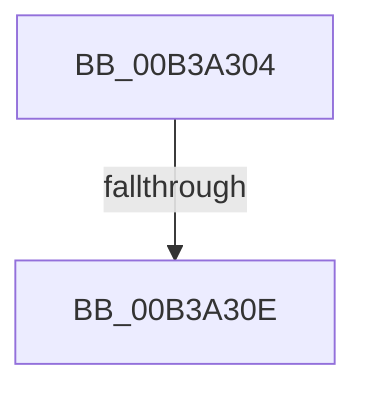

# sub_00B3A304

- RVA: `0x00B3A304`–`0x00B3A325` (길이 `33` bytes)
- VA: `0x0000000140B3A304`
- 실행 섹션: `PAGE`
- PDB 이름 있음: `아니요`; PDB Function 태그: `아니요`
- unwind 정보 RVA: `0x000AE184`
- 디코드: `6`개 명령, `33/33` bytes 표시
- 미해석 바이트: `0` (있으면 어셈블리에 `.byte`로 보존)

> 이 문서는 커널 이미지의 기계어와 PDB 기호를 분석해 생성했습니다. 4번과 5번은 함수 원형과 자료형을 바이너리 사용 방식에서 추정한 C 해석이며 원본 소스 복구 결과는 아닙니다.

## 1. Dependencies

- 직접 호출 지점: **1**; 고유 호출 대상: **1**
- 직접 호출자로 확인된 함수: **0**
- RIP 상대 이미지 참조: **0**

### Outgoing calls
- `0x00B3A316` → [AlpcpUnlockMessage](../89/AlpcpUnlockMessage_function_00897AE0.md) (function, `0x00897AE0`)

### Direct callers
- 이 함수 시작 RVA로 연결되는 직접 call은 확인되지 않았습니다. 간접 호출은 완전히 역산할 수 없습니다.

### Static image references
- 디코드된 RIP-relative 메모리 참조가 없습니다.

## 2. Other-region calls and transfers

- 다른 실행 섹션으로 향하는 call: **0**
- call이 아닌 외부 분기/꼬리 이동: **2**
  - `0x00B3A308` → [NtAlpcCancelMessage + 0xC2](../A3/NtAlpcCancelMessage_function_00A3A860.md) (`tail-transfer`)
  - `0x00B3A320` → [NtAlpcCancelMessage + 0xE5](../A3/NtAlpcCancelMessage_function_00A3A860.md) (`tail-transfer`)

## 3. Assembly (complete function range)

```asm
00B3A304  48 3B 70 70                     cmp rsi, qword ptr [rax + 0x70]
00B3A308  0F 84 14 06 F0 FF               je 0x140a3a922
00B3A30E  48 8B 8C 24 88 00 00 00         mov rcx, qword ptr [rsp + 0x88]
00B3A316  E8 C5 D7 D5 FF                  call 0x140897ae0
00B3A31B  BB 19 07 00 C0                  mov ebx, 0xc0000719
00B3A320  E9 20 06 F0 FF                  jmp 0x140a3a945
```

## 4. C-style interpretation (structured pseudocode)

```c
__int64 __fastcall sub_00B3A304(__int64 a1, __int64 a2, __int64 a3, __int64 a4, __int64 a5, __int64 a6, __int64 a7, __int64 a8, __int64 a9, __int64 a10, __int64 a11, __int64 a12, __int64 a13, __int64 a14, __int64 a15, __int64 a16, __int64 a17)
{
    __int64 result;

    result = AlpcpUnlockMessage(a17, a2, a3, a4);
}
```

## 5. (Beta) C Style

```c
int64_t sub_00B3A304(int64_t Arg1, int64_t Arg2, int64_t Arg3, int64_t Arg4, uint64_t Arg5, uint64_t Arg6, uint64_t Arg7, uint64_t Arg8, uint64_t Arg9, uint64_t Arg10, uint64_t Arg11, uint64_t Arg12, uint64_t Arg13, uint64_t Arg14, uint64_t Arg15, uint64_t Arg16, int64_t Arg17)
{
    int64_t result;

    result = AlpcpUnlockMessage(Arg17, Arg2, Arg3, Arg4);
}
```

## 6. Execution-region graph

[열기: 2D/3D 그래프와 함수 탐색 컨트롤 패널](../../../control-panel.html?section=page&rva=0x00B3A304&view=graph)

- 2D 그래프는 위에서 아래로 흐르고, 3D 그래프는 빈 공간을 드래그해 회전합니다. Shift+드래그는 이동, 휠은 확대·축소, 함수 노드 선택은 대상 보고서 이동입니다.

### Static fallback


