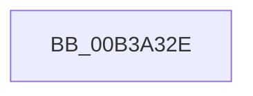

# sub_00B3A32E

- RVA: `0x00B3A32E`–`0x00B3A363` (길이 `53` bytes)
- VA: `0x0000000140B3A32E`
- 실행 섹션: `PAGE`
- PDB 이름 있음: `아니요`; PDB Function 태그: `아니요`
- unwind 정보 RVA: `0x000AE2AC`
- 디코드: `10`개 명령, `53/53` bytes 표시
- 미해석 바이트: `0` (있으면 어셈블리에 `.byte`로 보존)

> 이 문서는 커널 이미지의 기계어와 PDB 기호를 분석해 생성했습니다. 4번과 5번은 함수 원형과 자료형을 바이너리 사용 방식에서 추정한 C 해석이며 원본 소스 복구 결과는 아닙니다.

## 1. Dependencies

- 직접 호출 지점: **1**; 고유 호출 대상: **1**
- 직접 호출자로 확인된 함수: **0**
- RIP 상대 이미지 참조: **0**

### Outgoing calls
- `0x00B3A358` → [DbgkpSendApiMessage](../A7/DbgkpSendApiMessage_function_00A79458.md) (function, `0x00A79458`)

### Direct callers
- 이 함수 시작 RVA로 연결되는 직접 call은 확인되지 않았습니다. 간접 호출은 완전히 역산할 수 없습니다.

### Static image references
- 디코드된 RIP-relative 메모리 참조가 없습니다.

## 2. Other-region calls and transfers

- 다른 실행 섹션으로 향하는 call: **0**
- call이 아닌 외부 분기/꼬리 이동: **1**
  - `0x00B3A35E` → [DbgkUnMapViewOfSection + 0x66](../A3/DbgkUnMapViewOfSection_function_00A3B18C.md) (`tail-transfer`)

## 3. Assembly (complete function range)

```asm
00B3A32E  4C 8D 44 24 20                  lea r8, [rsp + 0x20]
00B3A333  48 89 7C 24 50                  mov qword ptr [rsp + 0x50], rdi
00B3A338  BA 01 00 00 00                  mov edx, 1
00B3A33D  C7 44 24 20 10 00 38 00         mov dword ptr [rsp + 0x20], 0x380010
00B3A345  48 8B CB                        mov rcx, rbx
00B3A348  C7 44 24 24 08 00 00 00         mov dword ptr [rsp + 0x24], 8
00B3A350  C7 44 24 48 06 00 00 00         mov dword ptr [rsp + 0x48], 6
00B3A358  E8 FB F0 F3 FF                  call 0x140a79458
00B3A35D  90                              nop
00B3A35E  E9 8F 0E F0 FF                  jmp 0x140a3b1f2
```

## 4. C-style interpretation (structured pseudocode)

```c
__int64 __fastcall sub_00B3A32E(void)
{
    __int64 result;
    unsigned __int64 v_stack_p20;
    unsigned int v_stack_p24;
    unsigned int v_stack_p48;
    unsigned __int64 v_stack_p50;

    v_stack_p50 = v_rdi;
    v_stack_p20 = 0x380010ULL;
    v_stack_p24 = 8;
    v_stack_p48 = 6;
    result = DbgkpSendApiMessage(v_rbx, 1, v_stack_p20, a4);
}
```

## 5. (Beta) C Style

```c
void sub_00B3A32E(void)
{
    int64_t result;
    uint64_t v_stack_p20;
    uint32_t v_stack_p24;
    uint32_t v_stack_p48;
    uint64_t v_stack_p50;

    v_stack_p50 = local_rdi;
    v_stack_p20 = 0x380010ULL;
    v_stack_p24 = 8;
    v_stack_p48 = 6;
    result = DbgkpSendApiMessage(local_rbx, 1, v_stack_p20, a4);
}
```

## 6. Execution-region graph

[열기: 2D/3D 그래프와 함수 탐색 컨트롤 패널](../../../control-panel.html?section=page&rva=0x00B3A32E&view=graph)

- 2D 그래프는 위에서 아래로 흐르고, 3D 그래프는 빈 공간을 드래그해 회전합니다. Shift+드래그는 이동, 휠은 확대·축소, 함수 노드 선택은 대상 보고서 이동입니다.

### Static fallback


