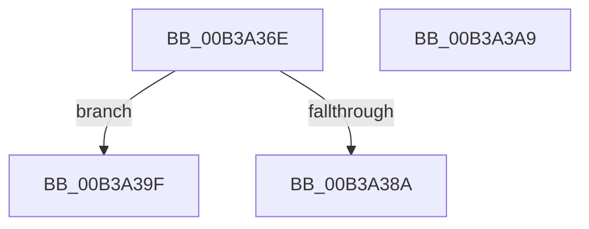

# sub_00B3A36E

- RVA: `0x00B3A36E`–`0x00B3A3BB` (길이 `77` bytes)
- VA: `0x0000000140B3A36E`
- 실행 섹션: `PAGE`
- PDB 이름 있음: `아니요`; PDB Function 태그: `아니요`
- unwind 정보 RVA: `0x000AE3F0`
- 디코드: `18`개 명령, `77/77` bytes 표시
- 미해석 바이트: `0` (있으면 어셈블리에 `.byte`로 보존)

> 이 문서는 커널 이미지의 기계어와 PDB 기호를 분석해 생성했습니다. 4번과 5번은 함수 원형과 자료형을 바이너리 사용 방식에서 추정한 C 해석이며 원본 소스 복구 결과는 아닙니다.

## 1. Dependencies

- 직접 호출 지점: **2**; 고유 호출 대상: **2**
- 직접 호출자로 확인된 함수: **0**
- RIP 상대 이미지 참조: **0**

### Outgoing calls
- `0x00B3A37D` → [ExAllocatePool2](../../poolcode/B8/ExAllocatePool2_function_00B820F0.md) (function, `0x00B820F0`)
- `0x00B3A3AE` → [ZwClose](../../text/6A/ZwClose_function_006AD2B0.md) (function, `0x006AD2B0`)

### Direct callers
- 이 함수 시작 RVA로 연결되는 직접 call은 확인되지 않았습니다. 간접 호출은 완전히 역산할 수 없습니다.

### Static image references
- 디코드된 RIP-relative 메모리 참조가 없습니다.

## 2. Other-region calls and transfers

- 다른 실행 섹션으로 향하는 call: **2**
  - `0x00B3A37D` → [ExAllocatePool2](../../poolcode/B8/ExAllocatePool2_function_00B820F0.md) (`PAGE` → `POOLCODE`)
  - `0x00B3A3AE` → [ZwClose](../../text/6A/ZwClose_function_006AD2B0.md) (`PAGE` → `.text`)
- call이 아닌 외부 분기/꼬리 이동: **3**
  - `0x00B3A39A` → [RtlpProcessIFEOKeyFilter + 0x28D](../A3/RtlpProcessIFEOKeyFilter_function_00A3BA78.md) (`tail-transfer`)
  - `0x00B3A3A4` → [RtlpProcessIFEOKeyFilter + 0x2A0](../A3/RtlpProcessIFEOKeyFilter_function_00A3BA78.md) (`tail-transfer`)
  - `0x00B3A3B6` → [RtlpProcessIFEOKeyFilter + 0x2E5](../A3/RtlpProcessIFEOKeyFilter_function_00A3BA78.md) (`tail-transfer`)

## 3. Assembly (complete function range)

```asm
00B3A36E  8B 54 24 34                     mov edx, dword ptr [rsp + 0x34]
00B3A372  B9 41 00 00 00                  mov ecx, 0x41
00B3A377  41 B8 52 74 49 6B               mov r8d, 0x6b497452
00B3A37D  E8 6E 7D 04 00                  call 0x140b820f0
00B3A382  48 8B F0                        mov rsi, rax
00B3A385  48 85 C0                        test rax, rax
00B3A388  74 15                           je 0x140b3a39f
00B3A38A  8B 4C 24 34                     mov ecx, dword ptr [rsp + 0x34]
00B3A38E  4C 8B F0                        mov r14, rax
00B3A391  89 4C 24 38                     mov dword ptr [rsp + 0x38], ecx
00B3A395  48 89 44 24 40                  mov qword ptr [rsp + 0x40], rax
00B3A39A  E9 66 19 F0 FF                  jmp 0x140a3bd05
00B3A39F  BF 17 00 00 C0                  mov edi, 0xc0000017
00B3A3A4  E9 6F 19 F0 FF                  jmp 0x140a3bd18
00B3A3A9  48 8B 4C 24 50                  mov rcx, qword ptr [rsp + 0x50]
00B3A3AE  E8 FD 2E B7 FF                  call 0x1406ad2b0
00B3A3B3  41 FF C5                        inc r13d
00B3A3B6  E9 A2 19 F0 FF                  jmp 0x140a3bd5d
```

## 4. C-style interpretation (structured pseudocode)

```c
__int64 __fastcall sub_00B3A36E(void)
{
    __int64 result;
    unsigned int v_stack_p34;
    unsigned int v_stack_p38;
    unsigned __int64 v_stack_p40;
    unsigned __int64 v_stack_p50;

    result = ExAllocatePool2(65, (unsigned int)(v_stack_p34), (unsigned int)(0x6B497452ULL), a4);
    if (result == 0) goto loc_00B3A39F;
    v_stack_p38 = (unsigned int)((unsigned int)(v_stack_p34));
    v_stack_p40 = result;
loc_00B3A39F:
}
```

## 5. (Beta) C Style

```c
void sub_00B3A36E(void)
{
    int64_t result;
    uint32_t v_stack_p34;
    uint32_t v_stack_p38;
    uint64_t v_stack_p40;
    uint64_t v_stack_p50;

    result = ExAllocatePool2(65, (uint32_t)(v_stack_p34), (uint32_t)(0x6B497452ULL), a4);
    if (result == 0) goto loc_00B3A39F;
    v_stack_p38 = (uint32_t)((uint32_t)(v_stack_p34));
    v_stack_p40 = result;
loc_00B3A39F:
}
```

## 6. Execution-region graph

[열기: 2D/3D 그래프와 함수 탐색 컨트롤 패널](../../../control-panel.html?section=page&rva=0x00B3A36E&view=graph)

- 2D 그래프는 위에서 아래로 흐르고, 3D 그래프는 빈 공간을 드래그해 회전합니다. Shift+드래그는 이동, 휠은 확대·축소, 함수 노드 선택은 대상 보고서 이동입니다.

### Static fallback


