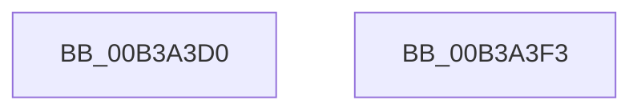

# sub_00B3A3D0

- RVA: `0x00B3A3D0`–`0x00B3A40A` (길이 `58` bytes)
- VA: `0x0000000140B3A3D0`
- 실행 섹션: `PAGE`
- PDB 이름 있음: `아니요`; PDB Function 태그: `아니요`
- unwind 정보 RVA: `0x000AE520`
- 디코드: `13`개 명령, `58/58` bytes 표시
- 미해석 바이트: `0` (있으면 어셈블리에 `.byte`로 보존)

> 이 문서는 커널 이미지의 기계어와 PDB 기호를 분석해 생성했습니다. 4번과 5번은 함수 원형과 자료형을 바이너리 사용 방식에서 추정한 C 해석이며 원본 소스 복구 결과는 아닙니다.

## 1. Dependencies

- 직접 호출 지점: **2**; 고유 호출 대상: **2**
- 직접 호출자로 확인된 함수: **0**
- RIP 상대 이미지 참조: **0**

### Outgoing calls
- `0x00B3A3E1` → [BiGetElement](../A3/BiGetElement_function_00A3E2B4.md) (function, `0x00A3E2B4`)
- `0x00B3A3FC` → [ExFreePoolWithTag](../../poolcode/B8/ExFreePoolWithTag_function_00B82870.md) (function, `0x00B82870`)

### Direct callers
- 이 함수 시작 RVA로 연결되는 직접 call은 확인되지 않았습니다. 간접 호출은 완전히 역산할 수 없습니다.

### Static image references
- 디코드된 RIP-relative 메모리 참조가 없습니다.

## 2. Other-region calls and transfers

- 다른 실행 섹션으로 향하는 call: **1**
  - `0x00B3A3FC` → [ExFreePoolWithTag](../../poolcode/B8/ExFreePoolWithTag_function_00B82870.md) (`PAGE` → `POOLCODE`)
- call이 아닌 외부 분기/꼬리 이동: **2**
  - `0x00B3A3EE` → [BiUpdateEfiEntry + 0x73](../A3/BiUpdateEfiEntry_function_00A3CCC0.md) (`tail-transfer`)
  - `0x00B3A405` → [BiUpdateEfiEntry + 0xA8](../A3/BiUpdateEfiEntry_function_00A3CCC0.md) (`tail-transfer`)

## 3. Assembly (complete function range)

```asm
00B3A3D0  48 8B 4D D0                     mov rcx, qword ptr [rbp - 0x30]
00B3A3D4  4C 8D 4D 58                     lea r9, [rbp + 0x58]
00B3A3D8  4C 8D 45 E0                     lea r8, [rbp - 0x20]
00B3A3DC  BA 02 00 00 12                  mov edx, 0x12000002
00B3A3E1  E8 CE 3E F0 FF                  call 0x140a3e2b4
00B3A3E6  4C 8B 7D D8                     mov r15, qword ptr [rbp - 0x28]
00B3A3EA  4C 8B 75 E0                     mov r14, qword ptr [rbp - 0x20]
00B3A3EE  E9 40 29 F0 FF                  jmp 0x140a3cd33
00B3A3F3  48 8B 4D 48                     mov rcx, qword ptr [rbp + 0x48]
00B3A3F7  BA 42 43 44 4B                  mov edx, 0x4b444342
00B3A3FC  E8 6F 84 04 00                  call 0x140b82870
00B3A401  49 89 75 28                     mov qword ptr [r13 + 0x28], rsi
00B3A405  E9 5E 29 F0 FF                  jmp 0x140a3cd68
```

## 4. C-style interpretation (structured pseudocode)

```c
__int64 __fastcall sub_00B3A3D0(void)
{
    __int64 result;

    result = BiGetElement(*(unsigned __int64 *)(v_rbp - 48), (unsigned int)(0x12000002ULL), v_rbp - 32, v_rbp + 88);
}
```

## 5. (Beta) C Style

```c
void sub_00B3A3D0(void)
{
    int64_t result;

    result = BiGetElement(*(uint64_t *)(local_rbp - 0x30), (uint32_t)(0x12000002ULL), local_rbp - 32, local_rbp + 88);
}
```

## 6. Execution-region graph

[열기: 2D/3D 그래프와 함수 탐색 컨트롤 패널](../../../control-panel.html?section=page&rva=0x00B3A3D0&view=graph)

- 2D 그래프는 위에서 아래로 흐르고, 3D 그래프는 빈 공간을 드래그해 회전합니다. Shift+드래그는 이동, 휠은 확대·축소, 함수 노드 선택은 대상 보고서 이동입니다.

### Static fallback


