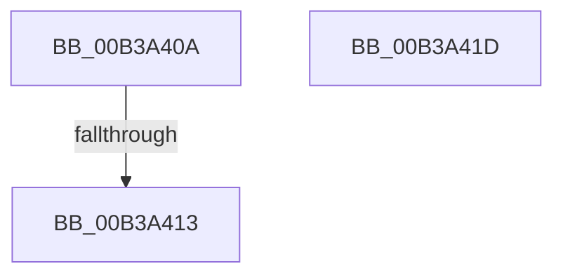

# sub_00B3A40A

- RVA: `0x00B3A40A`–`0x00B3A4A9` (길이 `159` bytes)
- VA: `0x0000000140B3A40A`
- 실행 섹션: `PAGE`
- PDB 이름 있음: `아니요`; PDB Function 태그: `아니요`
- unwind 정보 RVA: `0x000AE54C`
- 디코드: `40`개 명령, `159/159` bytes 표시
- 미해석 바이트: `0` (있으면 어셈블리에 `.byte`로 보존)

> 이 문서는 커널 이미지의 기계어와 PDB 기호를 분석해 생성했습니다. 4번과 5번은 함수 원형과 자료형을 바이너리 사용 방식에서 추정한 C 해석이며 원본 소스 복구 결과는 아닙니다.

## 1. Dependencies

- 직접 호출 지점: **4**; 고유 호출 대상: **2**
- 직접 호출자로 확인된 함수: **0**
- RIP 상대 이미지 참조: **0**

### Outgoing calls
- `0x00B3A425` → [memset](../../text/6C/memset_function_006C6C40.md) (function, `0x006C6C40`)
- `0x00B3A46E` → [memcpy](../../text/6C/memcpy_function_006C6840.md) (function, `0x006C6840`)
- `0x00B3A480` → [memcpy](../../text/6C/memcpy_function_006C6840.md) (function, `0x006C6840`)
- `0x00B3A492` → [memcpy](../../text/6C/memcpy_function_006C6840.md) (function, `0x006C6840`)

### Direct callers
- 이 함수 시작 RVA로 연결되는 직접 call은 확인되지 않았습니다. 간접 호출은 완전히 역산할 수 없습니다.

### Static image references
- 디코드된 RIP-relative 메모리 참조가 없습니다.

## 2. Other-region calls and transfers

- 다른 실행 섹션으로 향하는 call: **4**
  - `0x00B3A425` → [memset](../../text/6C/memset_function_006C6C40.md) (`PAGE` → `.text`)
  - `0x00B3A46E` → [memcpy](../../text/6C/memcpy_function_006C6840.md) (`PAGE` → `.text`)
  - `0x00B3A480` → [memcpy](../../text/6C/memcpy_function_006C6840.md) (`PAGE` → `.text`)
  - `0x00B3A492` → [memcpy](../../text/6C/memcpy_function_006C6840.md) (`PAGE` → `.text`)
- call이 아닌 외부 분기/꼬리 이동: **3**
  - `0x00B3A40D` → [BiCreateMergedBootEntry + 0x23E](../A3/BiCreateMergedBootEntry_function_00A3CE7C.md) (`tail-transfer`)
  - `0x00B3A418` → [BiCreateMergedBootEntry + 0x102](../A3/BiCreateMergedBootEntry_function_00A3CE7C.md) (`tail-transfer`)
  - `0x00B3A4A4` → [BiCreateMergedBootEntry + 0xD5](../A3/BiCreateMergedBootEntry_function_00A3CE7C.md) (`tail-transfer`)

## 3. Assembly (complete function range)

```asm
00B3A40A  83 F8 02                        cmp eax, 2
00B3A40D  0F 84 A7 2C F0 FF               je 0x140a3d0ba
00B3A413  B8 0D 00 00 C0                  mov eax, 0xc000000d
00B3A418  E9 61 2B F0 FF                  jmp 0x140a3cf7e
00B3A41D  45 8B C4                        mov r8d, r12d
00B3A420  33 D2                           xor edx, edx
00B3A422  48 8B C8                        mov rcx, rax
00B3A425  E8 16 C8 B8 FF                  call 0x1406c6c40
00B3A42A  48 8B 45 F0                     mov rax, qword ptr [rbp - 0x10]
00B3A42E  48 8B D3                        mov rdx, rbx
00B3A431  8B 4D D8                        mov ecx, dword ptr [rbp - 0x28]
00B3A434  44 8B 45 E0                     mov r8d, dword ptr [rbp - 0x20]
00B3A438  44 89 60 04                     mov dword ptr [rax + 4], r12d
00B3A43C  4C 8B 65 F0                     mov r12, qword ptr [rbp - 0x10]
00B3A440  C7 00 01 00 00 00               mov dword ptr [rax], 1
00B3A446  8B 46 08                        mov eax, dword ptr [rsi + 8]
00B3A449  41 89 44 24 08                  mov dword ptr [r12 + 8], eax
00B3A44E  8B 46 0C                        mov eax, dword ptr [rsi + 0xc]
00B3A451  41 89 44 24 0C                  mov dword ptr [r12 + 0xc], eax
00B3A456  8B 45 D4                        mov eax, dword ptr [rbp - 0x2c]
00B3A459  41 89 4C 24 10                  mov dword ptr [r12 + 0x10], ecx
00B3A45E  49 03 CC                        add rcx, r12
00B3A461  41 89 44 24 14                  mov dword ptr [r12 + 0x14], eax
00B3A466  8B 46 18                        mov eax, dword ptr [rsi + 0x18]
00B3A469  41 89 44 24 18                  mov dword ptr [r12 + 0x18], eax
00B3A46E  E8 CD C3 B8 FF                  call 0x1406c6840
00B3A473  8B 4D D4                        mov ecx, dword ptr [rbp - 0x2c]
00B3A476  48 8B D7                        mov rdx, rdi
00B3A479  44 8B 47 04                     mov r8d, dword ptr [rdi + 4]
00B3A47D  49 03 CC                        add rcx, r12
00B3A480  E8 BB C3 B8 FF                  call 0x1406c6840
00B3A485  44 8B 46 18                     mov r8d, dword ptr [rsi + 0x18]
00B3A489  48 8D 56 1C                     lea rdx, [rsi + 0x1c]
00B3A48D  49 8D 4C 24 1C                  lea rcx, [r12 + 0x1c]
00B3A492  E8 A9 C3 B8 FF                  call 0x1406c6840
00B3A497  48 8B 45 60                     mov rax, qword ptr [rbp + 0x60]
00B3A49B  4C 89 20                        mov qword ptr [rax], r12
00B3A49E  45 33 E4                        xor r12d, r12d
00B3A4A1  41 8B DC                        mov ebx, r12d
00B3A4A4  E9 A8 2A F0 FF                  jmp 0x140a3cf51
```

## 4. C-style interpretation (structured pseudocode)

```c
__int64 __fastcall sub_00B3A40A(__int64 a1, int a2)
{
}
```

## 5. (Beta) C Style

```c
int64_t sub_00B3A40A(int64_t Arg1, int32_t Arg2)
{
}
```

## 6. Execution-region graph

[열기: 2D/3D 그래프와 함수 탐색 컨트롤 패널](../../../control-panel.html?section=page&rva=0x00B3A40A&view=graph)

- 2D 그래프는 위에서 아래로 흐르고, 3D 그래프는 빈 공간을 드래그해 회전합니다. Shift+드래그는 이동, 휠은 확대·축소, 함수 노드 선택은 대상 보고서 이동입니다.

### Static fallback


