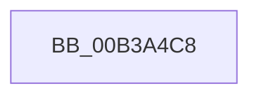

# sub_00B3A4C8

- RVA: `0x00B3A4C8`–`0x00B3A4FD` (길이 `53` bytes)
- VA: `0x0000000140B3A4C8`
- 실행 섹션: `PAGE`
- PDB 이름 있음: `아니요`; PDB Function 태그: `아니요`
- unwind 정보 RVA: `0x000AE5A4`
- 디코드: `13`개 명령, `53/53` bytes 표시
- 미해석 바이트: `0` (있으면 어셈블리에 `.byte`로 보존)

> 이 문서는 커널 이미지의 기계어와 PDB 기호를 분석해 생성했습니다. 4번과 5번은 함수 원형과 자료형을 바이너리 사용 방식에서 추정한 C 해석이며 원본 소스 복구 결과는 아닙니다.

## 1. Dependencies

- 직접 호출 지점: **2**; 고유 호출 대상: **2**
- 직접 호출자로 확인된 함수: **0**
- RIP 상대 이미지 참조: **0**

### Outgoing calls
- `0x00B3A4D0` → [memset](../../text/6C/memset_function_006C6C40.md) (function, `0x006C6C40`)
- `0x00B3A4E7` → [memcpy](../../text/6C/memcpy_function_006C6840.md) (function, `0x006C6840`)

### Direct callers
- 이 함수 시작 RVA로 연결되는 직접 call은 확인되지 않았습니다. 간접 호출은 완전히 역산할 수 없습니다.

### Static image references
- 디코드된 RIP-relative 메모리 참조가 없습니다.

## 2. Other-region calls and transfers

- 다른 실행 섹션으로 향하는 call: **2**
  - `0x00B3A4D0` → [memset](../../text/6C/memset_function_006C6C40.md) (`PAGE` → `.text`)
  - `0x00B3A4E7` → [memcpy](../../text/6C/memcpy_function_006C6840.md) (`PAGE` → `.text`)
- call이 아닌 외부 분기/꼬리 이동: **1**
  - `0x00B3A4F8` → [BiGetDeviceFromEfiPath + 0xB9](../A3/BiGetDeviceFromEfiPath_function_00A3D3BC.md) (`tail-transfer`)

## 3. Assembly (complete function range)

```asm
00B3A4C8  4D 8B C4                        mov r8, r12
00B3A4CB  33 D2                           xor edx, edx
00B3A4CD  49 8B CE                        mov rcx, r14
00B3A4D0  E8 6B C7 B8 FF                  call 0x1406c6c40
00B3A4D5  44 8B C5                        mov r8d, ebp
00B3A4D8  48 8D 57 0C                     lea rdx, [rdi + 0xc]
00B3A4DC  49 8D 4E 14                     lea rcx, [r14 + 0x14]
00B3A4E0  41 C7 06 02 00 00 00            mov dword ptr [r14], 2
00B3A4E7  E8 54 C3 B8 FF                  call 0x1406c6840
00B3A4EC  48 8B 44 24 68                  mov rax, qword ptr [rsp + 0x68]
00B3A4F1  45 89 7D 00                     mov dword ptr [r13], r15d
00B3A4F5  4C 89 30                        mov qword ptr [rax], r14
00B3A4F8  E9 78 2F F0 FF                  jmp 0x140a3d475
```

## 4. C-style interpretation (structured pseudocode)

```c
__int64 __fastcall sub_00B3A4C8(__int64 a1, int a2, __int64 a3, __int64 a4, __int64 a5, __int64 a6, __int64 a7, __int64 a8, __int64 a9, __int64 a10, __int64 a11, __int64 a12, __int64 a13)
{
    __int64 result;

    a2 = 0;
    result = memset(v_r14, a2, v_r12, a4);
    *(unsigned int *)(v_r14) = 2;
    result = memcpy(v_r14 + 20, v_rdi + 12, (unsigned int)((unsigned int)(v_rbp)), a4);
    *(unsigned int *)(v_r13) = (unsigned int)(v_r15);
    *(unsigned __int64 *)(a13) = v_r14;
}
```

## 5. (Beta) C Style

```c
int64_t sub_00B3A4C8(int64_t Arg1, int32_t Arg2, int64_t Arg3, int64_t Arg4, uint64_t Arg5, uint64_t Arg6, uint64_t Arg7, uint64_t Arg8, uint64_t Arg9, uint64_t Arg10, uint64_t Arg11, uint64_t Arg12, void *Arg13)
{
    uint8_t *arg13 = (uint8_t *)Arg13;

    int64_t result;

    Arg2 = 0;
    result = memset(local_r14, Arg2, local_r12, Arg4);
    *(uint32_t *)(local_r14) = 2;
    result = memcpy(local_r14 + 20, local_rdi + 12, (uint32_t)((uint32_t)(local_rbp)), Arg4);
    *(uint32_t *)(local_r13) = (uint32_t)(local_r15);
    *(uint64_t *)(arg13) = local_r14;
}
```

### 관측된 메모리 오프셋

구조체 형식이 확인되지 않은 접근은 인자 기준의 오프셋으로만 기록했습니다.

| 기준 인자 | 오프셋 표현 | 폭 (bit) | 접근 |
|---|---:|---:|---|
| `Arg13` | `+ 0x0` | `64` | `W` |

## 6. Execution-region graph

[열기: 2D/3D 그래프와 함수 탐색 컨트롤 패널](../../../control-panel.html?section=page&rva=0x00B3A4C8&view=graph)

- 2D 그래프는 위에서 아래로 흐르고, 3D 그래프는 빈 공간을 드래그해 회전합니다. Shift+드래그는 이동, 휠은 확대·축소, 함수 노드 선택은 대상 보고서 이동입니다.

### Static fallback


