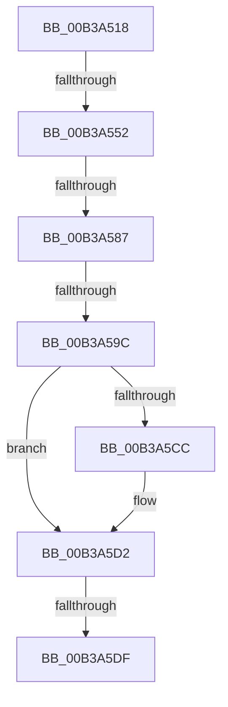

# sub_00B3A518

- RVA: `0x00B3A518`–`0x00B3A5EA` (길이 `210` bytes)
- VA: `0x0000000140B3A518`
- 실행 섹션: `PAGE`
- PDB 이름 있음: `아니요`; PDB Function 태그: `아니요`
- unwind 정보 RVA: `0x000AE650`
- 디코드: `52`개 명령, `210/210` bytes 표시
- 미해석 바이트: `0` (있으면 어셈블리에 `.byte`로 보존)

> 이 문서는 커널 이미지의 기계어와 PDB 기호를 분석해 생성했습니다. 4번과 5번은 함수 원형과 자료형을 바이너리 사용 방식에서 추정한 C 해석이며 원본 소스 복구 결과는 아닙니다.

## 1. Dependencies

- 직접 호출 지점: **6**; 고유 호출 대상: **5**
- 직접 호출자로 확인된 함수: **0**
- RIP 상대 이미지 참조: **3**

### Outgoing calls
- `0x00B3A528` → [BiLogMessage](../A3/BiLogMessage_function_00A3D3A8.md) (function, `0x00A3D3A8`)
- `0x00B3A53F` → [BiOpenKey](../A3/BiOpenKey_function_00A3F60C.md) (function, `0x00A3F60C`)
- `0x00B3A574` → [BiCreateKey](../A4/BiCreateKey_function_00A404DC.md) (function, `0x00A404DC`)
- `0x00B3A58D` → [BiSetObjectDescription](../A4/BiSetObjectDescription_function_00A41DE8.md) (function, `0x00A41DE8`)
- `0x00B3A5C1` → [BiCreateKey](../A4/BiCreateKey_function_00A404DC.md) (function, `0x00A404DC`)
- `0x00B3A5DF` → [BiCloseKey](../91/BiCloseKey_function_00916A00.md) (function, `0x00916A00`)

### Direct callers
- 이 함수 시작 RVA로 연결되는 직접 call은 확인되지 않았습니다. 간접 호출은 완전히 역산할 수 없습니다.

### Static image references
- `0x00B3A51C` → RVA `0x00B0B370` (` ?? ::NNGAKEGL::`string'`; read)
- `0x00B3A538` → RVA `0x00B0A540` (` ?? ::NNGAKEGL::`string'`; read)
- `0x00B3A5A8` → RVA `0x00B0B390` (` ?? ::NNGAKEGL::`string'`; read)

## 2. Other-region calls and transfers

- 다른 실행 섹션으로 향하는 call: **0**
- call이 아닌 외부 분기/꼬리 이동: **5**
  - `0x00B3A54C` → [BiCreateObject + 0xB2](../A3/BiCreateObject_function_00A3D92C.md) (`tail-transfer`)
  - `0x00B3A581` → [BiCreateObject + 0xB2](../A3/BiCreateObject_function_00A3D92C.md) (`tail-transfer`)
  - `0x00B3A596` → [BiCreateObject + 0xB2](../A3/BiCreateObject_function_00A3D92C.md) (`tail-transfer`)
  - `0x00B3A5D9` → [BiCreateObject + 0xB2](../A3/BiCreateObject_function_00A3D92C.md) (`tail-transfer`)
  - `0x00B3A5E5` → [BiCreateObject + 0xB2](../A3/BiCreateObject_function_00A3D92C.md) (`tail-transfer`)

## 3. Assembly (complete function range)

```asm
00B3A518  4C 8B 45 D0                     mov r8, qword ptr [rbp - 0x30]
00B3A51C  48 8D 15 4D 0E FD FF            lea rdx, [rip - 0x2f1b3]
00B3A523  B9 02 00 00 00                  mov ecx, 2
00B3A528  E8 7B 2E F0 FF                  call 0x140a3d3a8
00B3A52D  44 8D 41 02                     lea r8d, [rcx + 2]
00B3A531  49 8B CD                        mov rcx, r13
00B3A534  4C 8D 4D C0                     lea r9, [rbp - 0x40]
00B3A538  48 8D 15 01 00 FD FF            lea rdx, [rip - 0x2ffff]
00B3A53F  E8 C8 50 F0 FF                  call 0x140a3f60c
00B3A544  48 8B 75 C0                     mov rsi, qword ptr [rbp - 0x40]
00B3A548  8B D8                           mov ebx, eax
00B3A54A  85 C0                           test eax, eax
00B3A54C  0F 88 8C 34 F0 FF               js 0x140a3d9de
00B3A552  48 8B 55 D0                     mov rdx, qword ptr [rbp - 0x30]
00B3A556  48 8D 45 B0                     lea rax, [rbp - 0x50]
00B3A55A  48 89 44 24 28                  mov qword ptr [rsp + 0x28], rax
00B3A55F  45 33 C9                        xor r9d, r9d
00B3A562  48 8D 45 B8                     lea rax, [rbp - 0x48]
00B3A566  41 B8 3F 00 0F 00               mov r8d, 0xf003f
00B3A56C  48 8B CE                        mov rcx, rsi
00B3A56F  48 89 44 24 20                  mov qword ptr [rsp + 0x20], rax
00B3A574  E8 63 5F F0 FF                  call 0x140a404dc
00B3A579  48 8B 7D B8                     mov rdi, qword ptr [rbp - 0x48]
00B3A57D  8B D8                           mov ebx, eax
00B3A57F  85 C0                           test eax, eax
00B3A581  0F 88 57 34 F0 FF               js 0x140a3d9de
00B3A587  49 8B D7                        mov rdx, r15
00B3A58A  48 8B CF                        mov rcx, rdi
00B3A58D  E8 56 78 F0 FF                  call 0x140a41de8
00B3A592  8B D8                           mov ebx, eax
00B3A594  85 C0                           test eax, eax
00B3A596  0F 88 42 34 F0 FF               js 0x140a3d9de
00B3A59C  48 8D 45 B0                     lea rax, [rbp - 0x50]
00B3A5A0  45 33 C9                        xor r9d, r9d
00B3A5A3  48 89 44 24 28                  mov qword ptr [rsp + 0x28], rax
00B3A5A8  48 8D 15 E1 0D FD FF            lea rdx, [rip - 0x2f21f]
00B3A5AF  48 8D 45 D8                     lea rax, [rbp - 0x28]
00B3A5B3  41 B8 19 00 02 00               mov r8d, 0x20019
00B3A5B9  48 8B CF                        mov rcx, rdi
00B3A5BC  48 89 44 24 20                  mov qword ptr [rsp + 0x20], rax
00B3A5C1  E8 16 5F F0 FF                  call 0x140a404dc
00B3A5C6  8B D8                           mov ebx, eax
00B3A5C8  85 C0                           test eax, eax
00B3A5CA  78 06                           js 0x140b3a5d2
00B3A5CC  49 89 3C 24                     mov qword ptr [r12], rdi
00B3A5D0  33 DB                           xor ebx, ebx
00B3A5D2  48 8B 4D D8                     mov rcx, qword ptr [rbp - 0x28]
00B3A5D6  48 85 C9                        test rcx, rcx
00B3A5D9  0F 84 FF 33 F0 FF               je 0x140a3d9de
00B3A5DF  E8 1C C4 DD FF                  call 0x140916a00
00B3A5E4  90                              nop
00B3A5E5  E9 F4 33 F0 FF                  jmp 0x140a3d9de
```

## 4. C-style interpretation (structured pseudocode)

```c
__int64 __fastcall sub_00B3A518(void)
{
    __int64 result;
    __int64 v_rbx;
    unsigned __int64 v_stack_p20;
    unsigned __int64 v_stack_p28;

    result = BiLogMessage(2, v_rip - 192947, *(unsigned __int64 *)(v_rbp - 48), a4);
    result = BiOpenKey(v_r13, v_rip - 196607, 2 + 2, v_rbp - 64);
    v_stack_p28 = v_rbp - 80;
    a4 = 0;
    v_stack_p20 = v_rbp - 72;
    result = BiCreateKey(*(unsigned __int64 *)(v_rbp - 64), *(unsigned __int64 *)(v_rbp - 48), (unsigned int)(0xF003FULL), a4);
    result = BiSetObjectDescription(*(unsigned __int64 *)(v_rbp - 72), v_r15, (unsigned int)(0xF003FULL), a4);
    a4 = 0;
    v_stack_p28 = v_rbp - 80;
    v_stack_p20 = v_rbp - 40;
    result = BiCreateKey(*(unsigned __int64 *)(v_rbp - 72), v_rip - 193055, (unsigned int)(0x20019ULL), a4);
    v_rbx = (unsigned int)((unsigned int)(result));
    if (!(sign_flag)) {
        *(unsigned __int64 *)(v_r12) = *(unsigned __int64 *)(v_rbp - 72);
        v_rbx = 0;
    }
    result = BiCloseKey(*(unsigned __int64 *)(v_rbp - 40), v_rip - 193055, (unsigned int)(0x20019ULL), a4);
}
```

## 5. (Beta) C Style

```c
void sub_00B3A518(void)
{
    int64_t result;
    int64_t local_rbx;
    uint64_t v_stack_p20;
    uint64_t v_stack_p28;

    result = BiLogMessage(2, v_rip - 192947, *(uint64_t *)(local_rbp - 0x30), a4);
    result = BiOpenKey(local_r13, v_rip - 196607, 2 + 2, local_rbp - 64);
    v_stack_p28 = local_rbp - 80;
    a4 = 0;
    v_stack_p20 = local_rbp - 72;
    result = BiCreateKey(*(uint64_t *)(local_rbp - 0x40), *(uint64_t *)(local_rbp - 0x30), (uint32_t)(0xF003FULL), a4);
    result = BiSetObjectDescription(*(uint64_t *)(local_rbp - 0x48), local_r15, (uint32_t)(0xF003FULL), a4);
    a4 = 0;
    v_stack_p28 = local_rbp - 80;
    v_stack_p20 = local_rbp - 40;
    result = BiCreateKey(*(uint64_t *)(local_rbp - 0x48), v_rip - 193055, (uint32_t)(0x20019ULL), a4);
    local_rbx = (uint32_t)((uint32_t)(result));
    if (!(sign_flag)) {
        *(uint64_t *)(local_r12) = *(uint64_t *)(local_rbp - 0x48);
        local_rbx = 0;
    }
    result = BiCloseKey(*(uint64_t *)(local_rbp - 0x28), v_rip - 193055, (uint32_t)(0x20019ULL), a4);
}
```

## 6. Execution-region graph

[열기: 2D/3D 그래프와 함수 탐색 컨트롤 패널](../../../control-panel.html?section=page&rva=0x00B3A518&view=graph)

- 2D 그래프는 위에서 아래로 흐르고, 3D 그래프는 빈 공간을 드래그해 회전합니다. Shift+드래그는 이동, 휠은 확대·축소, 함수 노드 선택은 대상 보고서 이동입니다.

### Static fallback


