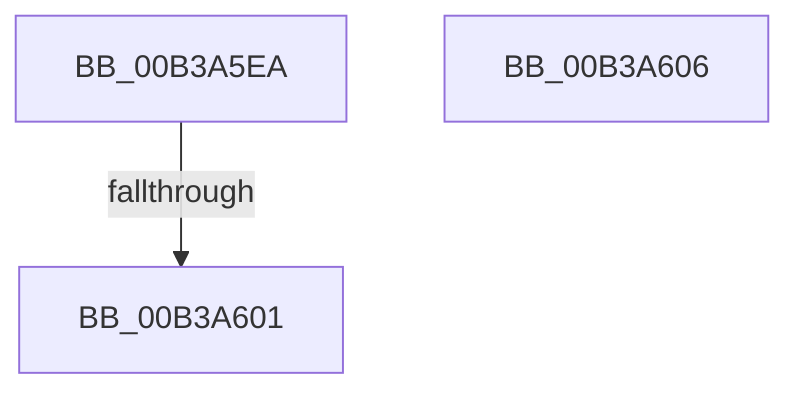

# sub_00B3A5EA

- RVA: `0x00B3A5EA`–`0x00B3A616` (길이 `44` bytes)
- VA: `0x0000000140B3A5EA`
- 실행 섹션: `PAGE`
- PDB 이름 있음: `아니요`; PDB Function 태그: `아니요`
- unwind 정보 RVA: `0x000AE674`
- 디코드: `11`개 명령, `44/44` bytes 표시
- 미해석 바이트: `0` (있으면 어셈블리에 `.byte`로 보존)

> 이 문서는 커널 이미지의 기계어와 PDB 기호를 분석해 생성했습니다. 4번과 5번은 함수 원형과 자료형을 바이너리 사용 방식에서 추정한 C 해석이며 원본 소스 복구 결과는 아닙니다.

## 1. Dependencies

- 직접 호출 지점: **2**; 고유 호출 대상: **2**
- 직접 호출자로 확인된 함수: **0**
- RIP 상대 이미지 참조: **0**

### Outgoing calls
- `0x00B3A5F2` → [ZwQueryBootOptions](../../text/6A/ZwQueryBootOptions_function_006AFA50.md) (function, `0x006AFA50`)
- `0x00B3A60B` → [BiReleasePrivilege](../A3/BiReleasePrivilege_function_00A3D600.md) (function, `0x00A3D600`)

### Direct callers
- 이 함수 시작 RVA로 연결되는 직접 call은 확인되지 않았습니다. 간접 호출은 완전히 역산할 수 없습니다.

### Static image references
- 디코드된 RIP-relative 메모리 참조가 없습니다.

## 2. Other-region calls and transfers

- 다른 실행 섹션으로 향하는 call: **1**
  - `0x00B3A5F2` → [ZwQueryBootOptions](../../text/6A/ZwQueryBootOptions_function_006AFA50.md) (`PAGE` → `.text`)
- call이 아닌 외부 분기/꼬리 이동: **3**
  - `0x00B3A5FB` → [BiQueryBootOptions + 0xBC](../A3/BiQueryBootOptions_function_00A3DB04.md) (`tail-transfer`)
  - `0x00B3A601` → [BiQueryBootOptions + 0x49](../A3/BiQueryBootOptions_function_00A3DB04.md) (`tail-transfer`)
  - `0x00B3A611` → [BiQueryBootOptions + 0x38](../A3/BiQueryBootOptions_function_00A3DB04.md) (`tail-transfer`)

## 3. Assembly (complete function range)

```asm
00B3A5EA  48 8D 54 24 40                  lea rdx, [rsp + 0x40]
00B3A5EF  48 8B C8                        mov rcx, rax
00B3A5F2  E8 59 54 B7 FF                  call 0x1406afa50
00B3A5F7  8B D8                           mov ebx, eax
00B3A5F9  85 C0                           test eax, eax
00B3A5FB  0F 89 BF 35 F0 FF               jns 0x140a3dbc0
00B3A601  E9 47 35 F0 FF                  jmp 0x140a3db4d
00B3A606  48 8D 4C 24 48                  lea rcx, [rsp + 0x48]
00B3A60B  E8 F0 2F F0 FF                  call 0x140a3d600
00B3A610  90                              nop
00B3A611  E9 26 35 F0 FF                  jmp 0x140a3db3c
```

## 4. C-style interpretation (structured pseudocode)

```c
__int64 __fastcall sub_00B3A5EA(__int64 a1, __int64 a2, __int64 a3, __int64 a4, __int64 a5, __int64 a6, __int64 a7, __int64 a8)
{
    __int64 result;
    unsigned __int64 v_stack_p48;

    result = ZwQueryBootOptions(result, a8, a3, a4);
}
```

## 5. (Beta) C Style

```c
int64_t sub_00B3A5EA(int64_t Arg1, int64_t Arg2, int64_t Arg3, int64_t Arg4, uint64_t Arg5, uint64_t Arg6, uint64_t Arg7, int64_t Arg8)
{
    int64_t result;
    uint64_t v_stack_p48;

    result = ZwQueryBootOptions(result, Arg8, Arg3, Arg4);
}
```

## 6. Execution-region graph

[열기: 2D/3D 그래프와 함수 탐색 컨트롤 패널](../../../control-panel.html?section=page&rva=0x00B3A5EA&view=graph)

- 2D 그래프는 위에서 아래로 흐르고, 3D 그래프는 빈 공간을 드래그해 회전합니다. Shift+드래그는 이동, 휠은 확대·축소, 함수 노드 선택은 대상 보고서 이동입니다.

### Static fallback


