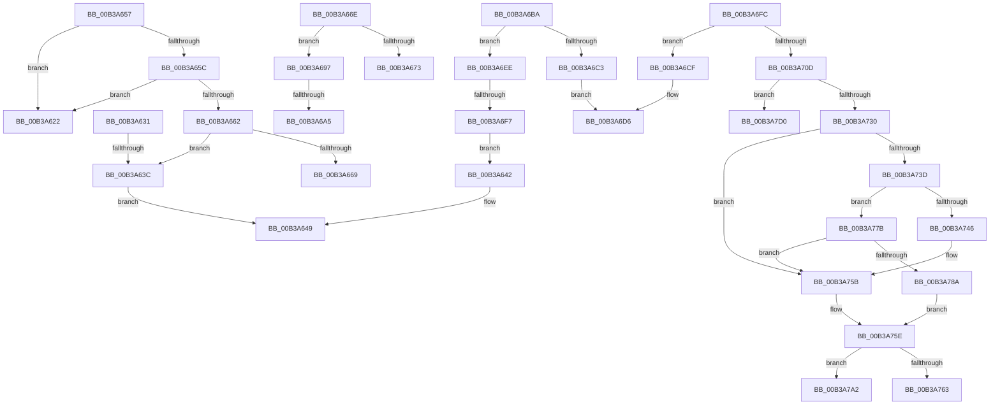

# sub_00B3A622

- RVA: `0x00B3A622`–`0x00B3A7D8` (길이 `438` bytes)
- VA: `0x0000000140B3A622`
- 실행 섹션: `PAGE`
- PDB 이름 있음: `아니요`; PDB Function 태그: `아니요`
- unwind 정보 RVA: `0x000AE87C`
- 디코드: `117`개 명령, `438/438` bytes 표시
- 미해석 바이트: `0` (있으면 어셈블리에 `.byte`로 보존)

> 이 문서는 커널 이미지의 기계어와 PDB 기호를 분석해 생성했습니다. 4번과 5번은 함수 원형과 자료형을 바이너리 사용 방식에서 추정한 C 해석이며 원본 소스 복구 결과는 아닙니다.

## 1. Dependencies

- 직접 호출 지점: **10**; 고유 호출 대상: **5**
- 직접 호출자로 확인된 함수: **0**
- RIP 상대 이미지 참조: **4**

### Outgoing calls
- `0x00B3A64C` → [memcpy](../../text/6C/memcpy_function_006C6840.md) (function, `0x006C6840`)
- `0x00B3A68C` → [BiLogMessage](../A3/BiLogMessage_function_00A3D3A8.md) (function, `0x00A3D3A8`)
- `0x00B3A6E3` → [BiLogMessage](../A3/BiLogMessage_function_00A3D3A8.md) (function, `0x00A3D3A8`)
- `0x00B3A721` → [BiConvertBootEnvironmentDeviceToElement](../82/BiConvertBootEnvironmentDeviceToElement_function_00823DF8.md) (function, `0x00823DF8`)
- `0x00B3A756` → [BiLogMessage](../A3/BiLogMessage_function_00A3D3A8.md) (function, `0x00A3D3A8`)
- `0x00B3A770` → [ExFreePoolWithTag](../../poolcode/B8/ExFreePoolWithTag_function_00B82870.md) (function, `0x00B82870`)
- `0x00B3A781` → [BiResolveLocateDevice](../82/BiResolveLocateDevice_function_00823AB4.md) (function, `0x00823AB4`)
- `0x00B3A79B` → [memcpy](../../text/6C/memcpy_function_006C6840.md) (function, `0x006C6840`)
- `0x00B3A7AF` → [memcpy](../../text/6C/memcpy_function_006C6840.md) (function, `0x006C6840`)
- `0x00B3A7C5` → [ExFreePoolWithTag](../../poolcode/B8/ExFreePoolWithTag_function_00B82870.md) (function, `0x00B82870`)

### Direct callers
- 이 함수 시작 RVA로 연결되는 직접 call은 확인되지 않았습니다. 간접 호출은 완전히 역산할 수 없습니다.

### Static image references
- `0x00B3A625` → RVA `0x00B0B840` (` ?? ::NNGAKEGL::`string'`; read)
- `0x00B3A681` → RVA `0x00B0B6B0` (` ?? ::NNGAKEGL::`string'`; read)
- `0x00B3A6C6` → RVA `0x00B0B7B0` (` ?? ::NNGAKEGL::`string'`; read)
- `0x00B3A74C` → RVA `0x00B0B750` (` ?? ::NNGAKEGL::`string'`; read)

## 2. Other-region calls and transfers

- 다른 실행 섹션으로 향하는 call: **5**
  - `0x00B3A64C` → [memcpy](../../text/6C/memcpy_function_006C6840.md) (`PAGE` → `.text`)
  - `0x00B3A770` → [ExFreePoolWithTag](../../poolcode/B8/ExFreePoolWithTag_function_00B82870.md) (`PAGE` → `POOLCODE`)
  - `0x00B3A79B` → [memcpy](../../text/6C/memcpy_function_006C6840.md) (`PAGE` → `.text`)
  - `0x00B3A7AF` → [memcpy](../../text/6C/memcpy_function_006C6840.md) (`PAGE` → `.text`)
  - `0x00B3A7C5` → [ExFreePoolWithTag](../../poolcode/B8/ExFreePoolWithTag_function_00B82870.md) (`PAGE` → `POOLCODE`)
- call이 아닌 외부 분기/꼬리 이동: **12**
  - `0x00B3A62C` → [BiConvertRegistryDataToElement + 0x195](../A3/BiConvertRegistryDataToElement_function_00A3F804.md) (`tail-transfer`)
  - `0x00B3A636` → [BiConvertRegistryDataToElement + 0x215](../A3/BiConvertRegistryDataToElement_function_00A3F804.md) (`tail-transfer`)
  - `0x00B3A652` → [BiConvertRegistryDataToElement + 0xA6](../A3/BiConvertRegistryDataToElement_function_00A3F804.md) (`tail-transfer`)
  - `0x00B3A669` → [BiConvertRegistryDataToElement + 0x215](../A3/BiConvertRegistryDataToElement_function_00A3F804.md) (`tail-transfer`)
  - `0x00B3A692` → [BiConvertRegistryDataToElement + 0x19F](../A3/BiConvertRegistryDataToElement_function_00A3F804.md) (`tail-transfer`)
  - `0x00B3A69F` → [BiConvertRegistryDataToElement + 0x215](../A3/BiConvertRegistryDataToElement_function_00A3F804.md) (`tail-transfer`)
  - `0x00B3A6B5` → [BiConvertRegistryDataToElement + 0xA6](../A3/BiConvertRegistryDataToElement_function_00A3F804.md) (`tail-transfer`)
  - `0x00B3A6E9` → [BiConvertRegistryDataToElement + 0x19F](../A3/BiConvertRegistryDataToElement_function_00A3F804.md) (`tail-transfer`)
  - `0x00B3A6F1` → [BiConvertRegistryDataToElement + 0x215](../A3/BiConvertRegistryDataToElement_function_00A3F804.md) (`tail-transfer`)
  - `0x00B3A776` → [BiConvertRegistryDataToElement + 0xA9](../A3/BiConvertRegistryDataToElement_function_00A3F804.md) (`tail-transfer`)
  - `0x00B3A7CB` → [BiConvertRegistryDataToElement + 0xA6](../A3/BiConvertRegistryDataToElement_function_00A3F804.md) (`tail-transfer`)
  - `0x00B3A7D3` → [BiConvertRegistryDataToElement + 0xEB](../A3/BiConvertRegistryDataToElement_function_00A3F804.md) (`tail-transfer`)

## 3. Assembly (complete function range)

```asm
00B3A622  44 8B C7                        mov r8d, edi
00B3A625  48 8D 15 14 12 FD FF            lea rdx, [rip - 0x2edec]
00B3A62C  E9 68 53 F0 FF                  jmp 0x140a3f999
00B3A631  8B F7                           mov esi, edi
00B3A633  41 3B 3E                        cmp edi, dword ptr [r14]
00B3A636  0F 87 DD 53 F0 FF               ja 0x140a3fa19
00B3A63C  48 8B 4D 58                     mov rcx, qword ptr [rbp + 0x58]
00B3A640  EB 07                           jmp 0x140b3a649
00B3A642  48 8B 4D 58                     mov rcx, qword ptr [rbp + 0x58]
00B3A646  4C 89 29                        mov qword ptr [rcx], r13
00B3A649  4C 8B C7                        mov r8, rdi
00B3A64C  E8 EF C1 B8 FF                  call 0x1406c6840
00B3A651  90                              nop
00B3A652  E9 53 52 F0 FF                  jmp 0x140a3f8aa
00B3A657  45 85 C0                        test r8d, r8d
00B3A65A  74 C6                           je 0x140b3a622
00B3A65C  40 F6 C7 07                     test dil, 7
00B3A660  75 C0                           jne 0x140b3a622
00B3A662  8B F7                           mov esi, edi
00B3A664  41 39 3E                        cmp dword ptr [r14], edi
00B3A667  73 D3                           jae 0x140b3a63c
00B3A669  E9 AB 53 F0 FF                  jmp 0x140a3fa19
00B3A66E  83 FF 01                        cmp edi, 1
00B3A671  74 24                           je 0x140b3a697
00B3A673  41 B9 01 00 00 00               mov r9d, 1
00B3A679  44 89 54 24 20                  mov dword ptr [rsp + 0x20], r10d
00B3A67E  44 8B C7                        mov r8d, edi
00B3A681  48 8D 15 28 10 FD FF            lea rdx, [rip - 0x2efd8]
00B3A688  41 8D 49 03                     lea ecx, [r9 + 3]
00B3A68C  E8 17 2D F0 FF                  call 0x140a3d3a8
00B3A691  90                              nop
00B3A692  E9 0C 53 F0 FF                  jmp 0x140a3f9a3
00B3A697  BE 02 00 00 00                  mov esi, 2
00B3A69C  41 39 36                        cmp dword ptr [r14], esi
00B3A69F  0F 82 74 53 F0 FF               jb 0x140a3fa19
00B3A6A5  48 8B 4D 58                     mov rcx, qword ptr [rbp + 0x58]
00B3A6A9  44 88 69 01                     mov byte ptr [rcx + 1], r13b
00B3A6AD  44 38 2A                        cmp byte ptr [rdx], r13b
00B3A6B0  0F 95 C0                        setne al
00B3A6B3  88 01                           mov byte ptr [rcx], al
00B3A6B5  E9 F0 51 F0 FF                  jmp 0x140a3f8aa
00B3A6BA  BE 08 00 00 00                  mov esi, 8
00B3A6BF  3B FE                           cmp edi, esi
00B3A6C1  76 2B                           jbe 0x140b3a6ee
00B3A6C3  44 8B CE                        mov r9d, esi
00B3A6C6  48 8D 15 E3 10 FD FF            lea rdx, [rip - 0x2ef1d]
00B3A6CD  EB 07                           jmp 0x140b3a6d6
00B3A6CF  48 8D 15 DA 0F FD FF            lea rdx, [rip - 0x2f026]
00B3A6D6  44 8B C7                        mov r8d, edi
00B3A6D9  44 89 54 24 20                  mov dword ptr [rsp + 0x20], r10d
00B3A6DE  B9 04 00 00 00                  mov ecx, 4
00B3A6E3  E8 C0 2C F0 FF                  call 0x140a3d3a8
00B3A6E8  90                              nop
00B3A6E9  E9 B5 52 F0 FF                  jmp 0x140a3f9a3
00B3A6EE  41 39 36                        cmp dword ptr [r14], esi
00B3A6F1  0F 82 22 53 F0 FF               jb 0x140a3fa19
00B3A6F7  E9 46 FF FF FF                  jmp 0x140b3a642
00B3A6FC  48 8D 4A 10                     lea rcx, [rdx + 0x10]
00B3A700  44 8B 49 08                     mov r9d, dword ptr [rcx + 8]
00B3A704  49 83 C1 10                     add r9, 0x10
00B3A708  4C 3B CF                        cmp r9, rdi
00B3A70B  75 C2                           jne 0x140b3a6cf
00B3A70D  44 8B 45 50                     mov r8d, dword ptr [rbp + 0x50]
00B3A711  48 8D 45 48                     lea rax, [rbp + 0x48]
00B3A715  4C 8D 4D E0                     lea r9, [rbp - 0x20]
00B3A719  48 89 44 24 20                  mov qword ptr [rsp + 0x20], rax
00B3A71E  41 8B D2                        mov edx, r10d
00B3A721  E8 D2 96 CE FF                  call 0x140823df8
00B3A726  8B D8                           mov ebx, eax
00B3A728  85 C0                           test eax, eax
00B3A72A  0F 88 A0 00 00 00               js 0x140b3a7d0
00B3A730  48 8B 7D E0                     mov rdi, qword ptr [rbp - 0x20]
00B3A734  BE 08 00 00 00                  mov esi, 8
00B3A739  39 37                           cmp dword ptr [rdi], esi
00B3A73B  75 1E                           jne 0x140b3a75b
00B3A73D  F7 45 50 00 01 00 00            test dword ptr [rbp + 0x50], 0x100
00B3A744  74 35                           je 0x140b3a77b
00B3A746  41 B8 BB 00 00 C0               mov r8d, 0xc00000bb
00B3A74C  48 8D 15 FD 0F FD FF            lea rdx, [rip - 0x2f003]
00B3A753  8D 4E FC                        lea ecx, [rsi - 4]
00B3A756  E8 4D 2C F0 FF                  call 0x140a3d3a8
00B3A75B  8B 75 48                        mov esi, dword ptr [rbp + 0x48]
00B3A75E  41 3B 36                        cmp esi, dword ptr [r14]
00B3A761  76 3F                           jbe 0x140b3a7a2
00B3A763  BA 42 43 44 4B                  mov edx, 0x4b444342
00B3A768  48 8B CF                        mov rcx, rdi
00B3A76B  BB 23 00 00 C0                  mov ebx, 0xc0000023
00B3A770  E8 FB 80 04 00                  call 0x140b82870
00B3A775  90                              nop
00B3A776  E9 32 51 F0 FF                  jmp 0x140a3f8ad
00B3A77B  48 8B D7                        mov rdx, rdi
00B3A77E  49 8B CC                        mov rcx, r12
00B3A781  E8 2E 93 CE FF                  call 0x140823ab4
00B3A786  85 C0                           test eax, eax
00B3A788  78 D1                           js 0x140b3a75b
00B3A78A  8B 57 18                        mov edx, dword ptr [rdi + 0x18]
00B3A78D  48 8B CF                        mov rcx, rdi
00B3A790  8B 75 48                        mov esi, dword ptr [rbp + 0x48]
00B3A793  2B F2                           sub esi, edx
00B3A795  48 03 D7                        add rdx, rdi
00B3A798  44 8B C6                        mov r8d, esi
00B3A79B  E8 A0 C0 B8 FF                  call 0x1406c6840
00B3A7A0  EB BC                           jmp 0x140b3a75e
00B3A7A2  48 8B 5D 58                     mov rbx, qword ptr [rbp + 0x58]
00B3A7A6  48 8B D7                        mov rdx, rdi
00B3A7A9  48 8B CB                        mov rcx, rbx
00B3A7AC  44 8B C6                        mov r8d, esi
00B3A7AF  E8 8C C0 B8 FF                  call 0x1406c6840
00B3A7B4  41 0F 10 07                     movups xmm0, xmmword ptr [r15]
00B3A7B8  BA 42 43 44 4B                  mov edx, 0x4b444342
00B3A7BD  48 8B CF                        mov rcx, rdi
00B3A7C0  F3 0F 7F 43 04                  movdqu xmmword ptr [rbx + 4], xmm0
00B3A7C5  E8 A6 80 04 00                  call 0x140b82870
00B3A7CA  90                              nop
00B3A7CB  E9 DA 50 F0 FF                  jmp 0x140a3f8aa
00B3A7D0  8B 75 48                        mov esi, dword ptr [rbp + 0x48]
00B3A7D3  E9 17 51 F0 FF                  jmp 0x140a3f8ef
```

## 4. C-style interpretation (structured pseudocode)

```c
__int64 __fastcall sub_00B3A622(void)
{
    unsigned int v_stack_p20;
}
```

## 5. (Beta) C Style

```c
void sub_00B3A622(void)
{
    uint32_t v_stack_p20;
}
```

## 6. Execution-region graph

[열기: 2D/3D 그래프와 함수 탐색 컨트롤 패널](../../../control-panel.html?section=page&rva=0x00B3A622&view=graph)

- 2D 그래프는 위에서 아래로 흐르고, 3D 그래프는 빈 공간을 드래그해 회전합니다. Shift+드래그는 이동, 휠은 확대·축소, 함수 노드 선택은 대상 보고서 이동입니다.

### Static fallback


