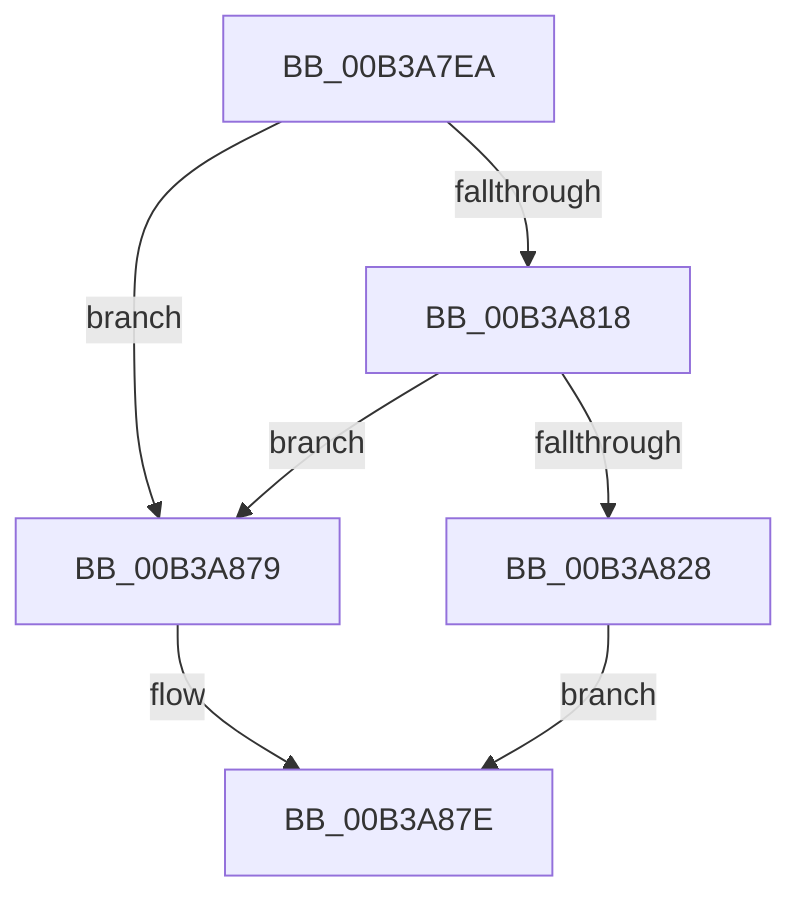

# sub_00B3A7EA

- RVA: `0x00B3A7EA`–`0x00B3A891` (길이 `167` bytes)
- VA: `0x0000000140B3A7EA`
- 실행 섹션: `PAGE`
- PDB 이름 있음: `아니요`; PDB Function 태그: `아니요`
- unwind 정보 RVA: `0x000AE8D8`
- 디코드: `44`개 명령, `167/167` bytes 표시
- 미해석 바이트: `0` (있으면 어셈블리에 `.byte`로 보존)

> 이 문서는 커널 이미지의 기계어와 PDB 기호를 분석해 생성했습니다. 4번과 5번은 함수 원형과 자료형을 바이너리 사용 방식에서 추정한 C 해석이며 원본 소스 복구 결과는 아닙니다.

## 1. Dependencies

- 직접 호출 지점: **6**; 고유 호출 대상: **6**
- 직접 호출자로 확인된 함수: **0**
- RIP 상대 이미지 참조: **1**

### Outgoing calls
- `0x00B3A7F4` → [memcpy](../../text/6C/memcpy_function_006C6840.md) (function, `0x006C6840`)
- `0x00B3A7FC` → [wcsupr](../../text/50/wcsupr_function_005003A0.md) (function, `0x005003A0`)
- `0x00B3A80B` → [wcsstr](../../text/50/wcsstr_function_00501F80.md) (function, `0x00501F80`)
- `0x00B3A864` → [RtlInitUnicodeString](../../text/42/RtlInitUnicodeString_function_0042A780.md) (function, `0x0042A780`)
- `0x00B3A870` → [RtlGUIDFromString](../8F/RtlGUIDFromString_function_008F1EF0.md) (function, `0x008F1EF0`)
- `0x00B3A886` → [ExFreePoolWithTag](../../poolcode/B8/ExFreePoolWithTag_function_00B82870.md) (function, `0x00B82870`)

### Direct callers
- 이 함수 시작 RVA로 연결되는 직접 call은 확인되지 않았습니다. 간접 호출은 완전히 역산할 수 없습니다.

### Static image references
- `0x00B3A801` → RVA `0x00B0C500` (` ?? ::NNGAKEGL::`string'`; read)

## 2. Other-region calls and transfers

- 다른 실행 섹션으로 향하는 call: **5**
  - `0x00B3A7F4` → [memcpy](../../text/6C/memcpy_function_006C6840.md) (`PAGE` → `.text`)
  - `0x00B3A7FC` → [wcsupr](../../text/50/wcsupr_function_005003A0.md) (`PAGE` → `.text`)
  - `0x00B3A80B` → [wcsstr](../../text/50/wcsstr_function_00501F80.md) (`PAGE` → `.text`)
  - `0x00B3A864` → [RtlInitUnicodeString](../../text/42/RtlInitUnicodeString_function_0042A780.md) (`PAGE` → `.text`)
  - `0x00B3A886` → [ExFreePoolWithTag](../../poolcode/B8/ExFreePoolWithTag_function_00B82870.md) (`PAGE` → `POOLCODE`)
- call이 아닌 외부 분기/꼬리 이동: **1**
  - `0x00B3A88C` → [BiGetObjectReferenceFromEfiEntry + 0x44](../A3/BiGetObjectReferenceFromEfiEntry_function_00A3FB4C.md) (`tail-transfer`)

## 3. Assembly (complete function range)

```asm
00B3A7EA  48 8D 56 30                     lea rdx, [rsi + 0x30]
00B3A7EE  4C 8B C3                        mov r8, rbx
00B3A7F1  48 8B CF                        mov rcx, rdi
00B3A7F4  E8 47 C0 B8 FF                  call 0x1406c6840
00B3A7F9  48 8B CF                        mov rcx, rdi
00B3A7FC  E8 9F 5B 9C FF                  call 0x1405003a0
00B3A801  48 8D 15 F8 1C FD FF            lea rdx, [rip - 0x2e308]
00B3A808  48 8B CF                        mov rcx, rdi
00B3A80B  E8 70 77 9C FF                  call 0x140501f80
00B3A810  48 8B C8                        mov rcx, rax
00B3A813  48 85 C0                        test rax, rax
00B3A816  74 61                           je 0x140b3a879
00B3A818  48 83 C1 14                     add rcx, 0x14
00B3A81C  48 2B D9                        sub rbx, rcx
00B3A81F  48 03 DF                        add rbx, rdi
00B3A822  48 83 FB 4E                     cmp rbx, 0x4e
00B3A826  72 51                           jb 0x140b3a879
00B3A828  0F 10 01                        movups xmm0, xmmword ptr [rcx]
00B3A82B  48 8D 55 D7                     lea rdx, [rbp - 0x29]
00B3A82F  0F 29 45 D7                     movaps xmmword ptr [rbp - 0x29], xmm0
00B3A833  0F 10 49 10                     movups xmm1, xmmword ptr [rcx + 0x10]
00B3A837  0F 29 4D E7                     movaps xmmword ptr [rbp - 0x19], xmm1
00B3A83B  0F 10 41 20                     movups xmm0, xmmword ptr [rcx + 0x20]
00B3A83F  0F 29 45 F7                     movaps xmmword ptr [rbp - 9], xmm0
00B3A843  0F 10 49 30                     movups xmm1, xmmword ptr [rcx + 0x30]
00B3A847  0F 29 4D 07                     movaps xmmword ptr [rbp + 7], xmm1
00B3A84B  F2 0F 10 41 40                  movsd xmm0, qword ptr [rcx + 0x40]
00B3A850  F2 0F 11 45 17                  movsd qword ptr [rbp + 0x17], xmm0
00B3A855  8B 41 48                        mov eax, dword ptr [rcx + 0x48]
00B3A858  48 8D 4D C7                     lea rcx, [rbp - 0x39]
00B3A85C  89 45 1F                        mov dword ptr [rbp + 0x1f], eax
00B3A85F  66 44 89 7D 23                  mov word ptr [rbp + 0x23], r15w
00B3A864  E8 17 FF 8E FF                  call 0x14042a780
00B3A869  49 8B D6                        mov rdx, r14
00B3A86C  48 8D 4D C7                     lea rcx, [rbp - 0x39]
00B3A870  E8 7B 76 DB FF                  call 0x1408f1ef0
00B3A875  8B D8                           mov ebx, eax
00B3A877  EB 05                           jmp 0x140b3a87e
00B3A879  BB 25 02 00 C0                  mov ebx, 0xc0000225
00B3A87E  BA 42 43 44 4B                  mov edx, 0x4b444342
00B3A883  48 8B CF                        mov rcx, rdi
00B3A886  E8 E5 7F 04 00                  call 0x140b82870
00B3A88B  90                              nop
00B3A88C  E9 FF 52 F0 FF                  jmp 0x140a3fb90
```

## 4. C-style interpretation (structured pseudocode)

```c
__int64 __fastcall sub_00B3A7EA(void)
{
    __int64 result;
    __int64 v_rbx;

    result = memcpy(v_rdi, v_rsi + 48, v_rbx, a4);
    result = wcsupr(v_rdi, v_rsi + 48, v_rbx, a4);
    result = wcsstr(v_rdi, v_rip - 189192, v_rbx, a4);
    if (result == 0) goto loc_00B3A879;
    a1 = (result) + (20);
    v_rbx = (v_rbx) - (a1);
    v_rbx = (v_rbx) + (v_rdi);
    if (v_rbx < 78) goto loc_00B3A879;
    *(unsigned __int64 *)(v_rbp - 41) = v_xmm0;
    *(unsigned __int64 *)(v_rbp - 25) = v_xmm1;
    *(unsigned __int64 *)(v_rbp - 9) = v_xmm0;
    *(unsigned __int64 *)(v_rbp + 7) = v_xmm1;
    *(unsigned __int64 *)(v_rbp + 23) = v_xmm0;
    *(unsigned int *)(v_rbp + 31) = (unsigned int)((unsigned int)(*(unsigned int *)(a1 + 72)));
    *(unsigned __int16 *)(v_rbp + 35) = (unsigned __int16)(v_r15);
    result = RtlInitUnicodeString(v_rbp - 57, v_rbp - 41, v_rbx, a4);
    result = RtlGUIDFromString(v_rbp - 57, v_r14, v_rbx, a4);
    goto loc_00B3A87E;
loc_00B3A879:
loc_00B3A87E:
    result = ExFreePoolWithTag(v_rdi, (unsigned int)(0x4B444342ULL), v_rbx, a4);
}
```

## 5. (Beta) C Style

```c
void sub_00B3A7EA(void)
{
    int64_t result;
    int64_t local_rbx;

    result = memcpy(local_rdi, local_rsi + 48, local_rbx, a4);
    result = wcsupr(local_rdi, local_rsi + 48, local_rbx, a4);
    result = wcsstr(local_rdi, v_rip - 189192, local_rbx, a4);
    if (result == 0) goto loc_00B3A879;
    a1 = (result) + (20);
    local_rbx = (local_rbx) - (a1);
    local_rbx = (local_rbx) + (local_rdi);
    if (local_rbx < 78) goto loc_00B3A879;
    *(uint64_t *)(local_rbp - 0x29) = v_xmm0;
    *(uint64_t *)(local_rbp - 0x19) = v_xmm1;
    *(uint64_t *)(local_rbp - 0x9) = v_xmm0;
    *(uint64_t *)(local_rbp + 0x7) = v_xmm1;
    *(uint64_t *)(local_rbp + 0x17) = v_xmm0;
    *(uint32_t *)(local_rbp + 0x1F) = (uint32_t)((uint32_t)(*(uint32_t *)(a1 + 0x48)));
    *(uint16_t *)(local_rbp + 0x23) = (uint16_t)(local_r15);
    result = RtlInitUnicodeString(local_rbp - 57, local_rbp - 41, local_rbx, a4);
    result = RtlGUIDFromString(local_rbp - 57, local_r14, local_rbx, a4);
    goto loc_00B3A87E;
loc_00B3A879:
loc_00B3A87E:
    result = ExFreePoolWithTag(local_rdi, (uint32_t)(0x4B444342ULL), local_rbx, a4);
}
```

## 6. Execution-region graph

[열기: 2D/3D 그래프와 함수 탐색 컨트롤 패널](../../../control-panel.html?section=page&rva=0x00B3A7EA&view=graph)

- 2D 그래프는 위에서 아래로 흐르고, 3D 그래프는 빈 공간을 드래그해 회전합니다. Shift+드래그는 이동, 휠은 확대·축소, 함수 노드 선택은 대상 보고서 이동입니다.

### Static fallback


