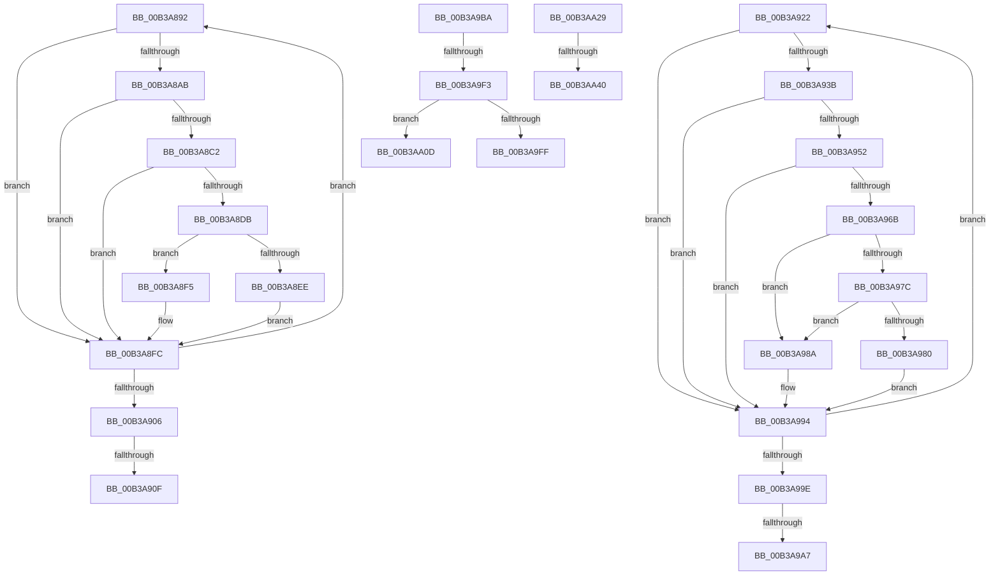

# sub_00B3A892

- RVA: `0x00B3A892`–`0x00B3AA4C` (길이 `442` bytes)
- VA: `0x0000000140B3A892`
- 실행 섹션: `PAGE`
- PDB 이름 있음: `아니요`; PDB Function 태그: `아니요`
- unwind 정보 RVA: `0x000AE9B4`
- 디코드: `118`개 명령, `442/442` bytes 표시
- 미해석 바이트: `0` (있으면 어셈블리에 `.byte`로 보존)

> 이 문서는 커널 이미지의 기계어와 PDB 기호를 분석해 생성했습니다. 4번과 5번은 함수 원형과 자료형을 바이너리 사용 방식에서 추정한 C 해석이며 원본 소스 복구 결과는 아닙니다.

## 1. Dependencies

- 직접 호출 지점: **20**; 고유 호출 대상: **10**
- 직접 호출자로 확인된 함수: **0**
- RIP 상대 이미지 참조: **3**

### Outgoing calls
- `0x00B3A8A2` → [wcsnicmp](../../text/50/wcsnicmp_function_005001C0.md) (function, `0x005001C0`)
- `0x00B3A8B8` → [wcstoul](../../text/50/wcstoul_function_005024A0.md) (function, `0x005024A0`)
- `0x00B3A8D2` → [BiOpenKey](../A3/BiOpenKey_function_00A3F60C.md) (function, `0x00A3F60C`)
- `0x00B3A8E2` → [BiIsSystemStore](../A3/BiIsSystemStore_function_00A3DF84.md) (function, `0x00A3DF84`)
- `0x00B3A8EE` → [BcdForciblyUnloadStore](../82/BcdForciblyUnloadStore_function_008232FC.md) (function, `0x008232FC`)
- `0x00B3A8F7` → [BiUnloadHiveByHandle](../A4/BiUnloadHiveByHandle_function_00A4105C.md) (function, `0x00A4105C`)
- `0x00B3A917` → [ExFreePoolWithTag](../../poolcode/B8/ExFreePoolWithTag_function_00B82870.md) (function, `0x00B82870`)
- `0x00B3A932` → [wcsnicmp](../../text/50/wcsnicmp_function_005001C0.md) (function, `0x005001C0`)
- `0x00B3A948` → [wcstoul](../../text/50/wcstoul_function_005024A0.md) (function, `0x005024A0`)
- `0x00B3A962` → [BiOpenKey](../A3/BiOpenKey_function_00A3F60C.md) (function, `0x00A3F60C`)
- `0x00B3A972` → [BiIsSystemStore](../A3/BiIsSystemStore_function_00A3DF84.md) (function, `0x00A3DF84`)
- `0x00B3A983` → [BiCloseKey](../91/BiCloseKey_function_00916A00.md) (function, `0x00916A00`)
- `0x00B3A98F` → [BiUnloadHiveByHandle](../A4/BiUnloadHiveByHandle_function_00A4105C.md) (function, `0x00A4105C`)
- `0x00B3A9AF` → [ExFreePoolWithTag](../../poolcode/B8/ExFreePoolWithTag_function_00B82870.md) (function, `0x00B82870`)
- `0x00B3A9CA` → [BiLogMessage](../A3/BiLogMessage_function_00A3D3A8.md) (function, `0x00A3D3A8`)
- `0x00B3A9E0` → [BiOpenKey](../A3/BiOpenKey_function_00A3F60C.md) (function, `0x00A3F60C`)
- `0x00B3A9F6` → [BiIsSystemStore](../A3/BiIsSystemStore_function_00A3DF84.md) (function, `0x00A3DF84`)
- `0x00B3AA02` → [BiCloseKey](../91/BiCloseKey_function_00916A00.md) (function, `0x00916A00`)
- `0x00B3AA1D` → [BiLogMessage](../A3/BiLogMessage_function_00A3D3A8.md) (function, `0x00A3D3A8`)
- `0x00B3AA2D` → [BiLoadSystemStore](../A3/BiLoadSystemStore_function_00A3C198.md) (function, `0x00A3C198`)

### Direct callers
- 이 함수 시작 RVA로 연결되는 직접 call은 확인되지 않았습니다. 간접 호출은 완전히 역산할 수 없습니다.

### Static image references
- `0x00B3A895` → RVA `0x00B0AC70` (` ?? ::NNGAKEGL::`string'`; read)
- `0x00B3A9BE` → RVA `0x00B0AE20` (` ?? ::NNGAKEGL::`string'`; read)
- `0x00B3AA11` → RVA `0x00B0AE60` (` ?? ::NNGAKEGL::`string'`; read)

## 2. Other-region calls and transfers

- 다른 실행 섹션으로 향하는 call: **6**
  - `0x00B3A8A2` → [wcsnicmp](../../text/50/wcsnicmp_function_005001C0.md) (`PAGE` → `.text`)
  - `0x00B3A8B8` → [wcstoul](../../text/50/wcstoul_function_005024A0.md) (`PAGE` → `.text`)
  - `0x00B3A917` → [ExFreePoolWithTag](../../poolcode/B8/ExFreePoolWithTag_function_00B82870.md) (`PAGE` → `POOLCODE`)
  - `0x00B3A932` → [wcsnicmp](../../text/50/wcsnicmp_function_005001C0.md) (`PAGE` → `.text`)
  - `0x00B3A948` → [wcstoul](../../text/50/wcstoul_function_005024A0.md) (`PAGE` → `.text`)
  - `0x00B3A9AF` → [ExFreePoolWithTag](../../poolcode/B8/ExFreePoolWithTag_function_00B82870.md) (`PAGE` → `POOLCODE`)
- call이 아닌 외부 분기/꼬리 이동: **9**
  - `0x00B3A909` → [BiOpenSystemStore + 0x8F](../A4/BiOpenSystemStore_function_00A40844.md) (`tail-transfer`)
  - `0x00B3A91D` → [BiOpenSystemStore + 0x8F](../A4/BiOpenSystemStore_function_00A40844.md) (`tail-transfer`)
  - `0x00B3A9A1` → [BiOpenSystemStore + 0x18E](../A4/BiOpenSystemStore_function_00A40844.md) (`tail-transfer`)
  - `0x00B3A9B5` → [BiOpenSystemStore + 0x18E](../A4/BiOpenSystemStore_function_00A40844.md) (`tail-transfer`)
  - `0x00B3A9ED` → [BiOpenSystemStore + 0x11E](../A4/BiOpenSystemStore_function_00A40844.md) (`tail-transfer`)
  - `0x00B3AA08` → [BiOpenSystemStore + 0x11E](../A4/BiOpenSystemStore_function_00A40844.md) (`tail-transfer`)
  - `0x00B3AA24` → [BiOpenSystemStore + 0x122](../A4/BiOpenSystemStore_function_00A40844.md) (`tail-transfer`)
  - `0x00B3AA3A` → [BiOpenSystemStore + 0x200](../A4/BiOpenSystemStore_function_00A40844.md) (`tail-transfer`)
  - `0x00B3AA47` → [BiOpenSystemStore + 0x131](../A4/BiOpenSystemStore_function_00A40844.md) (`tail-transfer`)

## 3. Assembly (complete function range)

```asm
00B3A892  48 8B 0B                        mov rcx, qword ptr [rbx]
00B3A895  48 8D 15 D4 03 FD FF            lea rdx, [rip - 0x2fc2c]
00B3A89C  41 B8 03 00 00 00               mov r8d, 3
00B3A8A2  E8 19 59 9C FF                  call 0x1405001c0
00B3A8A7  85 C0                           test eax, eax
00B3A8A9  75 51                           jne 0x140b3a8fc
00B3A8AB  48 8B 0B                        mov rcx, qword ptr [rbx]
00B3A8AE  44 8D 40 0A                     lea r8d, [rax + 0xa]
00B3A8B2  48 83 C1 06                     add rcx, 6
00B3A8B6  33 D2                           xor edx, edx
00B3A8B8  E8 E3 7B 9C FF                  call 0x1405024a0
00B3A8BD  83 F8 FF                        cmp eax, -1
00B3A8C0  74 3A                           je 0x140b3a8fc
00B3A8C2  48 8B 13                        mov rdx, qword ptr [rbx]
00B3A8C5  4C 8D 4D D8                     lea r9, [rbp - 0x28]
00B3A8C9  41 B8 19 00 02 00               mov r8d, 0x20019
00B3A8CF  49 8B CE                        mov rcx, r14
00B3A8D2  E8 35 4D F0 FF                  call 0x140a3f60c
00B3A8D7  85 C0                           test eax, eax
00B3A8D9  78 21                           js 0x140b3a8fc
00B3A8DB  48 8B 75 D8                     mov rsi, qword ptr [rbp - 0x28]
00B3A8DF  48 8B CE                        mov rcx, rsi
00B3A8E2  E8 9D 36 F0 FF                  call 0x140a3df84
00B3A8E7  48 8B CE                        mov rcx, rsi
00B3A8EA  84 C0                           test al, al
00B3A8EC  74 07                           je 0x140b3a8f5
00B3A8EE  E8 09 8A CE FF                  call 0x1408232fc
00B3A8F3  EB 07                           jmp 0x140b3a8fc
00B3A8F5  33 D2                           xor edx, edx
00B3A8F7  E8 60 67 F0 FF                  call 0x140a4105c
00B3A8FC  48 83 C3 08                     add rbx, 8
00B3A900  49 83 EC 01                     sub r12, 1
00B3A904  75 8C                           jne 0x140b3a892
00B3A906  4D 85 FF                        test r15, r15
00B3A909  0F 84 C4 5F F0 FF               je 0x140a408d3
00B3A90F  BA 42 43 44 4B                  mov edx, 0x4b444342
00B3A914  49 8B CF                        mov rcx, r15
00B3A917  E8 54 7F 04 00                  call 0x140b82870
00B3A91C  90                              nop
00B3A91D  E9 B1 5F F0 FF                  jmp 0x140a408d3
00B3A922  48 8B 0B                        mov rcx, qword ptr [rbx]
00B3A925  48 8D 15 44 03 FD FF            lea rdx, [rip - 0x2fcbc]
00B3A92C  41 B8 03 00 00 00               mov r8d, 3
00B3A932  E8 89 58 9C FF                  call 0x1405001c0
00B3A937  85 C0                           test eax, eax
00B3A939  75 59                           jne 0x140b3a994
00B3A93B  48 8B 0B                        mov rcx, qword ptr [rbx]
00B3A93E  44 8D 40 0A                     lea r8d, [rax + 0xa]
00B3A942  48 83 C1 06                     add rcx, 6
00B3A946  33 D2                           xor edx, edx
00B3A948  E8 53 7B 9C FF                  call 0x1405024a0
00B3A94D  83 F8 FF                        cmp eax, -1
00B3A950  74 42                           je 0x140b3a994
00B3A952  48 8B 13                        mov rdx, qword ptr [rbx]
00B3A955  4C 8D 4D C8                     lea r9, [rbp - 0x38]
00B3A959  41 B8 19 00 02 00               mov r8d, 0x20019
00B3A95F  49 8B CE                        mov rcx, r14
00B3A962  E8 A5 4C F0 FF                  call 0x140a3f60c
00B3A967  85 C0                           test eax, eax
00B3A969  78 29                           js 0x140b3a994
00B3A96B  48 8B 75 C8                     mov rsi, qword ptr [rbp - 0x38]
00B3A96F  48 8B CE                        mov rcx, rsi
00B3A972  E8 0D 36 F0 FF                  call 0x140a3df84
00B3A977  45 84 ED                        test r13b, r13b
00B3A97A  75 0E                           jne 0x140b3a98a
00B3A97C  84 C0                           test al, al
00B3A97E  74 0A                           je 0x140b3a98a
00B3A980  48 8B CE                        mov rcx, rsi
00B3A983  E8 78 C0 DD FF                  call 0x140916a00
00B3A988  EB 0A                           jmp 0x140b3a994
00B3A98A  33 D2                           xor edx, edx
00B3A98C  48 8B CE                        mov rcx, rsi
00B3A98F  E8 C8 66 F0 FF                  call 0x140a4105c
00B3A994  48 83 C3 08                     add rbx, 8
00B3A998  49 83 EC 01                     sub r12, 1
00B3A99C  75 84                           jne 0x140b3a922
00B3A99E  4D 85 FF                        test r15, r15
00B3A9A1  0F 84 2B 60 F0 FF               je 0x140a409d2
00B3A9A7  BA 42 43 44 4B                  mov edx, 0x4b444342
00B3A9AC  49 8B CF                        mov rcx, r15
00B3A9AF  E8 BC 7E 04 00                  call 0x140b82870
00B3A9B4  90                              nop
00B3A9B5  E9 18 60 F0 FF                  jmp 0x140a409d2
00B3A9BA  4D 8B 04 F6                     mov r8, qword ptr [r14 + rsi*8]
00B3A9BE  48 8D 15 5B 04 FD FF            lea rdx, [rip - 0x2fba5]
00B3A9C5  B9 02 00 00 00                  mov ecx, 2
00B3A9CA  E8 D9 29 F0 FF                  call 0x140a3d3a8
00B3A9CF  49 8B 14 F6                     mov rdx, qword ptr [r14 + rsi*8]
00B3A9D3  4C 8D 4D C0                     lea r9, [rbp - 0x40]
00B3A9D7  41 B8 19 00 02 00               mov r8d, 0x20019
00B3A9DD  49 8B CC                        mov rcx, r12
00B3A9E0  E8 27 4C F0 FF                  call 0x140a3f60c
00B3A9E5  48 8B 7D C0                     mov rdi, qword ptr [rbp - 0x40]
00B3A9E9  8B D8                           mov ebx, eax
00B3A9EB  85 C0                           test eax, eax
00B3A9ED  0F 88 6F 5F F0 FF               js 0x140a40962
00B3A9F3  48 8B CF                        mov rcx, rdi
00B3A9F6  E8 89 35 F0 FF                  call 0x140a3df84
00B3A9FB  84 C0                           test al, al
00B3A9FD  75 0E                           jne 0x140b3aa0d
00B3A9FF  48 8B CF                        mov rcx, rdi
00B3AA02  E8 F9 BF DD FF                  call 0x140916a00
00B3AA07  90                              nop
00B3AA08  E9 55 5F F0 FF                  jmp 0x140a40962
00B3AA0D  4D 8B 04 F6                     mov r8, qword ptr [r14 + rsi*8]
00B3AA11  48 8D 15 48 04 FD FF            lea rdx, [rip - 0x2fbb8]
00B3AA18  B9 02 00 00 00                  mov ecx, 2
00B3AA1D  E8 86 29 F0 FF                  call 0x140a3d3a8
00B3AA22  33 DB                           xor ebx, ebx
00B3AA24  E9 3D 5F F0 FF                  jmp 0x140a40966
00B3AA29  48 8D 4D C0                     lea rcx, [rbp - 0x40]
00B3AA2D  E8 66 17 F0 FF                  call 0x140a3c198
00B3AA32  48 8B 7D C0                     mov rdi, qword ptr [rbp - 0x40]
00B3AA36  8B D8                           mov ebx, eax
00B3AA38  85 C0                           test eax, eax
00B3AA3A  0F 88 04 60 F0 FF               js 0x140a40a44
00B3AA40  C7 45 60 01 00 00 00            mov dword ptr [rbp + 0x60], 1
00B3AA47  E9 29 5F F0 FF                  jmp 0x140a40975
```

## 4. C-style interpretation (structured pseudocode)

```c
__int64 __fastcall sub_00B3A892(void)
{
    __int64 result;
    __int64 v_r12;
    __int64 v_rbx;

    result = wcsnicmp(*(unsigned __int64 *)(v_rbx), v_rip - 195628, 3, a4);
    if ((unsigned int)(result) != 0) goto loc_00B3A8FC;
    a1 = (*(unsigned __int64 *)(v_rbx)) + (6);
    a2 = 0;
    result = wcstoul(a1, a2, result + 10, a4);
    if (((unsigned int)(result)) == -1) goto loc_00B3A8FC;
    result = BiOpenKey(v_r14, *(unsigned __int64 *)(v_rbx), (unsigned int)(0x20019ULL), v_rbp - 40);
    if (sign_flag) goto loc_00B3A8FC;
    result = BiIsSystemStore(*(unsigned __int64 *)(v_rbp - 40), *(unsigned __int64 *)(v_rbx), (unsigned int)(0x20019ULL), v_rbp - 40);
    if ((unsigned __int8)(result) == 0) goto loc_00B3A8F5;
    result = BcdForciblyUnloadStore(*(unsigned __int64 *)(v_rbp - 40), *(unsigned __int64 *)(v_rbx), (unsigned int)(0x20019ULL), v_rbp - 40);
    goto loc_00B3A8FC;
loc_00B3A8F5:
    a2 = 0;
    result = BiUnloadHiveByHandle(*(unsigned __int64 *)(v_rbp - 40), a2, (unsigned int)(0x20019ULL), v_rbp - 40);
loc_00B3A8FC:
    v_rbx = (v_rbx) + (8);
    v_r12 = (v_r12) - (1);
    if (condition_is_not_equal) goto loc_00B3A892;
    result = ExFreePoolWithTag(v_r15, (unsigned int)(0x4B444342ULL), (unsigned int)(0x20019ULL), v_rbp - 40);
}
```

## 5. (Beta) C Style

```c
void sub_00B3A892(void)
{
    int64_t result;
    int64_t local_r12;
    int64_t local_rbx;

    result = wcsnicmp(*(uint64_t *)(local_rbx), v_rip - 195628, 3, a4);
    if ((uint32_t)(result) != 0) goto loc_00B3A8FC;
    a1 = (*(uint64_t *)(local_rbx)) + (6);
    a2 = 0;
    result = wcstoul(a1, a2, result + 10, a4);
    if (((uint32_t)(result)) == -1) goto loc_00B3A8FC;
    result = BiOpenKey(local_r14, *(uint64_t *)(local_rbx), (uint32_t)(0x20019ULL), local_rbp - 40);
    if (sign_flag) goto loc_00B3A8FC;
    result = BiIsSystemStore(*(uint64_t *)(local_rbp - 0x28), *(uint64_t *)(local_rbx), (uint32_t)(0x20019ULL), local_rbp - 40);
    if ((uint8_t)(result) == 0) goto loc_00B3A8F5;
    result = BcdForciblyUnloadStore(*(uint64_t *)(local_rbp - 0x28), *(uint64_t *)(local_rbx), (uint32_t)(0x20019ULL), local_rbp - 40);
    goto loc_00B3A8FC;
loc_00B3A8F5:
    a2 = 0;
    result = BiUnloadHiveByHandle(*(uint64_t *)(local_rbp - 0x28), a2, (uint32_t)(0x20019ULL), local_rbp - 40);
loc_00B3A8FC:
    local_rbx = (local_rbx) + (8);
    local_r12 = (local_r12) - (1);
    if (condition_is_not_equal) goto loc_00B3A892;
    result = ExFreePoolWithTag(local_r15, (uint32_t)(0x4B444342ULL), (uint32_t)(0x20019ULL), local_rbp - 40);
}
```

## 6. Execution-region graph

[열기: 2D/3D 그래프와 함수 탐색 컨트롤 패널](../../../control-panel.html?section=page&rva=0x00B3A892&view=graph)

- 2D 그래프는 위에서 아래로 흐르고, 3D 그래프는 빈 공간을 드래그해 회전합니다. Shift+드래그는 이동, 휠은 확대·축소, 함수 노드 선택은 대상 보고서 이동입니다.

### Static fallback


