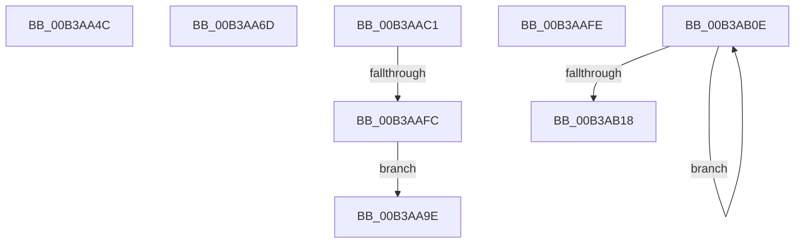

# sub_00B3AA4C

- RVA: `0x00B3AA4C`–`0x00B3AB31` (길이 `229` bytes)
- VA: `0x0000000140B3AA4C`
- 실행 섹션: `PAGE`
- PDB 이름 있음: `아니요`; PDB Function 태그: `아니요`
- unwind 정보 RVA: `0x000AEA18`
- 디코드: `54`개 명령, `229/229` bytes 표시
- 미해석 바이트: `0` (있으면 어셈블리에 `.byte`로 보존)

> 이 문서는 커널 이미지의 기계어와 PDB 기호를 분석해 생성했습니다. 4번과 5번은 함수 원형과 자료형을 바이너리 사용 방식에서 추정한 C 해석이며 원본 소스 복구 결과는 아닙니다.

## 1. Dependencies

- 직접 호출 지점: **6**; 고유 호출 대상: **4**
- 직접 호출자로 확인된 함수: **0**
- RIP 상대 이미지 참조: **5**

### Outgoing calls
- `0x00B3AA62` → [BiLogMessage](../A3/BiLogMessage_function_00A3D3A8.md) (function, `0x00A3D3A8`)
- `0x00B3AA93` → [BiLogMessage](../A3/BiLogMessage_function_00A3D3A8.md) (function, `0x00A3D3A8`)
- `0x00B3AAB6` → [BiLogMessage](../A3/BiLogMessage_function_00A3D3A8.md) (function, `0x00A3D3A8`)
- `0x00B3AAC5` → [BiCloseKey](../91/BiCloseKey_function_00916A00.md) (function, `0x00916A00`)
- `0x00B3AAED` → [BiCreateKey](../A4/BiCreateKey_function_00A404DC.md) (function, `0x00A404DC`)
- `0x00B3AB26` → [BiUnloadHiveByName](../A4/BiUnloadHiveByName_function_00A410F4.md) (function, `0x00A410F4`)

### Direct callers
- 이 함수 시작 RVA로 연결되는 직접 call은 확인되지 않았습니다. 간접 호출은 완전히 역산할 수 없습니다.

### Static image references
- `0x00B3AA56` → RVA `0x00B0A450` (` ?? ::NNGAKEGL::`string'`; read)
- `0x00B3AA84` → RVA `0x00B0A3E0` (` ?? ::NNGAKEGL::`string'`; read)
- `0x00B3AA9E` → RVA `0x00B0A5F0` (` ?? ::NNGAKEGL::`string'`; read)
- `0x00B3AAD7` → RVA `0x00AFF1D0` (` ?? ::NNGAKEGL::`string'`; read)
- `0x00B3AB02` → RVA `0x00B0A700` (` ?? ::NNGAKEGL::`string'`; read)

## 2. Other-region calls and transfers

- 다른 실행 섹션으로 향하는 call: **0**
- call이 아닌 외부 분기/꼬리 이동: **6**
  - `0x00B3AA68` → [BiAddStoreFromFile + 0x23B](../A4/BiAddStoreFromFile_function_00A40C54.md) (`tail-transfer`)
  - `0x00B3AA99` → [BiAddStoreFromFile + 0x23B](../A4/BiAddStoreFromFile_function_00A40C54.md) (`tail-transfer`)
  - `0x00B3AABC` → [BiAddStoreFromFile + 0x129](../A4/BiAddStoreFromFile_function_00A40C54.md) (`tail-transfer`)
  - `0x00B3AAF6` → [BiAddStoreFromFile + 0xA8](../A4/BiAddStoreFromFile_function_00A40C54.md) (`tail-transfer`)
  - `0x00B3AB09` → [BiAddStoreFromFile + 0x113](../A4/BiAddStoreFromFile_function_00A40C54.md) (`tail-transfer`)
  - `0x00B3AB2C` → [BiAddStoreFromFile + 0x13E](../A4/BiAddStoreFromFile_function_00A40C54.md) (`tail-transfer`)

## 3. Assembly (complete function range)

```asm
00B3AA4C  4C 8D 47 0C                     lea r8, [rdi + 0xc]
00B3AA50  41 B9 22 00 00 C0               mov r9d, 0xc0000022
00B3AA56  48 8D 15 F3 F9 FC FF            lea rdx, [rip - 0x3060d]
00B3AA5D  B9 04 00 00 00                  mov ecx, 4
00B3AA62  E8 41 29 F0 FF                  call 0x140a3d3a8
00B3AA67  90                              nop
00B3AA68  E9 22 64 F0 FF                  jmp 0x140a40e8f
00B3AA6D  B8 02 00 00 00                  mov eax, 2
00B3AA72  89 5C 24 20                     mov dword ptr [rsp + 0x20], ebx
00B3AA76  81 FB 0F 00 00 C0               cmp ebx, 0xc000000f
00B3AA7C  4C 8D 4F 0C                     lea r9, [rdi + 0xc]
00B3AA80  4C 8D 45 D8                     lea r8, [rbp - 0x28]
00B3AA84  48 8D 15 55 F9 FC FF            lea rdx, [rip - 0x306ab]
00B3AA8B  8D 48 02                        lea ecx, [rax + 2]
00B3AA8E  0F 45 C1                        cmovne eax, ecx
00B3AA91  8B C8                           mov ecx, eax
00B3AA93  E8 10 29 F0 FF                  call 0x140a3d3a8
00B3AA98  90                              nop
00B3AA99  E9 F1 63 F0 FF                  jmp 0x140a40e8f
00B3AA9E  48 8D 15 4B FB FC FF            lea rdx, [rip - 0x304b5]
00B3AAA5  4C 8D 4D D8                     lea r9, [rbp - 0x28]
00B3AAA9  89 44 24 20                     mov dword ptr [rsp + 0x20], eax
00B3AAAD  4C 8D 47 0C                     lea r8, [rdi + 0xc]
00B3AAB1  B9 04 00 00 00                  mov ecx, 4
00B3AAB6  E8 ED 28 F0 FF                  call 0x140a3d3a8
00B3AABB  90                              nop
00B3AABC  E9 BC 62 F0 FF                  jmp 0x140a40d7d
00B3AAC1  48 8B 4D C8                     mov rcx, qword ptr [rbp - 0x38]
00B3AAC5  E8 36 BF DD FF                  call 0x140916a00
00B3AACA  48 8B 4D C0                     mov rcx, qword ptr [rbp - 0x40]
00B3AACE  48 8D 45 C8                     lea rax, [rbp - 0x38]
00B3AAD2  4C 89 6C 24 28                  mov qword ptr [rsp + 0x28], r13
00B3AAD7  48 8D 15 F2 46 FC FF            lea rdx, [rip - 0x3b90e]
00B3AADE  45 33 C9                        xor r9d, r9d
00B3AAE1  48 89 44 24 20                  mov qword ptr [rsp + 0x20], rax
00B3AAE6  44 8B C6                        mov r8d, esi
00B3AAE9  4C 89 6D C8                     mov qword ptr [rbp - 0x38], r13
00B3AAED  E8 EA 59 F0 FF                  call 0x140a404dc
00B3AAF2  8B D8                           mov ebx, eax
00B3AAF4  85 C0                           test eax, eax
00B3AAF6  0F 89 00 62 F0 FF               jns 0x140a40cfc
00B3AAFC  EB A0                           jmp 0x140b3aa9e
00B3AAFE  89 5C 24 20                     mov dword ptr [rsp + 0x20], ebx
00B3AB02  48 8D 15 F7 FB FC FF            lea rdx, [rip - 0x30409]
00B3AB09  E9 59 62 F0 FF                  jmp 0x140a40d67
00B3AB0E  48 FF C2                        inc rdx
00B3AB11  66 44 39 2C 50                  cmp word ptr [rax + rdx*2], r13w
00B3AB16  75 F6                           jne 0x140b3ab0e
00B3AB18  8D 14 55 02 00 00 00            lea edx, [rdx*2 + 2]
00B3AB1F  45 33 C0                        xor r8d, r8d
00B3AB22  48 8D 4D D8                     lea rcx, [rbp - 0x28]
00B3AB26  E8 C9 65 F0 FF                  call 0x140a410f4
00B3AB2B  90                              nop
00B3AB2C  E9 61 62 F0 FF                  jmp 0x140a40d92
```

## 4. C-style interpretation (structured pseudocode)

```c
__int64 __fastcall sub_00B3AA4C(void)
{
    __int64 result;
    unsigned int v_stack_p20;
    unsigned __int64 v_stack_p28;

    result = BiLogMessage(4, v_rip - 198157, v_rdi + 12, (unsigned int)(0xC0000022ULL));
}
```

## 5. (Beta) C Style

```c
void sub_00B3AA4C(void)
{
    int64_t result;
    uint32_t v_stack_p20;
    uint64_t v_stack_p28;

    result = BiLogMessage(4, v_rip - 198157, local_rdi + 12, (uint32_t)(0xC0000022ULL));
}
```

## 6. Execution-region graph

[열기: 2D/3D 그래프와 함수 탐색 컨트롤 패널](../../../control-panel.html?section=page&rva=0x00B3AA4C&view=graph)

- 2D 그래프는 위에서 아래로 흐르고, 3D 그래프는 빈 공간을 드래그해 회전합니다. Shift+드래그는 이동, 휠은 확대·축소, 함수 노드 선택은 대상 보고서 이동입니다.

### Static fallback


