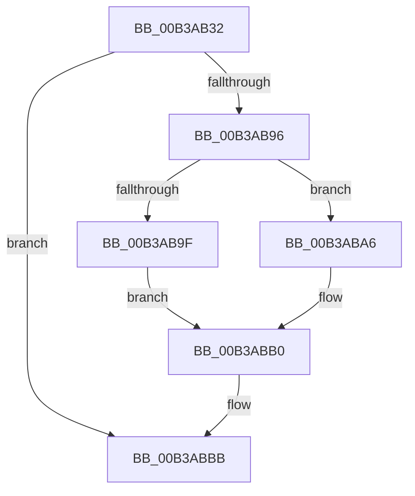

# sub_00B3AB32

- RVA: `0x00B3AB32`–`0x00B3ABCE` (길이 `156` bytes)
- VA: `0x0000000140B3AB32`
- 실행 섹션: `PAGE`
- PDB 이름 있음: `아니요`; PDB Function 태그: `아니요`
- unwind 정보 RVA: `0x000AEA54`
- 디코드: `38`개 명령, `156/156` bytes 표시
- 미해석 바이트: `0` (있으면 어셈블리에 `.byte`로 보존)

> 이 문서는 커널 이미지의 기계어와 PDB 기호를 분석해 생성했습니다. 4번과 5번은 함수 원형과 자료형을 바이너리 사용 방식에서 추정한 C 해석이며 원본 소스 복구 결과는 아닙니다.

## 1. Dependencies

- 직접 호출 지점: **7**; 고유 호출 대상: **7**
- 직접 호출자로 확인된 함수: **0**
- RIP 상대 이미지 참조: **2**

### Outgoing calls
- `0x00B3AB4E` → [swprintf_s](../../text/50/swprintf_s_function_00504B20.md) (function, `0x00504B20`)
- `0x00B3AB5A` → [RtlInitUnicodeString](../../text/42/RtlInitUnicodeString_function_0042A780.md) (function, `0x0042A780`)
- `0x00B3AB8B` → [BiAcquirePrivilege](../A3/BiAcquirePrivilege_function_00A3D658.md) (function, `0x00A3D658`)
- `0x00B3AB9F` → [ZwUnloadKey](../../text/6B/ZwUnloadKey_function_006B0C30.md) (function, `0x006B0C30`)
- `0x00B3ABAB` → [ZwUnloadKey2](../../text/6B/ZwUnloadKey2_function_006B0C50.md) (function, `0x006B0C50`)
- `0x00B3ABB6` → [BiReleasePrivilege](../A3/BiReleasePrivilege_function_00A3D600.md) (function, `0x00A3D600`)
- `0x00B3ABC3` → [ExFreePoolWithTag](../../poolcode/B8/ExFreePoolWithTag_function_00B82870.md) (function, `0x00B82870`)

### Direct callers
- 이 함수 시작 RVA로 연결되는 직접 call은 확인되지 않았습니다. 간접 호출은 완전히 역산할 수 없습니다.

### Static image references
- `0x00B3AB35` → RVA `0x00B0AC40` (` ?? ::NNGAKEGL::`string'`; read)
- `0x00B3AB44` → RVA `0x00AFD430` (` ?? ::NNGAKEGL::`string'`; read)

## 2. Other-region calls and transfers

- 다른 실행 섹션으로 향하는 call: **5**
  - `0x00B3AB4E` → [swprintf_s](../../text/50/swprintf_s_function_00504B20.md) (`PAGE` → `.text`)
  - `0x00B3AB5A` → [RtlInitUnicodeString](../../text/42/RtlInitUnicodeString_function_0042A780.md) (`PAGE` → `.text`)
  - `0x00B3AB9F` → [ZwUnloadKey](../../text/6B/ZwUnloadKey_function_006B0C30.md) (`PAGE` → `.text`)
  - `0x00B3ABAB` → [ZwUnloadKey2](../../text/6B/ZwUnloadKey2_function_006B0C50.md) (`PAGE` → `.text`)
  - `0x00B3ABC3` → [ExFreePoolWithTag](../../poolcode/B8/ExFreePoolWithTag_function_00B82870.md) (`PAGE` → `POOLCODE`)
- call이 아닌 외부 분기/꼬리 이동: **1**
  - `0x00B3ABC9` → [BiUnloadHiveByName + 0x59](../A4/BiUnloadHiveByName_function_00A410F4.md) (`tail-transfer`)

## 3. Assembly (complete function range)

```asm
00B3AB32  48 D1 EB                        shr rbx, 1
00B3AB35  4C 8D 0D 04 01 FD FF            lea r9, [rip - 0x2fefc]
00B3AB3C  48 8B D3                        mov rdx, rbx
00B3AB3F  4C 89 74 24 20                  mov qword ptr [rsp + 0x20], r14
00B3AB44  4C 8D 05 E5 28 FC FF            lea r8, [rip - 0x3d71b]
00B3AB4B  48 8B CF                        mov rcx, rdi
00B3AB4E  E8 CD 9F 9C FF                  call 0x140504b20
00B3AB53  48 8B D7                        mov rdx, rdi
00B3AB56  48 8D 4D C0                     lea rcx, [rbp - 0x40]
00B3AB5A  E8 21 FC 8E FF                  call 0x14042a780
00B3AB5F  48 83 65 D8 00                  and qword ptr [rbp - 0x28], 0
00B3AB64  48 8D 45 C0                     lea rax, [rbp - 0x40]
00B3AB68  0F 57 C0                        xorps xmm0, xmm0
00B3AB6B  48 89 45 E0                     mov qword ptr [rbp - 0x20], rax
00B3AB6F  48 8D 55 38                     lea rdx, [rbp + 0x38]
00B3AB73  C7 45 D0 30 00 00 00            mov dword ptr [rbp - 0x30], 0x30
00B3AB7A  B9 12 00 00 00                  mov ecx, 0x12
00B3AB7F  C7 45 E8 40 02 00 00            mov dword ptr [rbp - 0x18], 0x240
00B3AB86  F3 0F 7F 45 F0                  movdqu xmmword ptr [rbp - 0x10], xmm0
00B3AB8B  E8 C8 2A F0 FF                  call 0x140a3d658
00B3AB90  8B D8                           mov ebx, eax
00B3AB92  85 C0                           test eax, eax
00B3AB94  78 25                           js 0x140b3abbb
00B3AB96  48 8D 4D D0                     lea rcx, [rbp - 0x30]
00B3AB9A  40 84 F6                        test sil, sil
00B3AB9D  75 07                           jne 0x140b3aba6
00B3AB9F  E8 8C 60 B7 FF                  call 0x1406b0c30
00B3ABA4  EB 0A                           jmp 0x140b3abb0
00B3ABA6  BA 01 00 00 00                  mov edx, 1
00B3ABAB  E8 A0 60 B7 FF                  call 0x1406b0c50
00B3ABB0  48 8D 4D 38                     lea rcx, [rbp + 0x38]
00B3ABB4  8B D8                           mov ebx, eax
00B3ABB6  E8 45 2A F0 FF                  call 0x140a3d600
00B3ABBB  BA 42 43 44 4B                  mov edx, 0x4b444342
00B3ABC0  48 8B CF                        mov rcx, rdi
00B3ABC3  E8 A8 7C 04 00                  call 0x140b82870
00B3ABC8  90                              nop
00B3ABC9  E9 7F 65 F0 FF                  jmp 0x140a4114d
```

## 4. C-style interpretation (structured pseudocode)

```c
__int64 __fastcall sub_00B3AB32(void)
{
    __int64 result;
    __int64 v_rbx;
    unsigned __int64 v_stack_p20;

    v_rbx = (v_rbx) >> (1);
    v_stack_p20 = v_r14;
    result = swprintf_s(v_rdi, v_rbx, v_rip - 251675, v_rip - 196348);
    result = RtlInitUnicodeString(v_rbp - 64, v_rdi, v_rip - 251675, v_rip - 196348);
    *(unsigned __int64 *)(v_rbp - 32) = v_rbp - 64;
    *(unsigned int *)(v_rbp - 48) = 48;
    *(unsigned int *)(v_rbp - 24) = 576;
    *(unsigned __int64 *)(v_rbp - 16) = v_xmm0;
    result = BiAcquirePrivilege(18, v_rbp + 56, v_rip - 251675, v_rip - 196348);
    if (sign_flag) goto loc_00B3ABBB;
    if ((unsigned __int8)(v_rsi) != 0) goto loc_00B3ABA6;
    result = ZwUnloadKey(v_rbp - 48, v_rbp + 56, v_rip - 251675, v_rip - 196348);
    goto loc_00B3ABB0;
loc_00B3ABA6:
    result = ZwUnloadKey2(v_rbp - 48, 1, v_rip - 251675, v_rip - 196348);
loc_00B3ABB0:
    result = BiReleasePrivilege(v_rbp + 56, 1, v_rip - 251675, v_rip - 196348);
loc_00B3ABBB:
    result = ExFreePoolWithTag(v_rdi, (unsigned int)(0x4B444342ULL), v_rip - 251675, v_rip - 196348);
}
```

## 5. (Beta) C Style

```c
void sub_00B3AB32(void)
{
    int64_t result;
    int64_t local_rbx;
    uint64_t v_stack_p20;

    local_rbx = (local_rbx) >> (1);
    v_stack_p20 = local_r14;
    result = swprintf_s(local_rdi, local_rbx, v_rip - 251675, v_rip - 196348);
    result = RtlInitUnicodeString(local_rbp - 64, local_rdi, v_rip - 251675, v_rip - 196348);
    *(uint64_t *)(local_rbp - 0x20) = local_rbp - 64;
    *(uint32_t *)(local_rbp - 0x30) = 48;
    *(uint32_t *)(local_rbp - 0x18) = 576;
    *(uint64_t *)(local_rbp - 0x10) = v_xmm0;
    result = BiAcquirePrivilege(18, local_rbp + 56, v_rip - 251675, v_rip - 196348);
    if (sign_flag) goto loc_00B3ABBB;
    if ((uint8_t)(local_rsi) != 0) goto loc_00B3ABA6;
    result = ZwUnloadKey(local_rbp - 48, local_rbp + 56, v_rip - 251675, v_rip - 196348);
    goto loc_00B3ABB0;
loc_00B3ABA6:
    result = ZwUnloadKey2(local_rbp - 48, 1, v_rip - 251675, v_rip - 196348);
loc_00B3ABB0:
    result = BiReleasePrivilege(local_rbp + 56, 1, v_rip - 251675, v_rip - 196348);
loc_00B3ABBB:
    result = ExFreePoolWithTag(local_rdi, (uint32_t)(0x4B444342ULL), v_rip - 251675, v_rip - 196348);
}
```

## 6. Execution-region graph

[열기: 2D/3D 그래프와 함수 탐색 컨트롤 패널](../../../control-panel.html?section=page&rva=0x00B3AB32&view=graph)

- 2D 그래프는 위에서 아래로 흐르고, 3D 그래프는 빈 공간을 드래그해 회전합니다. Shift+드래그는 이동, 휠은 확대·축소, 함수 노드 선택은 대상 보고서 이동입니다.

### Static fallback


