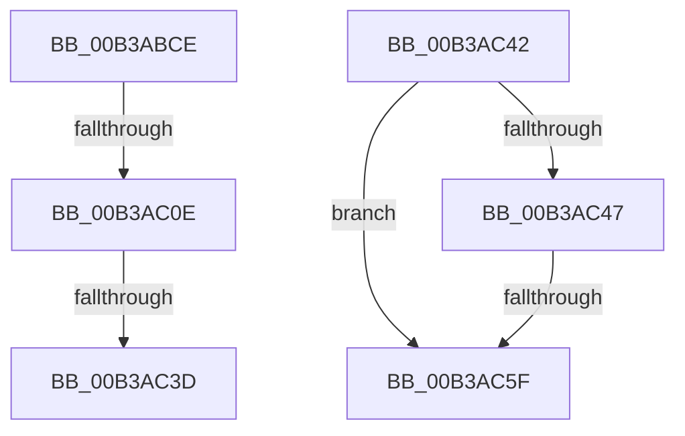

# sub_00B3ABCE

- RVA: `0x00B3ABCE`–`0x00B3AC67` (길이 `153` bytes)
- VA: `0x0000000140B3ABCE`
- 실행 섹션: `PAGE`
- PDB 이름 있음: `아니요`; PDB Function 태그: `아니요`
- unwind 정보 RVA: `0x000AEC38`
- 디코드: `37`개 명령, `153/153` bytes 표시
- 미해석 바이트: `0` (있으면 어셈블리에 `.byte`로 보존)

> 이 문서는 커널 이미지의 기계어와 PDB 기호를 분석해 생성했습니다. 4번과 5번은 함수 원형과 자료형을 바이너리 사용 방식에서 추정한 C 해석이며 원본 소스 복구 결과는 아닙니다.

## 1. Dependencies

- 직접 호출 지점: **5**; 고유 호출 대상: **5**
- 직접 호출자로 확인된 함수: **0**
- RIP 상대 이미지 참조: **0**

### Outgoing calls
- `0x00B3ABD6` → [PsReferencePrimaryTokenWithTag](../../text/20/PsReferencePrimaryTokenWithTag_function_0020FF80.md) (function, `0x0020FF80`)
- `0x00B3ABF0` → [SeQueryUserSidToken](../99/SeQueryUserSidToken_function_00990950.md) (function, `0x00990950`)
- `0x00B3ABFD` → [MiFindUserSidHotPatchContext](../80/MiFindUserSidHotPatchContext_function_0080360C.md) (function, `0x0080360C`)
- `0x00B3AC2B` → [MiFindHotPatchRecord](../A6/MiFindHotPatchRecord_function_00A6E618.md) (function, `0x00A6E618`)
- `0x00B3AC50` → [RtlDuplicateUnicodeString](../93/RtlDuplicateUnicodeString_function_009321F0.md) (function, `0x009321F0`)

### Direct callers
- 이 함수 시작 RVA로 연결되는 직접 call은 확인되지 않았습니다. 간접 호출은 완전히 역산할 수 없습니다.

### Static image references
- 디코드된 RIP-relative 메모리 참조가 없습니다.

## 2. Other-region calls and transfers

- 다른 실행 섹션으로 향하는 call: **1**
  - `0x00B3ABD6` → [PsReferencePrimaryTokenWithTag](../../text/20/PsReferencePrimaryTokenWithTag_function_0020FF80.md) (`PAGE` → `.text`)
- call이 아닌 외부 분기/꼬리 이동: **5**
  - `0x00B3AC08` → [MiFindProcessImageHotPatchRecord + 0xCA](../A4/MiFindProcessImageHotPatchRecord_function_00A4206C.md) (`tail-transfer`)
  - `0x00B3AC37` → [MiFindProcessImageHotPatchRecord + 0x124](../A4/MiFindProcessImageHotPatchRecord_function_00A4206C.md) (`tail-transfer`)
  - `0x00B3AC3D` → [MiFindProcessImageHotPatchRecord + 0xCA](../A4/MiFindProcessImageHotPatchRecord_function_00A4206C.md) (`tail-transfer`)
  - `0x00B3AC59` → [MiFindProcessImageHotPatchRecord + 0x124](../A4/MiFindProcessImageHotPatchRecord_function_00A4206C.md) (`tail-transfer`)
  - `0x00B3AC62` → [MiFindProcessImageHotPatchRecord + 0x124](../A4/MiFindProcessImageHotPatchRecord_function_00A4206C.md) (`tail-transfer`)

## 3. Assembly (complete function range)

```asm
00B3ABCE  BA 44 66 6C 74                  mov edx, 0x746c6644
00B3ABD3  49 8B CF                        mov rcx, r15
00B3ABD6  E8 A5 53 6D FF                  call 0x14020ff80
00B3ABDB  45 33 C9                        xor r9d, r9d
00B3ABDE  48 8D 94 24 90 00 00 00         lea rdx, [rsp + 0x90]
00B3ABE6  48 8B C8                        mov rcx, rax
00B3ABE9  48 8B E8                        mov rbp, rax
00B3ABEC  45 8D 41 44                     lea r8d, [r9 + 0x44]
00B3ABF0  E8 5B 5D E5 FF                  call 0x140990950
00B3ABF5  48 8D 8C 24 90 00 00 00         lea rcx, [rsp + 0x90]
00B3ABFD  E8 0A 8A CC FF                  call 0x14080360c
00B3AC02  45 33 FF                        xor r15d, r15d
00B3AC05  48 85 C0                        test rax, rax
00B3AC08  0F 84 28 75 F0 FF               je 0x140a42136
00B3AC0E  4C 89 74 24 30                  mov qword ptr [rsp + 0x30], r14
00B3AC13  48 8D 48 18                     lea rcx, [rax + 0x18]
00B3AC17  4C 89 7C 24 28                  mov qword ptr [rsp + 0x28], r15
00B3AC1C  41 8D 57 01                     lea edx, [r15 + 1]
00B3AC20  45 8B CC                        mov r9d, r12d
00B3AC23  66 89 74 24 20                  mov word ptr [rsp + 0x20], si
00B3AC28  45 8B C5                        mov r8d, r13d
00B3AC2B  E8 E8 39 F3 FF                  call 0x140a6e618
00B3AC30  8B D8                           mov ebx, eax
00B3AC32  3D 25 02 00 C0                  cmp eax, 0xc0000225
00B3AC37  0F 85 53 75 F0 FF               jne 0x140a42190
00B3AC3D  E9 F4 74 F0 FF                  jmp 0x140a42136
00B3AC42  4D 85 F6                        test r14, r14
00B3AC45  74 18                           je 0x140b3ac5f
00B3AC47  48 8D 53 28                     lea rdx, [rbx + 0x28]
00B3AC4B  4D 8B C6                        mov r8, r14
00B3AC4E  33 C9                           xor ecx, ecx
00B3AC50  E8 9B 75 DF FF                  call 0x1409321f0
00B3AC55  8B D8                           mov ebx, eax
00B3AC57  85 C0                           test eax, eax
00B3AC59  0F 88 31 75 F0 FF               js 0x140a42190
00B3AC5F  41 8B DF                        mov ebx, r15d
00B3AC62  E9 29 75 F0 FF                  jmp 0x140a42190
```

## 4. C-style interpretation (structured pseudocode)

```c
__int64 __fastcall sub_00B3ABCE(__int64 a1, __int64 a2, __int64 a3, int a4, __int64 a5, __int64 a6, __int64 a7, __int64 a8, __int64 a9, __int64 a10, __int64 a11, __int64 a12, __int64 a13, __int64 a14, __int64 a15, __int64 a16, __int64 a17, __int64 a18)
{
    __int64 result;
    __int64 v_r15;
    unsigned __int16 v_stack_p20;
    unsigned __int64 v_stack_p28;
    unsigned __int64 v_stack_p30;

    result = PsReferencePrimaryTokenWithTag(v_r15, (unsigned int)(0x746C6644ULL), a3, a4);
    a4 = 0;
    result = SeQueryUserSidToken(result, a18, a4 + 68, a4);
    result = MiFindUserSidHotPatchContext(a18, a18, a4 + 68, a4);
    v_r15 = 0;
    v_stack_p30 = v_r14;
    v_stack_p28 = 0;
    v_stack_p20 = (unsigned __int16)(v_rsi);
    result = MiFindHotPatchRecord(result + 24, v_r15 + 1, (unsigned int)((unsigned int)(v_r13)), (unsigned int)((unsigned int)(v_r12)));
}
```

## 5. (Beta) C Style

```c
int64_t sub_00B3ABCE(int64_t Arg1, int64_t Arg2, int64_t Arg3, int32_t Arg4, uint64_t Arg5, uint64_t Arg6, uint64_t Arg7, uint64_t Arg8, uint64_t Arg9, uint64_t Arg10, uint64_t Arg11, uint64_t Arg12, uint64_t Arg13, uint64_t Arg14, uint64_t Arg15, uint64_t Arg16, uint64_t Arg17, int64_t Arg18)
{
    int64_t result;
    int64_t local_r15;
    uint16_t v_stack_p20;
    uint64_t v_stack_p28;
    uint64_t v_stack_p30;

    result = PsReferencePrimaryTokenWithTag(local_r15, (uint32_t)(0x746C6644ULL), Arg3, Arg4);
    Arg4 = 0;
    result = SeQueryUserSidToken(result, Arg18, Arg4 + 68, Arg4);
    result = MiFindUserSidHotPatchContext(Arg18, Arg18, Arg4 + 68, Arg4);
    local_r15 = 0;
    v_stack_p30 = local_r14;
    v_stack_p28 = 0;
    v_stack_p20 = (uint16_t)(local_rsi);
    result = MiFindHotPatchRecord(result + 24, local_r15 + 1, (uint32_t)((uint32_t)(local_r13)), (uint32_t)((uint32_t)(local_r12)));
}
```

## 6. Execution-region graph

[열기: 2D/3D 그래프와 함수 탐색 컨트롤 패널](../../../control-panel.html?section=page&rva=0x00B3ABCE&view=graph)

- 2D 그래프는 위에서 아래로 흐르고, 3D 그래프는 빈 공간을 드래그해 회전합니다. Shift+드래그는 이동, 휠은 확대·축소, 함수 노드 선택은 대상 보고서 이동입니다.

### Static fallback


