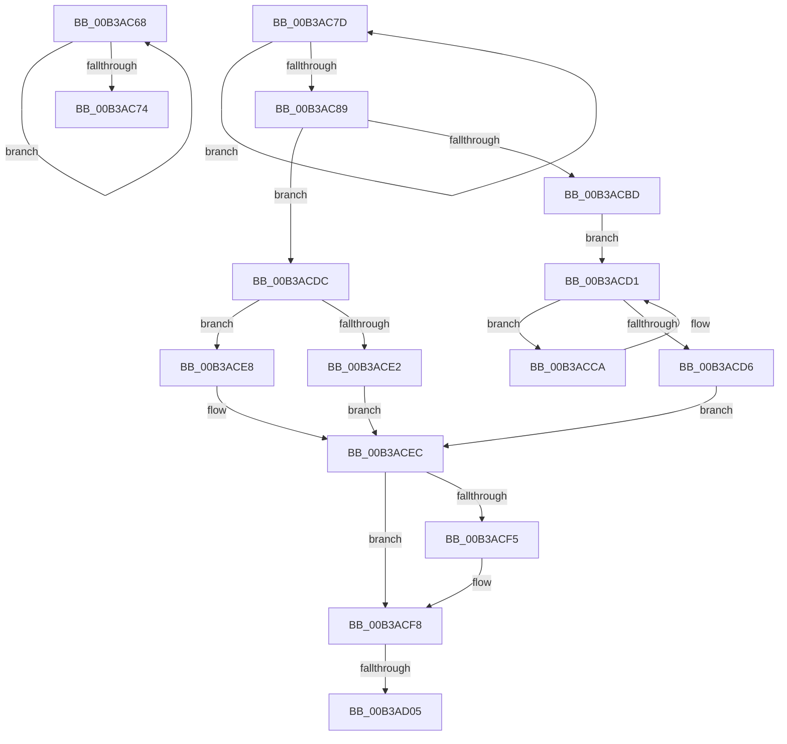

# sub_00B3AC68

- RVA: `0x00B3AC68`–`0x00B3AD0D` (길이 `165` bytes)
- VA: `0x0000000140B3AC68`
- 실행 섹션: `PAGE`
- PDB 이름 있음: `아니요`; PDB Function 태그: `아니요`
- unwind 정보 RVA: `0x000AEF68`
- 디코드: `48`개 명령, `165/165` bytes 표시
- 미해석 바이트: `0` (있으면 어셈블리에 `.byte`로 보존)

> 이 문서는 커널 이미지의 기계어와 PDB 기호를 분석해 생성했습니다. 4번과 5번은 함수 원형과 자료형을 바이너리 사용 방식에서 추정한 C 해석이며 원본 소스 복구 결과는 아닙니다.

## 1. Dependencies

- 직접 호출 지점: **0**; 고유 호출 대상: **0**
- 직접 호출자로 확인된 함수: **0**
- RIP 상대 이미지 참조: **0**

### Outgoing calls
- 직접 디코드된 call 명령이 없습니다.

### Direct callers
- 이 함수 시작 RVA로 연결되는 직접 call은 확인되지 않았습니다. 간접 호출은 완전히 역산할 수 없습니다.

### Static image references
- 디코드된 RIP-relative 메모리 참조가 없습니다.

## 2. Other-region calls and transfers

- 다른 실행 섹션으로 향하는 call: **0**
- call이 아닌 외부 분기/꼬리 이동: **3**
  - `0x00B3AC78` → [RtlRemoveUnicodePrefix + 0x61](../A4/RtlRemoveUnicodePrefix_function_00A431B0.md) (`tail-transfer`)
  - `0x00B3ACFF` → [RtlRemoveUnicodePrefix + 0x61](../A4/RtlRemoveUnicodePrefix_function_00A431B0.md) (`tail-transfer`)
  - `0x00B3AD08` → [RtlRemoveUnicodePrefix + 0x61](../A4/RtlRemoveUnicodePrefix_function_00A431B0.md) (`tail-transfer`)

## 3. Assembly (complete function range)

```asm
00B3AC68  48 8B C1                        mov rax, rcx
00B3AC6B  48 8B 49 10                     mov rcx, qword ptr [rcx + 0x10]
00B3AC6F  48 3B CA                        cmp rcx, rdx
00B3AC72  75 F4                           jne 0x140b3ac68
00B3AC74  4C 89 40 10                     mov qword ptr [rax + 0x10], r8
00B3AC78  E9 94 85 F0 FF                  jmp 0x140a43211
00B3AC7D  48 8B C8                        mov rcx, rax
00B3AC80  48 8B 40 10                     mov rax, qword ptr [rax + 0x10]
00B3AC84  48 3B C2                        cmp rax, rdx
00B3AC87  75 F4                           jne 0x140b3ac7d
00B3AC89  4C 89 41 10                     mov qword ptr [rcx + 0x10], r8
00B3AC8D  4C 8D 4A 18                     lea r9, [rdx + 0x18]
00B3AC91  0F B7 02                        movzx eax, word ptr [rdx]
00B3AC94  66 89 01                        mov word ptr [rcx], ax
00B3AC97  48 8B 42 08                     mov rax, qword ptr [rdx + 8]
00B3AC9B  48 89 41 08                     mov qword ptr [rcx + 8], rax
00B3AC9F  48 8D 41 18                     lea rax, [rcx + 0x18]
00B3ACA3  41 0F 10 01                     movups xmm0, xmmword ptr [r9]
00B3ACA7  0F 11 00                        movups xmmword ptr [rax], xmm0
00B3ACAA  F2 41 0F 10 49 10               movsd xmm1, qword ptr [r9 + 0x10]
00B3ACB0  F2 0F 11 48 10                  movsd qword ptr [rax + 0x10], xmm1
00B3ACB5  4D 8B 01                        mov r8, qword ptr [r9]
00B3ACB8  4D 3B C1                        cmp r8, r9
00B3ACBB  75 1F                           jne 0x140b3acdc
00B3ACBD  48 89 00                        mov qword ptr [rax], rax
00B3ACC0  4C 8B 42 08                     mov r8, qword ptr [rdx + 8]
00B3ACC4  4D 8B 48 08                     mov r9, qword ptr [r8 + 8]
00B3ACC8  EB 07                           jmp 0x140b3acd1
00B3ACCA  4D 8B C1                        mov r8, r9
00B3ACCD  4D 8B 49 08                     mov r9, qword ptr [r9 + 8]
00B3ACD1  4C 3B CA                        cmp r9, rdx
00B3ACD4  75 F4                           jne 0x140b3acca
00B3ACD6  49 89 48 08                     mov qword ptr [r8 + 8], rcx
00B3ACDA  EB 10                           jmp 0x140b3acec
00B3ACDC  4D 39 48 08                     cmp qword ptr [r8 + 8], r9
00B3ACE0  75 06                           jne 0x140b3ace8
00B3ACE2  49 89 40 08                     mov qword ptr [r8 + 8], rax
00B3ACE6  EB 04                           jmp 0x140b3acec
00B3ACE8  49 89 40 10                     mov qword ptr [r8 + 0x10], rax
00B3ACEC  48 8B 51 20                     mov rdx, qword ptr [rcx + 0x20]
00B3ACF0  48 85 D2                        test rdx, rdx
00B3ACF3  74 03                           je 0x140b3acf8
00B3ACF5  48 89 02                        mov qword ptr [rdx], rax
00B3ACF8  48 8B 51 28                     mov rdx, qword ptr [rcx + 0x28]
00B3ACFC  48 85 D2                        test rdx, rdx
00B3ACFF  0F 84 0C 85 F0 FF               je 0x140a43211
00B3AD05  48 89 02                        mov qword ptr [rdx], rax
00B3AD08  E9 04 85 F0 FF                  jmp 0x140a43211
```

## 4. C-style interpretation (structured pseudocode)

```c
__int64 __fastcall sub_00B3AC68(__int64 a1, __int64 a2, __int64 a3)
{
    if ((*(unsigned __int64 *)(a1 + 16)) != a2) goto loc_00B3AC68;
    *(unsigned __int64 *)(a1 + 16) = a3;
}
```

## 5. (Beta) C Style

```c
int64_t sub_00B3AC68(int64_t Arg1, int64_t Arg2, int64_t Arg3)
{
    if ((*(uint64_t *)(Arg1 + 0x10)) != Arg2) goto loc_00B3AC68;
    *(uint64_t *)(Arg1 + 0x10) = Arg3;
}
```

## 6. Execution-region graph

[열기: 2D/3D 그래프와 함수 탐색 컨트롤 패널](../../../control-panel.html?section=page&rva=0x00B3AC68&view=graph)

- 2D 그래프는 위에서 아래로 흐르고, 3D 그래프는 빈 공간을 드래그해 회전합니다. Shift+드래그는 이동, 휠은 확대·축소, 함수 노드 선택은 대상 보고서 이동입니다.

### Static fallback


