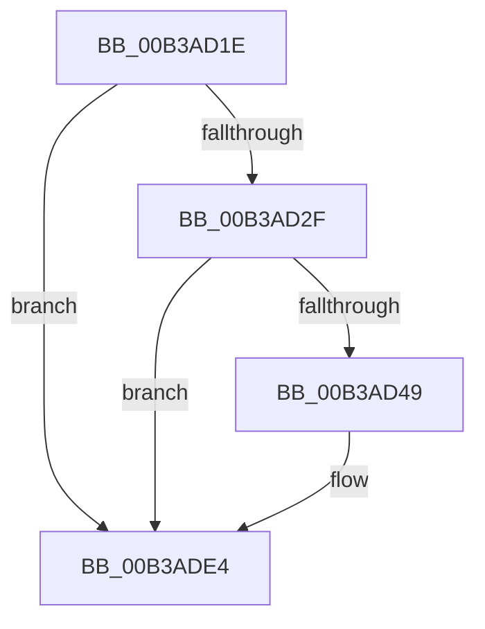

# sub_00B3AD1E

- RVA: `0x00B3AD1E`–`0x00B3ADEC` (길이 `206` bytes)
- VA: `0x0000000140B3AD1E`
- 실행 섹션: `PAGE`
- PDB 이름 있음: `아니요`; PDB Function 태그: `아니요`
- unwind 정보 RVA: `0x000AF0E8`
- 디코드: `44`개 명령, `206/206` bytes 표시
- 미해석 바이트: `0` (있으면 어셈블리에 `.byte`로 보존)

> 이 문서는 커널 이미지의 기계어와 PDB 기호를 분석해 생성했습니다. 4번과 5번은 함수 원형과 자료형을 바이너리 사용 방식에서 추정한 C 해석이며 원본 소스 복구 결과는 아닙니다.

## 1. Dependencies

- 직접 호출 지점: **2**; 고유 호출 대상: **2**
- 직접 호출자로 확인된 함수: **0**
- RIP 상대 이미지 참조: **2**

### Outgoing calls
- `0x00B3AD3C` → [tlgKeywordOn](../../text/42/tlgKeywordOn_function_0042EAA0.md) (function, `0x0042EAA0`)
- `0x00B3ADDF` → [tlgWriteAgg](../../text/2F/tlgWriteAgg_function_002F0F7C.md) (function, `0x002F0F7C`)

### Direct callers
- 이 함수 시작 RVA로 연결되는 직접 call은 확인되지 않았습니다. 간접 호출은 완전히 역산할 수 없습니다.

### Static image references
- `0x00B3AD1E` → RVA `0x00E37618` (`.data`; read)
- `0x00B3AD5F` → RVA `0x0005A091` (`.rdata`; read)

## 2. Other-region calls and transfers

- 다른 실행 섹션으로 향하는 call: **2**
  - `0x00B3AD3C` → [tlgKeywordOn](../../text/42/tlgKeywordOn_function_0042EAA0.md) (`PAGE` → `.text`)
  - `0x00B3ADDF` → [tlgWriteAgg](../../text/2F/tlgWriteAgg_function_002F0F7C.md) (`PAGE` → `.text`)
- call이 아닌 외부 분기/꼬리 이동: **1**
  - `0x00B3ADE7` → [MiLogPinDriverAddressesWorker + 0x77](../A4/MiLogPinDriverAddressesWorker_function_00A441B0.md) (`tail-transfer`)

## 3. Assembly (complete function range)

```asm
00B3AD1E  4C 8B 05 F3 C8 2F 00            mov r8, qword ptr [rip + 0x2fc8f3]
00B3AD25  41 83 38 05                     cmp dword ptr [r8], 5
00B3AD29  0F 86 B5 00 00 00               jbe 0x140b3ade4
00B3AD2F  48 BA 00 00 00 00 00 40 00 00   movabs rdx, 0x400000000000
00B3AD39  49 8B C8                        mov rcx, r8
00B3AD3C  E8 5F 3D 8F FF                  call 0x14042eaa0
00B3AD41  84 C0                           test al, al
00B3AD43  0F 84 9B 00 00 00               je 0x140b3ade4
00B3AD49  41 8B C4                        mov eax, r12d
00B3AD4C  48 C7 45 EF 08 00 00 00         mov qword ptr [rbp - 0x11], 8
00B3AD54  41 2B C1                        sub eax, r9d
00B3AD57  44 89 75 9F                     mov dword ptr [rbp - 0x61], r14d
00B3AD5B  48 89 45 AF                     mov qword ptr [rbp - 0x51], rax
00B3AD5F  48 8D 15 2B F3 51 FF            lea rdx, [rip - 0xae0cd5]
00B3AD66  41 83 FF 01                     cmp r15d, 1
00B3AD6A  48 C7 45 FF 04 00 00 00         mov qword ptr [rbp - 1], 4
00B3AD72  48 8D 45 AF                     lea rax, [rbp - 0x51]
00B3AD76  48 C7 45 0F 04 00 00 00         mov qword ptr [rbp + 0xf], 4
00B3AD7E  48 89 45 E7                     mov qword ptr [rbp - 0x19], rax
00B3AD82  41 B9 07 00 00 00               mov r9d, 7
00B3AD88  48 8D 45 9F                     lea rax, [rbp - 0x61]
00B3AD8C  48 C7 45 1F 04 00 00 00         mov qword ptr [rbp + 0x1f], 4
00B3AD94  48 89 45 F7                     mov qword ptr [rbp - 9], rax
00B3AD98  49 8B C8                        mov rcx, r8
00B3AD9B  8B C3                           mov eax, ebx
00B3AD9D  48 C7 45 B7 00 00 00 01         mov qword ptr [rbp - 0x49], 0x1000000
00B3ADA5  0F 94 C0                        sete al
00B3ADA8  48 C7 45 2F 08 00 00 00         mov qword ptr [rbp + 0x2f], 8
00B3ADB0  89 45 A3                        mov dword ptr [rbp - 0x5d], eax
00B3ADB3  83 FE 01                        cmp esi, 1
00B3ADB6  48 8D 45 A3                     lea rax, [rbp - 0x5d]
00B3ADBA  48 89 45 07                     mov qword ptr [rbp + 7], rax
00B3ADBE  8B C3                           mov eax, ebx
00B3ADC0  0F 94 C0                        sete al
00B3ADC3  89 45 A7                        mov dword ptr [rbp - 0x59], eax
00B3ADC6  48 8D 45 A7                     lea rax, [rbp - 0x59]
00B3ADCA  48 89 45 17                     mov qword ptr [rbp + 0x17], rax
00B3ADCE  48 8D 45 B7                     lea rax, [rbp - 0x49]
00B3ADD2  48 89 45 27                     mov qword ptr [rbp + 0x27], rax
00B3ADD6  48 8D 45 C7                     lea rax, [rbp - 0x39]
00B3ADDA  48 89 44 24 20                  mov qword ptr [rsp + 0x20], rax
00B3ADDF  E8 98 61 7B FF                  call 0x1402f0f7c
00B3ADE4  44 89 27                        mov dword ptr [rdi], r12d
00B3ADE7  E9 3B 94 F0 FF                  jmp 0x140a44227
```

## 4. C-style interpretation (structured pseudocode)

```c
__int64 __fastcall sub_00B3AD1E(__int64 a1, __int64 a2, __int64 a3, int a4)
{
    __int64 result;
    unsigned __int64 v_stack_p20;

    if ((*(unsigned int *)(*(unsigned __int64 *)(v_rip + 3131635))) <= 5) goto loc_00B3ADE4;
    result = tlgKeywordOn(*(unsigned __int64 *)(v_rip + 3131635), a2, *(unsigned __int64 *)(v_rip + 3131635), a4);
    if ((unsigned __int8)(result) != 0) {
        result = (unsigned int)(v_r12);
        *(unsigned __int64 *)(v_rbp - 17) = 8;
        result = (unsigned int)((result) - (a4));
        *(unsigned int *)(v_rbp - 97) = (unsigned int)(v_r14);
        *(unsigned __int64 *)(v_rbp - 81) = result;
        a2 = v_rip - 11406549;
        *(unsigned __int64 *)(v_rbp - 1) = 4;
        result = v_rbp - 81;
        *(unsigned __int64 *)(v_rbp + 15) = 4;
        *(unsigned __int64 *)(v_rbp - 25) = result;
        a4 = 7;
        result = v_rbp - 97;
        *(unsigned __int64 *)(v_rbp + 31) = 4;
        *(unsigned __int64 *)(v_rbp - 9) = result;
        a1 = *(unsigned __int64 *)(v_rip + 3131635);
        result = (unsigned int)(v_rbx);
        *(unsigned __int64 *)(v_rbp - 73) = 0x1000000ULL;
        result = (((unsigned int)(v_r15)) == 1) ? 1 : 0;
        *(unsigned __int64 *)(v_rbp + 47) = 8;
        *(unsigned int *)(v_rbp - 93) = (unsigned int)(result);
        result = v_rbp - 93;
        *(unsigned __int64 *)(v_rbp + 7) = result;
        result = (unsigned int)(v_rbx);
        result = (((unsigned int)(v_rsi)) == 1) ? 1 : 0;
        *(unsigned int *)(v_rbp - 89) = (unsigned int)(result);
        result = v_rbp - 89;
        *(unsigned __int64 *)(v_rbp + 23) = result;
        result = v_rbp - 73;
        *(unsigned __int64 *)(v_rbp + 39) = result;
        result = v_rbp - 57;
        v_stack_p20 = result;
        result = tlgWriteAgg(a1, a2, *(unsigned __int64 *)(v_rip + 3131635), a4);
    }
    *(unsigned int *)(v_rdi) = (unsigned int)(v_r12);
}
```

## 5. (Beta) C Style

```c
int64_t sub_00B3AD1E(int64_t Arg1, int64_t Arg2, int64_t Arg3, int32_t Arg4)
{
    int64_t result;
    uint64_t v_stack_p20;

    if ((*(uint32_t *)(*(uint64_t *)(v_rip + 0x2FC8F3))) <= 5) goto loc_00B3ADE4;
    result = tlgKeywordOn(*(uint64_t *)(v_rip + 0x2FC8F3), Arg2, *(uint64_t *)(v_rip + 0x2FC8F3), Arg4);
    if ((uint8_t)(result) != 0) {
        result = (uint32_t)(local_r12);
        *(uint64_t *)(local_rbp - 0x11) = 8;
        result = (uint32_t)((result) - (Arg4));
        *(uint32_t *)(local_rbp - 0x61) = (uint32_t)(local_r14);
        *(uint64_t *)(local_rbp - 0x51) = result;
        Arg2 = v_rip - 11406549;
        *(uint64_t *)(local_rbp - 0x1) = 4;
        result = local_rbp - 81;
        *(uint64_t *)(local_rbp + 0xF) = 4;
        *(uint64_t *)(local_rbp - 0x19) = result;
        Arg4 = 7;
        result = local_rbp - 97;
        *(uint64_t *)(local_rbp + 0x1F) = 4;
        *(uint64_t *)(local_rbp - 0x9) = result;
        Arg1 = *(uint64_t *)(v_rip + 0x2FC8F3);
        result = (uint32_t)(local_rbx);
        *(uint64_t *)(local_rbp - 0x49) = 0x1000000ULL;
        result = (((uint32_t)(local_r15)) == 1) ? 1 : 0;
        *(uint64_t *)(local_rbp + 0x2F) = 8;
        *(uint32_t *)(local_rbp - 0x5D) = (uint32_t)(result);
        result = local_rbp - 93;
        *(uint64_t *)(local_rbp + 0x7) = result;
        result = (uint32_t)(local_rbx);
        result = (((uint32_t)(local_rsi)) == 1) ? 1 : 0;
        *(uint32_t *)(local_rbp - 0x59) = (uint32_t)(result);
        result = local_rbp - 89;
        *(uint64_t *)(local_rbp + 0x17) = result;
        result = local_rbp - 73;
        *(uint64_t *)(local_rbp + 0x27) = result;
        result = local_rbp - 57;
        v_stack_p20 = result;
        result = tlgWriteAgg(Arg1, Arg2, *(uint64_t *)(v_rip + 0x2FC8F3), Arg4);
    }
    *(uint32_t *)(local_rdi) = (uint32_t)(local_r12);
}
```

## 6. Execution-region graph

[열기: 2D/3D 그래프와 함수 탐색 컨트롤 패널](../../../control-panel.html?section=page&rva=0x00B3AD1E&view=graph)

- 2D 그래프는 위에서 아래로 흐르고, 3D 그래프는 빈 공간을 드래그해 회전합니다. Shift+드래그는 이동, 휠은 확대·축소, 함수 노드 선택은 대상 보고서 이동입니다.

### Static fallback


