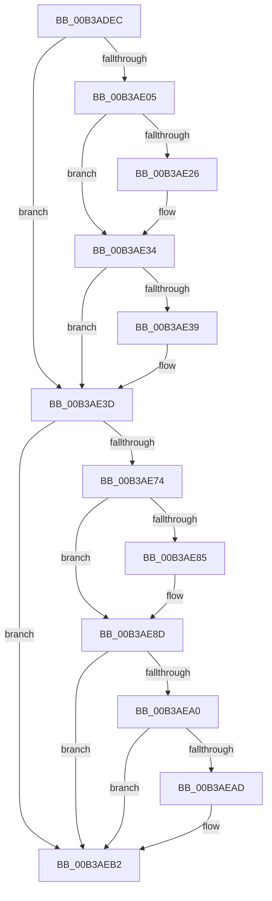

# sub_00B3ADEC

- RVA: `0x00B3ADEC`–`0x00B3AEBA` (길이 `206` bytes)
- VA: `0x0000000140B3ADEC`
- 실행 섹션: `PAGE`
- PDB 이름 있음: `아니요`; PDB Function 태그: `아니요`
- unwind 정보 RVA: `0x000AF1D4`
- 디코드: `54`개 명령, `206/206` bytes 표시
- 미해석 바이트: `0` (있으면 어셈블리에 `.byte`로 보존)

> 이 문서는 커널 이미지의 기계어와 PDB 기호를 분석해 생성했습니다. 4번과 5번은 함수 원형과 자료형을 바이너리 사용 방식에서 추정한 C 해석이며 원본 소스 복구 결과는 아닙니다.

## 1. Dependencies

- 직접 호출 지점: **8**; 고유 호출 대상: **8**
- 직접 호출자로 확인된 함수: **0**
- RIP 상대 이미지 참조: **3**

### Outgoing calls
- `0x00B3AE15` → [KeAbPreAcquire](../../text/21/KeAbPreAcquire_function_00210230.md) (function, `0x00210230`)
- `0x00B3AE2F` → [ExfAcquirePushLockExclusiveEx](../../text/20/ExfAcquirePushLockExclusiveEx_function_0020FC90.md) (function, `0x0020FC90`)
- `0x00B3AE4D` → [RtlCopyBitMapEx](../../text/41/RtlCopyBitMapEx_function_0041DEF0.md) (function, `0x0041DEF0`)
- `0x00B3AE59` → [RtlMergeBitMapsEx](../../text/5E/RtlMergeBitMapsEx_function_005E62F0.md) (function, `0x005E62F0`)
- `0x00B3AE67` → [RtlFindClearBitsEx](../../text/3F/RtlFindClearBitsEx_function_003FAF30.md) (function, `0x003FAF30`)
- `0x00B3AE88` → [ExfTryToWakePushLock](../../text/26/ExfTryToWakePushLock_function_00265DD0.md) (function, `0x00265DD0`)
- `0x00B3AE90` → [KeAbPostRelease](../../text/2E/KeAbPostRelease_function_002E1600.md) (function, `0x002E1600`)
- `0x00B3AEAD` → [KiCheckForKernelApcDelivery](../../text/2E/KiCheckForKernelApcDelivery_function_002E2C80.md) (function, `0x002E2C80`)

### Direct callers
- 이 함수 시작 RVA로 연결되는 직접 call은 확인되지 않았습니다. 간접 호출은 완전히 역산할 수 없습니다.

### Static image references
- `0x00B3ADF5` → RVA `0x00E2D728` (`.data`; read)
- `0x00B3AE40` → RVA `0x00E2D7B0` (`.data`; read)
- `0x00B3AE74` → RVA `0x00E2D728` (`.data`; read/write)

## 2. Other-region calls and transfers

- 다른 실행 섹션으로 향하는 call: **8**
  - `0x00B3AE15` → [KeAbPreAcquire](../../text/21/KeAbPreAcquire_function_00210230.md) (`PAGE` → `.text`)
  - `0x00B3AE2F` → [ExfAcquirePushLockExclusiveEx](../../text/20/ExfAcquirePushLockExclusiveEx_function_0020FC90.md) (`PAGE` → `.text`)
  - `0x00B3AE4D` → [RtlCopyBitMapEx](../../text/41/RtlCopyBitMapEx_function_0041DEF0.md) (`PAGE` → `.text`)
  - `0x00B3AE59` → [RtlMergeBitMapsEx](../../text/5E/RtlMergeBitMapsEx_function_005E62F0.md) (`PAGE` → `.text`)
  - `0x00B3AE67` → [RtlFindClearBitsEx](../../text/3F/RtlFindClearBitsEx_function_003FAF30.md) (`PAGE` → `.text`)
  - `0x00B3AE88` → [ExfTryToWakePushLock](../../text/26/ExfTryToWakePushLock_function_00265DD0.md) (`PAGE` → `.text`)
  - `0x00B3AE90` → [KeAbPostRelease](../../text/2E/KeAbPostRelease_function_002E1600.md) (`PAGE` → `.text`)
  - `0x00B3AEAD` → [KiCheckForKernelApcDelivery](../../text/2E/KiCheckForKernelApcDelivery_function_002E2C80.md) (`PAGE` → `.text`)
- call이 아닌 외부 분기/꼬리 이동: **1**
  - `0x00B3AEB5` → [MiSelectRelocationStartHint + 0x3F](../A4/MiSelectRelocationStartHint_function_00A448A8.md) (`tail-transfer`)

## 3. Assembly (complete function range)

```asm
00B3ADEC  65 48 8B 3C 25 88 01 00 00      mov rdi, qword ptr gs:[0x188]
00B3ADF5  4C 8D 2D 2C 29 2F 00            lea r13, [rip + 0x2f292c]
00B3ADFC  48 83 CB FF                     or rbx, 0xffffffffffffffff
00B3AE00  45 85 E4                        test r12d, r12d
00B3AE03  75 38                           jne 0x140b3ae3d
00B3AE05  66 01 9F E6 01 00 00            add word ptr [rdi + 0x1e6], bx
00B3AE0C  45 33 C0                        xor r8d, r8d
00B3AE0F  33 D2                           xor edx, edx
00B3AE11  49 8B CD                        mov rcx, r13
00B3AE14  90                              nop
00B3AE15  E8 16 54 6D FF                  call 0x140210230
00B3AE1A  F0 49 0F BA 6D 00 00            lock bts qword ptr [r13], 0
00B3AE21  48 8B F0                        mov rsi, rax
00B3AE24  73 0E                           jae 0x140b3ae34
00B3AE26  4D 8B C5                        mov r8, r13
00B3AE29  48 8B D0                        mov rdx, rax
00B3AE2C  49 8B CD                        mov rcx, r13
00B3AE2F  E8 5C 4E 6D FF                  call 0x14020fc90
00B3AE34  48 85 F6                        test rsi, rsi
00B3AE37  74 04                           je 0x140b3ae3d
00B3AE39  C6 46 0A 01                     mov byte ptr [rsi + 0xa], 1
00B3AE3D  49 8B 0E                        mov rcx, qword ptr [r14]
00B3AE40  48 8D 35 69 29 2F 00            lea rsi, [rip + 0x2f2969]
00B3AE47  48 8B D6                        mov rdx, rsi
00B3AE4A  45 33 C0                        xor r8d, r8d
00B3AE4D  E8 9E 30 8E FF                  call 0x14041def0
00B3AE52  49 8B 56 08                     mov rdx, qword ptr [r14 + 8]
00B3AE56  48 8B CE                        mov rcx, rsi
00B3AE59  E8 92 B4 AA FF                  call 0x1405e62f0
00B3AE5E  49 8B D7                        mov rdx, r15
00B3AE61  4C 8B C5                        mov r8, rbp
00B3AE64  48 8B CE                        mov rcx, rsi
00B3AE67  E8 C4 00 8C FF                  call 0x1403faf30
00B3AE6C  48 8B F0                        mov rsi, rax
00B3AE6F  45 85 E4                        test r12d, r12d
00B3AE72  75 3E                           jne 0x140b3aeb2
00B3AE74  F0 48 0F C1 1D AB 28 2F 00      lock xadd qword ptr [rip + 0x2f28ab], rbx
00B3AE7D  80 E3 06                        and bl, 6
00B3AE80  80 FB 02                        cmp bl, 2
00B3AE83  75 08                           jne 0x140b3ae8d
00B3AE85  49 8B CD                        mov rcx, r13
00B3AE88  E8 43 AF 72 FF                  call 0x140265dd0
00B3AE8D  49 8B CD                        mov rcx, r13
00B3AE90  E8 6B 67 7A FF                  call 0x1402e1600
00B3AE95  90                              nop
00B3AE96  66 83 87 E6 01 00 00 01         add word ptr [rdi + 0x1e6], 1
00B3AE9E  75 12                           jne 0x140b3aeb2
00B3AEA0  48 8D 87 98 00 00 00            lea rax, [rdi + 0x98]
00B3AEA7  90                              nop
00B3AEA8  48 39 00                        cmp qword ptr [rax], rax
00B3AEAB  74 05                           je 0x140b3aeb2
00B3AEAD  E8 CE 7D 7A FF                  call 0x1402e2c80
00B3AEB2  48 8B C6                        mov rax, rsi
00B3AEB5  E9 2D 9A F0 FF                  jmp 0x140a448e7
```

## 4. C-style interpretation (structured pseudocode)

```c
__int64 __fastcall sub_00B3ADEC(__int64 a1, int a2, int a3)
{
    __int64 result;
    __int64 v_rbx;

    v_rbx = (v_rbx) | (-1);
    if ((unsigned int)(v_r12) != 0) goto loc_00B3AE3D;
    a3 = 0;
    a2 = 0;
    result = KeAbPreAcquire(v_rip + 3090732, a2, a3, a4);
    if (!(condition_is_above_or_equal)) {
        a3 = v_rip + 3090732;
        a2 = result;
        a1 = v_rip + 3090732;
        result = ExfAcquirePushLockExclusiveEx(a1, a2, a3, a4);
    }
    if (result != 0) {
        *(unsigned __int8 *)(result + 10) = 1;
    }
    a3 = 0;
    result = RtlCopyBitMapEx(*(unsigned __int64 *)(v_r14), v_rip + 3090793, a3, a4);
    result = RtlMergeBitMapsEx(v_rip + 3090793, *(unsigned __int64 *)(v_r14 + 8), a3, a4);
    result = RtlFindClearBitsEx(v_rip + 3090793, v_r15, v_rbp, a4);
    if ((unsigned int)(v_r12) != 0) goto loc_00B3AEB2;
    v_rbx = (unsigned __int8)((v_rbx) & (6));
    if (((unsigned __int8)(v_rbx)) == 2) {
        a1 = v_rip + 3090732;
        result = ExfTryToWakePushLock(a1, v_r15, v_rbp, a4);
    }
    result = KeAbPostRelease(v_rip + 3090732, v_r15, v_rbp, a4);
    if (((unsigned __int8)(v_rbx)) != 2) goto loc_00B3AEB2;
    result = *(unsigned __int64 *)(gs_base + (0 + 392)) + 152;
    if ((*(unsigned __int64 *)(*(unsigned __int64 *)(gs_base + (0 + 392)) + 152)) != (*(unsigned __int64 *)(gs_base + (0 + 392)) + 152)) {
        result = KiCheckForKernelApcDelivery(v_rip + 3090732, v_r15, v_rbp, a4);
    }
}
```

## 5. (Beta) C Style

```c
int64_t sub_00B3ADEC(int64_t Arg1, int32_t Arg2, int32_t Arg3)
{
    int64_t result;
    int64_t local_rbx;

    local_rbx = (local_rbx) | (-1);
    if ((uint32_t)(local_r12) != 0) goto loc_00B3AE3D;
    Arg3 = 0;
    Arg2 = 0;
    result = KeAbPreAcquire(v_rip + 3090732, Arg2, Arg3, a4);
    if (!(condition_is_above_or_equal)) {
        Arg3 = v_rip + 3090732;
        Arg2 = result;
        Arg1 = v_rip + 3090732;
        result = ExfAcquirePushLockExclusiveEx(Arg1, Arg2, Arg3, a4);
    }
    if (result != 0) {
        *(uint8_t *)(result + 0xA) = 1;
    }
    Arg3 = 0;
    result = RtlCopyBitMapEx(*(uint64_t *)(local_r14), v_rip + 3090793, Arg3, a4);
    result = RtlMergeBitMapsEx(v_rip + 3090793, *(uint64_t *)(local_r14 + 0x8), Arg3, a4);
    result = RtlFindClearBitsEx(v_rip + 3090793, local_r15, local_rbp, a4);
    if ((uint32_t)(local_r12) != 0) goto loc_00B3AEB2;
    local_rbx = (uint8_t)((local_rbx) & (6));
    if (((uint8_t)(local_rbx)) == 2) {
        Arg1 = v_rip + 3090732;
        result = ExfTryToWakePushLock(Arg1, local_r15, local_rbp, a4);
    }
    result = KeAbPostRelease(v_rip + 3090732, local_r15, local_rbp, a4);
    if (((uint8_t)(local_rbx)) != 2) goto loc_00B3AEB2;
    result = *(uint64_t *)(gs_base + (0 + 0x188)) + 152;
    if ((*(uint64_t *)(*(uint64_t *)(gs_base + (0 + 0x188)) + 0x98)) != (*(uint64_t *)(gs_base + (0 + 0x188)) + 152)) {
        result = KiCheckForKernelApcDelivery(v_rip + 3090732, local_r15, local_rbp, a4);
    }
}
```

## 6. Execution-region graph

[열기: 2D/3D 그래프와 함수 탐색 컨트롤 패널](../../../control-panel.html?section=page&rva=0x00B3ADEC&view=graph)

- 2D 그래프는 위에서 아래로 흐르고, 3D 그래프는 빈 공간을 드래그해 회전합니다. Shift+드래그는 이동, 휠은 확대·축소, 함수 노드 선택은 대상 보고서 이동입니다.

### Static fallback


