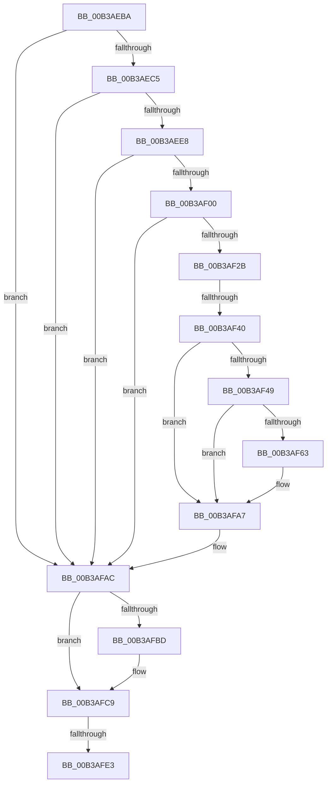

# sub_00B3AEBA

- RVA: `0x00B3AEBA`–`0x00B3AFF5` (길이 `315` bytes)
- VA: `0x0000000140B3AEBA`
- 실행 섹션: `PAGE`
- PDB 이름 있음: `아니요`; PDB Function 태그: `아니요`
- unwind 정보 RVA: `0x000AF25C`
- 디코드: `67`개 명령, `315/315` bytes 표시
- 미해석 바이트: `0` (있으면 어셈블리에 `.byte`로 보존)

> 이 문서는 커널 이미지의 기계어와 PDB 기호를 분석해 생성했습니다. 4번과 5번은 함수 원형과 자료형을 바이너리 사용 방식에서 추정한 C 해석이며 원본 소스 복구 결과는 아닙니다.

## 1. Dependencies

- 직접 호출 지점: **9**; 고유 호출 대상: **9**
- 직접 호출자로 확인된 함수: **0**
- RIP 상대 이미지 참조: **6**

### Outgoing calls
- `0x00B3AED9` → [CmFcpManagerCreateSection](../AD/CmFcpManagerCreateSection_function_00ADA3BC.md) (function, `0x00ADA3BC`)
- `0x00B3AEF1` → [CmFcpMapSection](../AC/CmFcpMapSection_function_00AC1714.md) (function, `0x00AC1714`)
- `0x00B3AF1C` → [RtlpFcUpdateUsageTriggers](../A4/RtlpFcUpdateUsageTriggers_function_00A44BB0.md) (function, `0x00A44BB0`)
- `0x00B3AF33` → [RtlpFcValidateFeatureUsageSubscriptionBuffer](../AC/RtlpFcValidateFeatureUsageSubscriptionBuffer_function_00AC93F8.md) (function, `0x00AC93F8`)
- `0x00B3AF5A` → [tlgKeywordOn](../../text/42/tlgKeywordOn_function_0042EAA0.md) (function, `0x0042EAA0`)
- `0x00B3AFA2` → [tlgWriteTransfer_EtwWriteTransfer](../../text/42/tlgWriteTransfer_EtwWriteTransfer_function_004260E0.md) (function, `0x004260E0`)
- `0x00B3AFC4` → [ExfTryToWakePushLock](../../text/26/ExfTryToWakePushLock_function_00265DD0.md) (function, `0x00265DD0`)
- `0x00B3AFD0` → [KeAbPostRelease](../../text/2E/KeAbPostRelease_function_002E1600.md) (function, `0x002E1600`)
- `0x00B3AFEA` → [RtlpFcBufferManagerDereferenceBuffers](../../text/37/RtlpFcBufferManagerDereferenceBuffers_function_00378D84.md) (function, `0x00378D84`)

### Direct callers
- 이 함수 시작 RVA로 연결되는 직접 call은 확인되지 않았습니다. 간접 호출은 완전히 역산할 수 없습니다.

### Static image references
- `0x00B3AEC5` → RVA `0x00EF72E0` (`.data`; read)
- `0x00B3AF40` → RVA `0x00E09F20` (`.data`; read)
- `0x00B3AF75` → RVA `0x00057557` (`.rdata`; read)
- `0x00B3AFAC` → RVA `0x00EF72F0` (`.data`; read/write)
- `0x00B3AFBD` → RVA `0x00EF72F0` (`.data`; read)
- `0x00B3AFE3` → RVA `0x00EF7368` (`.data`; read)

## 2. Other-region calls and transfers

- 다른 실행 섹션으로 향하는 call: **5**
  - `0x00B3AF5A` → [tlgKeywordOn](../../text/42/tlgKeywordOn_function_0042EAA0.md) (`PAGE` → `.text`)
  - `0x00B3AFA2` → [tlgWriteTransfer_EtwWriteTransfer](../../text/42/tlgWriteTransfer_EtwWriteTransfer_function_004260E0.md) (`PAGE` → `.text`)
  - `0x00B3AFC4` → [ExfTryToWakePushLock](../../text/26/ExfTryToWakePushLock_function_00265DD0.md) (`PAGE` → `.text`)
  - `0x00B3AFD0` → [KeAbPostRelease](../../text/2E/KeAbPostRelease_function_002E1600.md) (`PAGE` → `.text`)
  - `0x00B3AFEA` → [RtlpFcBufferManagerDereferenceBuffers](../../text/37/RtlpFcBufferManagerDereferenceBuffers_function_00378D84.md) (`PAGE` → `.text`)
- call이 아닌 외부 분기/꼬리 이동: **3**
  - `0x00B3AF3A` → [CmFcManagerUpdateFeatureUsageSubscriptions + 0x105](../A4/CmFcManagerUpdateFeatureUsageSubscriptions_function_00A4490C.md) (`tail-transfer`)
  - `0x00B3AFDD` → [CmFcManagerUpdateFeatureUsageSubscriptions + 0x1FD](../A4/CmFcManagerUpdateFeatureUsageSubscriptions_function_00A4490C.md) (`tail-transfer`)
  - `0x00B3AFF0` → [CmFcManagerUpdateFeatureUsageSubscriptions + 0x1FD](../A4/CmFcManagerUpdateFeatureUsageSubscriptions_function_00A4490C.md) (`tail-transfer`)

## 3. Assembly (complete function range)

```asm
00B3AEBA  3D 05 00 00 80                  cmp eax, 0x80000005
00B3AEBF  0F 85 E7 00 00 00               jne 0x140b3afac
00B3AEC5  4C 8B 05 14 C4 3B 00            mov r8, qword ptr [rip + 0x3bc414]
00B3AECC  4C 8D 4C 24 38                  lea r9, [rsp + 0x38]
00B3AED1  48 8B 4C 24 58                  mov rcx, qword ptr [rsp + 0x58]
00B3AED6  48 8B D6                        mov rdx, rsi
00B3AED9  E8 DE F4 F9 FF                  call 0x140ada3bc
00B3AEDE  8B F8                           mov edi, eax
00B3AEE0  85 C0                           test eax, eax
00B3AEE2  0F 88 C4 00 00 00               js 0x140b3afac
00B3AEE8  48 8D 55 A0                     lea rdx, [rbp - 0x60]
00B3AEEC  48 8D 4C 24 38                  lea rcx, [rsp + 0x38]
00B3AEF1  E8 1E 68 F8 FF                  call 0x140ac1714
00B3AEF6  8B F8                           mov edi, eax
00B3AEF8  85 C0                           test eax, eax
00B3AEFA  0F 88 AC 00 00 00               js 0x140b3afac
00B3AF00  49 8B 4E 38                     mov rcx, qword ptr [r14 + 0x38]
00B3AF04  48 8D 45 B0                     lea rax, [rbp - 0x50]
00B3AF08  48 89 44 24 28                  mov qword ptr [rsp + 0x28], rax
00B3AF0D  4D 8B CF                        mov r9, r15
00B3AF10  48 8B 45 A8                     mov rax, qword ptr [rbp - 0x58]
00B3AF14  4D 8B C4                        mov r8, r12
00B3AF17  48 89 44 24 20                  mov qword ptr [rsp + 0x20], rax
00B3AF1C  E8 8F 9C F0 FF                  call 0x140a44bb0
00B3AF21  8B F8                           mov edi, eax
00B3AF23  85 C0                           test eax, eax
00B3AF25  0F 88 81 00 00 00               js 0x140b3afac
00B3AF2B  48 8B 55 B0                     mov rdx, qword ptr [rbp - 0x50]
00B3AF2F  48 8B 4D A8                     mov rcx, qword ptr [rbp - 0x58]
00B3AF33  E8 C0 E4 F8 FF                  call 0x140ac93f8
00B3AF38  85 C0                           test eax, eax
00B3AF3A  0F 89 D1 9A F0 FF               jns 0x140a44a11
00B3AF40  83 3D D9 EF 2C 00 05            cmp dword ptr [rip + 0x2cefd9], 5
00B3AF47  76 5E                           jbe 0x140b3afa7
00B3AF49  48 BA 01 00 00 00 00 40 00 00   movabs rdx, 0x400000000001
00B3AF53  48 8D 0D C6 EF 2C 00            lea rcx, [rip + 0x2cefc6]
00B3AF5A  E8 41 3B 8F FF                  call 0x14042eaa0
00B3AF5F  84 C0                           test al, al
00B3AF61  74 44                           je 0x140b3afa7
00B3AF63  48 8D 44 24 60                  lea rax, [rsp + 0x60]
00B3AF68  48 C7 44 24 60 00 00 00 01      mov qword ptr [rsp + 0x60], 0x1000000
00B3AF71  48 89 45 F0                     mov qword ptr [rbp - 0x10], rax
00B3AF75  48 8D 15 DB C5 51 FF            lea rdx, [rip - 0xae3a25]
00B3AF7C  48 8D 45 D0                     lea rax, [rbp - 0x30]
00B3AF80  48 C7 45 F8 08 00 00 00         mov qword ptr [rbp - 8], 8
00B3AF88  48 89 44 24 28                  mov qword ptr [rsp + 0x28], rax
00B3AF8D  48 8D 0D 8C EF 2C 00            lea rcx, [rip + 0x2cef8c]
00B3AF94  45 33 C9                        xor r9d, r9d
00B3AF97  C7 44 24 20 03 00 00 00         mov dword ptr [rsp + 0x20], 3
00B3AF9F  45 33 C0                        xor r8d, r8d
00B3AFA2  E8 39 B1 8E FF                  call 0x1404260e0
00B3AFA7  BF E5 00 00 C0                  mov edi, 0xc00000e5
00B3AFAC  F0 48 0F C1 1D 3B C3 3B 00      lock xadd qword ptr [rip + 0x3bc33b], rbx
00B3AFB5  80 E3 06                        and bl, 6
00B3AFB8  80 FB 02                        cmp bl, 2
00B3AFBB  75 0C                           jne 0x140b3afc9
00B3AFBD  48 8D 0D 2C C3 3B 00            lea rcx, [rip + 0x3bc32c]
00B3AFC4  E8 07 AE 72 FF                  call 0x140265dd0
00B3AFC9  48 8D 0D 20 C3 3B 00            lea rcx, [rip + 0x3bc320]
00B3AFD0  E8 2B 66 7A FF                  call 0x1402e1600
00B3AFD5  48 8B 54 24 30                  mov rdx, qword ptr [rsp + 0x30]
00B3AFDA  48 85 D2                        test rdx, rdx
00B3AFDD  0F 84 26 9B F0 FF               je 0x140a44b09
00B3AFE3  48 8D 0D 7E C3 3B 00            lea rcx, [rip + 0x3bc37e]
00B3AFEA  E8 95 DD 83 FF                  call 0x140378d84
00B3AFEF  90                              nop
00B3AFF0  E9 14 9B F0 FF                  jmp 0x140a44b09
```

## 4. C-style interpretation (structured pseudocode)

```c
__int64 __fastcall sub_00B3AEBA(__int64 a1, __int64 a2, __int64 a3, __int64 a4, __int64 a5, __int64 a6, __int64 a7, __int64 a8, __int64 a9, __int64 a10, __int64 a11, __int64 a12)
{
    __int64 result;
    __int64 v_rbx;
    unsigned __int64 v_stack_p20;
    unsigned __int64 v_stack_p28;
    unsigned __int64 v_stack_p60;

    if (((unsigned int)(result)) != 0x80000005ULL) goto loc_00B3AFAC;
    result = CmFcpManagerCreateSection(a11, v_rsi, *(unsigned __int64 *)(v_rip + 3916820), a7);
    if (sign_flag) goto loc_00B3AFAC;
    result = CmFcpMapSection(a7, v_rbp - 96, *(unsigned __int64 *)(v_rip + 3916820), a7);
    if (sign_flag) goto loc_00B3AFAC;
    v_stack_p28 = v_rbp - 80;
    v_stack_p20 = *(unsigned __int64 *)(v_rbp - 88);
    result = RtlpFcUpdateUsageTriggers(*(unsigned __int64 *)(v_r14 + 56), v_rbp - 96, v_r12, v_r15);
    if (sign_flag) goto loc_00B3AFAC;
    result = RtlpFcValidateFeatureUsageSubscriptionBuffer(*(unsigned __int64 *)(v_rbp - 88), *(unsigned __int64 *)(v_rbp - 80), v_r12, v_r15);
    if ((*(unsigned int *)(v_rip + 2944985)) <= 5) goto loc_00B3AFA7;
    result = tlgKeywordOn(v_rip + 2944966, *(unsigned __int64 *)(v_rbp - 80), v_r12, v_r15);
    if ((unsigned __int8)(result) != 0) {
        result = a12;
        v_stack_p60 = 0x1000000ULL;
        *(unsigned __int64 *)(v_rbp - 16) = result;
        a2 = v_rip - 11418149;
        result = v_rbp - 48;
        *(unsigned __int64 *)(v_rbp - 8) = 8;
        v_stack_p28 = result;
        a1 = v_rip + 2944908;
        a4 = 0;
        v_stack_p20 = 3;
        a3 = 0;
        result = tlgWriteTransfer_EtwWriteTransfer(a1, a2, a3, a4);
    }
loc_00B3AFAC:
    v_rbx = (unsigned __int8)((v_rbx) & (6));
    if (((unsigned __int8)(v_rbx)) == 2) {
        a1 = v_rip + 3916588;
        result = ExfTryToWakePushLock(a1, a2, a3, a4);
    }
    result = KeAbPostRelease(v_rip + 3916576, a2, a3, a4);
    result = RtlpFcBufferManagerDereferenceBuffers(v_rip + 3916670, a6, a3, a4);
}
```

## 5. (Beta) C Style

```c
int64_t sub_00B3AEBA(int64_t Arg1, int64_t Arg2, int64_t Arg3, int64_t Arg4, uint64_t Arg5, int64_t Arg6, int64_t Arg7, uint64_t Arg8, uint64_t Arg9, uint64_t Arg10, int64_t Arg11, int64_t Arg12)
{
    int64_t result;
    int64_t local_rbx;
    uint64_t v_stack_p20;
    uint64_t v_stack_p28;
    uint64_t v_stack_p60;

    if (((uint32_t)(result)) != 0x80000005ULL) goto loc_00B3AFAC;
    result = CmFcpManagerCreateSection(Arg11, local_rsi, *(uint64_t *)(v_rip + 0x3BC414), Arg7);
    if (sign_flag) goto loc_00B3AFAC;
    result = CmFcpMapSection(Arg7, local_rbp - 96, *(uint64_t *)(v_rip + 0x3BC414), Arg7);
    if (sign_flag) goto loc_00B3AFAC;
    v_stack_p28 = local_rbp - 80;
    v_stack_p20 = *(uint64_t *)(local_rbp - 0x58);
    result = RtlpFcUpdateUsageTriggers(*(uint64_t *)(local_r14 + 0x38), local_rbp - 96, local_r12, local_r15);
    if (sign_flag) goto loc_00B3AFAC;
    result = RtlpFcValidateFeatureUsageSubscriptionBuffer(*(uint64_t *)(local_rbp - 0x58), *(uint64_t *)(local_rbp - 0x50), local_r12, local_r15);
    if ((*(uint32_t *)(v_rip + 0x2CEFD9)) <= 5) goto loc_00B3AFA7;
    result = tlgKeywordOn(v_rip + 2944966, *(uint64_t *)(local_rbp - 0x50), local_r12, local_r15);
    if ((uint8_t)(result) != 0) {
        result = Arg12;
        v_stack_p60 = 0x1000000ULL;
        *(uint64_t *)(local_rbp - 0x10) = result;
        Arg2 = v_rip - 11418149;
        result = local_rbp - 48;
        *(uint64_t *)(local_rbp - 0x8) = 8;
        v_stack_p28 = result;
        Arg1 = v_rip + 2944908;
        Arg4 = 0;
        v_stack_p20 = 3;
        Arg3 = 0;
        result = tlgWriteTransfer_EtwWriteTransfer(Arg1, Arg2, Arg3, Arg4);
    }
loc_00B3AFAC:
    local_rbx = (uint8_t)((local_rbx) & (6));
    if (((uint8_t)(local_rbx)) == 2) {
        Arg1 = v_rip + 3916588;
        result = ExfTryToWakePushLock(Arg1, Arg2, Arg3, Arg4);
    }
    result = KeAbPostRelease(v_rip + 3916576, Arg2, Arg3, Arg4);
    result = RtlpFcBufferManagerDereferenceBuffers(v_rip + 3916670, Arg6, Arg3, Arg4);
}
```

## 6. Execution-region graph

[열기: 2D/3D 그래프와 함수 탐색 컨트롤 패널](../../../control-panel.html?section=page&rva=0x00B3AEBA&view=graph)

- 2D 그래프는 위에서 아래로 흐르고, 3D 그래프는 빈 공간을 드래그해 회전합니다. Shift+드래그는 이동, 휠은 확대·축소, 함수 노드 선택은 대상 보고서 이동입니다.

### Static fallback


