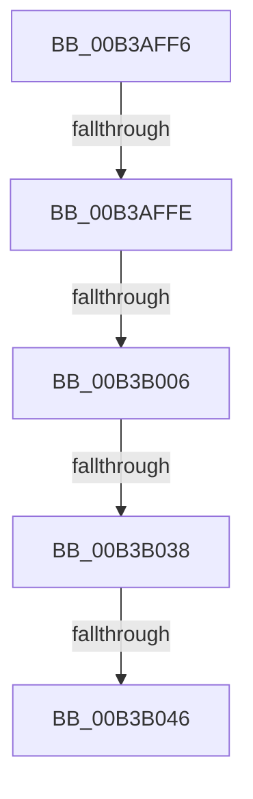

# sub_00B3AFF6

- RVA: `0x00B3AFF6`–`0x00B3B06F` (길이 `121` bytes)
- VA: `0x0000000140B3AFF6`
- 실행 섹션: `PAGE`
- PDB 이름 있음: `아니요`; PDB Function 태그: `아니요`
- unwind 정보 RVA: `0x000AF2A0`
- 디코드: `29`개 명령, `121/121` bytes 표시
- 미해석 바이트: `0` (있으면 어셈블리에 `.byte`로 보존)

> 이 문서는 커널 이미지의 기계어와 PDB 기호를 분석해 생성했습니다. 4번과 5번은 함수 원형과 자료형을 바이너리 사용 방식에서 추정한 C 해석이며 원본 소스 복구 결과는 아닙니다.

## 1. Dependencies

- 직접 호출 지점: **2**; 고유 호출 대상: **2**
- 직접 호출자로 확인된 함수: **0**
- RIP 상대 이미지 참조: **1**

### Outgoing calls
- `0x00B3B02B` → [ZwQueryWnfStateData](../../text/6A/ZwQueryWnfStateData_function_006AFEF0.md) (function, `0x006AFEF0`)
- `0x00B3B064` → [ZwUpdateWnfStateData](../../text/6B/ZwUpdateWnfStateData_function_006B0D10.md) (function, `0x006B0D10`)

### Direct callers
- 이 함수 시작 RVA로 연결되는 직접 call은 확인되지 않았습니다. 간접 호출은 완전히 역산할 수 없습니다.

### Static image references
- `0x00B3B024` → RVA `0x00020940` (`.rdata`; read)

## 2. Other-region calls and transfers

- 다른 실행 섹션으로 향하는 call: **2**
  - `0x00B3B02B` → [ZwQueryWnfStateData](../../text/6A/ZwQueryWnfStateData_function_006AFEF0.md) (`PAGE` → `.text`)
  - `0x00B3B064` → [ZwUpdateWnfStateData](../../text/6B/ZwUpdateWnfStateData_function_006B0D10.md) (`PAGE` → `.text`)
- call이 아닌 외부 분기/꼬리 이동: **5**
  - `0x00B3AFF8` → [CmFcpManagerPublishChangeNotifications + 0xAB](../A4/CmFcpManagerPublishChangeNotifications_function_00A44E94.md) (`tail-transfer`)
  - `0x00B3B000` → [CmFcpManagerPublishChangeNotifications + 0xAB](../A4/CmFcpManagerPublishChangeNotifications_function_00A44E94.md) (`tail-transfer`)
  - `0x00B3B032` → [CmFcpManagerPublishChangeNotifications + 0xE2](../A4/CmFcpManagerPublishChangeNotifications_function_00A44E94.md) (`tail-transfer`)
  - `0x00B3B040` → [CmFcpManagerPublishChangeNotifications + 0xE2](../A4/CmFcpManagerPublishChangeNotifications_function_00A44E94.md) (`tail-transfer`)
  - `0x00B3B06A` → [CmFcpManagerPublishChangeNotifications + 0xE2](../A4/CmFcpManagerPublishChangeNotifications_function_00A44E94.md) (`tail-transfer`)

## 3. Assembly (complete function range)

```asm
00B3AFF6  84 DB                           test bl, bl
00B3AFF8  0F 84 41 9F F0 FF               je 0x140a44f3f
00B3AFFE  85 C0                           test eax, eax
00B3B000  0F 88 39 9F F0 FF               js 0x140a44f3f
00B3B006  48 8D 45 48                     lea rax, [rbp + 0x48]
00B3B00A  89 75 48                        mov dword ptr [rbp + 0x48], esi
00B3B00D  48 89 44 24 28                  mov qword ptr [rsp + 0x28], rax
00B3B012  4C 8D 4D D8                     lea r9, [rbp - 0x28]
00B3B016  48 8D 45 E8                     lea rax, [rbp - 0x18]
00B3B01A  45 33 C0                        xor r8d, r8d
00B3B01D  33 D2                           xor edx, edx
00B3B01F  48 89 44 24 20                  mov qword ptr [rsp + 0x20], rax
00B3B024  48 8D 0D 15 59 4E FF            lea rcx, [rip - 0xb1a6eb]
00B3B02B  E8 C0 4E B7 FF                  call 0x1406afef0
00B3B030  85 C0                           test eax, eax
00B3B032  0F 88 3E 9F F0 FF               js 0x140a44f76
00B3B038  48 8B 45 40                     mov rax, qword ptr [rbp + 0x40]
00B3B03C  48 39 45 E8                     cmp qword ptr [rbp - 0x18], rax
00B3B040  0F 83 30 9F F0 FF               jae 0x140a44f76
00B3B046  89 7C 24 30                     mov dword ptr [rsp + 0x30], edi
00B3B04A  48 8D 55 40                     lea rdx, [rbp + 0x40]
00B3B04E  89 7C 24 28                     mov dword ptr [rsp + 0x28], edi
00B3B052  48 8D 0D E7 58 4E FF            lea rcx, [rip - 0xb1a719]
00B3B059  45 33 C9                        xor r9d, r9d
00B3B05C  48 89 7C 24 20                  mov qword ptr [rsp + 0x20], rdi
00B3B061  44 8B C6                        mov r8d, esi
00B3B064  E8 A7 5C B7 FF                  call 0x1406b0d10
00B3B069  90                              nop
00B3B06A  E9 07 9F F0 FF                  jmp 0x140a44f76
```

## 4. C-style interpretation (structured pseudocode)

```c
__int64 __fastcall sub_00B3AFF6(__int64 a1, int a2, int a3)
{
    __int64 result;
    unsigned __int64 v_stack_p20;
    unsigned __int64 v_stack_p28;
    unsigned int v_stack_p30;

    *(unsigned int *)(v_rbp + 72) = (unsigned int)(v_rsi);
    v_stack_p28 = v_rbp + 72;
    a3 = 0;
    a2 = 0;
    v_stack_p20 = v_rbp - 24;
    result = ZwQueryWnfStateData(v_rip - 11642603, a2, a3, v_rbp - 40);
    v_stack_p30 = (unsigned int)(v_rdi);
    v_stack_p28 = (unsigned int)(v_rdi);
    a4 = 0;
    v_stack_p20 = v_rdi;
    result = ZwUpdateWnfStateData(v_rip - 11642649, v_rbp + 64, (unsigned int)((unsigned int)(v_rsi)), a4);
}
```

## 5. (Beta) C Style

```c
int64_t sub_00B3AFF6(int64_t Arg1, int32_t Arg2, int32_t Arg3)
{
    int64_t result;
    uint64_t v_stack_p20;
    uint64_t v_stack_p28;
    uint32_t v_stack_p30;

    *(uint32_t *)(local_rbp + 0x48) = (uint32_t)(local_rsi);
    v_stack_p28 = local_rbp + 72;
    Arg3 = 0;
    Arg2 = 0;
    v_stack_p20 = local_rbp - 24;
    result = ZwQueryWnfStateData(v_rip - 11642603, Arg2, Arg3, local_rbp - 40);
    v_stack_p30 = (uint32_t)(local_rdi);
    v_stack_p28 = (uint32_t)(local_rdi);
    a4 = 0;
    v_stack_p20 = local_rdi;
    result = ZwUpdateWnfStateData(v_rip - 11642649, local_rbp + 64, (uint32_t)((uint32_t)(local_rsi)), a4);
}
```

## 6. Execution-region graph

[열기: 2D/3D 그래프와 함수 탐색 컨트롤 패널](../../../control-panel.html?section=page&rva=0x00B3AFF6&view=graph)

- 2D 그래프는 위에서 아래로 흐르고, 3D 그래프는 빈 공간을 드래그해 회전합니다. Shift+드래그는 이동, 휠은 확대·축소, 함수 노드 선택은 대상 보고서 이동입니다.

### Static fallback


