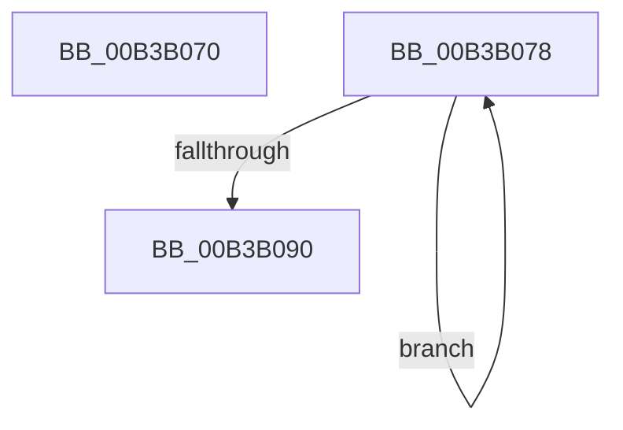

# sub_00B3B070

- RVA: `0x00B3B070`–`0x00B3B095` (길이 `37` bytes)
- VA: `0x0000000140B3B070`
- 실행 섹션: `PAGE`
- PDB 이름 있음: `아니요`; PDB Function 태그: `아니요`
- unwind 정보 RVA: `0x000AF2B0`
- 디코드: `10`개 명령, `37/37` bytes 표시
- 미해석 바이트: `0` (있으면 어셈블리에 `.byte`로 보존)

> 이 문서는 커널 이미지의 기계어와 PDB 기호를 분석해 생성했습니다. 4번과 5번은 함수 원형과 자료형을 바이너리 사용 방식에서 추정한 C 해석이며 원본 소스 복구 결과는 아닙니다.

## 1. Dependencies

- 직접 호출 지점: **0**; 고유 호출 대상: **0**
- 직접 호출자로 확인된 함수: **0**
- RIP 상대 이미지 참조: **0**

### Outgoing calls
- 직접 디코드된 call 명령이 없습니다.

### Direct callers
- 이 함수 시작 RVA로 연결되는 직접 call은 확인되지 않았습니다. 간접 호출은 완전히 역산할 수 없습니다.

### Static image references
- 디코드된 RIP-relative 메모리 참조가 없습니다.

## 2. Other-region calls and transfers

- 다른 실행 섹션으로 향하는 call: **0**
- call이 아닌 외부 분기/꼬리 이동: **2**
  - `0x00B3B073` → [RtlpFcCalculateRequiredSizeForNewUsageSubscriptionTable + 0x5C](../A4/RtlpFcCalculateRequiredSizeForNewUsageSubscriptionTable_function_00A44FEC.md) (`tail-transfer`)
  - `0x00B3B090` → [RtlpFcCalculateRequiredSizeForNewUsageSubscriptionTable + 0x66](../A4/RtlpFcCalculateRequiredSizeForNewUsageSubscriptionTable_function_00A44FEC.md) (`tail-transfer`)

## 3. Assembly (complete function range)

```asm
00B3B070  4C 8B D0                        mov r10, rax
00B3B073  E9 D0 9F F0 FF                  jmp 0x140a45048
00B3B078  83 3A 00                        cmp dword ptr [rdx], 0
00B3B07B  49 8D 4A 01                     lea rcx, [r10 + 1]
00B3B07F  48 8D 52 14                     lea rdx, [rdx + 0x14]
00B3B083  49 0F 45 CA                     cmovne rcx, r10
00B3B087  4C 8B D1                        mov r10, rcx
00B3B08A  49 83 E8 01                     sub r8, 1
00B3B08E  75 E8                           jne 0x140b3b078
00B3B090  E9 BD 9F F0 FF                  jmp 0x140a45052
```

## 4. C-style interpretation (structured pseudocode)

```c
void __fastcall sub_00B3B070(__int64 a1, __int64 a2, __int64 a3)
{
}
```

## 5. (Beta) C Style

```c
void sub_00B3B070(int64_t Arg1, int64_t Arg2, int64_t Arg3)
{
}
```

## 6. Execution-region graph

[열기: 2D/3D 그래프와 함수 탐색 컨트롤 패널](../../../control-panel.html?section=page&rva=0x00B3B070&view=graph)

- 2D 그래프는 위에서 아래로 흐르고, 3D 그래프는 빈 공간을 드래그해 회전합니다. Shift+드래그는 이동, 휠은 확대·축소, 함수 노드 선택은 대상 보고서 이동입니다.

### Static fallback


