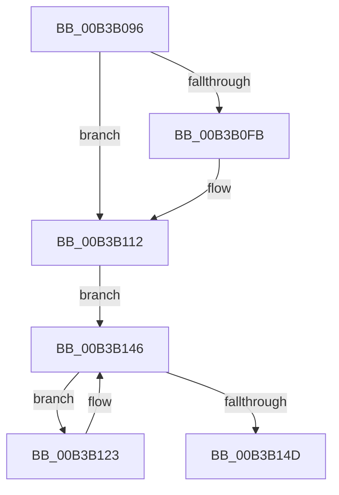

# sub_00B3B096

- RVA: `0x00B3B096`–`0x00B3B152` (길이 `188` bytes)
- VA: `0x0000000140B3B096`
- 실행 섹션: `PAGE`
- PDB 이름 있음: `아니요`; PDB Function 태그: `아니요`
- unwind 정보 RVA: `0x000AF2F4`
- 디코드: `41`개 명령, `188/188` bytes 표시
- 미해석 바이트: `0` (있으면 어셈블리에 `.byte`로 보존)

> 이 문서는 커널 이미지의 기계어와 PDB 기호를 분석해 생성했습니다. 4번과 5번은 함수 원형과 자료형을 바이너리 사용 방식에서 추정한 C 해석이며 원본 소스 복구 결과는 아닙니다.

## 1. Dependencies

- 직접 호출 지점: **7**; 고유 호출 대상: **7**
- 직접 호출자로 확인된 함수: **0**
- RIP 상대 이미지 참조: **2**

### Outgoing calls
- `0x00B3B0B0` → [memset](../../text/6C/memset_function_006C6C40.md) (function, `0x006C6C40`)
- `0x00B3B0BA` → [PoCopyDeepIdleMask](../../text/3C/PoCopyDeepIdleMask_function_003C04C8.md) (function, `0x003C04C8`)
- `0x00B3B0D6` → [KiSubtractAffinityEx](../../text/2D/KiSubtractAffinityEx_function_002D61E8.md) (function, `0x002D61E8`)
- `0x00B3B0E8` → [KeRemoveProcessorAffinityEx](../../text/30/KeRemoveProcessorAffinityEx_function_00304E10.md) (function, `0x00304E10`)
- `0x00B3B0F2` → [KeIsEmptyAffinityEx](../../text/2D/KeIsEmptyAffinityEx_function_002D1580.md) (function, `0x002D1580`)
- `0x00B3B10D` → [KeGenericProcessorCallback](../../text/39/KeGenericProcessorCallback_function_00398C2C.md) (function, `0x00398C2C`)
- `0x00B3B13B` → [ExBlockOnAddressPushLock](../../text/2A/ExBlockOnAddressPushLock_function_002A43A0.md) (function, `0x002A43A0`)

### Direct callers
- 이 함수 시작 RVA로 연결되는 직접 call은 확인되지 않았습니다. 간접 호출은 완전히 역산할 수 없습니다.

### Static image references
- `0x00B3B0CF` → RVA `0x00FC7120` (`ALMOSTRO`; read)
- `0x00B3B0FE` → RVA `0x0049E550` (`EmpCheckErrataList`; read)

## 2. Other-region calls and transfers

- 다른 실행 섹션으로 향하는 call: **7**
  - `0x00B3B0B0` → [memset](../../text/6C/memset_function_006C6C40.md) (`PAGE` → `.text`)
  - `0x00B3B0BA` → [PoCopyDeepIdleMask](../../text/3C/PoCopyDeepIdleMask_function_003C04C8.md) (`PAGE` → `.text`)
  - `0x00B3B0D6` → [KiSubtractAffinityEx](../../text/2D/KiSubtractAffinityEx_function_002D61E8.md) (`PAGE` → `.text`)
  - `0x00B3B0E8` → [KeRemoveProcessorAffinityEx](../../text/30/KeRemoveProcessorAffinityEx_function_00304E10.md) (`PAGE` → `.text`)
  - `0x00B3B0F2` → [KeIsEmptyAffinityEx](../../text/2D/KeIsEmptyAffinityEx_function_002D1580.md) (`PAGE` → `.text`)
  - `0x00B3B10D` → [KeGenericProcessorCallback](../../text/39/KeGenericProcessorCallback_function_00398C2C.md) (`PAGE` → `.text`)
  - `0x00B3B13B` → [ExBlockOnAddressPushLock](../../text/2A/ExBlockOnAddressPushLock_function_002A43A0.md) (`PAGE` → `.text`)
- call이 아닌 외부 분기/꼬리 이동: **1**
  - `0x00B3B14D` → [RtlUpdateSwapReference + 0x49](../A4/RtlUpdateSwapReference_function_00A45260.md) (`tail-transfer`)

## 3. Assembly (complete function range)

```asm
00B3B096  83 64 24 44 00                  and dword ptr [rsp + 0x44], 0
00B3B09B  48 8D 4C 24 48                  lea rcx, [rsp + 0x48]
00B3B0A0  33 D2                           xor edx, edx
00B3B0A2  C7 44 24 40 01 00 20 00         mov dword ptr [rsp + 0x40], 0x200001
00B3B0AA  41 B8 00 01 00 00               mov r8d, 0x100
00B3B0B0  E8 8B BB B8 FF                  call 0x1406c6c40
00B3B0B5  48 8D 4C 24 40                  lea rcx, [rsp + 0x40]
00B3B0BA  E8 09 54 88 FF                  call 0x1403c04c8
00B3B0BF  44 0F B7 4C 24 42               movzx r9d, word ptr [rsp + 0x42]
00B3B0C5  4C 8D 44 24 40                  lea r8, [rsp + 0x40]
00B3B0CA  48 8D 54 24 40                  lea rdx, [rsp + 0x40]
00B3B0CF  48 8D 0D 4A C0 48 00            lea rcx, [rip + 0x48c04a]
00B3B0D6  E8 0D B1 79 FF                  call 0x1402d61e8
00B3B0DB  65 8B 14 25 A4 01 00 00         mov edx, dword ptr gs:[0x1a4]
00B3B0E3  48 8D 4C 24 40                  lea rcx, [rsp + 0x40]
00B3B0E8  E8 23 9D 7C FF                  call 0x140304e10
00B3B0ED  48 8D 4C 24 40                  lea rcx, [rsp + 0x40]
00B3B0F2  E8 89 64 79 FF                  call 0x1402d1580
00B3B0F7  85 C0                           test eax, eax
00B3B0F9  75 17                           jne 0x140b3b112
00B3B0FB  45 33 C9                        xor r9d, r9d
00B3B0FE  48 8D 15 4B 34 96 FF            lea rdx, [rip - 0x69cbb5]
00B3B105  45 33 C0                        xor r8d, r8d
00B3B108  48 8D 4C 24 40                  lea rcx, [rsp + 0x40]
00B3B10D  E8 1A DB 85 FF                  call 0x140398c2c
00B3B112  48 8D 5E 08                     lea rbx, [rsi + 8]
00B3B116  48 8B C7                        mov rax, rdi
00B3B119  F0 48 0F C1 03                  lock xadd qword ptr [rbx], rax
00B3B11E  48 03 C7                        add rax, rdi
00B3B121  EB 23                           jmp 0x140b3b146
00B3B123  48 83 64 24 20 00               and qword ptr [rsp + 0x20], 0
00B3B129  4C 8D 44 24 30                  lea r8, [rsp + 0x30]
00B3B12E  41 B9 08 00 00 00               mov r9d, 8
00B3B134  48 8D 4E 10                     lea rcx, [rsi + 0x10]
00B3B138  48 8B D3                        mov rdx, rbx
00B3B13B  E8 60 92 76 FF                  call 0x1402a43a0
00B3B140  48 8B 03                        mov rax, qword ptr [rbx]
00B3B143  48 85 C0                        test rax, rax
00B3B146  48 89 44 24 30                  mov qword ptr [rsp + 0x30], rax
00B3B14B  75 D6                           jne 0x140b3b123
00B3B14D  E9 57 A1 F0 FF                  jmp 0x140a452a9
```

## 4. C-style interpretation (structured pseudocode)

```c
__int64 __fastcall sub_00B3B096(__int64 a1, int a2, __int64 a3, __int64 a4, __int64 a5, __int64 a6, __int64 a7, __int64 a8, __int64 a9)
{
    __int64 result;
    unsigned __int64 v_stack_p20;
    unsigned __int64 v_stack_p30;
    unsigned int v_stack_p40;
    unsigned __int16 v_stack_p42;
    unsigned int v_stack_p44;

    a2 = 0;
    v_stack_p40 = 0x200001ULL;
    result = memset(a9, a2, 256, a4);
    result = PoCopyDeepIdleMask(a8, a2, 256, a4);
    result = KiSubtractAffinityEx(v_rip + 4767818, a8, a8, v_stack_p42);
    result = KeRemoveProcessorAffinityEx(a8, (unsigned int)(*(unsigned int *)(gs_base + (0 + 420))), a8, v_stack_p42);
    result = KeIsEmptyAffinityEx(a8, (unsigned int)(*(unsigned int *)(gs_base + (0 + 420))), a8, v_stack_p42);
    if ((unsigned int)(result) == 0) {
        a4 = 0;
        a2 = v_rip - 6933429;
        a3 = 0;
        a1 = a8;
        result = KeGenericProcessorCallback(a1, a2, a3, a4);
    }
    result = (v_rdi) + (v_rdi);
    goto loc_00B3B146;
loc_00B3B123:
    result = ExBlockOnAddressPushLock(v_rsi + 16, v_rsi + 8, a6, 8);
loc_00B3B146:
    v_stack_p30 = *(unsigned __int64 *)(v_rsi + 8);
    if (*(unsigned __int64 *)(v_rsi + 8) != 0) goto loc_00B3B123;
}
```

## 5. (Beta) C Style

```c
int64_t sub_00B3B096(int64_t Arg1, int32_t Arg2, int64_t Arg3, int64_t Arg4, uint64_t Arg5, int64_t Arg6, uint64_t Arg7, int64_t Arg8, int64_t Arg9)
{
    int64_t result;
    uint64_t v_stack_p20;
    uint64_t v_stack_p30;
    uint32_t v_stack_p40;
    uint16_t v_stack_p42;
    uint32_t v_stack_p44;

    Arg2 = 0;
    v_stack_p40 = 0x200001ULL;
    result = memset(Arg9, Arg2, 256, Arg4);
    result = PoCopyDeepIdleMask(Arg8, Arg2, 256, Arg4);
    result = KiSubtractAffinityEx(v_rip + 4767818, Arg8, Arg8, v_stack_p42);
    result = KeRemoveProcessorAffinityEx(Arg8, (uint32_t)(*(uint32_t *)(gs_base + (0 + 0x1A4))), Arg8, v_stack_p42);
    result = KeIsEmptyAffinityEx(Arg8, (uint32_t)(*(uint32_t *)(gs_base + (0 + 0x1A4))), Arg8, v_stack_p42);
    if ((uint32_t)(result) == 0) {
        Arg4 = 0;
        Arg2 = v_rip - 6933429;
        Arg3 = 0;
        Arg1 = Arg8;
        result = KeGenericProcessorCallback(Arg1, Arg2, Arg3, Arg4);
    }
    result = (local_rdi) + (local_rdi);
    goto loc_00B3B146;
loc_00B3B123:
    result = ExBlockOnAddressPushLock(local_rsi + 16, local_rsi + 8, Arg6, 8);
loc_00B3B146:
    v_stack_p30 = *(uint64_t *)(local_rsi + 0x8);
    if (*(uint64_t *)(local_rsi + 0x8) != 0) goto loc_00B3B123;
}
```

## 6. Execution-region graph

[열기: 2D/3D 그래프와 함수 탐색 컨트롤 패널](../../../control-panel.html?section=page&rva=0x00B3B096&view=graph)

- 2D 그래프는 위에서 아래로 흐르고, 3D 그래프는 빈 공간을 드래그해 회전합니다. Shift+드래그는 이동, 휠은 확대·축소, 함수 노드 선택은 대상 보고서 이동입니다.

### Static fallback


