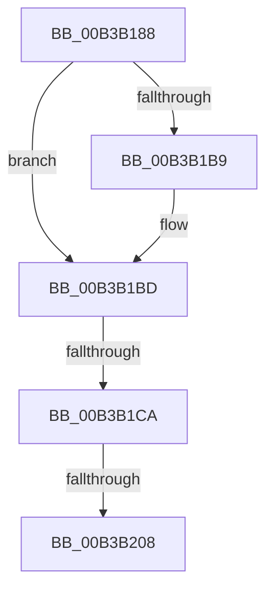

# sub_00B3B188

- RVA: `0x00B3B188`–`0x00B3B212` (길이 `138` bytes)
- VA: `0x0000000140B3B188`
- 실행 섹션: `PAGE`
- PDB 이름 있음: `아니요`; PDB Function 태그: `아니요`
- unwind 정보 RVA: `0x000AF78C`
- 디코드: `30`개 명령, `138/138` bytes 표시
- 미해석 바이트: `0` (있으면 어셈블리에 `.byte`로 보존)

> 이 문서는 커널 이미지의 기계어와 PDB 기호를 분석해 생성했습니다. 4번과 5번은 함수 원형과 자료형을 바이너리 사용 방식에서 추정한 C 해석이며 원본 소스 복구 결과는 아닙니다.

## 1. Dependencies

- 직접 호출 지점: **2**; 고유 호출 대상: **2**
- 직접 호출자로 확인된 함수: **0**
- RIP 상대 이미지 참조: **1**

### Outgoing calls
- `0x00B3B1B0` → [ObOpenObjectByPointer](../8B/ObOpenObjectByPointer_function_008B7420.md) (function, `0x008B7420`)
- `0x00B3B1FB` → [ObDuplicateObject](../8C/ObDuplicateObject_function_008C4FA0.md) (function, `0x008C4FA0`)

### Direct callers
- 이 함수 시작 RVA로 연결되는 직접 call은 확인되지 않았습니다. 간접 호출은 완전히 역산할 수 없습니다.

### Static image references
- `0x00B3B188` → RVA `0x00FC6A98` (`ALMOSTRO`; read)

## 2. Other-region calls and transfers

- 다른 실행 섹션으로 향하는 call: **0**
- call이 아닌 외부 분기/꼬리 이동: **3**
  - `0x00B3B1C4` → [DbgkpOpenHandles + 0x31](../A4/DbgkpOpenHandles_function_00A4681C.md) (`tail-transfer`)
  - `0x00B3B202` → [DbgkpOpenHandles + 0x85](../A4/DbgkpOpenHandles_function_00A4681C.md) (`tail-transfer`)
  - `0x00B3B20D` → [DbgkpOpenHandles + 0x85](../A4/DbgkpOpenHandles_function_00A4681C.md) (`tail-transfer`)

## 3. Assembly (complete function range)

```asm
00B3B188  48 8B 05 09 B9 48 00            mov rax, qword ptr [rip + 0x48b909]
00B3B18F  48 8D 77 18                     lea rsi, [rdi + 0x18]
00B3B193  48 89 74 24 30                  mov qword ptr [rsp + 0x30], rsi
00B3B198  41 B9 7B 06 12 00               mov r9d, 0x12067b
00B3B19E  C6 44 24 28 00                  mov byte ptr [rsp + 0x28], 0
00B3B1A3  45 33 C0                        xor r8d, r8d
00B3B1A6  33 D2                           xor edx, edx
00B3B1A8  48 89 44 24 20                  mov qword ptr [rsp + 0x20], rax
00B3B1AD  48 8B CD                        mov rcx, rbp
00B3B1B0  E8 6B C2 D7 FF                  call 0x1408b7420
00B3B1B5  85 C0                           test eax, eax
00B3B1B7  79 04                           jns 0x140b3b1bd
00B3B1B9  48 83 26 00                     and qword ptr [rsi], 0
00B3B1BD  48 8B 77 30                     mov rsi, qword ptr [rdi + 0x30]
00B3B1C1  48 85 F6                        test rsi, rsi
00B3B1C4  0F 84 83 B6 F0 FF               je 0x140a4684d
00B3B1CA  65 48 8B 04 25 88 01 00 00      mov rax, qword ptr gs:[0x188]
00B3B1D3  4C 8D 4F 30                     lea r9, [rdi + 0x30]
00B3B1D7  C6 44 24 38 00                  mov byte ptr [rsp + 0x38], 0
00B3B1DC  48 8B D6                        mov rdx, rsi
00B3B1DF  C7 44 24 30 02 00 00 00         mov dword ptr [rsp + 0x30], 2
00B3B1E7  83 64 24 28 00                  and dword ptr [rsp + 0x28], 0
00B3B1EC  48 8B 88 B8 00 00 00            mov rcx, qword ptr [rax + 0xb8]
00B3B1F3  83 64 24 20 00                  and dword ptr [rsp + 0x20], 0
00B3B1F8  4C 8B C1                        mov r8, rcx
00B3B1FB  E8 A0 9D D8 FF                  call 0x1408c4fa0
00B3B200  85 C0                           test eax, eax
00B3B202  0F 89 99 B6 F0 FF               jns 0x140a468a1
00B3B208  48 83 67 30 00                  and qword ptr [rdi + 0x30], 0
00B3B20D  E9 8F B6 F0 FF                  jmp 0x140a468a1
```

## 4. C-style interpretation (structured pseudocode)

```c
__int64 __fastcall sub_00B3B188(__int64 a1, int a2, int a3, __int64 a4, unsigned int a5)
{
    __int64 result;
    unsigned __int64 v_stack_p20;
    unsigned __int8 v_stack_p28;
    unsigned __int64 v_stack_p30;
    unsigned __int8 v_stack_p38;

    v_stack_p30 = v_rdi + 24;
    v_stack_p28 = 0;
    a3 = 0;
    a2 = 0;
    v_stack_p20 = *(unsigned __int64 *)(v_rip + 4765961);
    result = ObOpenObjectByPointer(v_rbp, a2, a3, (unsigned int)(0x12067BULL));
    if (sign_flag) {
    }
    v_stack_p38 = 0;
    v_stack_p30 = 2;
    result = ObDuplicateObject(*(unsigned __int64 *)(*(unsigned __int64 *)(gs_base + (0 + 392)) + 184), *(unsigned __int64 *)(v_rdi + 48), *(unsigned __int64 *)(*(unsigned __int64 *)(gs_base + (0 + 392)) + 184), v_rdi + 48);
}
```

## 5. (Beta) C Style

```c
int64_t sub_00B3B188(int64_t Arg1, int32_t Arg2, int32_t Arg3, int64_t Arg4, uint32_t Arg5)
{
    int64_t result;
    uint64_t v_stack_p20;
    uint8_t v_stack_p28;
    uint64_t v_stack_p30;
    uint8_t v_stack_p38;

    v_stack_p30 = local_rdi + 24;
    v_stack_p28 = 0;
    Arg3 = 0;
    Arg2 = 0;
    v_stack_p20 = *(uint64_t *)(v_rip + 0x48B909);
    result = ObOpenObjectByPointer(local_rbp, Arg2, Arg3, (uint32_t)(0x12067BULL));
    if (sign_flag) {
    }
    v_stack_p38 = 0;
    v_stack_p30 = 2;
    result = ObDuplicateObject(*(uint64_t *)(*(uint64_t *)(gs_base + (0 + 0x188)) + 0xB8), *(uint64_t *)(local_rdi + 0x30), *(uint64_t *)(*(uint64_t *)(gs_base + (0 + 0x188)) + 0xB8), local_rdi + 48);
}
```

## 6. Execution-region graph

[열기: 2D/3D 그래프와 함수 탐색 컨트롤 패널](../../../control-panel.html?section=page&rva=0x00B3B188&view=graph)

- 2D 그래프는 위에서 아래로 흐르고, 3D 그래프는 빈 공간을 드래그해 회전합니다. Shift+드래그는 이동, 휠은 확대·축소, 함수 노드 선택은 대상 보고서 이동입니다.

### Static fallback


