# sub_00B3B244

- RVA: `0x00B3B244`–`0x00B3B649` (길이 `1,029` bytes)
- VA: `0x0000000140B3B244`
- 실행 섹션: `PAGE`
- PDB 이름 있음: `아니요`; PDB Function 태그: `아니요`
- unwind 정보 RVA: `0x000AF83C`
- 디코드: `240`개 명령, `1,029/1,029` bytes 표시
- 미해석 바이트: `0` (있으면 어셈블리에 `.byte`로 보존)

> 이 문서는 커널 이미지의 기계어와 PDB 기호를 분석해 생성했습니다. 4번과 5번은 함수 원형과 자료형을 바이너리 사용 방식에서 추정한 C 해석이며 원본 소스 복구 결과는 아닙니다.

## 1. Dependencies

- 직접 호출 지점: **11**; 고유 호출 대상: **8**
- 직접 호출자로 확인된 함수: **0**
- RIP 상대 이미지 참조: **1**

### Outgoing calls
- `0x00B3B2D2` → [ExAllocatePool2](../../poolcode/B8/ExAllocatePool2_function_00B820F0.md) (function, `0x00B820F0`)
- `0x00B3B322` → [PpmResetPlatformIdleAccounting](../../text/5D/PpmResetPlatformIdleAccounting_function_005D0820.md) (function, `0x005D0820`)
- `0x00B3B36E` → [memset](../../text/6C/memset_function_006C6C40.md) (function, `0x006C6C40`)
- `0x00B3B37A` → [KeQueryActiveProcessorAffinity2](../../text/46/KeQueryActiveProcessorAffinity2_function_00469CC0.md) (function, `0x00469CC0`)
- `0x00B3B398` → [PpmIdleIsStateDisabled](../../text/4F/PpmIdleIsStateDisabled_function_004FD2E0.md) (function, `0x004FD2E0`)
- `0x00B3B497` → [KeGetPrcb](../../text/2D/KeGetPrcb_function_002D85D0.md) (function, `0x002D85D0`)
- `0x00B3B50E` → [KeGetPrcb](../../text/2D/KeGetPrcb_function_002D85D0.md) (function, `0x002D85D0`)
- `0x00B3B5C9` → [ExAllocatePool2](../../poolcode/B8/ExAllocatePool2_function_00B820F0.md) (function, `0x00B820F0`)
- `0x00B3B5E8` → [ExFreePoolWithTag](../../poolcode/B8/ExFreePoolWithTag_function_00B82870.md) (function, `0x00B82870`)
- `0x00B3B5FA` → [KeGetProcessorIndexFromNumber](../../text/2D/KeGetProcessorIndexFromNumber_function_002DD2D0.md) (function, `0x002DD2D0`)
- `0x00B3B620` → [memset](../../text/6C/memset_function_006C6C40.md) (function, `0x006C6C40`)

### Direct callers
- 이 함수 시작 RVA로 연결되는 직접 call은 확인되지 않았습니다. 간접 호출은 완전히 역산할 수 없습니다.

### Static image references
- `0x00B3B275` → RVA `0x00E67678` (`.data`; read)

## 2. Other-region calls and transfers

- 다른 실행 섹션으로 향하는 call: **11**
  - `0x00B3B2D2` → [ExAllocatePool2](../../poolcode/B8/ExAllocatePool2_function_00B820F0.md) (`PAGE` → `POOLCODE`)
  - `0x00B3B322` → [PpmResetPlatformIdleAccounting](../../text/5D/PpmResetPlatformIdleAccounting_function_005D0820.md) (`PAGE` → `.text`)
  - `0x00B3B36E` → [memset](../../text/6C/memset_function_006C6C40.md) (`PAGE` → `.text`)
  - `0x00B3B37A` → [KeQueryActiveProcessorAffinity2](../../text/46/KeQueryActiveProcessorAffinity2_function_00469CC0.md) (`PAGE` → `.text`)
  - `0x00B3B398` → [PpmIdleIsStateDisabled](../../text/4F/PpmIdleIsStateDisabled_function_004FD2E0.md) (`PAGE` → `.text`)
  - `0x00B3B497` → [KeGetPrcb](../../text/2D/KeGetPrcb_function_002D85D0.md) (`PAGE` → `.text`)
  - `0x00B3B50E` → [KeGetPrcb](../../text/2D/KeGetPrcb_function_002D85D0.md) (`PAGE` → `.text`)
  - `0x00B3B5C9` → [ExAllocatePool2](../../poolcode/B8/ExAllocatePool2_function_00B820F0.md) (`PAGE` → `POOLCODE`)
  - `0x00B3B5E8` → [ExFreePoolWithTag](../../poolcode/B8/ExFreePoolWithTag_function_00B82870.md) (`PAGE` → `POOLCODE`)
  - `0x00B3B5FA` → [KeGetProcessorIndexFromNumber](../../text/2D/KeGetProcessorIndexFromNumber_function_002DD2D0.md) (`PAGE` → `.text`)
  - `0x00B3B620` → [memset](../../text/6C/memset_function_006C6C40.md) (`PAGE` → `.text`)
- call이 아닌 외부 분기/꼬리 이동: **4**
  - `0x00B3B501` → [PpmInstallPlatformIdleStates + 0xE6](../A4/PpmInstallPlatformIdleStates_function_00A46A80.md) (`tail-transfer`)
  - `0x00B3B5A1` → [PpmInstallPlatformIdleStates + 0xE6](../A4/PpmInstallPlatformIdleStates_function_00A46A80.md) (`tail-transfer`)
  - `0x00B3B5F2` → [PpmInstallPlatformIdleStates + 0x48](../A4/PpmInstallPlatformIdleStates_function_00A46A80.md) (`tail-transfer`)
  - `0x00B3B644` → [PpmInstallPlatformIdleStates + 0x1C7](../A4/PpmInstallPlatformIdleStates_function_00A46A80.md) (`tail-transfer`)

## 3. Assembly (complete function range)

```asm
00B3B244  41 8B 4F 04                     mov ecx, dword ptr [r15 + 4]
00B3B248  41 B8 F8 FF FF FF               mov r8d, 0xfffffff8
00B3B24E  8B C1                           mov eax, ecx
00B3B250  69 D7 C0 01 00 00               imul edx, edi, 0x1c0
00B3B256  41 0F AF C4                     imul eax, r12d
00B3B25A  83 C2 47                        add edx, 0x47
00B3B25D  41 23 D0                        and edx, r8d
00B3B260  89 94 24 A8 00 00 00            mov dword ptr [rsp + 0xa8], edx
00B3B267  8D 04 40                        lea eax, [rax + rax*2]
00B3B26A  8D 14 C2                        lea edx, [rdx + rax*8]
00B3B26D  43 8D 04 2C                     lea eax, [r12 + r13]
00B3B271  89 54 24 20                     mov dword ptr [rsp + 0x20], edx
00B3B275  4C 8B 2D FC C3 32 00            mov r13, qword ptr [rip + 0x32c3fc]
00B3B27C  0F AF C1                        imul eax, ecx
00B3B27F  8D 04 40                        lea eax, [rax + rax*2]
00B3B282  8D 0C C2                        lea ecx, [rdx + rax*8]
00B3B285  8B C7                           mov eax, edi
00B3B287  C1 E0 0A                        shl eax, 0xa
00B3B28A  83 C0 2F                        add eax, 0x2f
00B3B28D  89 8C 24 98 00 00 00            mov dword ptr [rsp + 0x98], ecx
00B3B294  03 C1                           add eax, ecx
00B3B296  8D 0C BD 0F 00 00 00            lea ecx, [rdi*4 + 0xf]
00B3B29D  41 23 C8                        and ecx, r8d
00B3B2A0  41 23 C0                        and eax, r8d
00B3B2A3  44 8B F1                        mov r14d, ecx
00B3B2A6  89 44 24 28                     mov dword ptr [rsp + 0x28], eax
00B3B2AA  45 0F AF F4                     imul r14d, r12d
00B3B2AE  89 4C 24 2C                     mov dword ptr [rsp + 0x2c], ecx
00B3B2B2  44 03 F0                        add r14d, eax
00B3B2B5  4D 85 ED                        test r13, r13
00B3B2B8  0F 85 E8 02 00 00               jne 0x140b3b5a6
00B3B2BE  44 8B EE                        mov r13d, esi
00B3B2C1  48 8B DE                        mov rbx, rsi
00B3B2C4  41 8B D6                        mov edx, r14d
00B3B2C7  B9 48 00 00 00                  mov ecx, 0x48
00B3B2CC  41 B8 50 50 4D 69               mov r8d, 0x694d5050
00B3B2D2  E8 19 6E 04 00                  call 0x140b820f0
00B3B2D7  4C 8B F0                        mov r14, rax
00B3B2DA  48 85 C0                        test rax, rax
00B3B2DD  0F 84 FD 02 00 00               je 0x140b3b5e0
00B3B2E3  89 38                           mov dword ptr [rax], edi
00B3B2E5  44 89 60 04                     mov dword ptr [rax + 4], r12d
00B3B2E9  49 8B 47 08                     mov rax, qword ptr [r15 + 8]
00B3B2ED  49 89 46 10                     mov qword ptr [r14 + 0x10], rax
00B3B2F1  49 8B 47 10                     mov rax, qword ptr [r15 + 0x10]
00B3B2F5  49 89 46 18                     mov qword ptr [r14 + 0x18], rax
00B3B2F9  49 8B 47 18                     mov rax, qword ptr [r15 + 0x18]
00B3B2FD  49 89 46 20                     mov qword ptr [r14 + 0x20], rax
00B3B301  49 8B 47 20                     mov rax, qword ptr [r15 + 0x20]
00B3B305  49 89 46 28                     mov qword ptr [r14 + 0x28], rax
00B3B309  8B 84 24 98 00 00 00            mov eax, dword ptr [rsp + 0x98]
00B3B310  49 03 C6                        add rax, r14
00B3B313  49 89 46 30                     mov qword ptr [r14 + 0x30], rax
00B3B317  48 8B C8                        mov rcx, rax
00B3B31A  48 89 44 24 38                  mov qword ptr [rsp + 0x38], rax
00B3B31F  89 78 04                        mov dword ptr [rax + 4], edi
00B3B322  E8 F9 54 A9 FF                  call 0x1405d0820
00B3B327  41 8B 47 04                     mov eax, dword ptr [r15 + 4]
00B3B32B  85 C0                           test eax, eax
00B3B32D  0F 84 E2 00 00 00               je 0x140b3b415
00B3B333  44 8B E6                        mov r12d, esi
00B3B336  41 8B C4                        mov eax, r12d
00B3B339  33 D2                           xor edx, edx
00B3B33B  48 69 F8 C0 01 00 00            imul rdi, rax, 0x1c0
00B3B342  41 B8 00 01 00 00               mov r8d, 0x100
00B3B348  48 89 84 24 98 00 00 00         mov qword ptr [rsp + 0x98], rax
00B3B350  4A 8D 1C 37                     lea rbx, [rdi + r14]
00B3B354  66 42 C7 44 37 79 01 01         mov word ptr [rdi + r14 + 0x79], 0x101
00B3B35C  48 8D 8B 88 00 00 00            lea rcx, [rbx + 0x88]
00B3B363  48 C7 83 80 00 00 00 01 00 20 00  mov qword ptr [rbx + 0x80], 0x200001
00B3B36E  E8 CD B8 B8 FF                  call 0x1406c6c40
00B3B373  48 8D 8B 80 00 00 00            lea rcx, [rbx + 0x80]
00B3B37A  E8 41 E9 92 FF                  call 0x140469cc0
00B3B37F  49 8D 46 58                     lea rax, [r14 + 0x58]
00B3B383  41 8B D4                        mov edx, r12d
00B3B386  48 03 C7                        add rax, rdi
00B3B389  33 C9                           xor ecx, ecx
00B3B38B  48 89 40 08                     mov qword ptr [rax + 8], rax
00B3B38F  48 89 00                        mov qword ptr [rax], rax
00B3B392  42 C6 44 37 68 07               mov byte ptr [rdi + r14 + 0x68], 7
00B3B398  E8 43 1F 9C FF                  call 0x1404fd2e0
00B3B39D  84 C0                           test al, al
00B3B39F  74 09                           je 0x140b3b3aa
00B3B3A1  42 C7 44 37 50 00 00 00 80      mov dword ptr [rdi + r14 + 0x50], 0x80000000
00B3B3AA  45 85 ED                        test r13d, r13d
00B3B3AD  74 4E                           je 0x140b3b3fd
00B3B3AF  41 8B 47 04                     mov eax, dword ptr [r15 + 4]
00B3B3B3  2B C5                           sub eax, ebp
00B3B3B5  44 3B E0                        cmp r12d, eax
00B3B3B8  75 05                           jne 0x140b3b3bf
00B3B3BA  42 88 6C 37 69                  mov byte ptr [rdi + r14 + 0x69], bpl
00B3B3BF  48 8B 4C 24 30                  mov rcx, qword ptr [rsp + 0x30]
00B3B3C4  48 8B 94 24 98 00 00 00         mov rdx, qword ptr [rsp + 0x98]
00B3B3CC  4A 89 4C 37 70                  mov qword ptr [rdi + r14 + 0x70], rcx
00B3B3D1  41 8B C5                        mov eax, r13d
00B3B3D4  48 C1 E0 06                     shl rax, 6
00B3B3D8  48 03 C8                        add rcx, rax
00B3B3DB  46 89 6C 37 6C                  mov dword ptr [rdi + r14 + 0x6c], r13d
00B3B3E0  49 8D 46 50                     lea rax, [r14 + 0x50]
00B3B3E4  48 89 4C 24 30                  mov qword ptr [rsp + 0x30], rcx
00B3B3E9  48 8B 4C 24 38                  mov rcx, qword ptr [rsp + 0x38]
00B3B3EE  48 03 C7                        add rax, rdi
00B3B3F1  48 C1 E2 0A                     shl rdx, 0xa
00B3B3F5  48 89 84 0A E0 00 00 00         mov qword ptr [rdx + rcx + 0xe0], rax
00B3B3FD  41 8B 47 04                     mov eax, dword ptr [r15 + 4]
00B3B401  44 03 E5                        add r12d, ebp
00B3B404  44 3B E0                        cmp r12d, eax
00B3B407  0F 82 29 FF FF FF               jb 0x140b3b336
00B3B40D  44 8B A4 24 A0 00 00 00         mov r12d, dword ptr [rsp + 0xa0]
00B3B415  8B 8C 24 A8 00 00 00            mov ecx, dword ptr [rsp + 0xa8]
00B3B41C  44 8B EE                        mov r13d, esi
00B3B41F  8B 7C 24 20                     mov edi, dword ptr [rsp + 0x20]
00B3B423  49 03 CE                        add rcx, r14
00B3B426  49 03 FE                        add rdi, r14
00B3B429  89 B4 24 98 00 00 00            mov dword ptr [rsp + 0x98], esi
00B3B430  85 C0                           test eax, eax
00B3B432  0F 84 C4 00 00 00               je 0x140b3b4fc
00B3B438  41 8B C4                        mov eax, r12d
00B3B43B  4C 8D 04 40                     lea r8, [rax + rax*2]
00B3B43F  49 C1 E0 03                     shl r8, 3
00B3B443  4C 89 44 24 20                  mov qword ptr [rsp + 0x20], r8
00B3B448  41 8B C5                        mov eax, r13d
00B3B44B  48 69 D0 C0 01 00 00            imul rdx, rax, 0x1c0
00B3B452  48 8D 04 40                     lea rax, [rax + rax*2]
00B3B456  48 03 C0                        add rax, rax
00B3B459  41 0F 10 44 C7 48               movups xmm0, xmmword ptr [r15 + rax*8 + 0x48]
00B3B45F  4A 89 8C 32 98 01 00 00         mov qword ptr [rdx + r14 + 0x198], rcx
00B3B467  49 03 C8                        add rcx, r8
00B3B46A  46 89 64 32 7C                  mov dword ptr [rdx + r14 + 0x7c], r12d
00B3B46F  48 89 4C 24 30                  mov qword ptr [rsp + 0x30], rcx
00B3B474  F3 42 0F 7F 84 32 88 01 00 00   movdqu xmmword ptr [rdx + r14 + 0x188], xmm0
00B3B47E  45 85 E4                        test r12d, r12d
00B3B481  74 64                           je 0x140b3b4e7
00B3B483  4C 8B FE                        mov r15, rsi
00B3B486  48 8B F2                        mov rsi, rdx
00B3B489  45 8B EF                        mov r13d, r15d
00B3B48C  4A 8B 9C 36 98 01 00 00         mov rbx, qword ptr [rsi + r14 + 0x198]
00B3B494  41 8B CD                        mov ecx, r13d
00B3B497  E8 34 D1 79 FF                  call 0x1402d85d0
00B3B49C  48 8B 88 40 88 00 00            mov rcx, qword ptr [rax + 0x8840]
00B3B4A3  45 89 2C 1F                     mov dword ptr [r15 + rbx], r13d
00B3B4A7  44 03 ED                        add r13d, ebp
00B3B4AA  4D 8D 7F 18                     lea r15, [r15 + 0x18]
00B3B4AE  8B 41 28                        mov eax, dword ptr [rcx + 0x28]
00B3B4B1  49 89 7C 1F F8                  mov qword ptr [r15 + rbx - 8], rdi
00B3B4B6  41 89 44 1F F0                  mov dword ptr [r15 + rbx - 0x10], eax
00B3B4BB  8B 41 28                        mov eax, dword ptr [rcx + 0x28]
00B3B4BE  48 8D 0C 40                     lea rcx, [rax + rax*2]
00B3B4C2  48 8D 3C CF                     lea rdi, [rdi + rcx*8]
00B3B4C6  45 3B EC                        cmp r13d, r12d
00B3B4C9  72 C1                           jb 0x140b3b48c
00B3B4CB  4C 8B BC 24 90 00 00 00         mov r15, qword ptr [rsp + 0x90]
00B3B4D3  33 F6                           xor esi, esi
00B3B4D5  44 8B AC 24 98 00 00 00         mov r13d, dword ptr [rsp + 0x98]
00B3B4DD  48 8B 4C 24 30                  mov rcx, qword ptr [rsp + 0x30]
00B3B4E2  4C 8B 44 24 20                  mov r8, qword ptr [rsp + 0x20]
00B3B4E7  44 03 ED                        add r13d, ebp
00B3B4EA  44 89 AC 24 98 00 00 00         mov dword ptr [rsp + 0x98], r13d
00B3B4F2  45 3B 6F 04                     cmp r13d, dword ptr [r15 + 4]
00B3B4F6  0F 82 4C FF FF FF               jb 0x140b3b448
00B3B4FC  8B DE                           mov ebx, esi
00B3B4FE  45 85 E4                        test r12d, r12d
00B3B501  0F 84 5F B6 F0 FF               je 0x140a46b66
00B3B507  44 8B 6C 24 28                  mov r13d, dword ptr [rsp + 0x28]
00B3B50C  8B CB                           mov ecx, ebx
00B3B50E  E8 BD D0 79 FF                  call 0x1402d85d0
00B3B513  44 8B CE                        mov r9d, esi
00B3B516  4C 8B 90 40 88 00 00            mov r10, qword ptr [rax + 0x8840]
00B3B51D  8B 44 24 2C                     mov eax, dword ptr [rsp + 0x2c]
00B3B521  0F AF C3                        imul eax, ebx
00B3B524  41 03 C5                        add eax, r13d
00B3B527  49 03 C6                        add rax, r14
00B3B52A  49 89 82 E0 03 00 00            mov qword ptr [r10 + 0x3e0], rax
00B3B531  41 8B 47 04                     mov eax, dword ptr [r15 + 4]
00B3B535  41 89 82 F8 03 00 00            mov dword ptr [r10 + 0x3f8], eax
00B3B53C  49 89 BA 00 04 00 00            mov qword ptr [r10 + 0x400], rdi
00B3B543  41 8B 4F 04                     mov ecx, dword ptr [r15 + 4]
00B3B547  48 8D 04 49                     lea rax, [rcx + rcx*2]
00B3B54B  48 8D 3C C7                     lea rdi, [rdi + rax*8]
00B3B54F  85 C9                           test ecx, ecx
00B3B551  74 43                           je 0x140b3b596
00B3B553  41 2B C9                        sub ecx, r9d
00B3B556  41 8B C1                        mov eax, r9d
00B3B559  4C 69 C0 C0 01 00 00            imul r8, rax, 0x1c0
00B3B560  2B CD                           sub ecx, ebp
00B3B562  48 8D 14 49                     lea rdx, [rcx + rcx*2]
00B3B566  49 8B 8A 00 04 00 00            mov rcx, qword ptr [r10 + 0x400]
00B3B56D  44 89 4C D1 04                  mov dword ptr [rcx + rdx*8 + 4], r9d
00B3B572  44 03 CD                        add r9d, ebp
00B3B575  43 8B 44 30 7C                  mov eax, dword ptr [r8 + r14 + 0x7c]
00B3B57A  89 44 D1 08                     mov dword ptr [rcx + rdx*8 + 8], eax
00B3B57E  4B 8B 84 30 98 01 00 00         mov rax, qword ptr [r8 + r14 + 0x198]
00B3B586  48 89 44 D1 10                  mov qword ptr [rcx + rdx*8 + 0x10], rax
00B3B58B  41 8B 47 04                     mov eax, dword ptr [r15 + 4]
00B3B58F  8B C8                           mov ecx, eax
00B3B591  44 3B C8                        cmp r9d, eax
00B3B594  72 BD                           jb 0x140b3b553
00B3B596  03 DD                           add ebx, ebp
00B3B598  41 3B DC                        cmp ebx, r12d
00B3B59B  0F 82 6B FF FF FF               jb 0x140b3b50c
00B3B5A1  E9 C0 B5 F0 FF                  jmp 0x140a46b66
00B3B5A6  45 8B 6D 04                     mov r13d, dword ptr [r13 + 4]
00B3B5AA  45 85 ED                        test r13d, r13d
00B3B5AD  0F 84 0E FD FF FF               je 0x140b3b2c1
00B3B5B3  41 8B D5                        mov edx, r13d
00B3B5B6  B9 40 00 00 00                  mov ecx, 0x40
00B3B5BB  48 0F AF D7                     imul rdx, rdi
00B3B5BF  41 B8 50 50 4D 69               mov r8d, 0x694d5050
00B3B5C5  48 C1 E2 06                     shl rdx, 6
00B3B5C9  E8 22 6B 04 00                  call 0x140b820f0
00B3B5CE  48 89 44 24 30                  mov qword ptr [rsp + 0x30], rax
00B3B5D3  48 8B D8                        mov rbx, rax
00B3B5D6  48 85 C0                        test rax, rax
00B3B5D9  74 12                           je 0x140b3b5ed
00B3B5DB  E9 E4 FC FF FF                  jmp 0x140b3b2c4
00B3B5E0  BA 50 50 4D 69                  mov edx, 0x694d5050
00B3B5E5  48 8B CB                        mov rcx, rbx
00B3B5E8  E8 83 72 04 00                  call 0x140b82870
00B3B5ED  BE 9A 00 00 C0                  mov esi, 0xc000009a
00B3B5F2  E9 D1 B4 F0 FF                  jmp 0x140a46ac8
00B3B5F7  49 8B CD                        mov rcx, r13
00B3B5FA  E8 D1 1C 7A FF                  call 0x1402dd2d0
00B3B5FF  4A 8B 9C 33 98 01 00 00         mov rbx, qword ptr [rbx + r14 + 0x198]
00B3B607  33 D2                           xor edx, edx
00B3B609  8B C0                           mov eax, eax
00B3B60B  48 8D 3C 40                     lea rdi, [rax + rax*2]
00B3B60F  8B 44 FB 08                     mov eax, dword ptr [rbx + rdi*8 + 8]
00B3B613  48 8B 4C FB 10                  mov rcx, qword ptr [rbx + rdi*8 + 0x10]
00B3B618  4C 8D 04 40                     lea r8, [rax + rax*2]
00B3B61C  49 C1 E0 03                     shl r8, 3
00B3B620  E8 1B B6 B8 FF                  call 0x1406c6c40
00B3B625  8B 44 FB 08                     mov eax, dword ptr [rbx + rdi*8 + 8]
00B3B629  41 0F B6 55 05                  movzx edx, byte ptr [r13 + 5]
00B3B62E  2B C2                           sub eax, edx
00B3B630  2B C5                           sub eax, ebp
00B3B632  48 8D 0C 40                     lea rcx, [rax + rax*2]
00B3B636  48 8B 44 FB 10                  mov rax, qword ptr [rbx + rdi*8 + 0x10]
00B3B63B  89 54 C8 04                     mov dword ptr [rax + rcx*8 + 4], edx
00B3B63F  40 88 6C C8 01                  mov byte ptr [rax + rcx*8 + 1], bpl
00B3B644  E9 FE B5 F0 FF                  jmp 0x140a46c47
```

## 4. C-style interpretation (structured pseudocode)

```c
__int64 __fastcall sub_00B3B244(__int64 a1, __int64 a2, __int64 a3, __int64 a4, unsigned int a5, __int64 a6, __int64 a7, __int64 a8, __int64 a9, __int64 a10, __int64 a11, __int64 a12, __int64 a13, __int64 a14, __int64 a15, __int64 a16, __int64 a17, __int64 a18, unsigned int a19, unsigned int a20, unsigned int a21)
{
    __int64 result;
    __int64 v_r12;
    __int64 v_r13;
    __int64 v_r14;
    __int64 v_rbx;
    __int64 v_rdi;
    __int64 v_rsi;
    unsigned int v_stack_p20;
    unsigned int v_stack_p28;
    unsigned int v_stack_p2C;
    unsigned __int64 v_stack_p30;
    unsigned __int64 v_stack_p38;
    unsigned int v_stack_p98;
    unsigned int v_stack_pA8;

    a2 = (unsigned int)((a2) * ((unsigned int)(v_rdi)));
    result = (unsigned int)(((unsigned int)((unsigned int)((unsigned int)(*(unsigned int *)(v_r15 + 4))))) * ((unsigned int)(v_r12)));
    a2 = (unsigned int)((a2) + (71));
    a2 = (unsigned int)((a2) & ((unsigned int)((unsigned int)(0xFFFFFFF8ULL))));
    v_stack_pA8 = (unsigned int)(a2);
    v_stack_p20 = (unsigned int)(a2 + result + result * 2 * 8);
    result = (unsigned int)((v_r12 + v_r13 * 1) * ((unsigned int)((unsigned int)(*(unsigned int *)(v_r15 + 4)))));
    result = (unsigned int)(((unsigned int)((unsigned int)(v_rdi))) << (10));
    result = (unsigned int)((result) + (47));
    v_stack_p98 = (unsigned int)(a2 + result + result * 2 * 8 + result + result * 2 * 8);
    result = (unsigned int)((result) + ((unsigned int)(a2 + result + result * 2 * 8 + result + result * 2 * 8)));
    a1 = (unsigned int)((v_rdi * 4 + 15) & ((unsigned int)((unsigned int)(0xFFFFFFF8ULL))));
    result = (unsigned int)((result) & ((unsigned int)((unsigned int)(0xFFFFFFF8ULL))));
    v_stack_p28 = (unsigned int)(result);
    v_r14 = (unsigned int)(((unsigned int)((unsigned int)(a1))) * ((unsigned int)(v_r12)));
    v_stack_p2C = (unsigned int)(a1);
    v_r14 = (unsigned int)((v_r14) + ((unsigned int)(result)));
    if (*(unsigned __int64 *)(v_rip + 3326972) != 0) goto loc_00B3B5A6;
loc_00B3B2C1:
loc_00B3B2C4:
    result = ExAllocatePool2(72, (unsigned int)((unsigned int)(v_r14)), (unsigned int)(0x694D5050ULL), a4);
    if (result == 0) goto loc_00B3B5E0;
    *(unsigned int *)(result) = (unsigned int)(v_rdi);
    *(unsigned int *)(result + 4) = (unsigned int)(v_r12);
    *(unsigned __int64 *)(result + 16) = *(unsigned __int64 *)(v_r15 + 8);
    *(unsigned __int64 *)(result + 24) = *(unsigned __int64 *)(v_r15 + 16);
    *(unsigned __int64 *)(result + 32) = *(unsigned __int64 *)(v_r15 + 24);
    *(unsigned __int64 *)(result + 40) = *(unsigned __int64 *)(v_r15 + 32);
    result = ((unsigned int)(a19)) + (result);
    *(unsigned __int64 *)(result + 48) = result;
    v_stack_p38 = result;
    *(unsigned int *)(result + 4) = (unsigned int)(v_rdi);
    result = PpmResetPlatformIdleAccounting(result, (unsigned int)((unsigned int)(v_r14)), (unsigned int)(0x694D5050ULL), a4);
    if ((unsigned int)((unsigned int)(*(unsigned int *)(v_r15 + 4))) == 0) goto loc_00B3B415;
loc_00B3B336:
    a2 = 0;
    v_rdi = (v_rdi) * ((unsigned int)((unsigned int)((unsigned int)((unsigned int)(v_rsi)))));
    v_stack_p98 = (unsigned int)((unsigned int)((unsigned int)((unsigned int)(v_rsi))));
    *(unsigned __int16 *)(v_rdi + result * 1 + 121) = 257;
    *(unsigned __int64 *)(v_rdi + result * 1 + 128) = 0x200001ULL;
    result = memset(v_rdi + result * 1 + 136, a2, 256, a4);
    result = KeQueryActiveProcessorAffinity2(v_rdi + result * 1 + 128, a2, 256, a4);
    result = (result + 88) + (v_rdi);
    a1 = 0;
    *(unsigned __int64 *)(result + 8) = result;
    *(unsigned __int64 *)(result) = result;
    *(unsigned __int8 *)(v_rdi + result * 1 + 104) = 7;
    result = PpmIdleIsStateDisabled(a1, (unsigned int)((unsigned int)((unsigned int)((unsigned int)(v_rsi)))), 256, a4);
    if ((unsigned __int8)(result) != 0) {
        *(unsigned int *)(v_rdi + result * 1 + 80) = 0x80000000ULL;
    }
    if ((unsigned int)((unsigned int)((unsigned int)(v_rsi))) == 0) goto loc_00B3B3FD;
    result = (unsigned int)(((unsigned int)(*(unsigned int *)(v_r15 + 4))) - ((unsigned int)(v_rbp)));
    if (((unsigned int)((unsigned int)((unsigned int)(v_rsi)))) == ((unsigned int)(result))) {
        *(unsigned __int8 *)(v_rdi + result * 1 + 105) = (unsigned __int8)(v_rbp);
    }
    *(unsigned __int64 *)(v_rdi + result * 1 + 112) = a6;
    result = ((unsigned int)((unsigned int)((unsigned int)((unsigned int)(v_rsi))))) << (6);
    a1 = (a6) + (result);
    *(unsigned int *)(v_rdi + result * 1 + 108) = (unsigned int)((unsigned int)((unsigned int)(v_rsi)));
    v_stack_p30 = a1;
    result = (result + 80) + (v_rdi);
    a2 = (a19) << (10);
    *(unsigned __int64 *)(a2 + a7 * 1 + 224) = result;
loc_00B3B3FD:
    v_r12 = (unsigned int)(((unsigned int)((unsigned int)(v_rsi))) + ((unsigned int)(v_rbp)));
    if (((unsigned int)(v_r12)) < ((unsigned int)((unsigned int)(*(unsigned int *)(v_r15 + 4))))) goto loc_00B3B336;
loc_00B3B415:
    a1 = ((unsigned int)(a21)) + (result);
    v_rdi = ((unsigned int)(v_stack_p20)) + (result);
    v_stack_p98 = (unsigned int)(v_rsi);
    if ((unsigned int)((unsigned int)(*(unsigned int *)(v_r15 + 4))) == 0) goto loc_00B3B4FC;
    a3 = ((unsigned int)((unsigned int)((unsigned int)(a20))) + (unsigned int)((unsigned int)((unsigned int)(a20))) * 2) << (3);
    v_stack_p20 = a3;
loc_00B3B448:
    a2 = (a2) * ((unsigned int)((unsigned int)((unsigned int)((unsigned int)(v_rsi)))));
    result = ((unsigned int)((unsigned int)((unsigned int)((unsigned int)(v_rsi)))) + (unsigned int)((unsigned int)((unsigned int)((unsigned int)(v_rsi)))) * 2) + ((unsigned int)((unsigned int)((unsigned int)((unsigned int)(v_rsi)))) + (unsigned int)((unsigned int)((unsigned int)((unsigned int)(v_rsi)))) * 2);
    *(unsigned __int64 *)(a2 + result * 1 + 408) = a1;
    a1 = (a1) + (a3);
    *(unsigned int *)(a2 + result * 1 + 124) = (unsigned int)((unsigned int)(a20));
    v_stack_p30 = a1;
    *(unsigned __int64 *)(a2 + result * 1 + 392) = v_xmm0;
    if ((unsigned int)((unsigned int)(a20)) == 0) goto loc_00B3B4E7;
loc_00B3B48C:
    result = KeGetPrcb((unsigned int)((unsigned int)((unsigned int)((unsigned int)(v_rsi)))), a2, a3, a4);
    *(unsigned int *)(v_rsi + *(unsigned __int64 *)(a2 + result * 1 + 408) * 1) = (unsigned int)((unsigned int)((unsigned int)(v_rsi)));
    v_r13 = (unsigned int)(((unsigned int)((unsigned int)(v_rsi))) + ((unsigned int)(v_rbp)));
    *(unsigned __int64 *)(v_rsi + 24 + *(unsigned __int64 *)(a2 + result * 1 + 408) * 1 - 8) = v_rdi;
    *(unsigned int *)(v_rsi + 24 + *(unsigned __int64 *)(a2 + result * 1 + 408) * 1 - 16) = (unsigned int)((unsigned int)(*(unsigned int *)(*(unsigned __int64 *)(result + 34880) + 40)));
    if (((unsigned int)(v_r13)) < ((unsigned int)((unsigned int)(a20)))) goto loc_00B3B48C;
    v_rsi = 0;
loc_00B3B4E7:
    v_r13 = (unsigned int)(((unsigned int)(a19)) + ((unsigned int)(v_rbp)));
    v_stack_p98 = (unsigned int)(v_r13);
    if (((unsigned int)(v_r13)) < (*(unsigned int *)(a18 + 4))) goto loc_00B3B448;
loc_00B3B4FC:
loc_00B3B50C:
    result = KeGetPrcb(0, a2, v_stack_p20, a4);
    result = (unsigned int)(((unsigned int)(v_stack_p2C)) * (0));
    result = (unsigned int)((result) + ((unsigned int)((unsigned int)(a5))));
    result = (result) + (result);
    *(unsigned __int64 *)(*(unsigned __int64 *)(result + 34880) + 992) = result;
    *(unsigned int *)(*(unsigned __int64 *)(result + 34880) + 1016) = (unsigned int)((unsigned int)(*(unsigned int *)(a18 + 4)));
    *(unsigned __int64 *)(*(unsigned __int64 *)(result + 34880) + 1024) = v_rdi + (unsigned int)(*(unsigned int *)(*(unsigned __int64 *)(result + 34880) + 40)) + (unsigned int)(*(unsigned int *)(*(unsigned __int64 *)(result + 34880) + 40)) * 2 * 8;
    if ((unsigned int)((unsigned int)(*(unsigned int *)(a18 + 4))) == 0) goto loc_00B3B596;
loc_00B3B553:
    a1 = (unsigned int)(((unsigned int)(*(unsigned int *)(a18 + 4))) - (0));
    a3 = (v_stack_p20) * (0);
    a1 = (unsigned int)((a1) - ((unsigned int)(v_rbp)));
    *(unsigned int *)(*(unsigned __int64 *)(*(unsigned __int64 *)(result + 34880) + 1024) + a1 + a1 * 2 * 8 + 4) = 0;
    a4 = (unsigned int)((0) + ((unsigned int)(v_rbp)));
    *(unsigned int *)(*(unsigned __int64 *)(*(unsigned __int64 *)(result + 34880) + 1024) + a1 + a1 * 2 * 8 + 8) = (unsigned int)((unsigned int)(*(unsigned int *)(a3 + result * 1 + 124)));
    *(unsigned __int64 *)(*(unsigned __int64 *)(*(unsigned __int64 *)(result + 34880) + 1024) + a1 + a1 * 2 * 8 + 16) = *(unsigned __int64 *)(a3 + result * 1 + 408);
    if (((unsigned int)(a4)) < ((unsigned int)((unsigned int)(*(unsigned int *)(a18 + 4))))) goto loc_00B3B553;
loc_00B3B596:
    v_rbx = (unsigned int)((0) + ((unsigned int)(v_rbp)));
    if (((unsigned int)(v_rbx)) < ((unsigned int)((unsigned int)(a20)))) goto loc_00B3B50C;
loc_00B3B5A6:
    if ((unsigned int)((unsigned int)(*(unsigned int *)((unsigned int)(a5) + 4))) == 0) goto loc_00B3B2C1;
    a2 = ((unsigned int)((unsigned int)((unsigned int)(*(unsigned int *)((unsigned int)(a5) + 4))))) * (v_rdi + (unsigned int)(*(unsigned int *)(*(unsigned __int64 *)(result + 34880) + 40)) + (unsigned int)(*(unsigned int *)(*(unsigned __int64 *)(result + 34880) + 40)) * 2 * 8 + (unsigned int)(*(unsigned int *)(a18 + 4)) + (unsigned int)(*(unsigned int *)(a18 + 4)) * 2 * 8);
    a2 = (a2) << (6);
    result = ExAllocatePool2(64, a2, (unsigned int)(0x694D5050ULL), a4);
    v_stack_p30 = result;
    if (result == 0) goto loc_00B3B5ED;
    goto loc_00B3B2C4;
loc_00B3B5E0:
    result = ExFreePoolWithTag(result, (unsigned int)(0x694D5050ULL), (unsigned int)(0x694D5050ULL), a4);
loc_00B3B5ED:
}
```

## 5. (Beta) C Style

```c
int64_t sub_00B3B244(int64_t Arg1, void *Arg2, int64_t Arg3, int64_t Arg4, uint32_t Arg5, int64_t Arg6, int64_t Arg7, uint64_t Arg8, uint64_t Arg9, uint64_t Arg10, uint64_t Arg11, uint64_t Arg12, uint64_t Arg13, uint64_t Arg14, uint64_t Arg15, uint64_t Arg16, uint64_t Arg17, int64_t Arg18, void *Arg19, uint32_t Arg20, uint32_t Arg21)
{
    uint8_t *arg2 = (uint8_t *)Arg2;
    uint8_t *arg19 = (uint8_t *)Arg19;

    int64_t result;
    int64_t local_r12;
    int64_t local_r13;
    int64_t local_r14;
    int64_t local_rbx;
    int64_t local_rdi;
    int64_t local_rsi;
    uint32_t v_stack_p20;
    uint32_t v_stack_p28;
    uint32_t v_stack_p2C;
    uint64_t v_stack_p30;
    uint64_t v_stack_p38;
    uint32_t v_stack_p98;
    uint32_t v_stack_pA8;

    Arg2 = (uint32_t)((Arg2) * ((uint32_t)(local_rdi)));
    result = (uint32_t)(((uint32_t)((uint32_t)((uint32_t)(*(uint32_t *)(local_r15 + 0x4))))) * ((uint32_t)(local_r12)));
    Arg2 = (uint32_t)((Arg2) + (71));
    Arg2 = (uint32_t)((Arg2) & ((uint32_t)((uint32_t)(0xFFFFFFF8ULL))));
    v_stack_pA8 = (uint32_t)(Arg2);
    v_stack_p20 = (uint32_t)(Arg2 + result + result * 2 * 8);
    result = (uint32_t)((local_r12 + local_r13 * 1) * ((uint32_t)((uint32_t)(*(uint32_t *)(local_r15 + 0x4)))));
    result = (uint32_t)(((uint32_t)((uint32_t)(local_rdi))) << (10));
    result = (uint32_t)((result) + (47));
    v_stack_p98 = (uint32_t)(Arg2 + result + result * 2 * 8 + result + result * 2 * 8);
    result = (uint32_t)((result) + ((uint32_t)(Arg2 + result + result * 2 * 8 + result + result * 2 * 8)));
    Arg1 = (uint32_t)((local_rdi * 4 + 15) & ((uint32_t)((uint32_t)(0xFFFFFFF8ULL))));
    result = (uint32_t)((result) & ((uint32_t)((uint32_t)(0xFFFFFFF8ULL))));
    v_stack_p28 = (uint32_t)(result);
    local_r14 = (uint32_t)(((uint32_t)((uint32_t)(Arg1))) * ((uint32_t)(local_r12)));
    v_stack_p2C = (uint32_t)(Arg1);
    local_r14 = (uint32_t)((local_r14) + ((uint32_t)(result)));
    if (*(uint64_t *)(v_rip + 0x32C3FC) != 0) goto loc_00B3B5A6;
loc_00B3B2C1:
loc_00B3B2C4:
    result = ExAllocatePool2(72, (uint32_t)((uint32_t)(local_r14)), (uint32_t)(0x694D5050ULL), Arg4);
    if (result == 0) goto loc_00B3B5E0;
    *(uint32_t *)(result) = (uint32_t)(local_rdi);
    *(uint32_t *)(result + 0x4) = (uint32_t)(local_r12);
    *(uint64_t *)(result + 0x10) = *(uint64_t *)(local_r15 + 0x8);
    *(uint64_t *)(result + 0x18) = *(uint64_t *)(local_r15 + 0x10);
    *(uint64_t *)(result + 0x20) = *(uint64_t *)(local_r15 + 0x18);
    *(uint64_t *)(result + 0x28) = *(uint64_t *)(local_r15 + 0x20);
    result = ((uint32_t)(Arg19)) + (result);
    *(uint64_t *)(result + 0x30) = result;
    v_stack_p38 = result;
    *(uint32_t *)(result + 0x4) = (uint32_t)(local_rdi);
    result = PpmResetPlatformIdleAccounting(result, (uint32_t)((uint32_t)(local_r14)), (uint32_t)(0x694D5050ULL), Arg4);
    if ((uint32_t)((uint32_t)(*(uint32_t *)(local_r15 + 0x4))) == 0) goto loc_00B3B415;
loc_00B3B336:
    Arg2 = 0;
    local_rdi = (local_rdi) * ((uint32_t)((uint32_t)((uint32_t)((uint32_t)(local_rsi)))));
    v_stack_p98 = (uint32_t)((uint32_t)((uint32_t)((uint32_t)(local_rsi))));
    *(uint16_t *)(local_rdi + result * 1 + 0x79) = 257;
    *(uint64_t *)(local_rdi + result * 1 + 0x80) = 0x200001ULL;
    result = memset(local_rdi + result * 1 + 136, Arg2, 256, Arg4);
    result = KeQueryActiveProcessorAffinity2(local_rdi + result * 1 + 128, Arg2, 256, Arg4);
    result = (result + 88) + (local_rdi);
    Arg1 = 0;
    *(uint64_t *)(result + 0x8) = result;
    *(uint64_t *)(result) = result;
    *(uint8_t *)(local_rdi + result * 1 + 0x68) = 7;
    result = PpmIdleIsStateDisabled(Arg1, (uint32_t)((uint32_t)((uint32_t)((uint32_t)(local_rsi)))), 256, Arg4);
    if ((uint8_t)(result) != 0) {
        *(uint32_t *)(local_rdi + result * 1 + 0x50) = 0x80000000ULL;
    }
    if ((uint32_t)((uint32_t)((uint32_t)(local_rsi))) == 0) goto loc_00B3B3FD;
    result = (uint32_t)(((uint32_t)(*(uint32_t *)(local_r15 + 0x4))) - ((uint32_t)(local_rbp)));
    if (((uint32_t)((uint32_t)((uint32_t)(local_rsi)))) == ((uint32_t)(result))) {
        *(uint8_t *)(local_rdi + result * 1 + 0x69) = (uint8_t)(local_rbp);
    }
    *(uint64_t *)(local_rdi + result * 1 + 0x70) = Arg6;
    result = ((uint32_t)((uint32_t)((uint32_t)((uint32_t)(local_rsi))))) << (6);
    Arg1 = (Arg6) + (result);
    *(uint32_t *)(local_rdi + result * 1 + 0x6C) = (uint32_t)((uint32_t)((uint32_t)(local_rsi)));
    v_stack_p30 = Arg1;
    result = (result + 80) + (local_rdi);
    Arg2 = (Arg19) << (10);
    *(uint64_t *)(arg2 + Arg7 * 1 + 0xE0) = result;
loc_00B3B3FD:
    local_r12 = (uint32_t)(((uint32_t)((uint32_t)(local_rsi))) + ((uint32_t)(local_rbp)));
    if (((uint32_t)(local_r12)) < ((uint32_t)((uint32_t)(*(uint32_t *)(local_r15 + 0x4))))) goto loc_00B3B336;
loc_00B3B415:
    Arg1 = ((uint32_t)(Arg21)) + (result);
    local_rdi = ((uint32_t)(v_stack_p20)) + (result);
    v_stack_p98 = (uint32_t)(local_rsi);
    if ((uint32_t)((uint32_t)(*(uint32_t *)(local_r15 + 0x4))) == 0) goto loc_00B3B4FC;
    Arg3 = ((uint32_t)((uint32_t)((uint32_t)(Arg20))) + (uint32_t)((uint32_t)((uint32_t)(Arg20))) * 2) << (3);
    v_stack_p20 = Arg3;
loc_00B3B448:
    Arg2 = (Arg2) * ((uint32_t)((uint32_t)((uint32_t)((uint32_t)(local_rsi)))));
    result = ((uint32_t)((uint32_t)((uint32_t)((uint32_t)(local_rsi)))) + (uint32_t)((uint32_t)((uint32_t)((uint32_t)(local_rsi)))) * 2) + ((uint32_t)((uint32_t)((uint32_t)((uint32_t)(local_rsi)))) + (uint32_t)((uint32_t)((uint32_t)((uint32_t)(local_rsi)))) * 2);
    *(uint64_t *)(arg2 + result * 1 + 0x198) = Arg1;
    Arg1 = (Arg1) + (Arg3);
    *(uint32_t *)(arg2 + result * 1 + 0x7C) = (uint32_t)((uint32_t)(Arg20));
    v_stack_p30 = Arg1;
    *(uint64_t *)(arg2 + result * 1 + 0x188) = v_xmm0;
    if ((uint32_t)((uint32_t)(Arg20)) == 0) goto loc_00B3B4E7;
loc_00B3B48C:
    result = KeGetPrcb((uint32_t)((uint32_t)((uint32_t)((uint32_t)(local_rsi)))), Arg2, Arg3, Arg4);
    *(uint32_t *)(local_rsi + *(uint64_t *)(arg2 + result * 1 + 0x198) * 1) = (uint32_t)((uint32_t)((uint32_t)(local_rsi)));
    local_r13 = (uint32_t)(((uint32_t)((uint32_t)(local_rsi))) + ((uint32_t)(local_rbp)));
    *(uint64_t *)(local_rsi + 0x18 + *(uint64_t *)(arg2 + result * 1 + 0x198) * 1 - 0x8) = local_rdi;
    *(uint32_t *)(local_rsi + 0x18 + *(uint64_t *)(arg2 + result * 1 + 0x198) * 1 - 0x10) = (uint32_t)((uint32_t)(*(uint32_t *)(*(uint64_t *)(result + 0x8840) + 0x28)));
    if (((uint32_t)(local_r13)) < ((uint32_t)((uint32_t)(Arg20)))) goto loc_00B3B48C;
    local_rsi = 0;
loc_00B3B4E7:
    local_r13 = (uint32_t)(((uint32_t)(Arg19)) + ((uint32_t)(local_rbp)));
    v_stack_p98 = (uint32_t)(local_r13);
    if (((uint32_t)(local_r13)) < (*(uint32_t *)(Arg18 + 0x4))) goto loc_00B3B448;
loc_00B3B4FC:
loc_00B3B50C:
    result = KeGetPrcb(0, Arg2, v_stack_p20, Arg4);
    result = (uint32_t)(((uint32_t)(v_stack_p2C)) * (0));
    result = (uint32_t)((result) + ((uint32_t)((uint32_t)(Arg5))));
    result = (result) + (result);
    *(uint64_t *)(*(uint64_t *)(result + 0x8840) + 0x3E0) = result;
    *(uint32_t *)(*(uint64_t *)(result + 0x8840) + 0x3F8) = (uint32_t)((uint32_t)(*(uint32_t *)(Arg18 + 0x4)));
    *(uint64_t *)(*(uint64_t *)(result + 0x8840) + 0x400) = local_rdi + (uint32_t)(*(uint32_t *)(*(uint64_t *)(result + 0x8840) + 0x28)) + (uint32_t)(*(uint32_t *)(*(uint64_t *)(result + 0x8840) + 0x28)) * 2 * 8;
    if ((uint32_t)((uint32_t)(*(uint32_t *)(Arg18 + 0x4))) == 0) goto loc_00B3B596;
loc_00B3B553:
    Arg1 = (uint32_t)(((uint32_t)(*(uint32_t *)(Arg18 + 0x4))) - (0));
    Arg3 = (v_stack_p20) * (0);
    Arg1 = (uint32_t)((Arg1) - ((uint32_t)(local_rbp)));
    *(uint32_t *)(*(uint64_t *)(*(uint64_t *)(result + 0x8840) + 0x400) + Arg1 + Arg1 * 2 * 8 + 0x4) = 0;
    Arg4 = (uint32_t)((0) + ((uint32_t)(local_rbp)));
    *(uint32_t *)(*(uint64_t *)(*(uint64_t *)(result + 0x8840) + 0x400) + Arg1 + Arg1 * 2 * 8 + 0x8) = (uint32_t)((uint32_t)(*(uint32_t *)(Arg3 + result * 1 + 0x7C)));
    *(uint64_t *)(*(uint64_t *)(*(uint64_t *)(result + 0x8840) + 0x400) + Arg1 + Arg1 * 2 * 8 + 0x10) = *(uint64_t *)(Arg3 + result * 1 + 0x198);
    if (((uint32_t)(Arg4)) < ((uint32_t)((uint32_t)(*(uint32_t *)(Arg18 + 0x4))))) goto loc_00B3B553;
loc_00B3B596:
    local_rbx = (uint32_t)((0) + ((uint32_t)(local_rbp)));
    if (((uint32_t)(local_rbx)) < ((uint32_t)((uint32_t)(Arg20)))) goto loc_00B3B50C;
loc_00B3B5A6:
    if ((uint32_t)((uint32_t)(*(uint32_t *)((uint32_t)(Arg5) + 0x4))) == 0) goto loc_00B3B2C1;
    Arg2 = ((uint32_t)((uint32_t)((uint32_t)(*(uint32_t *)((uint32_t)(Arg5) + 0x4))))) * (local_rdi + (uint32_t)(*(uint32_t *)(*(uint64_t *)(result + 0x8840) + 0x28)) + (uint32_t)(*(uint32_t *)(*(uint64_t *)(result + 0x8840) + 0x28)) * 2 * 8 + (uint32_t)(*(uint32_t *)(Arg18 + 0x4)) + (uint32_t)(*(uint32_t *)(Arg18 + 0x4)) * 2 * 8);
    Arg2 = (Arg2) << (6);
    result = ExAllocatePool2(64, Arg2, (uint32_t)(0x694D5050ULL), Arg4);
    v_stack_p30 = result;
    if (result == 0) goto loc_00B3B5ED;
    goto loc_00B3B2C4;
loc_00B3B5E0:
    result = ExFreePoolWithTag(result, (uint32_t)(0x694D5050ULL), (uint32_t)(0x694D5050ULL), Arg4);
loc_00B3B5ED:
}
```

### 관측된 메모리 오프셋

구조체 형식이 확인되지 않은 접근은 인자 기준의 오프셋으로만 기록했습니다.

| 기준 인자 | 오프셋 표현 | 폭 (bit) | 접근 |
|---|---:|---:|---|
| `Arg2` | `+ 0x0 + rax*8` | `32` | `R` |
| `Arg19` | `+ 0x4` | `32` | `W` |

## 6. Execution-region graph

[열기: 2D/3D 그래프와 함수 탐색 컨트롤 패널](../../../control-panel.html?section=page&rva=0x00B3B244&view=graph)

- 2D 그래프는 위에서 아래로 흐르고, 3D 그래프는 빈 공간을 드래그해 회전합니다. Shift+드래그는 이동, 휠은 확대·축소, 함수 노드 선택은 대상 보고서 이동입니다.

### Static fallback

```mermaid
flowchart TD
  bb_00B3B244[BB_00B3B244]
  bb_00B3B2BE[BB_00B3B2BE]
  bb_00B3B2C1[BB_00B3B2C1]
  bb_00B3B2C4[BB_00B3B2C4]
  bb_00B3B2E3[BB_00B3B2E3]
  bb_00B3B333[BB_00B3B333]
  bb_00B3B336[BB_00B3B336]
  bb_00B3B3A1[BB_00B3B3A1]
  bb_00B3B3AA[BB_00B3B3AA]
  bb_00B3B3AF[BB_00B3B3AF]
  bb_00B3B3BA[BB_00B3B3BA]
  bb_00B3B3BF[BB_00B3B3BF]
  bb_00B3B3FD[BB_00B3B3FD]
  bb_00B3B40D[BB_00B3B40D]
  bb_00B3B415[BB_00B3B415]
  bb_00B3B438[BB_00B3B438]
  bb_00B3B448[BB_00B3B448]
  bb_00B3B483[BB_00B3B483]
  bb_00B3B48C[BB_00B3B48C]
  bb_00B3B4CB[BB_00B3B4CB]
  bb_00B3B4E7[BB_00B3B4E7]
  bb_00B3B4FC[BB_00B3B4FC]
  bb_00B3B507[BB_00B3B507]
  bb_00B3B50C[BB_00B3B50C]
  bb_00B3B553[BB_00B3B553]
  bb_00B3B596[BB_00B3B596]
  bb_00B3B5A1[BB_00B3B5A1]
  bb_00B3B5A6[BB_00B3B5A6]
  bb_00B3B5B3[BB_00B3B5B3]
  bb_00B3B5DB[BB_00B3B5DB]
  bb_00B3B5E0[BB_00B3B5E0]
  bb_00B3B5ED[BB_00B3B5ED]
  bb_00B3B5F7[BB_00B3B5F7]
  bb_00B3B244 -->|branch| bb_00B3B5A6
  bb_00B3B244 -->|fallthrough| bb_00B3B2BE
  bb_00B3B2BE -->|flow| bb_00B3B2C1
  bb_00B3B2C1 -->|flow| bb_00B3B2C4
  bb_00B3B2C4 -->|branch| bb_00B3B5E0
  bb_00B3B2C4 -->|fallthrough| bb_00B3B2E3
  bb_00B3B2E3 -->|branch| bb_00B3B415
  bb_00B3B2E3 -->|fallthrough| bb_00B3B333
  bb_00B3B333 -->|flow| bb_00B3B336
  bb_00B3B336 -->|branch| bb_00B3B3AA
  bb_00B3B336 -->|fallthrough| bb_00B3B3A1
  bb_00B3B3A1 -->|flow| bb_00B3B3AA
  bb_00B3B3AA -->|branch| bb_00B3B3FD
  bb_00B3B3AA -->|fallthrough| bb_00B3B3AF
  bb_00B3B3AF -->|branch| bb_00B3B3BF
  bb_00B3B3AF -->|fallthrough| bb_00B3B3BA
  bb_00B3B3BA -->|flow| bb_00B3B3BF
  bb_00B3B3BF -->|flow| bb_00B3B3FD
  bb_00B3B3FD -->|branch| bb_00B3B336
  bb_00B3B3FD -->|fallthrough| bb_00B3B40D
  bb_00B3B40D -->|flow| bb_00B3B415
  bb_00B3B415 -->|branch| bb_00B3B4FC
  bb_00B3B415 -->|fallthrough| bb_00B3B438
  bb_00B3B438 -->|flow| bb_00B3B448
  bb_00B3B448 -->|branch| bb_00B3B4E7
  bb_00B3B448 -->|fallthrough| bb_00B3B483
  bb_00B3B483 -->|flow| bb_00B3B48C
  bb_00B3B48C -->|branch| bb_00B3B48C
  bb_00B3B48C -->|fallthrough| bb_00B3B4CB
  bb_00B3B4CB -->|flow| bb_00B3B4E7
  bb_00B3B4E7 -->|branch| bb_00B3B448
  bb_00B3B4E7 -->|fallthrough| bb_00B3B4FC
  bb_00B3B4FC -->|fallthrough| bb_00B3B507
  bb_00B3B507 -->|flow| bb_00B3B50C
  bb_00B3B50C -->|branch| bb_00B3B596
  bb_00B3B50C -->|fallthrough| bb_00B3B553
  bb_00B3B553 -->|branch| bb_00B3B553
  bb_00B3B553 -->|fallthrough| bb_00B3B596
  bb_00B3B596 -->|branch| bb_00B3B50C
  bb_00B3B596 -->|fallthrough| bb_00B3B5A1
  bb_00B3B5A6 -->|branch| bb_00B3B2C1
  bb_00B3B5A6 -->|fallthrough| bb_00B3B5B3
  bb_00B3B5B3 -->|branch| bb_00B3B5ED
  bb_00B3B5B3 -->|fallthrough| bb_00B3B5DB
  bb_00B3B5DB -->|branch| bb_00B3B2C4
  bb_00B3B5E0 -->|flow| bb_00B3B5ED
```


