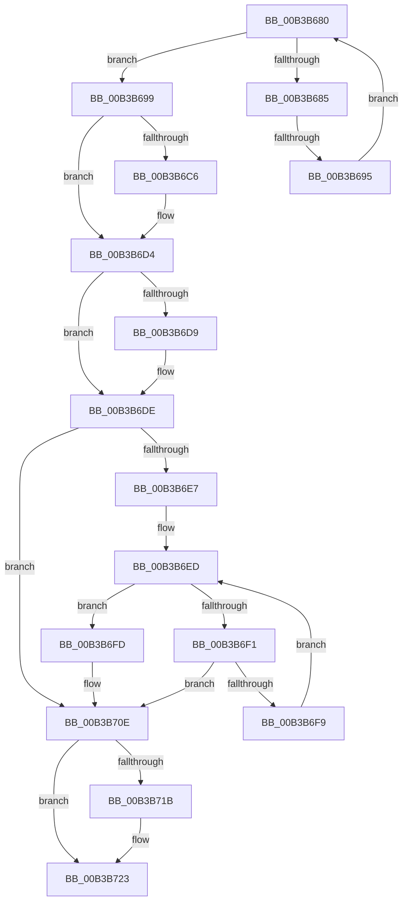

# sub_00B3B680

- RVA: `0x00B3B680`–`0x00B3B736` (길이 `182` bytes)
- VA: `0x0000000140B3B680`
- 실행 섹션: `PAGE`
- PDB 이름 있음: `아니요`; PDB Function 태그: `아니요`
- unwind 정보 RVA: `0x000AF86C`
- 디코드: `54`개 명령, `182/182` bytes 표시
- 미해석 바이트: `0` (있으면 어셈블리에 `.byte`로 보존)

> 이 문서는 커널 이미지의 기계어와 PDB 기호를 분석해 생성했습니다. 4번과 5번은 함수 원형과 자료형을 바이너리 사용 방식에서 추정한 C 해석이며 원본 소스 복구 결과는 아닙니다.

## 1. Dependencies

- 직접 호출 지점: **5**; 고유 호출 대상: **5**
- 직접 호출자로 확인된 함수: **0**
- RIP 상대 이미지 참조: **0**

### Outgoing calls
- `0x00B3B6B6` → [KeAbPreAcquire](../../text/21/KeAbPreAcquire_function_00210230.md) (function, `0x00210230`)
- `0x00B3B6CF` → [ExfAcquirePushLockExclusiveEx](../../text/20/ExfAcquirePushLockExclusiveEx_function_0020FC90.md) (function, `0x0020FC90`)
- `0x00B3B71E` → [ExfTryToWakePushLock](../../text/26/ExfTryToWakePushLock_function_00265DD0.md) (function, `0x00265DD0`)
- `0x00B3B726` → [KeAbPostRelease](../../text/2E/KeAbPostRelease_function_002E1600.md) (function, `0x002E1600`)
- `0x00B3B72B` → [KeLeaveCriticalRegion](../../text/25/KeLeaveCriticalRegion_function_0025D8B0.md) (function, `0x0025D8B0`)

### Direct callers
- 이 함수 시작 RVA로 연결되는 직접 call은 확인되지 않았습니다. 간접 호출은 완전히 역산할 수 없습니다.

### Static image references
- 디코드된 RIP-relative 메모리 참조가 없습니다.

## 2. Other-region calls and transfers

- 다른 실행 섹션으로 향하는 call: **5**
  - `0x00B3B6B6` → [KeAbPreAcquire](../../text/21/KeAbPreAcquire_function_00210230.md) (`PAGE` → `.text`)
  - `0x00B3B6CF` → [ExfAcquirePushLockExclusiveEx](../../text/20/ExfAcquirePushLockExclusiveEx_function_0020FC90.md) (`PAGE` → `.text`)
  - `0x00B3B71E` → [ExfTryToWakePushLock](../../text/26/ExfTryToWakePushLock_function_00265DD0.md) (`PAGE` → `.text`)
  - `0x00B3B726` → [KeAbPostRelease](../../text/2E/KeAbPostRelease_function_002E1600.md) (`PAGE` → `.text`)
  - `0x00B3B72B` → [KeLeaveCriticalRegion](../../text/25/KeLeaveCriticalRegion_function_0025D8B0.md) (`PAGE` → `.text`)
- call이 아닌 외부 분기/꼬리 이동: **2**
  - `0x00B3B68F` → [KiShouldLogUserModeReturnMismatch + 0x4A](../A4/KiShouldLogUserModeReturnMismatch_function_00A46E10.md) (`tail-transfer`)
  - `0x00B3B731` → [KiShouldLogUserModeReturnMismatch + 0x4A](../A4/KiShouldLogUserModeReturnMismatch_function_00A46E10.md) (`tail-transfer`)

## 3. Assembly (complete function range)

```asm
00B3B680  41 3B D0                        cmp edx, r8d
00B3B683  73 14                           jae 0x140b3b699
00B3B685  48 8B 04 3E                     mov rax, qword ptr [rsi + rdi]
00B3B689  8B CA                           mov ecx, edx
00B3B68B  4C 39 3C C8                     cmp qword ptr [rax + rcx*8], r15
00B3B68F  0F 84 C5 B7 F0 FF               je 0x140a46e5a
00B3B695  FF C2                           inc edx
00B3B697  EB E7                           jmp 0x140b3b680
00B3B699  65 48 8B 04 25 88 01 00 00      mov rax, qword ptr gs:[0x188]
00B3B6A2  48 83 CB FF                     or rbx, 0xffffffffffffffff
00B3B6A6  45 33 C0                        xor r8d, r8d
00B3B6A9  33 D2                           xor edx, edx
00B3B6AB  48 8B CF                        mov rcx, rdi
00B3B6AE  66 01 98 E4 01 00 00            add word ptr [rax + 0x1e4], bx
00B3B6B5  90                              nop
00B3B6B6  E8 75 4B 6D FF                  call 0x140210230
00B3B6BB  F0 48 0F BA 2F 00               lock bts qword ptr [rdi], 0
00B3B6C1  4C 8B F0                        mov r14, rax
00B3B6C4  73 0E                           jae 0x140b3b6d4
00B3B6C6  4C 8B C7                        mov r8, rdi
00B3B6C9  48 8B D0                        mov rdx, rax
00B3B6CC  48 8B CF                        mov rcx, rdi
00B3B6CF  E8 BC 45 6D FF                  call 0x14020fc90
00B3B6D4  4D 85 F6                        test r14, r14
00B3B6D7  74 05                           je 0x140b3b6de
00B3B6D9  41 C6 46 0A 01                  mov byte ptr [r14 + 0xa], 1
00B3B6DE  8B 54 3E 08                     mov edx, dword ptr [rsi + rdi + 8]
00B3B6E2  41 3B D4                        cmp edx, r12d
00B3B6E5  74 27                           je 0x140b3b70e
00B3B6E7  4C 8B 04 3E                     mov r8, qword ptr [rsi + rdi]
00B3B6EB  8B CD                           mov ecx, ebp
00B3B6ED  3B CA                           cmp ecx, edx
00B3B6EF  73 0C                           jae 0x140b3b6fd
00B3B6F1  8B C1                           mov eax, ecx
00B3B6F3  4D 39 3C C0                     cmp qword ptr [r8 + rax*8], r15
00B3B6F7  74 15                           je 0x140b3b70e
00B3B6F9  FF C1                           inc ecx
00B3B6FB  EB F0                           jmp 0x140b3b6ed
00B3B6FD  4D 89 3C D0                     mov qword ptr [r8 + rdx*8], r15
00B3B701  40 B5 01                        mov bpl, 1
00B3B704  8B 44 3E 08                     mov eax, dword ptr [rsi + rdi + 8]
00B3B708  FF C0                           inc eax
00B3B70A  89 44 3E 08                     mov dword ptr [rsi + rdi + 8], eax
00B3B70E  F0 48 0F C1 1F                  lock xadd qword ptr [rdi], rbx
00B3B713  80 E3 06                        and bl, 6
00B3B716  80 FB 02                        cmp bl, 2
00B3B719  75 08                           jne 0x140b3b723
00B3B71B  48 8B CF                        mov rcx, rdi
00B3B71E  E8 AD A6 72 FF                  call 0x140265dd0
00B3B723  48 8B CF                        mov rcx, rdi
00B3B726  E8 D5 5E 7A FF                  call 0x1402e1600
00B3B72B  E8 80 21 72 FF                  call 0x14025d8b0
00B3B730  90                              nop
00B3B731  E9 24 B7 F0 FF                  jmp 0x140a46e5a
```

## 4. C-style interpretation (structured pseudocode)

```c
__int64 __fastcall sub_00B3B680(__int64 a1, int a2, int a3)
{
    __int64 result;
    __int64 v_rbx;

    if (a2 >= a3) goto loc_00B3B699;
    a2 = (unsigned int)((a2) + 1);
    goto loc_00B3B680;
loc_00B3B699:
    v_rbx = (v_rbx) | (-1);
    a3 = 0;
    a2 = 0;
    result = KeAbPreAcquire(v_rdi, a2, a3, a4);
    if (!(condition_is_above_or_equal)) {
        a3 = v_rdi;
        a2 = result;
        a1 = v_rdi;
        result = ExfAcquirePushLockExclusiveEx(a1, a2, a3, a4);
    }
    if (result != 0) {
        *(unsigned __int8 *)(result + 10) = 1;
    }
    if (((unsigned int)((unsigned int)(*(unsigned int *)(v_rsi + v_rdi * 1 + 8)))) == ((unsigned int)(v_r12))) goto loc_00B3B70E;
loc_00B3B6ED:
    if (((unsigned int)((unsigned int)((unsigned int)(v_rbp)))) >= ((unsigned int)((unsigned int)(*(unsigned int *)(v_rsi + v_rdi * 1 + 8))))) goto loc_00B3B6FD;
    if ((*(unsigned __int64 *)(*(unsigned __int64 *)(v_rsi + v_rdi * 1) + (unsigned int)((unsigned int)((unsigned int)((unsigned int)(v_rbp)))) * 8)) == v_r15) goto loc_00B3B70E;
    a1 = (unsigned int)(((unsigned int)((unsigned int)(v_rbp))) + 1);
    goto loc_00B3B6ED;
loc_00B3B6FD:
    *(unsigned __int64 *)(*(unsigned __int64 *)(v_rsi + v_rdi * 1) + (unsigned int)(*(unsigned int *)(v_rsi + v_rdi * 1 + 8)) * 8) = v_r15;
    result = (unsigned int)(((unsigned int)(*(unsigned int *)(v_rsi + v_rdi * 1 + 8))) + 1);
    *(unsigned int *)(v_rsi + v_rdi * 1 + 8) = (unsigned int)(result);
loc_00B3B70E:
    v_rbx = (unsigned __int8)((v_rbx) & (6));
    if (((unsigned __int8)(v_rbx)) == 2) {
        a1 = v_rdi;
        result = ExfTryToWakePushLock(a1, (unsigned int)(*(unsigned int *)(v_rsi + v_rdi * 1 + 8)), *(unsigned __int64 *)(v_rsi + v_rdi * 1), a4);
    }
    result = KeAbPostRelease(v_rdi, (unsigned int)(*(unsigned int *)(v_rsi + v_rdi * 1 + 8)), *(unsigned __int64 *)(v_rsi + v_rdi * 1), a4);
    result = KeLeaveCriticalRegion(v_rdi, (unsigned int)(*(unsigned int *)(v_rsi + v_rdi * 1 + 8)), *(unsigned __int64 *)(v_rsi + v_rdi * 1), a4);
}
```

## 5. (Beta) C Style

```c
int64_t sub_00B3B680(int64_t Arg1, int32_t Arg2, int32_t Arg3)
{
    int64_t result;
    int64_t local_rbx;

    if (Arg2 >= Arg3) goto loc_00B3B699;
    Arg2 = (uint32_t)((Arg2) + 1);
    goto loc_00B3B680;
loc_00B3B699:
    local_rbx = (local_rbx) | (-1);
    Arg3 = 0;
    Arg2 = 0;
    result = KeAbPreAcquire(local_rdi, Arg2, Arg3, a4);
    if (!(condition_is_above_or_equal)) {
        Arg3 = local_rdi;
        Arg2 = result;
        Arg1 = local_rdi;
        result = ExfAcquirePushLockExclusiveEx(Arg1, Arg2, Arg3, a4);
    }
    if (result != 0) {
        *(uint8_t *)(result + 0xA) = 1;
    }
    if (((uint32_t)((uint32_t)(*(uint32_t *)(local_rsi + local_rdi * 1 + 0x8)))) == ((uint32_t)(local_r12))) goto loc_00B3B70E;
loc_00B3B6ED:
    if (((uint32_t)((uint32_t)((uint32_t)(local_rbp)))) >= ((uint32_t)((uint32_t)(*(uint32_t *)(local_rsi + local_rdi * 1 + 0x8))))) goto loc_00B3B6FD;
    if ((*(uint64_t *)(*(uint64_t *)(local_rsi + local_rdi * 1) + (uint32_t)((uint32_t)((uint32_t)((uint32_t)(local_rbp)))) * 8)) == local_r15) goto loc_00B3B70E;
    Arg1 = (uint32_t)(((uint32_t)((uint32_t)(local_rbp))) + 1);
    goto loc_00B3B6ED;
loc_00B3B6FD:
    *(uint64_t *)(*(uint64_t *)(local_rsi + local_rdi * 1) + (uint32_t)(*(uint32_t *)(local_rsi + local_rdi * 1 + 0x8)) * 8) = local_r15;
    result = (uint32_t)(((uint32_t)(*(uint32_t *)(local_rsi + local_rdi * 1 + 0x8))) + 1);
    *(uint32_t *)(local_rsi + local_rdi * 1 + 0x8) = (uint32_t)(result);
loc_00B3B70E:
    local_rbx = (uint8_t)((local_rbx) & (6));
    if (((uint8_t)(local_rbx)) == 2) {
        Arg1 = local_rdi;
        result = ExfTryToWakePushLock(Arg1, (uint32_t)(*(uint32_t *)(local_rsi + local_rdi * 1 + 0x8)), *(uint64_t *)(local_rsi + local_rdi * 1), a4);
    }
    result = KeAbPostRelease(local_rdi, (uint32_t)(*(uint32_t *)(local_rsi + local_rdi * 1 + 0x8)), *(uint64_t *)(local_rsi + local_rdi * 1), a4);
    result = KeLeaveCriticalRegion(local_rdi, (uint32_t)(*(uint32_t *)(local_rsi + local_rdi * 1 + 0x8)), *(uint64_t *)(local_rsi + local_rdi * 1), a4);
}
```

## 6. Execution-region graph

[열기: 2D/3D 그래프와 함수 탐색 컨트롤 패널](../../../control-panel.html?section=page&rva=0x00B3B680&view=graph)

- 2D 그래프는 위에서 아래로 흐르고, 3D 그래프는 빈 공간을 드래그해 회전합니다. Shift+드래그는 이동, 휠은 확대·축소, 함수 노드 선택은 대상 보고서 이동입니다.

### Static fallback


