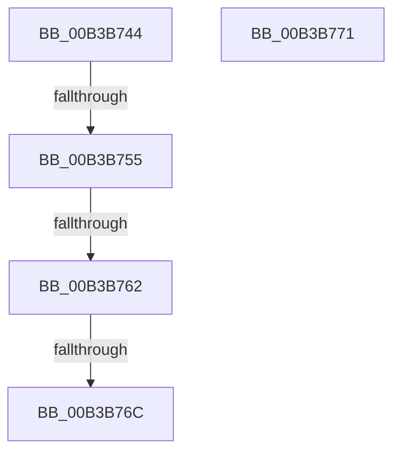

# sub_00B3B744

- RVA: `0x00B3B744`–`0x00B3B77E` (길이 `58` bytes)
- VA: `0x0000000140B3B744`
- 실행 섹션: `PAGE`
- PDB 이름 있음: `아니요`; PDB Function 태그: `아니요`
- unwind 정보 RVA: `0x000AFA60`
- 디코드: `12`개 명령, `58/58` bytes 표시
- 미해석 바이트: `0` (있으면 어셈블리에 `.byte`로 보존)

> 이 문서는 커널 이미지의 기계어와 PDB 기호를 분석해 생성했습니다. 4번과 5번은 함수 원형과 자료형을 바이너리 사용 방식에서 추정한 C 해석이며 원본 소스 복구 결과는 아닙니다.

## 1. Dependencies

- 직접 호출 지점: **0**; 고유 호출 대상: **0**
- 직접 호출자로 확인된 함수: **0**
- RIP 상대 이미지 참조: **0**

### Outgoing calls
- 직접 디코드된 call 명령이 없습니다.

### Direct callers
- 이 함수 시작 RVA로 연결되는 직접 call은 확인되지 않았습니다. 간접 호출은 완전히 역산할 수 없습니다.

### Static image references
- 디코드된 RIP-relative 메모리 참조가 없습니다.

## 2. Other-region calls and transfers

- 다른 실행 섹션으로 향하는 call: **0**
- call이 아닌 외부 분기/꼬리 이동: **5**
  - `0x00B3B74F` → [FsRtlCopyWrite + 0x416](../A4/FsRtlCopyWrite_function_00A48210.md) (`tail-transfer`)
  - `0x00B3B75C` → [FsRtlCopyWrite + 0x416](../A4/FsRtlCopyWrite_function_00A48210.md) (`tail-transfer`)
  - `0x00B3B766` → [FsRtlCopyWrite + 0x180](../A4/FsRtlCopyWrite_function_00A48210.md) (`tail-transfer`)
  - `0x00B3B76C` → [FsRtlCopyWrite + 0x416](../A4/FsRtlCopyWrite_function_00A48210.md) (`tail-transfer`)
  - `0x00B3B779` → [FsRtlCopyWrite + 0x280](../A4/FsRtlCopyWrite_function_00A48210.md) (`tail-transfer`)

## 3. Assembly (complete function range)

```asm
00B3B744  8B 94 24 E0 00 00 00            mov edx, dword ptr [rsp + 0xe0]
00B3B74B  4D 39 65 30                     cmp qword ptr [r13 + 0x30], r12
00B3B74F  0F 84 D1 CE F0 FF               je 0x140a48626
00B3B755  45 8A 47 05                     mov r8b, byte ptr [r15 + 5]
00B3B759  45 84 C0                        test r8b, r8b
00B3B75C  0F 84 C4 CE F0 FF               je 0x140a48626
00B3B762  49 3B 5F 18                     cmp rbx, qword ptr [r15 + 0x18]
00B3B766  0F 8E 24 CC F0 FF               jle 0x140a48390
00B3B76C  E9 B5 CE F0 FF                  jmp 0x140a48626
00B3B771  49 89 77 20                     mov qword ptr [r15 + 0x20], rsi
00B3B775  4D 89 77 28                     mov qword ptr [r15 + 0x28], r14
00B3B779  E9 12 CD F0 FF                  jmp 0x140a48490
```

## 4. C-style interpretation (structured pseudocode)

```c
void __fastcall sub_00B3B744(__int64 a1, __int64 a2, __int64 a3, __int64 a4, __int64 a5, __int64 a6, __int64 a7, __int64 a8, __int64 a9, __int64 a10, __int64 a11, __int64 a12, __int64 a13, __int64 a14, __int64 a15, __int64 a16, __int64 a17, __int64 a18, __int64 a19, __int64 a20, __int64 a21, __int64 a22, __int64 a23, __int64 a24, __int64 a25, __int64 a26, __int64 a27, unsigned int a28)
{
}
```

## 5. (Beta) C Style

```c
void sub_00B3B744(int64_t Arg1, int64_t Arg2, int64_t Arg3, int64_t Arg4, uint64_t Arg5, uint64_t Arg6, uint64_t Arg7, uint64_t Arg8, uint64_t Arg9, uint64_t Arg10, uint64_t Arg11, uint64_t Arg12, uint64_t Arg13, uint64_t Arg14, uint64_t Arg15, uint64_t Arg16, uint64_t Arg17, uint64_t Arg18, uint64_t Arg19, uint64_t Arg20, uint64_t Arg21, uint64_t Arg22, uint64_t Arg23, uint64_t Arg24, uint64_t Arg25, uint64_t Arg26, uint64_t Arg27, uint32_t Arg28)
{
}
```

## 6. Execution-region graph

[열기: 2D/3D 그래프와 함수 탐색 컨트롤 패널](../../../control-panel.html?section=page&rva=0x00B3B744&view=graph)

- 2D 그래프는 위에서 아래로 흐르고, 3D 그래프는 빈 공간을 드래그해 회전합니다. Shift+드래그는 이동, 휠은 확대·축소, 함수 노드 선택은 대상 보고서 이동입니다.

### Static fallback


