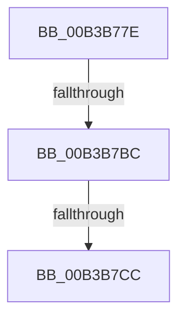

# sub_00B3B77E

- RVA: `0x00B3B77E`–`0x00B3B7E5` (길이 `103` bytes)
- VA: `0x0000000140B3B77E`
- 실행 섹션: `PAGE`
- PDB 이름 있음: `아니요`; PDB Function 태그: `아니요`
- unwind 정보 RVA: `0x000AFCF4`
- 디코드: `21`개 명령, `103/103` bytes 표시
- 미해석 바이트: `0` (있으면 어셈블리에 `.byte`로 보존)

> 이 문서는 커널 이미지의 기계어와 PDB 기호를 분석해 생성했습니다. 4번과 5번은 함수 원형과 자료형을 바이너리 사용 방식에서 추정한 C 해석이며 원본 소스 복구 결과는 아닙니다.

## 1. Dependencies

- 직접 호출 지점: **2**; 고유 호출 대상: **2**
- 직접 호출자로 확인된 함수: **0**
- RIP 상대 이미지 참조: **1**

### Outgoing calls
- `0x00B3B7AF` → [ObpReferenceObjectByHandleWithTag](../86/ObpReferenceObjectByHandleWithTag_function_00869650.md) (function, `0x00869650`)
- `0x00B3B7D6` → [KiStackAttachProcess](../../text/21/KiStackAttachProcess_function_00216820.md) (function, `0x00216820`)

### Direct callers
- 이 함수 시작 RVA로 연결되는 직접 call은 확인되지 않았습니다. 간접 호출은 완전히 역산할 수 없습니다.

### Static image references
- `0x00B3B79B` → RVA `0x00FC6A98` (`ALMOSTRO`; read)

## 2. Other-region calls and transfers

- 다른 실행 섹션으로 향하는 call: **1**
  - `0x00B3B7D6` → [KiStackAttachProcess](../../text/21/KiStackAttachProcess_function_00216820.md) (`PAGE` → `.text`)
- call이 아닌 외부 분기/꼬리 이동: **3**
  - `0x00B3B7B6` → [NtResetWriteWatch + 0x120](../A4/NtResetWriteWatch_function_00A48F60.md) (`tail-transfer`)
  - `0x00B3B7C6` → [NtResetWriteWatch + 0x9A](../A4/NtResetWriteWatch_function_00A48F60.md) (`tail-transfer`)
  - `0x00B3B7E0` → [NtResetWriteWatch + 0x9A](../A4/NtResetWriteWatch_function_00A48F60.md) (`tail-transfer`)

## 3. Assembly (complete function range)

```asm
00B3B77E  48 83 64 24 38 00               and qword ptr [rsp + 0x38], 0
00B3B784  48 8D 44 24 40                  lea rax, [rsp + 0x40]
00B3B789  48 83 64 24 30 00               and qword ptr [rsp + 0x30], 0
00B3B78F  BA 08 00 00 00                  mov edx, 8
00B3B794  45 8A 89 32 02 00 00            mov r9b, byte ptr [r9 + 0x232]
00B3B79B  4C 8B 05 F6 B2 48 00            mov r8, qword ptr [rip + 0x48b2f6]
00B3B7A2  48 89 44 24 28                  mov qword ptr [rsp + 0x28], rax
00B3B7A7  C7 44 24 20 4D 6D 57 77         mov dword ptr [rsp + 0x20], 0x77576d4d
00B3B7AF  E8 9C DE D2 FF                  call 0x140869650
00B3B7B4  85 C0                           test eax, eax
00B3B7B6  0F 88 C4 D8 F0 FF               js 0x140a49080
00B3B7BC  4C 8B 74 24 40                  mov r14, qword ptr [rsp + 0x40]
00B3B7C1  33 DB                           xor ebx, ebx
00B3B7C3  49 3B F6                        cmp rsi, r14
00B3B7C6  0F 84 2E D8 F0 FF               je 0x140a48ffa
00B3B7CC  4C 8D 44 24 48                  lea r8, [rsp + 0x48]
00B3B7D1  33 D2                           xor edx, edx
00B3B7D3  49 8B CE                        mov rcx, r14
00B3B7D6  E8 45 B0 6D FF                  call 0x140216820
00B3B7DB  BB 01 00 00 00                  mov ebx, 1
00B3B7E0  E9 15 D8 F0 FF                  jmp 0x140a48ffa
```

## 4. C-style interpretation (structured pseudocode)

```c
__int64 __fastcall sub_00B3B77E(__int64 a1, __int64 a2, __int64 a3, __int64 a4, __int64 a5, __int64 a6, __int64 a7, __int64 a8, __int64 a9)
{
    __int64 result;
    __int64 v_rbx;
    unsigned int v_stack_p20;
    unsigned __int64 v_stack_p28;

    v_stack_p28 = a8;
    v_stack_p20 = 0x77576D4DULL;
    result = ObpReferenceObjectByHandleWithTag(a1, 8, *(unsigned __int64 *)(v_rip + 4764406), *(unsigned __int8 *)(a4 + 562));
    v_rbx = 0;
    a2 = 0;
    result = KiStackAttachProcess(a8, a2, a9, *(unsigned __int8 *)(a4 + 562));
}
```

## 5. (Beta) C Style

```c
int64_t sub_00B3B77E(int64_t Arg1, int64_t Arg2, int64_t Arg3, void *Arg4, uint64_t Arg5, int64_t Arg6, int64_t Arg7, int64_t Arg8, int64_t Arg9)
{
    uint8_t *arg4 = (uint8_t *)Arg4;

    int64_t result;
    int64_t local_rbx;
    uint32_t v_stack_p20;
    uint64_t v_stack_p28;

    v_stack_p28 = Arg8;
    v_stack_p20 = 0x77576D4DULL;
    result = ObpReferenceObjectByHandleWithTag(Arg1, 8, *(uint64_t *)(v_rip + 0x48B2F6), *(uint8_t *)(arg4 + 0x232));
    local_rbx = 0;
    Arg2 = 0;
    result = KiStackAttachProcess(Arg8, Arg2, Arg9, *(uint8_t *)(arg4 + 0x232));
}
```

### 관측된 메모리 오프셋

구조체 형식이 확인되지 않은 접근은 인자 기준의 오프셋으로만 기록했습니다.

| 기준 인자 | 오프셋 표현 | 폭 (bit) | 접근 |
|---|---:|---:|---|
| `Arg4` | `+ 0x232` | `8` | `R` |

## 6. Execution-region graph

[열기: 2D/3D 그래프와 함수 탐색 컨트롤 패널](../../../control-panel.html?section=page&rva=0x00B3B77E&view=graph)

- 2D 그래프는 위에서 아래로 흐르고, 3D 그래프는 빈 공간을 드래그해 회전합니다. Shift+드래그는 이동, 휠은 확대·축소, 함수 노드 선택은 대상 보고서 이동입니다.

### Static fallback


