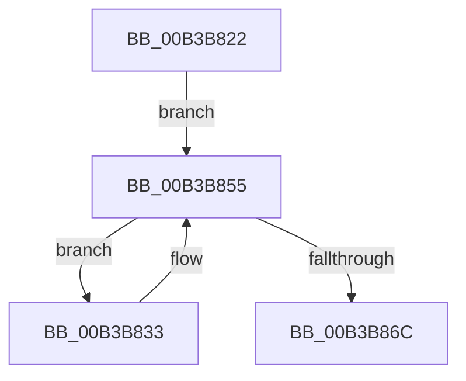

# sub_00B3B822

- RVA: `0x00B3B822`–`0x00B3B881` (길이 `95` bytes)
- VA: `0x0000000140B3B822`
- 실행 섹션: `PAGE`
- PDB 이름 있음: `아니요`; PDB Function 태그: `아니요`
- unwind 정보 RVA: `0x000B0268`
- 디코드: `25`개 명령, `95/95` bytes 표시
- 미해석 바이트: `0` (있으면 어셈블리에 `.byte`로 보존)

> 이 문서는 커널 이미지의 기계어와 PDB 기호를 분석해 생성했습니다. 4번과 5번은 함수 원형과 자료형을 바이너리 사용 방식에서 추정한 C 해석이며 원본 소스 복구 결과는 아닙니다.

## 1. Dependencies

- 직접 호출 지점: **4**; 고유 호출 대상: **4**
- 직접 호출자로 확인된 함수: **0**
- RIP 상대 이미지 참조: **0**

### Outgoing calls
- `0x00B3B826` → [MiGetPteAddress](../../text/43/MiGetPteAddress_function_0043E130.md) (function, `0x0043E130`)
- `0x00B3B845` → [MiUnlockCodePage](../../text/2A/MiUnlockCodePage_function_002A2AB8.md) (function, `0x002A2AB8`)
- `0x00B3B85E` → [RtlFindSetBitsEx](../../text/40/RtlFindSetBitsEx_function_0040B880.md) (function, `0x0040B880`)
- `0x00B3B872` → [ExFreePoolWithTag](../../poolcode/B8/ExFreePoolWithTag_function_00B82870.md) (function, `0x00B82870`)

### Direct callers
- 이 함수 시작 RVA로 연결되는 직접 call은 확인되지 않았습니다. 간접 호출은 완전히 역산할 수 없습니다.

### Static image references
- 디코드된 RIP-relative 메모리 참조가 없습니다.

## 2. Other-region calls and transfers

- 다른 실행 섹션으로 향하는 call: **4**
  - `0x00B3B826` → [MiGetPteAddress](../../text/43/MiGetPteAddress_function_0043E130.md) (`PAGE` → `.text`)
  - `0x00B3B845` → [MiUnlockCodePage](../../text/2A/MiUnlockCodePage_function_002A2AB8.md) (`PAGE` → `.text`)
  - `0x00B3B85E` → [RtlFindSetBitsEx](../../text/40/RtlFindSetBitsEx_function_0040B880.md) (`PAGE` → `.text`)
  - `0x00B3B872` → [ExFreePoolWithTag](../../poolcode/B8/ExFreePoolWithTag_function_00B82870.md) (`PAGE` → `POOLCODE`)
- call이 아닌 외부 분기/꼬리 이동: **1**
  - `0x00B3B87C` → [MiUnlockDriverPages + 0x3A](../A4/MiUnlockDriverPages_function_00A4BA6C.md) (`tail-transfer`)

## 3. Assembly (complete function range)

```asm
00B3B822  48 8B 4F 30                     mov rcx, qword ptr [rdi + 0x30]
00B3B826  E8 05 29 90 FF                  call 0x14043e130
00B3B82B  4C 8B F0                        mov r14, rax
00B3B82E  45 33 C0                        xor r8d, r8d
00B3B831  EB 22                           jmp 0x140b3b855
00B3B833  44 8B 43 60                     mov r8d, dword ptr [rbx + 0x60]
00B3B837  49 8D 0C F6                     lea rcx, [r14 + rsi*8]
00B3B83B  41 D1 E8                        shr r8d, 1
00B3B83E  48 8B D1                        mov rdx, rcx
00B3B841  41 83 E0 01                     and r8d, 1
00B3B845  E8 6E 72 76 FF                  call 0x1402a2ab8
00B3B84A  48 8B 43 28                     mov rax, qword ptr [rbx + 0x28]
00B3B84E  4C 8B C6                        mov r8, rsi
00B3B851  48 0F B3 30                     btr qword ptr [rax], rsi
00B3B855  BA 01 00 00 00                  mov edx, 1
00B3B85A  48 8D 4B 20                     lea rcx, [rbx + 0x20]
00B3B85E  E8 1D 00 8D FF                  call 0x14040b880
00B3B863  48 8B F0                        mov rsi, rax
00B3B866  48 83 F8 FF                     cmp rax, -1
00B3B86A  75 C7                           jne 0x140b3b833
00B3B86C  48 8B 4B 28                     mov rcx, qword ptr [rbx + 0x28]
00B3B870  33 D2                           xor edx, edx
00B3B872  E8 F9 6F 04 00                  call 0x140b82870
00B3B877  48 83 63 28 00                  and qword ptr [rbx + 0x28], 0
00B3B87C  E9 25 02 F1 FF                  jmp 0x140a4baa6
```

## 4. C-style interpretation (structured pseudocode)

```c
__int64 __fastcall sub_00B3B822(__int64 a1, __int64 a2, int a3)
{
    __int64 result;

    result = MiGetPteAddress(*(unsigned __int64 *)(v_rdi + 48), a2, a3, a4);
    a3 = 0;
    goto loc_00B3B855;
loc_00B3B833:
    a3 = (unsigned int)(((unsigned int)(*(unsigned int *)(v_rbx + 96))) >> (1));
    a3 = (unsigned int)((a3) & (1));
    result = MiUnlockCodePage(result + v_rsi * 8, result + v_rsi * 8, a3, a4);
loc_00B3B855:
    result = RtlFindSetBitsEx(v_rbx + 32, 1, v_rsi, a4);
    if (result != -1) goto loc_00B3B833;
    a2 = 0;
    result = ExFreePoolWithTag(*(unsigned __int64 *)(v_rbx + 40), a2, v_rsi, a4);
}
```

## 5. (Beta) C Style

```c
int64_t sub_00B3B822(int64_t Arg1, int64_t Arg2, int32_t Arg3)
{
    int64_t result;

    result = MiGetPteAddress(*(uint64_t *)(local_rdi + 0x30), Arg2, Arg3, a4);
    Arg3 = 0;
    goto loc_00B3B855;
loc_00B3B833:
    Arg3 = (uint32_t)(((uint32_t)(*(uint32_t *)(local_rbx + 0x60))) >> (1));
    Arg3 = (uint32_t)((Arg3) & (1));
    result = MiUnlockCodePage(result + local_rsi * 8, result + local_rsi * 8, Arg3, a4);
loc_00B3B855:
    result = RtlFindSetBitsEx(local_rbx + 32, 1, local_rsi, a4);
    if (result != -1) goto loc_00B3B833;
    Arg2 = 0;
    result = ExFreePoolWithTag(*(uint64_t *)(local_rbx + 0x28), Arg2, local_rsi, a4);
}
```

## 6. Execution-region graph

[열기: 2D/3D 그래프와 함수 탐색 컨트롤 패널](../../../control-panel.html?section=page&rva=0x00B3B822&view=graph)

- 2D 그래프는 위에서 아래로 흐르고, 3D 그래프는 빈 공간을 드래그해 회전합니다. Shift+드래그는 이동, 휠은 확대·축소, 함수 노드 선택은 대상 보고서 이동입니다.

### Static fallback


