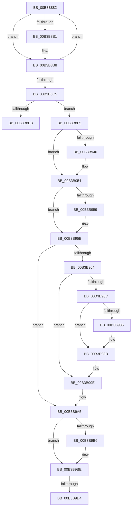

# sub_00B3B882

- RVA: `0x00B3B882`–`0x00B3B9EA` (길이 `360` bytes)
- VA: `0x0000000140B3B882`
- 실행 섹션: `PAGE`
- PDB 이름 있음: `아니요`; PDB Function 태그: `아니요`
- unwind 정보 RVA: `0x000B0314`
- 디코드: `87`개 명령, `360/360` bytes 표시
- 미해석 바이트: `0` (있으면 어셈블리에 `.byte`로 보존)

> 이 문서는 커널 이미지의 기계어와 PDB 기호를 분석해 생성했습니다. 4번과 5번은 함수 원형과 자료형을 바이너리 사용 방식에서 추정한 C 해석이며 원본 소스 복구 결과는 아닙니다.

## 1. Dependencies

- 직접 호출 지점: **11**; 고유 호출 대상: **11**
- 직접 호출자로 확인된 함수: **0**
- RIP 상대 이미지 참조: **8**

### Outgoing calls
- `0x00B3B88F` → [memset](../../text/6C/memset_function_006C6C40.md) (function, `0x006C6C40`)
- `0x00B3B8A5` → [MmManagePartitionMemoryInformation](../90/MmManagePartitionMemoryInformation_function_0090343C.md) (function, `0x0090343C`)
- `0x00B3B8DE` → [SmAllocEx](../../text/34/SmAllocEx_function_0034C794.md) (function, `0x0034C794`)
- `0x00B3B8F8` → [SmPartitionInitialize](../7A/SmPartitionInitialize_function_007A5D04.md) (function, `0x007A5D04`)
- `0x00B3B936` → [KeAbPreAcquire](../../text/21/KeAbPreAcquire_function_00210230.md) (function, `0x00210230`)
- `0x00B3B94F` → [ExfAcquirePushLockExclusiveEx](../../text/20/ExfAcquirePushLockExclusiveEx_function_0020FC90.md) (function, `0x0020FC90`)
- `0x00B3B9B9` → [ExfTryToWakePushLock](../../text/26/ExfTryToWakePushLock_function_00265DD0.md) (function, `0x00265DD0`)
- `0x00B3B9C1` → [KeAbPostRelease](../../text/2E/KeAbPostRelease_function_002E1600.md) (function, `0x002E1600`)
- `0x00B3B9C6` → [KeLeaveCriticalRegion](../../text/25/KeLeaveCriticalRegion_function_0025D8B0.md) (function, `0x0025D8B0`)
- `0x00B3B9D7` → [SmPartitionCleanup](../7A/SmPartitionCleanup_function_007A5C14.md) (function, `0x007A5C14`)
- `0x00B3B9DF` → [CmSiFreeMemory](../../text/47/CmSiFreeMemory_function_00475D80.md) (function, `0x00475D80`)

### Direct callers
- 이 함수 시작 RVA로 연결되는 직접 call은 확인되지 않았습니다. 간접 호출은 완전히 역산할 수 없습니다.

### Static image references
- `0x00B3B8B8` → RVA `0x00FC5000` (`ALMOSTRO`; read)
- `0x00B3B904` → RVA `0x00E288C8` (`.data`; read)
- `0x00B3B90B` → RVA `0x00E28380` (`.data`; read)
- `0x00B3B964` → RVA `0x00E288F0` (`.data`; read)
- `0x00B3B96C` → RVA `0x00E288C0` (`.data`; read)
- `0x00B3B973` → RVA `0x00E288B8` (`.data`; read)
- `0x00B3B997` → RVA `0x00E288C0` (`.data`; write)
- `0x00B3B9A5` → RVA `0x00E288C8` (`.data`; read/write)

## 2. Other-region calls and transfers

- 다른 실행 섹션으로 향하는 call: **8**
  - `0x00B3B88F` → [memset](../../text/6C/memset_function_006C6C40.md) (`PAGE` → `.text`)
  - `0x00B3B8DE` → [SmAllocEx](../../text/34/SmAllocEx_function_0034C794.md) (`PAGE` → `.text`)
  - `0x00B3B936` → [KeAbPreAcquire](../../text/21/KeAbPreAcquire_function_00210230.md) (`PAGE` → `.text`)
  - `0x00B3B94F` → [ExfAcquirePushLockExclusiveEx](../../text/20/ExfAcquirePushLockExclusiveEx_function_0020FC90.md) (`PAGE` → `.text`)
  - `0x00B3B9B9` → [ExfTryToWakePushLock](../../text/26/ExfTryToWakePushLock_function_00265DD0.md) (`PAGE` → `.text`)
  - `0x00B3B9C1` → [KeAbPostRelease](../../text/2E/KeAbPostRelease_function_002E1600.md) (`PAGE` → `.text`)
  - `0x00B3B9C6` → [KeLeaveCriticalRegion](../../text/25/KeLeaveCriticalRegion_function_0025D8B0.md) (`PAGE` → `.text`)
  - `0x00B3B9DF` → [CmSiFreeMemory](../../text/47/CmSiFreeMemory_function_00475D80.md) (`PAGE` → `.text`)
- call이 아닌 외부 분기/꼬리 이동: **3**
  - `0x00B3B8F0` → [SmCreatePartition + 0x3B](../A4/SmCreatePartition_function_00A4BC90.md) (`tail-transfer`)
  - `0x00B3B9CE` → [SmCreatePartition + 0x3B](../A4/SmCreatePartition_function_00A4BC90.md) (`tail-transfer`)
  - `0x00B3B9E5` → [SmCreatePartition + 0x3B](../A4/SmCreatePartition_function_00A4BC90.md) (`tail-transfer`)

## 3. Assembly (complete function range)

```asm
00B3B882  33 D2                           xor edx, edx
00B3B884  48 8D 4C 24 20                  lea rcx, [rsp + 0x20]
00B3B889  41 B8 F0 00 00 00               mov r8d, 0xf0
00B3B88F  E8 AC B3 B8 FF                  call 0x1406c6c40
00B3B894  48 8D 54 24 20                  lea rdx, [rsp + 0x20]
00B3B899  89 5C 24 24                     mov dword ptr [rsp + 0x24], ebx
00B3B89D  48 8B CD                        mov rcx, rbp
00B3B8A0  44 89 7C 24 28                  mov dword ptr [rsp + 0x28], r15d
00B3B8A5  E8 92 7B DC FF                  call 0x14090343c
00B3B8AA  4C 39 74 24 50                  cmp qword ptr [rsp + 0x50], r14
00B3B8AF  76 07                           jbe 0x140b3b8b8
00B3B8B1  4C 8B 74 24 50                  mov r14, qword ptr [rsp + 0x50]
00B3B8B6  8B F3                           mov esi, ebx
00B3B8B8  0F B7 05 41 97 48 00            movzx eax, word ptr [rip + 0x489741]
00B3B8BF  FF C3                           inc ebx
00B3B8C1  3B D8                           cmp ebx, eax
00B3B8C3  72 BD                           jb 0x140b3b882
00B3B8C5  44 8B C6                        mov r8d, esi
00B3B8C8  BA 53 6D 50 61                  mov edx, 0x61506d53
00B3B8CD  41 0F BA E8 1F                  bts r8d, 0x1f
00B3B8D2  B9 40 0D 00 00                  mov ecx, 0xd40
00B3B8D7  41 3B F7                        cmp esi, r15d
00B3B8DA  44 0F 44 C6                     cmove r8d, esi
00B3B8DE  E8 B1 0E 81 FF                  call 0x14034c794
00B3B8E3  48 8B F0                        mov rsi, rax
00B3B8E6  48 85 C0                        test rax, rax
00B3B8E9  75 0A                           jne 0x140b3b8f5
00B3B8EB  BF 9A 00 00 C0                  mov edi, 0xc000009a
00B3B8F0  E9 D6 03 F1 FF                  jmp 0x140a4bccb
00B3B8F5  48 8B CE                        mov rcx, rsi
00B3B8F8  E8 07 A4 C6 FF                  call 0x1407a5d04
00B3B8FD  48 89 AE 30 08 00 00            mov qword ptr [rsi + 0x830], rbp
00B3B904  4C 8D 3D BD CF 2E 00            lea r15, [rip + 0x2ecfbd]
00B3B90B  48 8B 05 6E CA 2E 00            mov rax, qword ptr [rip + 0x2eca6e]
00B3B912  48 83 CB FF                     or rbx, 0xffffffffffffffff
00B3B916  48 89 86 B0 08 00 00            mov qword ptr [rsi + 0x8b0], rax
00B3B91D  45 33 C0                        xor r8d, r8d
00B3B920  65 48 8B 04 25 88 01 00 00      mov rax, qword ptr gs:[0x188]
00B3B929  33 D2                           xor edx, edx
00B3B92B  49 8B CF                        mov rcx, r15
00B3B92E  66 01 98 E4 01 00 00            add word ptr [rax + 0x1e4], bx
00B3B935  90                              nop
00B3B936  E8 F5 48 6D FF                  call 0x140210230
00B3B93B  F0 49 0F BA 2F 00               lock bts qword ptr [r15], 0
00B3B941  4C 8B F0                        mov r14, rax
00B3B944  73 0E                           jae 0x140b3b954
00B3B946  4D 8B C7                        mov r8, r15
00B3B949  48 8B D0                        mov rdx, rax
00B3B94C  49 8B CF                        mov rcx, r15
00B3B94F  E8 3C 43 6D FF                  call 0x14020fc90
00B3B954  4D 85 F6                        test r14, r14
00B3B957  74 05                           je 0x140b3b95e
00B3B959  41 C6 46 0A 01                  mov byte ptr [r14 + 0xa], 1
00B3B95E  48 39 7D 18                     cmp qword ptr [rbp + 0x18], rdi
00B3B962  75 41                           jne 0x140b3b9a5
00B3B964  39 3D 86 CF 2E 00               cmp dword ptr [rip + 0x2ecf86], edi
00B3B96A  74 32                           je 0x140b3b99e
00B3B96C  48 8B 0D 4D CF 2E 00            mov rcx, qword ptr [rip + 0x2ecf4d]
00B3B973  48 8D 15 3E CF 2E 00            lea rdx, [rip + 0x2ecf3e]
00B3B97A  48 8D 86 48 08 00 00            lea rax, [rsi + 0x848]
00B3B981  48 39 11                        cmp qword ptr [rcx], rdx
00B3B984  74 07                           je 0x140b3b98d
00B3B986  B9 03 00 00 00                  mov ecx, 3
00B3B98B  CD 29                           int 0x29
00B3B98D  48 89 10                        mov qword ptr [rax], rdx
00B3B990  48 89 48 08                     mov qword ptr [rax + 8], rcx
00B3B994  48 89 01                        mov qword ptr [rcx], rax
00B3B997  48 89 05 22 CF 2E 00            mov qword ptr [rip + 0x2ecf22], rax
00B3B99E  48 89 75 18                     mov qword ptr [rbp + 0x18], rsi
00B3B9A2  48 8B F7                        mov rsi, rdi
00B3B9A5  F0 48 0F C1 1D 1A CF 2E 00      lock xadd qword ptr [rip + 0x2ecf1a], rbx
00B3B9AE  80 E3 06                        and bl, 6
00B3B9B1  80 FB 02                        cmp bl, 2
00B3B9B4  75 08                           jne 0x140b3b9be
00B3B9B6  49 8B CF                        mov rcx, r15
00B3B9B9  E8 12 A4 72 FF                  call 0x140265dd0
00B3B9BE  49 8B CF                        mov rcx, r15
00B3B9C1  E8 3A 5C 7A FF                  call 0x1402e1600
00B3B9C6  E8 E5 1E 72 FF                  call 0x14025d8b0
00B3B9CB  48 85 F6                        test rsi, rsi
00B3B9CE  0F 84 F7 02 F1 FF               je 0x140a4bccb
00B3B9D4  48 8B CE                        mov rcx, rsi
00B3B9D7  E8 38 A2 C6 FF                  call 0x1407a5c14
00B3B9DC  48 8B CE                        mov rcx, rsi
00B3B9DF  E8 9C A3 93 FF                  call 0x140475d80
00B3B9E4  90                              nop
00B3B9E5  E9 E1 02 F1 FF                  jmp 0x140a4bccb
```

## 4. C-style interpretation (structured pseudocode)

```c
__int64 __fastcall sub_00B3B882(__int64 a1, int a2, __int64 a3, __int64 a4, __int64 a5, __int64 a6, __int64 a7, __int64 a8, __int64 a9, __int64 a10)
{
    __int64 result;
    __int64 v_r14;
    __int64 v_rbx;
    __int64 v_rsi;
    unsigned __int64 v_stack_p20;
    unsigned int v_stack_p24;
    unsigned int v_stack_p28;

    a2 = 0;
    result = memset(v_stack_p20, a2, 240, a4);
    v_stack_p24 = (unsigned int)(v_rbx);
    v_stack_p28 = (unsigned int)(v_r15);
    result = MmManagePartitionMemoryInformation(v_rbp, v_stack_p20, 240, a4);
    if (a10 >= = v_r14) {
        v_r14 = a10;
        v_rsi = (unsigned int)(v_rbx);
    }
    v_rbx = (unsigned int)((v_rbx) + 1);
    if (((unsigned int)(v_rbx)) < ((unsigned int)(*(unsigned __int16 *)(v_rip + 4757313)))) goto loc_00B3B882;
    a3 = (unsigned int)((unsigned int)(v_rsi));
    if (((unsigned int)(v_rsi)) == ((unsigned int)(v_r15))) { a3 = (unsigned int)(v_rsi); }
    result = SmAllocEx((unsigned int)(0xD40ULL), (unsigned int)(0x61506D53ULL), a3, a4);
    if (result != 0) goto loc_00B3B8F5;
loc_00B3B8F5:
    result = SmPartitionInitialize(result, (unsigned int)(0x61506D53ULL), a3, a4);
    *(unsigned __int64 *)(result + 2096) = v_rbp;
    v_rbx = (v_rbx) | (-1);
    *(unsigned __int64 *)(result + 2224) = *(unsigned __int64 *)(v_rip + 3066478);
    a3 = 0;
    a2 = 0;
    result = KeAbPreAcquire(v_rip + 3067837, a2, a3, a4);
    if (!(condition_is_above_or_equal)) {
        a3 = v_rip + 3067837;
        a2 = result;
        a1 = v_rip + 3067837;
        result = ExfAcquirePushLockExclusiveEx(a1, a2, a3, a4);
    }
    if (result != 0) {
        *(unsigned __int8 *)(result + 10) = 1;
    }
    if ((*(unsigned __int64 *)(v_rbp + 24)) != ((unsigned int)(0xC000009AULL))) goto loc_00B3B9A5;
    if ((*(unsigned int *)(v_rip + 3067782)) == ((unsigned int)((unsigned int)(0xC000009AULL)))) goto loc_00B3B99E;
    if ((*(unsigned __int64 *)(*(unsigned __int64 *)(v_rip + 3067725))) != (v_rip + 3067710)) {
        a1 = 3;
    }
    *(unsigned __int64 *)(result + 2120) = v_rip + 3067710;
    *(unsigned __int64 *)(result + 2120 + 8) = a1;
    *(unsigned __int64 *)(a1) = result + 2120;
    *(unsigned __int64 *)(v_rip + 3067682) = result + 2120;
loc_00B3B99E:
    *(unsigned __int64 *)(v_rbp + 24) = result;
loc_00B3B9A5:
    v_rbx = (unsigned __int8)((v_rbx) & (6));
    result = result + 2120;
    if (((unsigned __int8)(v_rbx)) == 2) {
        a1 = v_rip + 3067837;
        result = ExfTryToWakePushLock(a1, v_rip + 3067710, a3, a4);
    }
    result = KeAbPostRelease(v_rip + 3067837, v_rip + 3067710, a3, a4);
    result = KeLeaveCriticalRegion(v_rip + 3067837, v_rip + 3067710, a3, a4);
    result = SmPartitionCleanup((unsigned int)(0xC000009AULL), v_rip + 3067710, a3, a4);
    result = CmSiFreeMemory((unsigned int)(0xC000009AULL), v_rip + 3067710, a3, a4);
}
```

## 5. (Beta) C Style

```c
int64_t sub_00B3B882(int64_t Arg1, int32_t Arg2, int64_t Arg3, int64_t Arg4, uint64_t Arg5, uint64_t Arg6, uint64_t Arg7, uint64_t Arg8, uint64_t Arg9, int64_t Arg10)
{
    int64_t result;
    int64_t local_r14;
    int64_t local_rbx;
    int64_t local_rsi;
    uint64_t v_stack_p20;
    uint32_t v_stack_p24;
    uint32_t v_stack_p28;

    Arg2 = 0;
    result = memset(v_stack_p20, Arg2, 240, Arg4);
    v_stack_p24 = (uint32_t)(local_rbx);
    v_stack_p28 = (uint32_t)(local_r15);
    result = MmManagePartitionMemoryInformation(local_rbp, v_stack_p20, 240, Arg4);
    if (Arg10 >= = local_r14) {
        local_r14 = Arg10;
        local_rsi = (uint32_t)(local_rbx);
    }
    local_rbx = (uint32_t)((local_rbx) + 1);
    if (((uint32_t)(local_rbx)) < ((uint32_t)(*(uint16_t *)(v_rip + 0x489741)))) goto loc_00B3B882;
    Arg3 = (uint32_t)((uint32_t)(local_rsi));
    if (((uint32_t)(local_rsi)) == ((uint32_t)(local_r15))) { Arg3 = (uint32_t)(local_rsi); }
    result = SmAllocEx((uint32_t)(0xD40ULL), (uint32_t)(0x61506D53ULL), Arg3, Arg4);
    if (result != 0) goto loc_00B3B8F5;
loc_00B3B8F5:
    result = SmPartitionInitialize(result, (uint32_t)(0x61506D53ULL), Arg3, Arg4);
    *(uint64_t *)(result + 0x830) = local_rbp;
    local_rbx = (local_rbx) | (-1);
    *(uint64_t *)(result + 0x8B0) = *(uint64_t *)(v_rip + 0x2ECA6E);
    Arg3 = 0;
    Arg2 = 0;
    result = KeAbPreAcquire(v_rip + 3067837, Arg2, Arg3, Arg4);
    if (!(condition_is_above_or_equal)) {
        Arg3 = v_rip + 3067837;
        Arg2 = result;
        Arg1 = v_rip + 3067837;
        result = ExfAcquirePushLockExclusiveEx(Arg1, Arg2, Arg3, Arg4);
    }
    if (result != 0) {
        *(uint8_t *)(result + 0xA) = 1;
    }
    if ((*(uint64_t *)(local_rbp + 0x18)) != ((uint32_t)(0xC000009AULL))) goto loc_00B3B9A5;
    if ((*(uint32_t *)(v_rip + 0x2ECF86)) == ((uint32_t)((uint32_t)(0xC000009AULL)))) goto loc_00B3B99E;
    if ((*(uint64_t *)(*(uint64_t *)(v_rip + 0x2ECF4D))) != (v_rip + 3067710)) {
        Arg1 = 3;
    }
    *(uint64_t *)(result + 0x848) = v_rip + 3067710;
    *(uint64_t *)(result + 0x848 + 0x8) = Arg1;
    *(uint64_t *)(Arg1) = result + 2120;
    *(uint64_t *)(v_rip + 0x2ECF22) = result + 2120;
loc_00B3B99E:
    *(uint64_t *)(local_rbp + 0x18) = result;
loc_00B3B9A5:
    local_rbx = (uint8_t)((local_rbx) & (6));
    result = result + 2120;
    if (((uint8_t)(local_rbx)) == 2) {
        Arg1 = v_rip + 3067837;
        result = ExfTryToWakePushLock(Arg1, v_rip + 3067710, Arg3, Arg4);
    }
    result = KeAbPostRelease(v_rip + 3067837, v_rip + 3067710, Arg3, Arg4);
    result = KeLeaveCriticalRegion(v_rip + 3067837, v_rip + 3067710, Arg3, Arg4);
    result = SmPartitionCleanup((uint32_t)(0xC000009AULL), v_rip + 3067710, Arg3, Arg4);
    result = CmSiFreeMemory((uint32_t)(0xC000009AULL), v_rip + 3067710, Arg3, Arg4);
}
```

## 6. Execution-region graph

[열기: 2D/3D 그래프와 함수 탐색 컨트롤 패널](../../../control-panel.html?section=page&rva=0x00B3B882&view=graph)

- 2D 그래프는 위에서 아래로 흐르고, 3D 그래프는 빈 공간을 드래그해 회전합니다. Shift+드래그는 이동, 휠은 확대·축소, 함수 노드 선택은 대상 보고서 이동입니다.

### Static fallback


