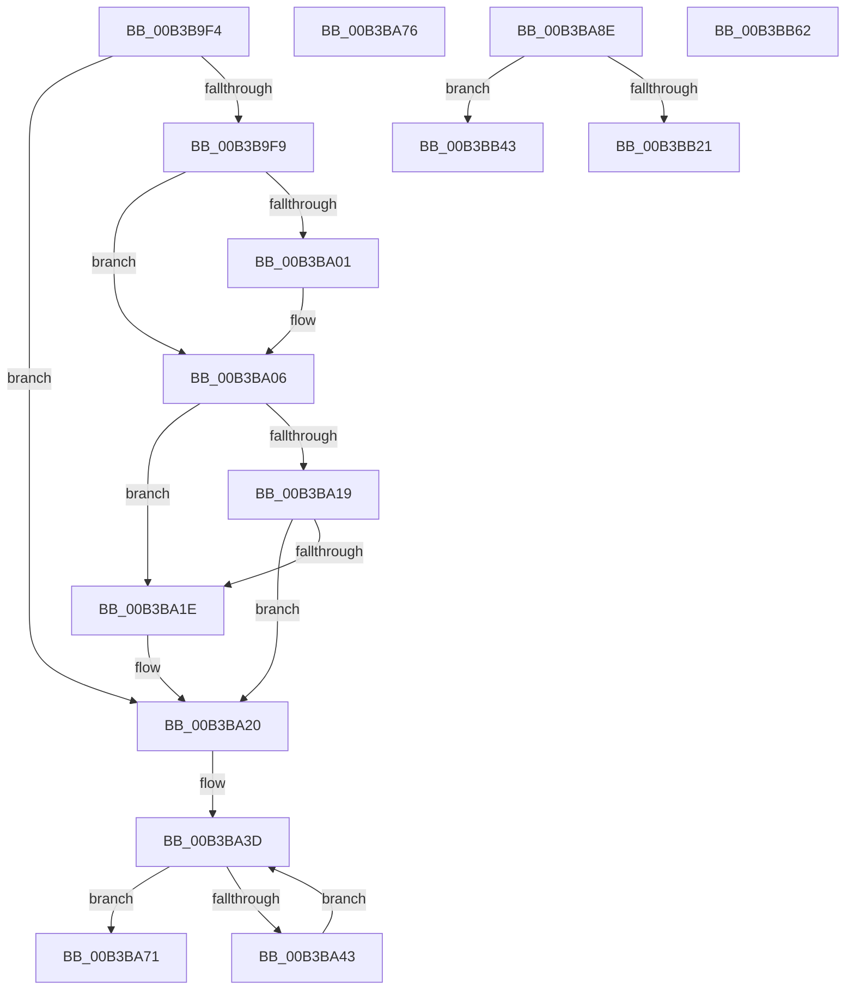

# sub_00B3B9F4

- RVA: `0x00B3B9F4`–`0x00B3BB79` (길이 `389` bytes)
- VA: `0x0000000140B3B9F4`
- 실행 섹션: `PAGE`
- PDB 이름 있음: `아니요`; PDB Function 태그: `아니요`
- unwind 정보 RVA: `0x000B0430`
- 디코드: `83`개 명령, `389/389` bytes 표시
- 미해석 바이트: `0` (있으면 어셈블리에 `.byte`로 보존)

> 이 문서는 커널 이미지의 기계어와 PDB 기호를 분석해 생성했습니다. 4번과 5번은 함수 원형과 자료형을 바이너리 사용 방식에서 추정한 C 해석이며 원본 소스 복구 결과는 아닙니다.

## 1. Dependencies

- 직접 호출 지점: **9**; 고유 호출 대상: **9**
- 직접 호출자로 확인된 함수: **0**
- RIP 상대 이미지 참조: **4**

### Outgoing calls
- `0x00B3BA01` → [ExRaiseDatatypeMisalignment](../89/ExRaiseDatatypeMisalignment_function_00899FD0.md) (function, `0x00899FD0`)
- `0x00B3BA2A` → [memcpy](../../text/6C/memcpy_function_006C6840.md) (function, `0x006C6840`)
- `0x00B3BA5F` → [ProbeForWrite](../8E/ProbeForWrite_function_008E91C0.md) (function, `0x008E91C0`)
- `0x00B3BA98` → [RtlpGetBootStatusPath](../../text/5E/RtlpGetBootStatusPath_function_005E7A0C.md) (function, `0x005E7A0C`)
- `0x00B3BAAD` → [RtlInitUnicodeString](../../text/42/RtlInitUnicodeString_function_0042A780.md) (function, `0x0042A780`)
- `0x00B3BB16` → [ZwOpenFile](../../text/6A/ZwOpenFile_function_006AD730.md) (function, `0x006AD730`)
- `0x00B3BB34` → [RtlInitializeBootStatDataCache](../../text/5E/RtlInitializeBootStatDataCache_function_005E78F0.md) (function, `0x005E78F0`)
- `0x00B3BB69` → [KeAbPostRelease](../../text/2E/KeAbPostRelease_function_002E1600.md) (function, `0x002E1600`)
- `0x00B3BB6E` → [KeLeaveCriticalRegion](../../text/25/KeLeaveCriticalRegion_function_0025D8B0.md) (function, `0x0025D8B0`)

### Direct callers
- 이 함수 시작 RVA로 연결되는 직접 call은 확인되지 않았습니다. 간접 호출은 완전히 역산할 수 없습니다.

### Static image references
- `0x00B3BB26` → RVA `0x00F05C28` (`.data`; write)
- `0x00B3BB2D` → RVA `0x00F05C20` (`.data`; write)
- `0x00B3BB51` → RVA `0x00F05C44` (`.data`; write)
- `0x00B3BB62` → RVA `0x00F084F0` (`.data`; read)

## 2. Other-region calls and transfers

- 다른 실행 섹션으로 향하는 call: **7**
  - `0x00B3BA2A` → [memcpy](../../text/6C/memcpy_function_006C6840.md) (`PAGE` → `.text`)
  - `0x00B3BA98` → [RtlpGetBootStatusPath](../../text/5E/RtlpGetBootStatusPath_function_005E7A0C.md) (`PAGE` → `.text`)
  - `0x00B3BAAD` → [RtlInitUnicodeString](../../text/42/RtlInitUnicodeString_function_0042A780.md) (`PAGE` → `.text`)
  - `0x00B3BB16` → [ZwOpenFile](../../text/6A/ZwOpenFile_function_006AD730.md) (`PAGE` → `.text`)
  - `0x00B3BB34` → [RtlInitializeBootStatDataCache](../../text/5E/RtlInitializeBootStatDataCache_function_005E78F0.md) (`PAGE` → `.text`)
  - `0x00B3BB69` → [KeAbPostRelease](../../text/2E/KeAbPostRelease_function_002E1600.md) (`PAGE` → `.text`)
  - `0x00B3BB6E` → [KeLeaveCriticalRegion](../../text/25/KeLeaveCriticalRegion_function_0025D8B0.md) (`PAGE` → `.text`)
- call이 아닌 외부 분기/꼬리 이동: **5**
  - `0x00B3BA71` → [PopBootStatGet + 0x12A](../A4/PopBootStatGet_function_00A4C398.md) (`tail-transfer`)
  - `0x00B3BA89` → [PopBootStatGet + 0xA4](../A4/PopBootStatGet_function_00A4C398.md) (`tail-transfer`)
  - `0x00B3BB3E` → [PopBootStatGet + 0x1EA](../A4/PopBootStatGet_function_00A4C398.md) (`tail-transfer`)
  - `0x00B3BB5D` → [PopBootStatGet + 0x1EF](../A4/PopBootStatGet_function_00A4C398.md) (`tail-transfer`)
  - `0x00B3BB74` → [PopBootStatGet + 0xBD](../A4/PopBootStatGet_function_00A4C398.md) (`tail-transfer`)

## 3. Assembly (complete function range)

```asm
00B3B9F4  48 85 F6                        test rsi, rsi
00B3B9F7  74 27                           je 0x140b3ba20
00B3B9F9  49 8B 45 10                     mov rax, qword ptr [r13 + 0x10]
00B3B9FD  A8 07                           test al, 7
00B3B9FF  74 05                           je 0x140b3ba06
00B3BA01  E8 CA E5 D5 FF                  call 0x140899fd0
00B3BA06  48 8D 0C 30                     lea rcx, [rax + rsi]
00B3BA0A  48 BA 00 00 FF FF FF 7F 00 00   movabs rdx, 0x7fffffff0000
00B3BA14  48 3B CA                        cmp rcx, rdx
00B3BA17  77 05                           ja 0x140b3ba1e
00B3BA19  48 3B C8                        cmp rcx, rax
00B3BA1C  73 02                           jae 0x140b3ba20
00B3BA1E  8A 02                           mov al, byte ptr [rdx]
00B3BA20  4C 8B C6                        mov r8, rsi
00B3BA23  49 8B 55 10                     mov rdx, qword ptr [r13 + 0x10]
00B3BA27  49 8B CF                        mov rcx, r15
00B3BA2A  E8 11 AE B8 FF                  call 0x1406c6840
00B3BA2F  44 89 74 24 38                  mov dword ptr [rsp + 0x38], r14d
00B3BA34  41 8B C6                        mov eax, r14d
00B3BA37  41 8B CE                        mov ecx, r14d
00B3BA3A  41 8B FE                        mov edi, r14d
00B3BA3D  41 3B 45 08                     cmp eax, dword ptr [r13 + 8]
00B3BA41  73 2E                           jae 0x140b3ba71
00B3BA43  8B C1                           mov eax, ecx
00B3BA45  48 8D 0C 40                     lea rcx, [rax + rax*2]
00B3BA49  49 8D 0C CF                     lea rcx, [r15 + rcx*8]
00B3BA4D  48 89 4C 24 68                  mov qword ptr [rsp + 0x68], rcx
00B3BA52  8B 51 10                        mov edx, dword ptr [rcx + 0x10]
00B3BA55  41 B8 01 00 00 00               mov r8d, 1
00B3BA5B  48 8B 49 08                     mov rcx, qword ptr [rcx + 8]
00B3BA5F  E8 5C D7 DA FF                  call 0x1408e91c0
00B3BA64  8D 47 01                        lea eax, [rdi + 1]
00B3BA67  89 44 24 38                     mov dword ptr [rsp + 0x38], eax
00B3BA6B  8B C8                           mov ecx, eax
00B3BA6D  8B F8                           mov edi, eax
00B3BA6F  EB CC                           jmp 0x140b3ba3d
00B3BA71  E9 4C 0A F1 FF                  jmp 0x140a4c4c2
00B3BA76  8B F8                           mov edi, eax
00B3BA78  45 33 F6                        xor r14d, r14d
00B3BA7B  48 83 CB FF                     or rbx, 0xffffffffffffffff
00B3BA7F  4C 8B 7C 24 58                  mov r15, qword ptr [rsp + 0x58]
00B3BA84  44 8A 64 24 31                  mov r12b, byte ptr [rsp + 0x31]
00B3BA89  E9 AE 09 F1 FF                  jmp 0x140a4c43c
00B3BA8E  48 8D 54 24 30                  lea rdx, [rsp + 0x30]
00B3BA93  48 8D 4C 24 60                  lea rcx, [rsp + 0x60]
00B3BA98  E8 6F BF AA FF                  call 0x1405e7a0c
00B3BA9D  48 8B 74 24 60                  mov rsi, qword ptr [rsp + 0x60]
00B3BAA2  48 8B D6                        mov rdx, rsi
00B3BAA5  48 8D 8C 24 C8 00 00 00         lea rcx, [rsp + 0xc8]
00B3BAAD  E8 CE EC 8E FF                  call 0x14042a780
00B3BAB2  C7 84 24 98 00 00 00 30 00 00 00  mov dword ptr [rsp + 0x98], 0x30
00B3BABD  4C 89 B4 24 A0 00 00 00         mov qword ptr [rsp + 0xa0], r14
00B3BAC5  C7 84 24 B0 00 00 00 C0 02 00 00  mov dword ptr [rsp + 0xb0], 0x2c0
00B3BAD0  48 8D 84 24 C8 00 00 00         lea rax, [rsp + 0xc8]
00B3BAD8  48 89 84 24 A8 00 00 00         mov qword ptr [rsp + 0xa8], rax
00B3BAE0  0F 57 C0                        xorps xmm0, xmm0
00B3BAE3  F3 0F 7F 84 24 B8 00 00 00      movdqu xmmword ptr [rsp + 0xb8], xmm0
00B3BAEC  C7 44 24 28 20 00 00 00         mov dword ptr [rsp + 0x28], 0x20
00B3BAF4  C7 44 24 20 01 00 00 00         mov dword ptr [rsp + 0x20], 1
00B3BAFC  4C 8D 8C 24 D8 00 00 00         lea r9, [rsp + 0xd8]
00B3BB04  4C 8D 84 24 98 00 00 00         lea r8, [rsp + 0x98]
00B3BB0C  BA 9F 01 12 00                  mov edx, 0x12019f
00B3BB11  48 8D 4C 24 50                  lea rcx, [rsp + 0x50]
00B3BB16  E8 15 1C B7 FF                  call 0x1406ad730
00B3BB1B  8B F8                           mov edi, eax
00B3BB1D  85 C0                           test eax, eax
00B3BB1F  78 22                           js 0x140b3bb43
00B3BB21  48 8B 44 24 50                  mov rax, qword ptr [rsp + 0x50]
00B3BB26  48 89 05 FB A0 3C 00            mov qword ptr [rip + 0x3ca0fb], rax
00B3BB2D  C6 05 EC A0 3C 00 01            mov byte ptr [rip + 0x3ca0ec], 1
00B3BB34  E8 B7 BD AA FF                  call 0x1405e78f0
00B3BB39  48 8B 44 24 50                  mov rax, qword ptr [rsp + 0x50]
00B3BB3E  E9 3F 0A F1 FF                  jmp 0x140a4c582
00B3BB43  4C 89 35 DE A0 3C 00            mov qword ptr [rip + 0x3ca0de], r14
00B3BB4A  44 88 35 CF A0 3C 00            mov byte ptr [rip + 0x3ca0cf], r14b
00B3BB51  44 89 35 EC A0 3C 00            mov dword ptr [rip + 0x3ca0ec], r14d
00B3BB58  4C 89 74 24 40                  mov qword ptr [rsp + 0x40], r14
00B3BB5D  E9 25 0A F1 FF                  jmp 0x140a4c587
00B3BB62  48 8D 0D 87 C9 3C 00            lea rcx, [rip + 0x3cc987]
00B3BB69  E8 92 5A 7A FF                  call 0x1402e1600
00B3BB6E  E8 3D 1D 72 FF                  call 0x14025d8b0
00B3BB73  90                              nop
00B3BB74  E9 DC 08 F1 FF                  jmp 0x140a4c455
```

## 4. C-style interpretation (structured pseudocode)

```c
__int64 __fastcall sub_00B3B9F4(void)
{
    __int64 result;
    unsigned int v_stack_p20;
    unsigned int v_stack_p28;
    unsigned __int64 v_stack_p30;
    unsigned __int8 v_stack_p31;
    unsigned int v_stack_p38;
    unsigned __int64 v_stack_p40;
    unsigned __int64 v_stack_p50;
    unsigned __int64 v_stack_p58;
    unsigned __int64 v_stack_p60;
    unsigned __int64 v_stack_p68;
    unsigned int v_stack_p98;
    unsigned __int64 v_stack_pA0;
    unsigned __int64 v_stack_pA8;
    unsigned int v_stack_pB0;
    unsigned __int64 v_stack_pB8;
    unsigned __int64 v_stack_pC8;
    unsigned __int64 v_stack_pD8;

    if (v_rsi == 0) goto loc_00B3BA20;
    result = *(unsigned __int64 *)(v_r13 + 16);
    if ((((unsigned __int8)(*(unsigned __int64 *)(v_r13 + 16))) & (7)) != 0) {
        result = ExRaiseDatatypeMisalignment(a1, a2, a3, a4);
    }
    if ((result + v_rsi * 1) > a2) goto loc_00B3BA1E;
    if ((result + v_rsi * 1) < result) {
        result = *(unsigned __int8 *)(a2);
    }
    result = memcpy(v_r15, *(unsigned __int64 *)(v_r13 + 16), v_rsi, a4);
    v_stack_p38 = (unsigned int)(v_r14);
loc_00B3BA3D:
    if (((unsigned int)((unsigned int)((unsigned int)(v_r14)))) >= (*(unsigned int *)(v_r13 + 8))) goto loc_00B3BA71;
    v_stack_p68 = v_r15 + (unsigned int)((unsigned int)((unsigned int)((unsigned int)(v_r14)))) + (unsigned int)((unsigned int)((unsigned int)((unsigned int)(v_r14)))) * 2 * 8;
    result = ProbeForWrite(*(unsigned __int64 *)(v_r15 + (unsigned int)((unsigned int)((unsigned int)((unsigned int)(v_r14)))) + (unsigned int)((unsigned int)((unsigned int)((unsigned int)(v_r14)))) * 2 * 8 + 8), (unsigned int)(*(unsigned int *)(v_r15 + (unsigned int)((unsigned int)((unsigned int)((unsigned int)(v_r14)))) + (unsigned int)((unsigned int)((unsigned int)((unsigned int)(v_r14)))) * 2 * 8 + 16)), 1, a4);
    v_stack_p38 = (unsigned int)((unsigned int)((unsigned int)(v_r14)) + 1);
    goto loc_00B3BA3D;
loc_00B3BA71:
}
```

## 5. (Beta) C Style

```c
void sub_00B3B9F4(void)
{
    int64_t result;
    uint32_t v_stack_p20;
    uint32_t v_stack_p28;
    uint64_t v_stack_p30;
    uint8_t v_stack_p31;
    uint32_t v_stack_p38;
    uint64_t v_stack_p40;
    uint64_t v_stack_p50;
    uint64_t v_stack_p58;
    uint64_t v_stack_p60;
    uint64_t v_stack_p68;
    uint32_t v_stack_p98;
    uint64_t v_stack_pA0;
    uint64_t v_stack_pA8;
    uint32_t v_stack_pB0;
    uint64_t v_stack_pB8;
    uint64_t v_stack_pC8;
    uint64_t v_stack_pD8;

    if (local_rsi == 0) goto loc_00B3BA20;
    result = *(uint64_t *)(local_r13 + 0x10);
    if ((((uint8_t)(*(uint64_t *)(local_r13 + 0x10))) & (7)) != 0) {
        result = ExRaiseDatatypeMisalignment(a1, a2, a3, a4);
    }
    if ((result + local_rsi * 1) > a2) goto loc_00B3BA1E;
    if ((result + local_rsi * 1) < result) {
        result = *(uint8_t *)(a2);
    }
    result = memcpy(local_r15, *(uint64_t *)(local_r13 + 0x10), local_rsi, a4);
    v_stack_p38 = (uint32_t)(local_r14);
loc_00B3BA3D:
    if (((uint32_t)((uint32_t)((uint32_t)(local_r14)))) >= (*(uint32_t *)(local_r13 + 0x8))) goto loc_00B3BA71;
    v_stack_p68 = local_r15 + (uint32_t)((uint32_t)((uint32_t)((uint32_t)(local_r14)))) + (uint32_t)((uint32_t)((uint32_t)((uint32_t)(local_r14)))) * 2 * 8;
    result = ProbeForWrite(*(uint64_t *)(local_r15 + (uint32_t)((uint32_t)((uint32_t)((uint32_t)(local_r14)))) + (uint32_t)((uint32_t)((uint32_t)((uint32_t)(local_r14)))) * 2 * 8 + 0x8), (uint32_t)(*(uint32_t *)(local_r15 + (uint32_t)((uint32_t)((uint32_t)((uint32_t)(local_r14)))) + (uint32_t)((uint32_t)((uint32_t)((uint32_t)(local_r14)))) * 2 * 8 + 0x10)), 1, a4);
    v_stack_p38 = (uint32_t)((uint32_t)((uint32_t)(local_r14)) + 1);
    goto loc_00B3BA3D;
loc_00B3BA71:
}
```

## 6. Execution-region graph

[열기: 2D/3D 그래프와 함수 탐색 컨트롤 패널](../../../control-panel.html?section=page&rva=0x00B3B9F4&view=graph)

- 2D 그래프는 위에서 아래로 흐르고, 3D 그래프는 빈 공간을 드래그해 회전합니다. Shift+드래그는 이동, 휠은 확대·축소, 함수 노드 선택은 대상 보고서 이동입니다.

### Static fallback


