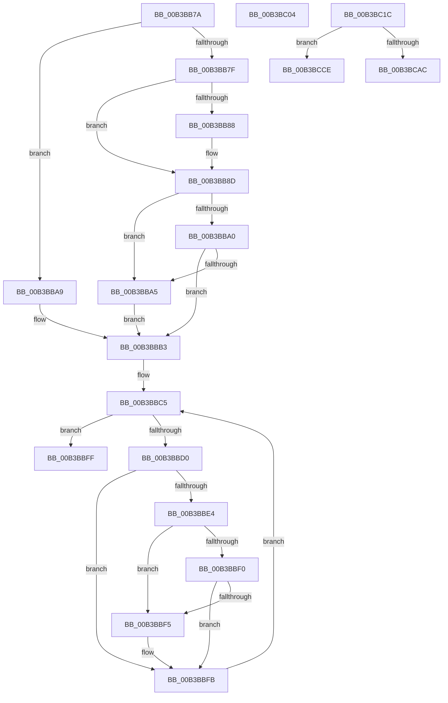

# sub_00B3BB7A

- RVA: `0x00B3BB7A`–`0x00B3BCEF` (길이 `373` bytes)
- VA: `0x0000000140B3BB7A`
- 실행 섹션: `PAGE`
- PDB 이름 있음: `아니요`; PDB Function 태그: `아니요`
- unwind 정보 RVA: `0x000B0480`
- 디코드: `80`개 명령, `373/373` bytes 표시
- 미해석 바이트: `0` (있으면 어셈블리에 `.byte`로 보존)

> 이 문서는 커널 이미지의 기계어와 PDB 기호를 분석해 생성했습니다. 4번과 5번은 함수 원형과 자료형을 바이너리 사용 방식에서 추정한 C 해석이며 원본 소스 복구 결과는 아닙니다.

## 1. Dependencies

- 직접 호출 지점: **6**; 고유 호출 대상: **6**
- 직접 호출자로 확인된 함수: **0**
- RIP 상대 이미지 참조: **4**

### Outgoing calls
- `0x00B3BB88` → [ExRaiseDatatypeMisalignment](../89/ExRaiseDatatypeMisalignment_function_00899FD0.md) (function, `0x00899FD0`)
- `0x00B3BBBE` → [memcpy](../../text/6C/memcpy_function_006C6840.md) (function, `0x006C6840`)
- `0x00B3BC29` → [RtlpGetBootStatusPath](../../text/5E/RtlpGetBootStatusPath_function_005E7A0C.md) (function, `0x005E7A0C`)
- `0x00B3BC3E` → [RtlInitUnicodeString](../../text/42/RtlInitUnicodeString_function_0042A780.md) (function, `0x0042A780`)
- `0x00B3BCA1` → [ZwOpenFile](../../text/6A/ZwOpenFile_function_006AD730.md) (function, `0x006AD730`)
- `0x00B3BCBF` → [RtlInitializeBootStatDataCache](../../text/5E/RtlInitializeBootStatDataCache_function_005E78F0.md) (function, `0x005E78F0`)

### Direct callers
- 이 함수 시작 RVA로 연결되는 직접 call은 확인되지 않았습니다. 간접 호출은 완전히 역산할 수 없습니다.

### Static image references
- `0x00B3BCB1` → RVA `0x00F05C28` (`.data`; write)
- `0x00B3BCB8` → RVA `0x00F05C20` (`.data`; write)
- `0x00B3BCCE` → RVA `0x00F05C28` (`.data`; read/write)
- `0x00B3BCDD` → RVA `0x00F05C44` (`.data`; read/write)

## 2. Other-region calls and transfers

- 다른 실행 섹션으로 향하는 call: **5**
  - `0x00B3BBBE` → [memcpy](../../text/6C/memcpy_function_006C6840.md) (`PAGE` → `.text`)
  - `0x00B3BC29` → [RtlpGetBootStatusPath](../../text/5E/RtlpGetBootStatusPath_function_005E7A0C.md) (`PAGE` → `.text`)
  - `0x00B3BC3E` → [RtlInitUnicodeString](../../text/42/RtlInitUnicodeString_function_0042A780.md) (`PAGE` → `.text`)
  - `0x00B3BCA1` → [ZwOpenFile](../../text/6A/ZwOpenFile_function_006AD730.md) (`PAGE` → `.text`)
  - `0x00B3BCBF` → [RtlInitializeBootStatDataCache](../../text/5E/RtlInitializeBootStatDataCache_function_005E78F0.md) (`PAGE` → `.text`)
- call이 아닌 외부 분기/꼬리 이동: **4**
  - `0x00B3BBFF` → [PopBootStatSet + 0x68](../A4/PopBootStatSet_function_00A4C77C.md) (`tail-transfer`)
  - `0x00B3BC17` → [PopBootStatSet + 0x24D](../A4/PopBootStatSet_function_00A4C77C.md) (`tail-transfer`)
  - `0x00B3BCC9` → [PopBootStatSet + 0x126](../A4/PopBootStatSet_function_00A4C77C.md) (`tail-transfer`)
  - `0x00B3BCEA` → [PopBootStatSet + 0x12B](../A4/PopBootStatSet_function_00A4C77C.md) (`tail-transfer`)

## 3. Assembly (complete function range)

```asm
00B3BB7A  4D 85 FF                        test r15, r15
00B3BB7D  74 2A                           je 0x140b3bba9
00B3BB7F  49 8B 44 24 10                  mov rax, qword ptr [r12 + 0x10]
00B3BB84  A8 07                           test al, 7
00B3BB86  74 05                           je 0x140b3bb8d
00B3BB88  E8 43 E4 D5 FF                  call 0x140899fd0
00B3BB8D  4A 8D 0C 38                     lea rcx, [rax + r15]
00B3BB91  48 BE 00 00 FF FF FF 7F 00 00   movabs rsi, 0x7fffffff0000
00B3BB9B  48 3B CE                        cmp rcx, rsi
00B3BB9E  77 05                           ja 0x140b3bba5
00B3BBA0  48 3B C8                        cmp rcx, rax
00B3BBA3  73 0E                           jae 0x140b3bbb3
00B3BBA5  8A 06                           mov al, byte ptr [rsi]
00B3BBA7  EB 0A                           jmp 0x140b3bbb3
00B3BBA9  48 BE 00 00 FF FF FF 7F 00 00   movabs rsi, 0x7fffffff0000
00B3BBB3  4D 8B C7                        mov r8, r15
00B3BBB6  49 8B 54 24 10                  mov rdx, qword ptr [r12 + 0x10]
00B3BBBB  49 8B CE                        mov rcx, r14
00B3BBBE  E8 7D AC B8 FF                  call 0x1406c6840
00B3BBC3  33 D2                           xor edx, edx
00B3BBC5  89 54 24 34                     mov dword ptr [rsp + 0x34], edx
00B3BBC9  41 3B 54 24 08                  cmp edx, dword ptr [r12 + 8]
00B3BBCE  73 2F                           jae 0x140b3bbff
00B3BBD0  48 8D 0C 52                     lea rcx, [rdx + rdx*2]
00B3BBD4  49 8D 04 CE                     lea rax, [r14 + rcx*8]
00B3BBD8  48 89 44 24 70                  mov qword ptr [rsp + 0x70], rax
00B3BBDD  8B 48 10                        mov ecx, dword ptr [rax + 0x10]
00B3BBE0  85 C9                           test ecx, ecx
00B3BBE2  74 17                           je 0x140b3bbfb
00B3BBE4  4C 8B 40 08                     mov r8, qword ptr [rax + 8]
00B3BBE8  49 03 C8                        add rcx, r8
00B3BBEB  48 3B CE                        cmp rcx, rsi
00B3BBEE  77 05                           ja 0x140b3bbf5
00B3BBF0  49 3B C8                        cmp rcx, r8
00B3BBF3  73 06                           jae 0x140b3bbfb
00B3BBF5  8A 06                           mov al, byte ptr [rsi]
00B3BBF7  8B 54 24 34                     mov edx, dword ptr [rsp + 0x34]
00B3BBFB  FF C2                           inc edx
00B3BBFD  EB C6                           jmp 0x140b3bbc5
00B3BBFF  E9 E0 0B F1 FF                  jmp 0x140a4c7e4
00B3BC04  8B F0                           mov esi, eax
00B3BC06  48 83 CB FF                     or rbx, 0xffffffffffffffff
00B3BC0A  4C 8B 74 24 58                  mov r14, qword ptr [rsp + 0x58]
00B3BC0F  44 8A AC 24 28 01 00 00         mov r13b, byte ptr [rsp + 0x128]
00B3BC17  E9 AD 0D F1 FF                  jmp 0x140a4c9c9
00B3BC1C  48 8D 94 24 20 01 00 00         lea rdx, [rsp + 0x120]
00B3BC24  48 8D 4C 24 60                  lea rcx, [rsp + 0x60]
00B3BC29  E8 DE BD AA FF                  call 0x1405e7a0c
00B3BC2E  4C 8B 7C 24 60                  mov r15, qword ptr [rsp + 0x60]
00B3BC33  49 8B D7                        mov rdx, r15
00B3BC36  48 8D 8C 24 A8 00 00 00         lea rcx, [rsp + 0xa8]
00B3BC3E  E8 3D EB 8E FF                  call 0x14042a780
00B3BC43  C7 44 24 78 30 00 00 00         mov dword ptr [rsp + 0x78], 0x30
00B3BC4B  48 21 B4 24 80 00 00 00         and qword ptr [rsp + 0x80], rsi
00B3BC53  C7 84 24 90 00 00 00 C0 02 00 00  mov dword ptr [rsp + 0x90], 0x2c0
00B3BC5E  48 8D 84 24 A8 00 00 00         lea rax, [rsp + 0xa8]
00B3BC66  48 89 84 24 88 00 00 00         mov qword ptr [rsp + 0x88], rax
00B3BC6E  0F 57 C0                        xorps xmm0, xmm0
00B3BC71  F3 0F 7F 84 24 98 00 00 00      movdqu xmmword ptr [rsp + 0x98], xmm0
00B3BC7A  C7 44 24 28 20 00 00 00         mov dword ptr [rsp + 0x28], 0x20
00B3BC82  C7 44 24 20 01 00 00 00         mov dword ptr [rsp + 0x20], 1
00B3BC8A  4C 8D 8C 24 B8 00 00 00         lea r9, [rsp + 0xb8]
00B3BC92  4C 8D 44 24 78                  lea r8, [rsp + 0x78]
00B3BC97  BA 9F 01 12 00                  mov edx, 0x12019f
00B3BC9C  48 8D 4C 24 50                  lea rcx, [rsp + 0x50]
00B3BCA1  E8 8A 1A B7 FF                  call 0x1406ad730
00B3BCA6  8B F0                           mov esi, eax
00B3BCA8  85 C0                           test eax, eax
00B3BCAA  78 22                           js 0x140b3bcce
00B3BCAC  48 8B 44 24 50                  mov rax, qword ptr [rsp + 0x50]
00B3BCB1  48 89 05 70 9F 3C 00            mov qword ptr [rip + 0x3c9f70], rax
00B3BCB8  C6 05 61 9F 3C 00 01            mov byte ptr [rip + 0x3c9f61], 1
00B3BCBF  E8 2C BC AA FF                  call 0x1405e78f0
00B3BCC4  48 8B 44 24 50                  mov rax, qword ptr [rsp + 0x50]
00B3BCC9  E9 D4 0B F1 FF                  jmp 0x140a4c8a2
00B3BCCE  48 83 25 52 9F 3C 00 00         and qword ptr [rip + 0x3c9f52], 0
00B3BCD6  C6 05 43 9F 3C 00 00            mov byte ptr [rip + 0x3c9f43], 0
00B3BCDD  83 25 60 9F 3C 00 00            and dword ptr [rip + 0x3c9f60], 0
00B3BCE4  48 83 64 24 40 00               and qword ptr [rsp + 0x40], 0
00B3BCEA  E9 B8 0B F1 FF                  jmp 0x140a4c8a7
```

## 4. C-style interpretation (structured pseudocode)

```c
__int64 __fastcall sub_00B3BB7A(void)
{
    __int64 result;
    unsigned __int64 v_stack_p120;
    unsigned __int8 v_stack_p128;
    unsigned int v_stack_p20;
    unsigned int v_stack_p28;
    unsigned int v_stack_p34;
    unsigned __int64 v_stack_p40;
    unsigned __int64 v_stack_p50;
    unsigned __int64 v_stack_p58;
    unsigned __int64 v_stack_p60;
    unsigned __int64 v_stack_p70;
    unsigned int v_stack_p78;
    unsigned __int64 v_stack_p80;
    unsigned __int64 v_stack_p88;
    unsigned int v_stack_p90;
    unsigned __int64 v_stack_p98;
    unsigned __int64 v_stack_pA8;
    unsigned __int64 v_stack_pB8;

    if (v_r15 == 0) goto loc_00B3BBA9;
    result = *(unsigned __int64 *)(v_r12 + 16);
    if ((((unsigned __int8)(*(unsigned __int64 *)(v_r12 + 16))) & (7)) != 0) {
        result = ExRaiseDatatypeMisalignment(a1, a2, a3, a4);
    }
    if ((result + v_r15 * 1) > v_rsi) goto loc_00B3BBA5;
    if ((result + v_r15 * 1) >= result) goto loc_00B3BBB3;
loc_00B3BBA5:
    goto loc_00B3BBB3;
loc_00B3BBA9:
loc_00B3BBB3:
    result = memcpy(v_r14, *(unsigned __int64 *)(v_r12 + 16), v_r15, a4);
    a2 = 0;
loc_00B3BBC5:
    v_stack_p34 = 0;
    if (0 >= (*(unsigned int *)(v_r12 + 8))) goto loc_00B3BBFF;
    v_stack_p70 = v_r14 + a2 + a2 * 2 * 8;
    if ((unsigned int)((unsigned int)(*(unsigned int *)(v_r14 + a2 + a2 * 2 * 8 + 16))) == 0) goto loc_00B3BBFB;
    a1 = ((unsigned int)(*(unsigned int *)(v_r14 + a2 + a2 * 2 * 8 + 16))) + (*(unsigned __int64 *)(v_r14 + a2 + a2 * 2 * 8 + 8));
    if (a1 > v_rsi) goto loc_00B3BBF5;
    result = v_r14 + a2 + a2 * 2 * 8;
    if (a1 < (*(unsigned __int64 *)(v_r14 + a2 + a2 * 2 * 8 + 8))) {
        result = *(unsigned __int8 *)(v_rsi);
        a2 = v_stack_p34;
    }
    a2 = (unsigned int)((a2) + 1);
    goto loc_00B3BBC5;
loc_00B3BBFF:
}
```

## 5. (Beta) C Style

```c
void sub_00B3BB7A(void)
{
    int64_t result;
    uint64_t v_stack_p120;
    uint8_t v_stack_p128;
    uint32_t v_stack_p20;
    uint32_t v_stack_p28;
    uint32_t v_stack_p34;
    uint64_t v_stack_p40;
    uint64_t v_stack_p50;
    uint64_t v_stack_p58;
    uint64_t v_stack_p60;
    uint64_t v_stack_p70;
    uint32_t v_stack_p78;
    uint64_t v_stack_p80;
    uint64_t v_stack_p88;
    uint32_t v_stack_p90;
    uint64_t v_stack_p98;
    uint64_t v_stack_pA8;
    uint64_t v_stack_pB8;

    if (local_r15 == 0) goto loc_00B3BBA9;
    result = *(uint64_t *)(local_r12 + 0x10);
    if ((((uint8_t)(*(uint64_t *)(local_r12 + 0x10))) & (7)) != 0) {
        result = ExRaiseDatatypeMisalignment(a1, a2, a3, a4);
    }
    if ((result + local_r15 * 1) > local_rsi) goto loc_00B3BBA5;
    if ((result + local_r15 * 1) >= result) goto loc_00B3BBB3;
loc_00B3BBA5:
    goto loc_00B3BBB3;
loc_00B3BBA9:
loc_00B3BBB3:
    result = memcpy(local_r14, *(uint64_t *)(local_r12 + 0x10), local_r15, a4);
    a2 = 0;
loc_00B3BBC5:
    v_stack_p34 = 0;
    if (0 >= (*(uint32_t *)(local_r12 + 0x8))) goto loc_00B3BBFF;
    v_stack_p70 = local_r14 + a2 + a2 * 2 * 8;
    if ((uint32_t)((uint32_t)(*(uint32_t *)(local_r14 + a2 + a2 * 2 * 8 + 0x10))) == 0) goto loc_00B3BBFB;
    a1 = ((uint32_t)(*(uint32_t *)(local_r14 + a2 + a2 * 2 * 8 + 0x10))) + (*(uint64_t *)(local_r14 + a2 + a2 * 2 * 8 + 0x8));
    if (a1 > local_rsi) goto loc_00B3BBF5;
    result = local_r14 + a2 + a2 * 2 * 8;
    if (a1 < (*(uint64_t *)(local_r14 + a2 + a2 * 2 * 8 + 0x8))) {
        result = *(uint8_t *)(local_rsi);
        a2 = v_stack_p34;
    }
    a2 = (uint32_t)((a2) + 1);
    goto loc_00B3BBC5;
loc_00B3BBFF:
}
```

## 6. Execution-region graph

[열기: 2D/3D 그래프와 함수 탐색 컨트롤 패널](../../../control-panel.html?section=page&rva=0x00B3BB7A&view=graph)

- 2D 그래프는 위에서 아래로 흐르고, 3D 그래프는 빈 공간을 드래그해 회전합니다. Shift+드래그는 이동, 휠은 확대·축소, 함수 노드 선택은 대상 보고서 이동입니다.

### Static fallback


