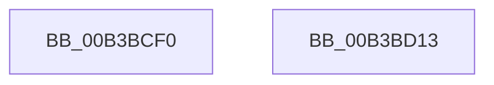

# sub_00B3BCF0

- RVA: `0x00B3BCF0`–`0x00B3BD21` (길이 `49` bytes)
- VA: `0x0000000140B3BCF0`
- 실행 섹션: `PAGE`
- PDB 이름 있음: `아니요`; PDB Function 태그: `아니요`
- unwind 정보 RVA: `0x000B04A4`
- 디코드: `10`개 명령, `49/49` bytes 표시
- 미해석 바이트: `0` (있으면 어셈블리에 `.byte`로 보존)

> 이 문서는 커널 이미지의 기계어와 PDB 기호를 분석해 생성했습니다. 4번과 5번은 함수 원형과 자료형을 바이너리 사용 방식에서 추정한 C 해석이며 원본 소스 복구 결과는 아닙니다.

## 1. Dependencies

- 직접 호출 지점: **1**; 고유 호출 대상: **1**
- 직접 호출자로 확인된 함수: **0**
- RIP 상대 이미지 참조: **4**

### Outgoing calls
- `0x00B3BD16` → [ZwClose](../../text/6A/ZwClose_function_006AD2B0.md) (function, `0x006AD2B0`)

### Direct callers
- 이 함수 시작 RVA로 연결되는 직접 call은 확인되지 않았습니다. 간접 호출은 완전히 역산할 수 없습니다.

### Static image references
- `0x00B3BCF0` → RVA `0x00F05C44` (`.data`; write)
- `0x00B3BCF9` → RVA `0x00F05C28` (`.data`; write)
- `0x00B3BD00` → RVA `0x00F05C20` (`.data`; write)
- `0x00B3BD07` → RVA `0x00F05C40` (`.data`; write)

## 2. Other-region calls and transfers

- 다른 실행 섹션으로 향하는 call: **1**
  - `0x00B3BD16` → [ZwClose](../../text/6A/ZwClose_function_006AD2B0.md) (`PAGE` → `.text`)
- call이 아닌 외부 분기/꼬리 이동: **2**
  - `0x00B3BD0E` → [RtlUnlockBootStatusData + 0xAB](../A4/RtlUnlockBootStatusData_function_00A4CAF0.md) (`tail-transfer`)
  - `0x00B3BD1C` → [RtlUnlockBootStatusData + 0x93](../A4/RtlUnlockBootStatusData_function_00A4CAF0.md) (`tail-transfer`)

## 3. Assembly (complete function range)

```asm
00B3BCF0  89 35 4E 9F 3C 00               mov dword ptr [rip + 0x3c9f4e], esi
00B3BCF6  40 B7 01                        mov dil, 1
00B3BCF9  48 89 35 28 9F 3C 00            mov qword ptr [rip + 0x3c9f28], rsi
00B3BD00  40 88 35 19 9F 3C 00            mov byte ptr [rip + 0x3c9f19], sil
00B3BD07  40 88 35 32 9F 3C 00            mov byte ptr [rip + 0x3c9f32], sil
00B3BD0E  E9 88 0E F1 FF                  jmp 0x140a4cb9b
00B3BD13  48 8B CB                        mov rcx, rbx
00B3BD16  E8 95 15 B7 FF                  call 0x1406ad2b0
00B3BD1B  90                              nop
00B3BD1C  E9 62 0E F1 FF                  jmp 0x140a4cb83
```

## 4. C-style interpretation (structured pseudocode)

```c
__int64 __fastcall sub_00B3BCF0(void)
{
    *(unsigned int *)(v_rip + 3972942) = (unsigned int)(v_rsi);
    *(unsigned __int64 *)(v_rip + 3972904) = v_rsi;
    *(unsigned __int8 *)(v_rip + 3972889) = (unsigned __int8)(v_rsi);
    *(unsigned __int8 *)(v_rip + 3972914) = (unsigned __int8)(v_rsi);
}
```

## 5. (Beta) C Style

```c
void sub_00B3BCF0(void)
{
    *(uint32_t *)(v_rip + 0x3C9F4E) = (uint32_t)(local_rsi);
    *(uint64_t *)(v_rip + 0x3C9F28) = local_rsi;
    *(uint8_t *)(v_rip + 0x3C9F19) = (uint8_t)(local_rsi);
    *(uint8_t *)(v_rip + 0x3C9F32) = (uint8_t)(local_rsi);
}
```

## 6. Execution-region graph

[열기: 2D/3D 그래프와 함수 탐색 컨트롤 패널](../../../control-panel.html?section=page&rva=0x00B3BCF0&view=graph)

- 2D 그래프는 위에서 아래로 흐르고, 3D 그래프는 빈 공간을 드래그해 회전합니다. Shift+드래그는 이동, 휠은 확대·축소, 함수 노드 선택은 대상 보고서 이동입니다.

### Static fallback


