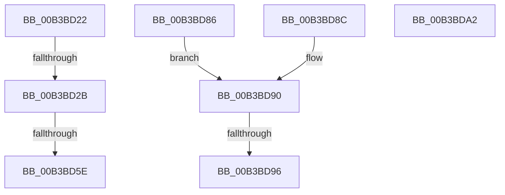

# sub_00B3BD22

- RVA: `0x00B3BD22`–`0x00B3BDB7` (길이 `149` bytes)
- VA: `0x0000000140B3BD22`
- 실행 섹션: `PAGE`
- PDB 이름 있음: `아니요`; PDB Function 태그: `아니요`
- unwind 정보 RVA: `0x000B0514`
- 디코드: `37`개 명령, `149/149` bytes 표시
- 미해석 바이트: `0` (있으면 어셈블리에 `.byte`로 보존)

> 이 문서는 커널 이미지의 기계어와 PDB 기호를 분석해 생성했습니다. 4번과 5번은 함수 원형과 자료형을 바이너리 사용 방식에서 추정한 C 해석이며 원본 소스 복구 결과는 아닙니다.

## 1. Dependencies

- 직접 호출 지점: **2**; 고유 호출 대상: **2**
- 직접 호출자로 확인된 함수: **0**
- RIP 상대 이미지 참조: **1**

### Outgoing calls
- `0x00B3BD51` → [FsRtlAllocateExtraCreateParameter](../9F/FsRtlAllocateExtraCreateParameter_function_009F5450.md) (function, `0x009F5450`)
- `0x00B3BD7B` → [FsRtlInsertExtraCreateParameter](../8A/FsRtlInsertExtraCreateParameter_function_008A1F30.md) (function, `0x008A1F30`)

### Direct callers
- 이 함수 시작 RVA로 연결되는 직접 call은 확인되지 않았습니다. 간접 호출은 완전히 역산할 수 없습니다.

### Static image references
- `0x00B3BD4A` → RVA `0x0001A620` (`.rdata`; read)

## 2. Other-region calls and transfers

- 다른 실행 섹션으로 향하는 call: **0**
- call이 아닌 외부 분기/꼬리 이동: **6**
  - `0x00B3BD25` → [IopSymlinkEnforceEnabledTypes + 0x87](../A4/IopSymlinkEnforceEnabledTypes_function_00A4CFCC.md) (`tail-transfer`)
  - `0x00B3BD58` → [IopSymlinkEnforceEnabledTypes + 0xA2](../A4/IopSymlinkEnforceEnabledTypes_function_00A4CFCC.md) (`tail-transfer`)
  - `0x00B3BD81` → [IopSymlinkEnforceEnabledTypes + 0x87](../A4/IopSymlinkEnforceEnabledTypes_function_00A4CFCC.md) (`tail-transfer`)
  - `0x00B3BD90` → [IopSymlinkEnforceEnabledTypes + 0xBA](../A4/IopSymlinkEnforceEnabledTypes_function_00A4CFCC.md) (`tail-transfer`)
  - `0x00B3BD9D` → [IopSymlinkEnforceEnabledTypes + 0xBA](../A4/IopSymlinkEnforceEnabledTypes_function_00A4CFCC.md) (`tail-transfer`)
  - `0x00B3BDB2` → [IopSymlinkEnforceEnabledTypes + 0xA2](../A4/IopSymlinkEnforceEnabledTypes_function_00A4CFCC.md) (`tail-transfer`)

## 3. Assembly (complete function range)

```asm
00B3BD22  48 85 DB                        test rbx, rbx
00B3BD25  0F 85 28 13 F1 FF               jne 0x140a4d053
00B3BD2B  48 8D 44 24 78                  lea rax, [rsp + 0x78]
00B3BD30  45 33 C9                        xor r9d, r9d
00B3BD33  48 89 44 24 28                  mov qword ptr [rsp + 0x28], rax
00B3BD38  44 8D 6B 1C                     lea r13d, [rbx + 0x1c]
00B3BD3C  41 8B D5                        mov edx, r13d
00B3BD3F  C7 44 24 20 49 6F 53 69         mov dword ptr [rsp + 0x20], 0x69536f49
00B3BD47  45 33 C0                        xor r8d, r8d
00B3BD4A  48 8D 0D CF E8 4D FF            lea rcx, [rip - 0xb21731]
00B3BD51  E8 FA 96 EB FF                  call 0x1409f5450
00B3BD56  85 C0                           test eax, eax
00B3BD58  0F 88 10 13 F1 FF               js 0x140a4d06e
00B3BD5E  48 8B 5C 24 78                  mov rbx, qword ptr [rsp + 0x78]
00B3BD63  33 C0                           xor eax, eax
00B3BD65  0F 57 C0                        xorps xmm0, xmm0
00B3BD68  48 8B D3                        mov rdx, rbx
00B3BD6B  49 8B CE                        mov rcx, r14
00B3BD6E  0F 11 03                        movups xmmword ptr [rbx], xmm0
00B3BD71  48 89 43 10                     mov qword ptr [rbx + 0x10], rax
00B3BD75  89 43 18                        mov dword ptr [rbx + 0x18], eax
00B3BD78  44 89 2B                        mov dword ptr [rbx], r13d
00B3BD7B  E8 B0 61 D6 FF                  call 0x1408a1f30
00B3BD80  90                              nop
00B3BD81  E9 CD 12 F1 FF                  jmp 0x140a4d053
00B3BD86  40 F6 C7 01                     test dil, 1
00B3BD8A  EB 04                           jmp 0x140b3bd90
00B3BD8C  40 F6 C7 04                     test dil, 4
00B3BD90  0F 85 F0 12 F1 FF               jne 0x140a4d086
00B3BD96  C7 43 04 01 00 00 00            mov dword ptr [rbx + 4], 1
00B3BD9D  E9 E4 12 F1 FF                  jmp 0x140a4d086
00B3BDA2  40 80 E7 04                     and dil, 4
00B3BDA6  40 F6 DF                        neg dil
00B3BDA9  1B C0                           sbb eax, eax
00B3BDAB  F7 D0                           not eax
00B3BDAD  25 15 07 00 C0                  and eax, 0xc0000715
00B3BDB2  E9 B7 12 F1 FF                  jmp 0x140a4d06e
```

## 4. C-style interpretation (structured pseudocode)

```c
__int64 __fastcall sub_00B3BD22(__int64 a1, __int64 a2, int a3, int a4, __int64 a5, __int64 a6, __int64 a7, __int64 a8, __int64 a9, __int64 a10, __int64 a11, __int64 a12, __int64 a13, __int64 a14, __int64 a15)
{
    __int64 result;
    unsigned int v_stack_p20;
    unsigned __int64 v_stack_p28;

    a4 = 0;
    v_stack_p28 = a15;
    v_stack_p20 = 0x69536F49ULL;
    a3 = 0;
    result = FsRtlAllocateExtraCreateParameter(v_rip - 11671345, (unsigned int)((unsigned int)(v_rbx + 28)), a3, a4);
    result = 0;
    *(unsigned __int64 *)(a15) = v_xmm0;
    *(unsigned __int64 *)(a15 + 16) = 0;
    *(unsigned int *)(a15 + 24) = 0;
    *(unsigned int *)(a15) = (unsigned int)(v_rbx + 28);
    result = FsRtlInsertExtraCreateParameter(v_r14, a15, a3, a4);
}
```

## 5. (Beta) C Style

```c
int64_t sub_00B3BD22(int64_t Arg1, int64_t Arg2, int32_t Arg3, int32_t Arg4, uint64_t Arg5, uint64_t Arg6, uint64_t Arg7, uint64_t Arg8, uint64_t Arg9, uint64_t Arg10, uint64_t Arg11, uint64_t Arg12, uint64_t Arg13, uint64_t Arg14, void *Arg15)
{
    uint8_t *arg15 = (uint8_t *)Arg15;

    int64_t result;
    uint32_t v_stack_p20;
    uint64_t v_stack_p28;

    Arg4 = 0;
    v_stack_p28 = Arg15;
    v_stack_p20 = 0x69536F49ULL;
    Arg3 = 0;
    result = FsRtlAllocateExtraCreateParameter(v_rip - 11671345, (uint32_t)((uint32_t)(local_rbx + 28)), Arg3, Arg4);
    result = 0;
    *(uint64_t *)(arg15) = v_xmm0;
    *(uint64_t *)(arg15 + 0x10) = 0;
    *(uint32_t *)(arg15 + 0x18) = 0;
    *(uint32_t *)(arg15) = (uint32_t)(local_rbx + 28);
    result = FsRtlInsertExtraCreateParameter(local_r14, Arg15, Arg3, Arg4);
}
```

### 관측된 메모리 오프셋

구조체 형식이 확인되지 않은 접근은 인자 기준의 오프셋으로만 기록했습니다.

| 기준 인자 | 오프셋 표현 | 폭 (bit) | 접근 |
|---|---:|---:|---|
| `Arg15` | `+ 0x0` | `32` | `W` |
| `Arg15` | `+ 0x0` | `128` | `R` |
| `Arg15` | `+ 0x10` | `64` | `W` |
| `Arg15` | `+ 0x18` | `32` | `W` |

## 6. Execution-region graph

[열기: 2D/3D 그래프와 함수 탐색 컨트롤 패널](../../../control-panel.html?section=page&rva=0x00B3BD22&view=graph)

- 2D 그래프는 위에서 아래로 흐르고, 3D 그래프는 빈 공간을 드래그해 회전합니다. Shift+드래그는 이동, 휠은 확대·축소, 함수 노드 선택은 대상 보고서 이동입니다.

### Static fallback


