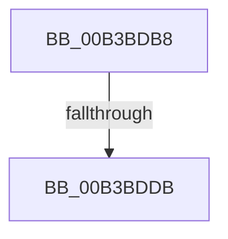

# sub_00B3BDB8

- RVA: `0x00B3BDB8`–`0x00B3BDF8` (길이 `64` bytes)
- VA: `0x0000000140B3BDB8`
- 실행 섹션: `PAGE`
- PDB 이름 있음: `아니요`; PDB Function 태그: `아니요`
- unwind 정보 RVA: `0x000B057C`
- 디코드: `15`개 명령, `64/64` bytes 표시
- 미해석 바이트: `0` (있으면 어셈블리에 `.byte`로 보존)

> 이 문서는 커널 이미지의 기계어와 PDB 기호를 분석해 생성했습니다. 4번과 5번은 함수 원형과 자료형을 바이너리 사용 방식에서 추정한 C 해석이며 원본 소스 복구 결과는 아닙니다.

## 1. Dependencies

- 직접 호출 지점: **1**; 고유 호출 대상: **1**
- 직접 호출자로 확인된 함수: **0**
- RIP 상대 이미지 참조: **0**

### Outgoing calls
- `0x00B3BDC6` → [PoBroadcastSystemState](../../pagelk/B7/PoBroadcastSystemState_function_00B761B0.md) (function, `0x00B761B0`)

### Direct callers
- 이 함수 시작 RVA로 연결되는 직접 call은 확인되지 않았습니다. 간접 호출은 완전히 역산할 수 없습니다.

### Static image references
- 디코드된 RIP-relative 메모리 참조가 없습니다.

## 2. Other-region calls and transfers

- 다른 실행 섹션으로 향하는 call: **1**
  - `0x00B3BDC6` → [PoBroadcastSystemState](../../pagelk/B7/PoBroadcastSystemState_function_00B761B0.md) (`PAGE` → `PAGELK`)
- call이 아닌 외부 분기/꼬리 이동: **2**
  - `0x00B3BDD5` → [PopDirectedDripsSuspendDevices + 0xB4](../A4/PopDirectedDripsSuspendDevices_function_00A4D474.md) (`tail-transfer`)
  - `0x00B3BDF3` → [PopDirectedDripsSuspendDevices + 0xD1](../A4/PopDirectedDripsSuspendDevices_function_00A4D474.md) (`tail-transfer`)

## 3. Assembly (complete function range)

```asm
00B3BDB8  C6 83 4C 02 00 00 00            mov byte ptr [rbx + 0x24c], 0
00B3BDBF  49 8B CE                        mov rcx, r14
00B3BDC2  C6 43 56 02                     mov byte ptr [rbx + 0x56], 2
00B3BDC6  E8 E5 A3 03 00                  call 0x140b761b0
00B3BDCB  89 83 8C 00 00 00               mov dword ptr [rbx + 0x8c], eax
00B3BDD1  8B F8                           mov edi, eax
00B3BDD3  85 C0                           test eax, eax
00B3BDD5  0F 88 4D 17 F1 FF               js 0x140a4d528
00B3BDDB  F0 83 0B 10                     lock or dword ptr [rbx], 0x10
00B3BDDF  F0 83 23 DF                     lock and dword ptr [rbx], 0xffffffdf
00B3BDE3  8B 83 90 00 00 00               mov eax, dword ptr [rbx + 0x90]
00B3BDE9  FF C0                           inc eax
00B3BDEB  89 83 90 00 00 00               mov dword ptr [rbx + 0x90], eax
00B3BDF1  33 FF                           xor edi, edi
00B3BDF3  E9 4D 17 F1 FF                  jmp 0x140a4d545
```

## 4. C-style interpretation (structured pseudocode)

```c
__int64 __fastcall sub_00B3BDB8(void)
{
    __int64 result;
    __int64 v_rdi;

    *(unsigned __int8 *)(v_rbx + 588) = 0;
    *(unsigned __int8 *)(v_rbx + 86) = 2;
    result = PoBroadcastSystemState(v_r14, a2, a3, a4);
    *(unsigned int *)(v_rbx + 140) = (unsigned int)(result);
    result = (unsigned int)(((unsigned int)(*(unsigned int *)(v_rbx + 144))) + 1);
    *(unsigned int *)(v_rbx + 144) = (unsigned int)(result);
    v_rdi = 0;
}
```

## 5. (Beta) C Style

```c
void sub_00B3BDB8(void)
{
    int64_t result;
    int64_t local_rdi;

    *(uint8_t *)(local_rbx + 0x24C) = 0;
    *(uint8_t *)(local_rbx + 0x56) = 2;
    result = PoBroadcastSystemState(local_r14, a2, a3, a4);
    *(uint32_t *)(local_rbx + 0x8C) = (uint32_t)(result);
    result = (uint32_t)(((uint32_t)(*(uint32_t *)(local_rbx + 0x90))) + 1);
    *(uint32_t *)(local_rbx + 0x90) = (uint32_t)(result);
    local_rdi = 0;
}
```

## 6. Execution-region graph

[열기: 2D/3D 그래프와 함수 탐색 컨트롤 패널](../../../control-panel.html?section=page&rva=0x00B3BDB8&view=graph)

- 2D 그래프는 위에서 아래로 흐르고, 3D 그래프는 빈 공간을 드래그해 회전합니다. Shift+드래그는 이동, 휠은 확대·축소, 함수 노드 선택은 대상 보고서 이동입니다.

### Static fallback


