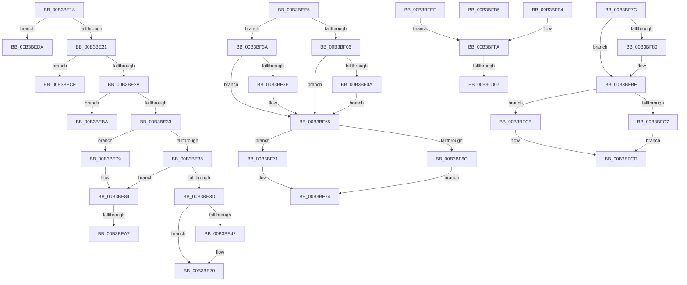

# sub_00B3BE18

- RVA: `0x00B3BE18`–`0x00B3C017` (길이 `511` bytes)
- VA: `0x0000000140B3BE18`
- 실행 섹션: `PAGE`
- PDB 이름 있음: `아니요`; PDB Function 태그: `아니요`
- unwind 정보 RVA: `0x000B063C`
- 디코드: `135`개 명령, `511/511` bytes 표시
- 미해석 바이트: `0` (있으면 어셈블리에 `.byte`로 보존)

> 이 문서는 커널 이미지의 기계어와 PDB 기호를 분석해 생성했습니다. 4번과 5번은 함수 원형과 자료형을 바이너리 사용 방식에서 추정한 C 해석이며 원본 소스 복구 결과는 아닙니다.

## 1. Dependencies

- 직접 호출 지점: **11**; 고유 호출 대상: **8**
- 직접 호출자로 확인된 함수: **0**
- RIP 상대 이미지 참조: **1**

### Outgoing calls
- `0x00B3BE4D` → [PopInternalAddToDumpFile](../../text/5C/PopInternalAddToDumpFile_function_005CE634.md) (function, `0x005CE634`)
- `0x00B3BE6A` → [KeBugCheckEx](../../text/4F/KeBugCheckEx_function_004FD660.md) (function, `0x004FD660`)
- `0x00B3BEAF` → [PopDiagTraceThermalZoneEnumeration](../../text/5D/PopDiagTraceThermalZoneEnumeration_function_005D7154.md) (function, `0x005D7154`)
- `0x00B3BEF5` → [PopThermalUpdateActiveTimeTracking](../AB/PopThermalUpdateActiveTimeTracking_function_00ABA79C.md) (function, `0x00ABA79C`)
- `0x00B3BF17` → [PopDiagTraceActiveCooling](../AD/PopDiagTraceActiveCooling_function_00AD72A8.md) (function, `0x00AD72A8`)
- `0x00B3BF2C` → [PopDiagTraceActiveCooling](../AD/PopDiagTraceActiveCooling_function_00AD72A8.md) (function, `0x00AD72A8`)
- `0x00B3BF4B` → [PopDiagTraceActiveCooling](../AD/PopDiagTraceActiveCooling_function_00AD72A8.md) (function, `0x00AD72A8`)
- `0x00B3BF60` → [PopDiagTraceActiveCooling](../AD/PopDiagTraceActiveCooling_function_00AD72A8.md) (function, `0x00AD72A8`)
- `0x00B3BF94` → [PopDiagTracePassiveCooling](../76/PopDiagTracePassiveCooling_function_00761CAC.md) (function, `0x00761CAC`)
- `0x00B3BFBA` → [PopDiagTraceThermalZoneThrottleDurationPerfTrack](../../text/5D/PopDiagTraceThermalZoneThrottleDurationPerfTrack_function_005D74F4.md) (function, `0x005D74F4`)
- `0x00B3BFE4` → [PopPrepareIoctl](../A7/PopPrepareIoctl_function_00A74A98.md) (function, `0x00A74A98`)

### Direct callers
- 이 함수 시작 RVA로 연결되는 직접 call은 확인되지 않았습니다. 간접 호출은 완전히 역산할 수 없습니다.

### Static image references
- `0x00B3BFFA` → RVA `0x00F0C964` (`.data`; read)

## 2. Other-region calls and transfers

- 다른 실행 섹션으로 향하는 call: **4**
  - `0x00B3BE4D` → [PopInternalAddToDumpFile](../../text/5C/PopInternalAddToDumpFile_function_005CE634.md) (`PAGE` → `.text`)
  - `0x00B3BE6A` → [KeBugCheckEx](../../text/4F/KeBugCheckEx_function_004FD660.md) (`PAGE` → `.text`)
  - `0x00B3BEAF` → [PopDiagTraceThermalZoneEnumeration](../../text/5D/PopDiagTraceThermalZoneEnumeration_function_005D7154.md) (`PAGE` → `.text`)
  - `0x00B3BFBA` → [PopDiagTraceThermalZoneThrottleDurationPerfTrack](../../text/5D/PopDiagTraceThermalZoneThrottleDurationPerfTrack_function_005D74F4.md) (`PAGE` → `.text`)
- call이 아닌 외부 분기/꼬리 이동: **11**
  - `0x00B3BE74` → [PopThermalWorker + 0x98](../A4/PopThermalWorker_function_00A4E200.md) (`tail-transfer`)
  - `0x00B3BEA1` → [PopThermalWorker + 0x229](../A4/PopThermalWorker_function_00A4E200.md) (`tail-transfer`)
  - `0x00B3BEB5` → [PopThermalWorker + 0x229](../A4/PopThermalWorker_function_00A4E200.md) (`tail-transfer`)
  - `0x00B3BECA` → [PopThermalWorker + 0x98](../A4/PopThermalWorker_function_00A4E200.md) (`tail-transfer`)
  - `0x00B3BED5` → [PopThermalWorker + 0x98](../A4/PopThermalWorker_function_00A4E200.md) (`tail-transfer`)
  - `0x00B3BEE0` → [PopThermalWorker + 0x98](../A4/PopThermalWorker_function_00A4E200.md) (`tail-transfer`)
  - `0x00B3BF77` → [PopThermalWorker + 0x303](../A4/PopThermalWorker_function_00A4E200.md) (`tail-transfer`)
  - `0x00B3BFD0` → [PopThermalWorker + 0x320](../A4/PopThermalWorker_function_00A4E200.md) (`tail-transfer`)
  - `0x00B3BFEA` → [PopThermalWorker + 0x17C](../A4/PopThermalWorker_function_00A4E200.md) (`tail-transfer`)
  - `0x00B3C001` → [PopThermalWorker + 0x12C](../A4/PopThermalWorker_function_00A4E200.md) (`tail-transfer`)
  - `0x00B3C012` → [PopThermalWorker + 0x12C](../A4/PopThermalWorker_function_00A4E200.md) (`tail-transfer`)

## 3. Assembly (complete function range)

```asm
00B3BE18  41 2B CC                        sub ecx, r12d
00B3BE1B  0F 84 B9 00 00 00               je 0x140b3beda
00B3BE21  41 2B CC                        sub ecx, r12d
00B3BE24  0F 84 A5 00 00 00               je 0x140b3becf
00B3BE2A  83 E9 02                        sub ecx, 2
00B3BE2D  0F 84 87 00 00 00               je 0x140b3beba
00B3BE33  41 2B CC                        sub ecx, r12d
00B3BE36  74 41                           je 0x140b3be79
00B3BE38  41 2B CC                        sub ecx, r12d
00B3BE3B  74 47                           je 0x140b3be84
00B3BE3D  83 F9 02                        cmp ecx, 2
00B3BE40  74 2E                           je 0x140b3be70
00B3BE42  4D 8B C5                        mov r8, r13
00B3BE45  BA D0 00 00 00                  mov edx, 0xd0
00B3BE4A  48 8B CD                        mov rcx, rbp
00B3BE4D  E8 E2 27 A9 FF                  call 0x1405ce634
00B3BE52  4C 8B CD                        mov r9, rbp
00B3BE55  4C 89 6C 24 20                  mov qword ptr [rsp + 0x20], r13
00B3BE5A  BA 00 05 00 00                  mov edx, 0x500
00B3BE5F  B9 A0 00 00 00                  mov ecx, 0xa0
00B3BE64  41 B8 05 00 00 00               mov r8d, 5
00B3BE6A  E8 F1 17 9C FF                  call 0x1404fd660
00B3BE6F  CC                              int3
00B3BE70  C6 46 40 07                     mov byte ptr [rsi + 0x40], 7
00B3BE74  E9 1F 24 F1 FF                  jmp 0x140a4e298
00B3BE79  44 88 A6 E4 00 00 00            mov byte ptr [rsi + 0xe4], r12b
00B3BE80  C6 46 40 08                     mov byte ptr [rsi + 0x40], 8
00B3BE84  8B 8E D8 00 00 00               mov ecx, dword ptr [rsi + 0xd8]
00B3BE8A  3B CB                           cmp ecx, ebx
00B3BE8C  8B 46 50                        mov eax, dword ptr [rsi + 0x50]
00B3BE8F  41 0F 92 C7                     setb r15b
00B3BE93  2B C1                           sub eax, ecx
00B3BE95  44 8D 24 80                     lea r12d, [rax + rax*4]
00B3BE99  8A 46 41                        mov al, byte ptr [rsi + 0x41]
00B3BE9C  45 03 E4                        add r12d, r12d
00B3BE9F  A8 02                           test al, 2
00B3BEA1  0F 85 82 25 F1 FF               jne 0x140a4e429
00B3BEA7  0C 02                           or al, 2
00B3BEA9  48 8B CE                        mov rcx, rsi
00B3BEAC  88 46 41                        mov byte ptr [rsi + 0x41], al
00B3BEAF  E8 A0 B2 A9 FF                  call 0x1405d7154
00B3BEB4  90                              nop
00B3BEB5  E9 6F 25 F1 FF                  jmp 0x140a4e429
00B3BEBA  8A 86 90 00 00 00               mov al, byte ptr [rsi + 0x90]
00B3BEC0  88 86 F9 01 00 00               mov byte ptr [rsi + 0x1f9], al
00B3BEC6  C6 46 40 0A                     mov byte ptr [rsi + 0x40], 0xa
00B3BECA  E9 C9 23 F1 FF                  jmp 0x140a4e298
00B3BECF  8B 46 54                        mov eax, dword ptr [rsi + 0x54]
00B3BED2  89 46 50                        mov dword ptr [rsi + 0x50], eax
00B3BED5  E9 BE 23 F1 FF                  jmp 0x140a4e298
00B3BEDA  8A 46 46                        mov al, byte ptr [rsi + 0x46]
00B3BEDD  88 46 45                        mov byte ptr [rsi + 0x45], al
00B3BEE0  E9 B3 23 F1 FF                  jmp 0x140a4e298
00B3BEE5  8A 86 DC 00 00 00               mov al, byte ptr [rsi + 0xdc]
00B3BEEB  48 8D 8E F8 01 00 00            lea rcx, [rsi + 0x1f8]
00B3BEF2  88 46 46                        mov byte ptr [rsi + 0x46], al
00B3BEF5  E8 A2 E8 F7 FF                  call 0x140aba79c
00B3BEFA  8A 46 41                        mov al, byte ptr [rsi + 0x41]
00B3BEFD  C6 44 24 30 01                  mov byte ptr [rsp + 0x30], 1
00B3BF02  3B FD                           cmp edi, ebp
00B3BF04  73 34                           jae 0x140b3bf3a
00B3BF06  A8 04                           test al, 4
00B3BF08  75 5B                           jne 0x140b3bf65
00B3BF0A  45 33 C9                        xor r9d, r9d
00B3BF0D  48 8D 4E 70                     lea rcx, [rsi + 0x70]
00B3BF11  41 B0 01                        mov r8b, 1
00B3BF14  49 8B D5                        mov rdx, r13
00B3BF17  E8 8C B3 F9 FF                  call 0x140ad72a8
00B3BF1C  41 B9 01 00 00 00               mov r9d, 1
00B3BF22  48 8D 4E 70                     lea rcx, [rsi + 0x70]
00B3BF26  45 8A C1                        mov r8b, r9b
00B3BF29  49 8B D5                        mov rdx, r13
00B3BF2C  E8 77 B3 F9 FF                  call 0x140ad72a8
00B3BF31  4C 89 B6 F8 00 00 00            mov qword ptr [rsi + 0xf8], r14
00B3BF38  EB 2B                           jmp 0x140b3bf65
00B3BF3A  A8 04                           test al, 4
00B3BF3C  74 27                           je 0x140b3bf65
00B3BF3E  45 33 C9                        xor r9d, r9d
00B3BF41  48 8D 4E 70                     lea rcx, [rsi + 0x70]
00B3BF45  45 33 C0                        xor r8d, r8d
00B3BF48  49 8B D5                        mov rdx, r13
00B3BF4B  E8 58 B3 F9 FF                  call 0x140ad72a8
00B3BF50  41 B9 01 00 00 00               mov r9d, 1
00B3BF56  48 8D 4E 70                     lea rcx, [rsi + 0x70]
00B3BF5A  45 33 C0                        xor r8d, r8d
00B3BF5D  49 8B D5                        mov rdx, r13
00B3BF60  E8 43 B3 F9 FF                  call 0x140ad72a8
00B3BF65  8A 4E 41                        mov cl, byte ptr [rsi + 0x41]
00B3BF68  3B FD                           cmp edi, ebp
00B3BF6A  72 05                           jb 0x140b3bf71
00B3BF6C  80 E1 FB                        and cl, 0xfb
00B3BF6F  EB 03                           jmp 0x140b3bf74
00B3BF71  80 C9 04                        or cl, 4
00B3BF74  88 4E 41                        mov byte ptr [rsi + 0x41], cl
00B3BF77  E9 87 25 F1 FF                  jmp 0x140a4e503
00B3BF7C  A8 01                           test al, 1
00B3BF7E  74 3F                           je 0x140b3bfbf
00B3BF80  45 8B CC                        mov r9d, r12d
00B3BF83  C7 44 24 20 01 00 00 00         mov dword ptr [rsp + 0x20], 1
00B3BF8B  45 33 C0                        xor r8d, r8d
00B3BF8E  49 8B D5                        mov rdx, r13
00B3BF91  48 8B CB                        mov rcx, rbx
00B3BF94  E8 13 5D C2 FF                  call 0x140761cac
00B3BF99  49 8B CE                        mov rcx, r14
00B3BF9C  48 B8 4B 59 86 38 D6 C5 6D 34   movabs rax, 0x346dc5d63886594b
00B3BFA6  48 2B 8E 00 01 00 00            sub rcx, qword ptr [rsi + 0x100]
00B3BFAD  48 F7 E1                        mul rcx
00B3BFB0  48 8B CA                        mov rcx, rdx
00B3BFB3  49 8B D5                        mov rdx, r13
00B3BFB6  48 C1 E9 0B                     shr rcx, 0xb
00B3BFBA  E8 35 B5 A9 FF                  call 0x1405d74f4
00B3BFBF  8A 46 41                        mov al, byte ptr [rsi + 0x41]
00B3BFC2  45 84 FF                        test r15b, r15b
00B3BFC5  75 04                           jne 0x140b3bfcb
00B3BFC7  24 FE                           and al, 0xfe
00B3BFC9  EB 02                           jmp 0x140b3bfcd
00B3BFCB  0C 01                           or al, 1
00B3BFCD  88 46 41                        mov byte ptr [rsi + 0x41], al
00B3BFD0  E9 4B 25 F1 FF                  jmp 0x140a4e520
00B3BFD5  89 44 24 28                     mov dword ptr [rsp + 0x28], eax
00B3BFD9  45 33 C0                        xor r8d, r8d
00B3BFDC  89 44 24 20                     mov dword ptr [rsp + 0x20], eax
00B3BFE0  48 8B 4E 38                     mov rcx, qword ptr [rsi + 0x38]
00B3BFE4  E8 AF 8A F3 FF                  call 0x140a74a98
00B3BFE9  90                              nop
00B3BFEA  E9 8D 23 F1 FF                  jmp 0x140a4e37c
00B3BFEF  48 8B CA                        mov rcx, rdx
00B3BFF2  EB 06                           jmp 0x140b3bffa
00B3BFF4  89 7E 70                        mov dword ptr [rsi + 0x70], edi
00B3BFF7  48 8B CF                        mov rcx, rdi
00B3BFFA  40 38 3D 63 09 3D 00            cmp byte ptr [rip + 0x3d0963], dil
00B3C001  0F 85 25 23 F1 FF               jne 0x140a4e32c
00B3C007  48 83 4C 24 48 FF               or qword ptr [rsp + 0x48], 0xffffffffffffffff
00B3C00D  4C 8D 4C 24 40                  lea r9, [rsp + 0x40]
00B3C012  E9 15 23 F1 FF                  jmp 0x140a4e32c
```

## 4. C-style interpretation (structured pseudocode)

```c
__int64 __fastcall sub_00B3BE18(int a1)
{
    __int64 result;
    __int64 v_r12;
    __int64 v_r15;
    unsigned __int64 v_stack_p20;
    unsigned int v_stack_p28;
    unsigned __int8 v_stack_p30;
    unsigned __int64 v_stack_p40;
    unsigned __int64 v_stack_p48;

    a1 = (unsigned int)((a1) - ((unsigned int)(v_r12)));
    if (condition_is_equal) goto loc_00B3BEDA;
    a1 = (unsigned int)((a1) - ((unsigned int)(v_r12)));
    if (condition_is_equal) goto loc_00B3BECF;
    a1 = (unsigned int)((a1) - (2));
    if (condition_is_equal) goto loc_00B3BEBA;
    a1 = (unsigned int)((a1) - ((unsigned int)(v_r12)));
    if (condition_is_equal) goto loc_00B3BE79;
    a1 = (unsigned int)((a1) - ((unsigned int)(v_r12)));
    if (condition_is_equal) goto loc_00B3BE84;
    if (a1 != 2) {
        a3 = v_r13;
        a2 = 208;
        a1 = v_rbp;
        result = PopInternalAddToDumpFile(a1, a2, a3, a4);
        a4 = v_rbp;
        v_stack_p20 = v_r13;
        a2 = 0x500ULL;
        a1 = 160;
        a3 = 5;
        result = KeBugCheckEx(a1, a2, a3, a4);
    }
    *(unsigned __int8 *)(v_rsi + 64) = 7;
loc_00B3BE79:
    *(unsigned __int8 *)(v_rsi + 228) = (unsigned __int8)(v_r12);
    *(unsigned __int8 *)(v_rsi + 64) = 8;
loc_00B3BE84:
    v_r15 = (((unsigned int)((unsigned int)(*(unsigned int *)(v_rsi + 216)))) < ((unsigned int)(v_rbx))) ? 1 : 0;
    result = (unsigned int)(((unsigned int)(*(unsigned int *)(v_rsi + 80))) - ((unsigned int)((unsigned int)(*(unsigned int *)(v_rsi + 216)))));
    v_r12 = (unsigned int)((result + result * 4) + ((unsigned int)(result + result * 4)));
    result = (unsigned __int8)((*(unsigned __int8 *)(v_rsi + 65)) | (2));
    *(unsigned __int8 *)(v_rsi + 65) = (unsigned __int8)(result);
    result = PopDiagTraceThermalZoneEnumeration(v_rsi, a2, a3, a4);
loc_00B3BEBA:
    *(unsigned __int8 *)(v_rsi + 505) = (unsigned __int8)(*(unsigned __int8 *)(v_rsi + 144));
    *(unsigned __int8 *)(v_rsi + 64) = 10;
loc_00B3BECF:
    *(unsigned int *)(v_rsi + 80) = (unsigned int)((unsigned int)(*(unsigned int *)(v_rsi + 84)));
loc_00B3BEDA:
    *(unsigned __int8 *)(v_rsi + 69) = (unsigned __int8)(*(unsigned __int8 *)(v_rsi + 70));
}
```

## 5. (Beta) C Style

```c
int64_t sub_00B3BE18(int32_t Arg1)
{
    int64_t result;
    int64_t local_r12;
    int64_t local_r15;
    uint64_t v_stack_p20;
    uint32_t v_stack_p28;
    uint8_t v_stack_p30;
    uint64_t v_stack_p40;
    uint64_t v_stack_p48;

    Arg1 = (uint32_t)((Arg1) - ((uint32_t)(local_r12)));
    if (condition_is_equal) goto loc_00B3BEDA;
    Arg1 = (uint32_t)((Arg1) - ((uint32_t)(local_r12)));
    if (condition_is_equal) goto loc_00B3BECF;
    Arg1 = (uint32_t)((Arg1) - (2));
    if (condition_is_equal) goto loc_00B3BEBA;
    Arg1 = (uint32_t)((Arg1) - ((uint32_t)(local_r12)));
    if (condition_is_equal) goto loc_00B3BE79;
    Arg1 = (uint32_t)((Arg1) - ((uint32_t)(local_r12)));
    if (condition_is_equal) goto loc_00B3BE84;
    if (Arg1 != 2) {
        a3 = local_r13;
        a2 = 208;
        Arg1 = local_rbp;
        result = PopInternalAddToDumpFile(Arg1, a2, a3, a4);
        a4 = local_rbp;
        v_stack_p20 = local_r13;
        a2 = 0x500ULL;
        Arg1 = 160;
        a3 = 5;
        result = KeBugCheckEx(Arg1, a2, a3, a4);
    }
    *(uint8_t *)(local_rsi + 0x40) = 7;
loc_00B3BE79:
    *(uint8_t *)(local_rsi + 0xE4) = (uint8_t)(local_r12);
    *(uint8_t *)(local_rsi + 0x40) = 8;
loc_00B3BE84:
    local_r15 = (((uint32_t)((uint32_t)(*(uint32_t *)(local_rsi + 0xD8)))) < ((uint32_t)(local_rbx))) ? 1 : 0;
    result = (uint32_t)(((uint32_t)(*(uint32_t *)(local_rsi + 0x50))) - ((uint32_t)((uint32_t)(*(uint32_t *)(local_rsi + 0xD8)))));
    local_r12 = (uint32_t)((result + result * 4) + ((uint32_t)(result + result * 4)));
    result = (uint8_t)((*(uint8_t *)(local_rsi + 0x41)) | (2));
    *(uint8_t *)(local_rsi + 0x41) = (uint8_t)(result);
    result = PopDiagTraceThermalZoneEnumeration(local_rsi, a2, a3, a4);
loc_00B3BEBA:
    *(uint8_t *)(local_rsi + 0x1F9) = (uint8_t)(*(uint8_t *)(local_rsi + 0x90));
    *(uint8_t *)(local_rsi + 0x40) = 10;
loc_00B3BECF:
    *(uint32_t *)(local_rsi + 0x50) = (uint32_t)((uint32_t)(*(uint32_t *)(local_rsi + 0x54)));
loc_00B3BEDA:
    *(uint8_t *)(local_rsi + 0x45) = (uint8_t)(*(uint8_t *)(local_rsi + 0x46));
}
```

## 6. Execution-region graph

[열기: 2D/3D 그래프와 함수 탐색 컨트롤 패널](../../../control-panel.html?section=page&rva=0x00B3BE18&view=graph)

- 2D 그래프는 위에서 아래로 흐르고, 3D 그래프는 빈 공간을 드래그해 회전합니다. Shift+드래그는 이동, 휠은 확대·축소, 함수 노드 선택은 대상 보고서 이동입니다.

### Static fallback


