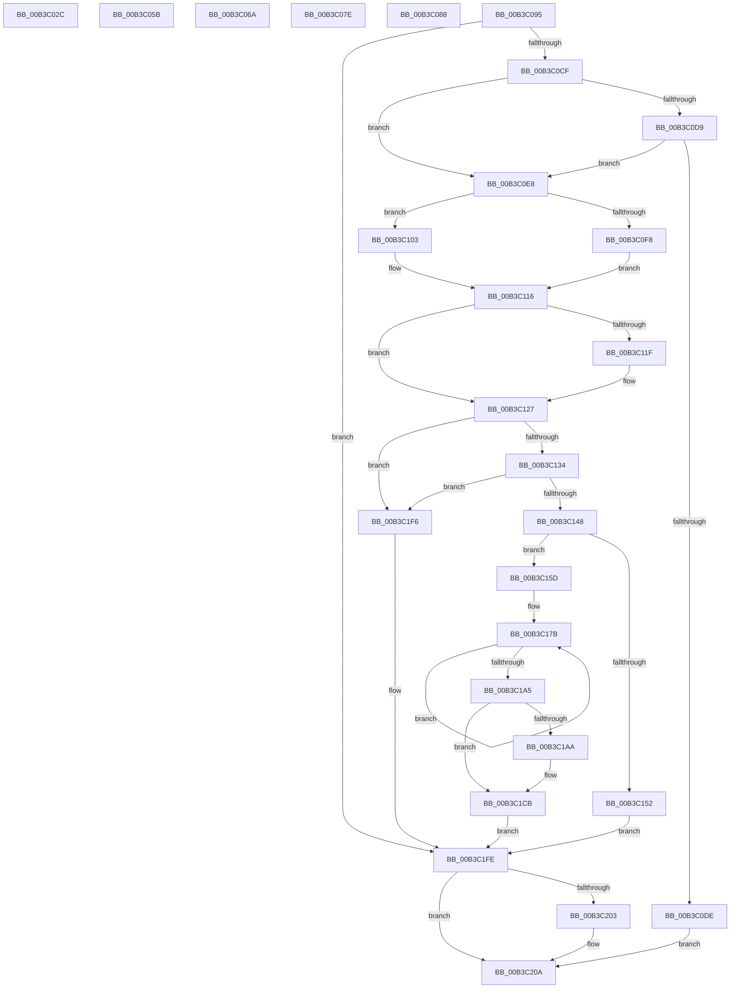

# sub_00B3C02C

- RVA: `0x00B3C02C`–`0x00B3C216` (길이 `490` bytes)
- VA: `0x0000000140B3C02C`
- 실행 섹션: `PAGE`
- PDB 이름 있음: `아니요`; PDB Function 태그: `아니요`
- unwind 정보 RVA: `0x000B06E4`
- 디코드: `124`개 명령, `490/490` bytes 표시
- 미해석 바이트: `0` (있으면 어셈블리에 `.byte`로 보존)

> 이 문서는 커널 이미지의 기계어와 PDB 기호를 분석해 생성했습니다. 4번과 5번은 함수 원형과 자료형을 바이너리 사용 방식에서 추정한 C 해석이며 원본 소스 복구 결과는 아닙니다.

## 1. Dependencies

- 직접 호출 지점: **5**; 고유 호출 대상: **4**
- 직접 호출자로 확인된 함수: **0**
- RIP 상대 이미지 참조: **1**

### Outgoing calls
- `0x00B3C073` → [WmipUnreferenceRegEntry](../../text/47/WmipUnreferenceRegEntry_function_0047B6F0.md) (function, `0x0047B6F0`)
- `0x00B3C0BC` → [WmipQueryWmiRegInfo](../7B/WmipQueryWmiRegInfo_function_007B4B50.md) (function, `0x007B4B50`)
- `0x00B3C1C2` → [memcpy](../../text/6C/memcpy_function_006C6840.md) (function, `0x006C6840`)
- `0x00B3C1E8` → [memcpy](../../text/6C/memcpy_function_006C6840.md) (function, `0x006C6840`)
- `0x00B3C205` → [ExFreePoolWithTag](../../poolcode/B8/ExFreePoolWithTag_function_00B82870.md) (function, `0x00B82870`)

### Direct callers
- 이 함수 시작 RVA로 연결되는 직접 call은 확인되지 않았습니다. 간접 호출은 완전히 역산할 수 없습니다.

### Static image references
- `0x00B3C0E8` → RVA `0x00B4CD28` (`PAGE`; read)

## 2. Other-region calls and transfers

- 다른 실행 섹션으로 향하는 call: **4**
  - `0x00B3C073` → [WmipUnreferenceRegEntry](../../text/47/WmipUnreferenceRegEntry_function_0047B6F0.md) (`PAGE` → `.text`)
  - `0x00B3C1C2` → [memcpy](../../text/6C/memcpy_function_006C6840.md) (`PAGE` → `.text`)
  - `0x00B3C1E8` → [memcpy](../../text/6C/memcpy_function_006C6840.md) (`PAGE` → `.text`)
  - `0x00B3C205` → [ExFreePoolWithTag](../../poolcode/B8/ExFreePoolWithTag_function_00B82870.md) (`PAGE` → `POOLCODE`)
- call이 아닌 외부 분기/꼬리 이동: **6**
  - `0x00B3C056` → [IoWMISystemControl + 0x158](../A4/IoWMISystemControl_function_00A4EB04.md) (`tail-transfer`)
  - `0x00B3C065` → [IoWMISystemControl + 0x221](../A4/IoWMISystemControl_function_00A4EB04.md) (`tail-transfer`)
  - `0x00B3C079` → [IoWMISystemControl + 0x10F](../A4/IoWMISystemControl_function_00A4EB04.md) (`tail-transfer`)
  - `0x00B3C083` → [IoWMISystemControl + 0x68](../A4/IoWMISystemControl_function_00A4EB04.md) (`tail-transfer`)
  - `0x00B3C090` → [IoWMISystemControl + 0x189](../A4/IoWMISystemControl_function_00A4EB04.md) (`tail-transfer`)
  - `0x00B3C211` → [IoWMISystemControl + 0x5B](../A4/IoWMISystemControl_function_00A4EB04.md) (`tail-transfer`)

## 3. Assembly (complete function range)

```asm
00B3C02C  41 8B 46 38                     mov eax, dword ptr [r14 + 0x38]
00B3C030  44 8B 4D 40                     mov r9d, dword ptr [rbp + 0x40]
00B3C034  44 2B E0                        sub r12d, eax
00B3C037  49 8D 0C 06                     lea rcx, [r14 + rax]
00B3C03B  48 89 4C 24 38                  mov qword ptr [rsp + 0x38], rcx
00B3C040  49 8D 46 3C                     lea rax, [r14 + 0x3c]
00B3C044  44 89 64 24 30                  mov dword ptr [rsp + 0x30], r12d
00B3C049  48 89 44 24 28                  mov qword ptr [rsp + 0x28], rax
00B3C04E  C7 44 24 20 01 00 00 00         mov dword ptr [rsp + 0x20], 1
00B3C056  E9 01 2C F1 FF                  jmp 0x140a4ec5c
00B3C05B  89 5C 24 20                     mov dword ptr [rsp + 0x20], ebx
00B3C05F  41 B9 95 02 00 C0               mov r9d, 0xc0000295
00B3C065  E9 BB 2C F1 FF                  jmp 0x140a4ed25
00B3C06A  41 BF 01 00 00 00               mov r15d, 1
00B3C070  48 8B C8                        mov rcx, rax
00B3C073  E8 78 F6 93 FF                  call 0x14047b6f0
00B3C078  90                              nop
00B3C079  E9 95 2B F1 FF                  jmp 0x140a4ec13
00B3C07E  BE 10 00 00 C0                  mov esi, 0xc0000010
00B3C083  E9 E4 2A F1 FF                  jmp 0x140a4eb6c
00B3C088  BE 10 00 00 C0                  mov esi, 0xc0000010
00B3C08D  89 77 30                        mov dword ptr [rdi + 0x30], esi
00B3C090  E9 F8 2B F1 FF                  jmp 0x140a4ec8d
00B3C095  0F 57 C0                        xorps xmm0, xmm0
00B3C098  48 89 5D 58                     mov qword ptr [rbp + 0x58], rbx
00B3C09C  0F 57 C9                        xorps xmm1, xmm1
00B3C09F  89 5D 50                        mov dword ptr [rbp + 0x50], ebx
00B3C0A2  4C 8D 4D 58                     lea r9, [rbp + 0x58]
00B3C0A6  49 8B CD                        mov rcx, r13
00B3C0A9  4C 8D 45 E0                     lea r8, [rbp - 0x20]
00B3C0AD  44 8B FB                        mov r15d, ebx
00B3C0B0  48 8D 55 50                     lea rdx, [rbp + 0x50]
00B3C0B4  0F 11 45 F0                     movups xmmword ptr [rbp - 0x10], xmm0
00B3C0B8  0F 11 4D E0                     movups xmmword ptr [rbp - 0x20], xmm1
00B3C0BC  E8 8F 8A C7 FF                  call 0x1407b4b50
00B3C0C1  48 8B 4D E8                     mov rcx, qword ptr [rbp - 0x18]
00B3C0C5  8B F0                           mov esi, eax
00B3C0C7  85 C0                           test eax, eax
00B3C0C9  0F 88 2F 01 00 00               js 0x140b3c1fe
00B3C0CF  8B 55 50                        mov edx, dword ptr [rbp + 0x50]
00B3C0D2  8B C2                           mov eax, edx
00B3C0D4  83 E0 20                        and eax, 0x20
00B3C0D7  75 0F                           jne 0x140b3c0e8
00B3C0D9  48 85 C9                        test rcx, rcx
00B3C0DC  75 0A                           jne 0x140b3c0e8
00B3C0DE  BE 10 00 00 C0                  mov esi, 0xc0000010
00B3C0E3  E9 22 01 00 00                  jmp 0x140b3c20a
00B3C0E8  4C 8B 0D 39 0C 01 00            mov r9, qword ptr [rip + 0x10c39]
00B3C0EF  44 0F B7 55 E0                  movzx r10d, word ptr [rbp - 0x20]
00B3C0F4  85 C0                           test eax, eax
00B3C0F6  74 0B                           je 0x140b3c103
00B3C0F8  4C 8B DB                        mov r11, rbx
00B3C0FB  41 BF F8 00 00 00               mov r15d, 0xf8
00B3C101  EB 13                           jmp 0x140b3c116
00B3C103  83 CA 04                        or edx, 4
00B3C106  45 8D BA FA 00 00 00            lea r15d, [r10 + 0xfa]
00B3C10D  89 55 50                        mov dword ptr [rbp + 0x50], edx
00B3C110  41 BB F8 00 00 00               mov r11d, 0xf8
00B3C116  4C 8B 45 58                     mov r8, qword ptr [rbp + 0x58]
00B3C11A  4D 85 C0                        test r8, r8
00B3C11D  75 08                           jne 0x140b3c127
00B3C11F  4C 8D 45 F0                     lea r8, [rbp - 0x10]
00B3C123  4C 89 45 58                     mov qword ptr [rbp + 0x58], r8
00B3C127  41 81 FF F8 00 00 00            cmp r15d, 0xf8
00B3C12E  0F 82 C2 00 00 00               jb 0x140b3c1f6
00B3C134  45 0F B7 28                     movzx r13d, word ptr [r8]
00B3C138  41 83 C5 02                     add r13d, 2
00B3C13C  45 03 EF                        add r13d, r15d
00B3C13F  45 3B EF                        cmp r13d, r15d
00B3C142  0F 82 AE 00 00 00               jb 0x140b3c1f6
00B3C148  45 89 2E                        mov dword ptr [r14], r13d
00B3C14B  8B F3                           mov esi, ebx
00B3C14D  45 3B EC                        cmp r13d, r12d
00B3C150  76 0B                           jbe 0x140b3c15d
00B3C152  41 BF 04 00 00 00               mov r15d, 4
00B3C158  E9 A1 00 00 00                  jmp 0x140b3c1fe
00B3C15D  41 BC 07 00 00 00               mov r12d, 7
00B3C163  41 89 5E 04                     mov dword ptr [r14 + 4], ebx
00B3C167  45 89 66 10                     mov dword ptr [r14 + 0x10], r12d
00B3C16B  49 8D 4E 30                     lea rcx, [r14 + 0x30]
00B3C16F  41 89 5E 0C                     mov dword ptr [r14 + 0xc], ebx
00B3C173  49 83 C1 10                     add r9, 0x10
00B3C177  45 89 7E 08                     mov dword ptr [r14 + 8], r15d
00B3C17B  41 0F 10 41 F0                  movups xmm0, xmmword ptr [r9 - 0x10]
00B3C180  8B C2                           mov eax, edx
00B3C182  F3 0F 7F 41 E8                  movdqu xmmword ptr [rcx - 0x18], xmm0
00B3C187  41 0B 41 04                     or eax, dword ptr [r9 + 4]
00B3C18B  89 41 F8                        mov dword ptr [rcx - 8], eax
00B3C18E  4C 89 19                        mov qword ptr [rcx], r11
00B3C191  48 8D 49 20                     lea rcx, [rcx + 0x20]
00B3C195  41 8B 01                        mov eax, dword ptr [r9]
00B3C198  4D 8D 49 18                     lea r9, [r9 + 0x18]
00B3C19C  89 41 DC                        mov dword ptr [rcx - 0x24], eax
00B3C19F  49 83 EC 01                     sub r12, 1
00B3C1A3  75 D6                           jne 0x140b3c17b
00B3C1A5  F6 C2 04                        test dl, 4
00B3C1A8  74 21                           je 0x140b3c1cb
00B3C1AA  66 45 89 96 F8 00 00 00         mov word ptr [r14 + 0xf8], r10w
00B3C1B2  49 8D 8E FA 00 00 00            lea rcx, [r14 + 0xfa]
00B3C1B9  44 0F B7 45 E0                  movzx r8d, word ptr [rbp - 0x20]
00B3C1BE  48 8B 55 E8                     mov rdx, qword ptr [rbp - 0x18]
00B3C1C2  E8 79 A6 B8 FF                  call 0x1406c6840
00B3C1C7  4C 8B 45 58                     mov r8, qword ptr [rbp + 0x58]
00B3C1CB  41 0F B7 00                     movzx eax, word ptr [r8]
00B3C1CF  41 8B CF                        mov ecx, r15d
00B3C1D2  49 03 CE                        add rcx, r14
00B3C1D5  66 89 01                        mov word ptr [rcx], ax
00B3C1D8  48 83 C1 02                     add rcx, 2
00B3C1DC  48 8B 55 58                     mov rdx, qword ptr [rbp + 0x58]
00B3C1E0  44 0F B7 02                     movzx r8d, word ptr [rdx]
00B3C1E4  48 8B 52 08                     mov rdx, qword ptr [rdx + 8]
00B3C1E8  E8 53 A6 B8 FF                  call 0x1406c6840
00B3C1ED  48 8B 4D E8                     mov rcx, qword ptr [rbp - 0x18]
00B3C1F1  45 8B FD                        mov r15d, r13d
00B3C1F4  EB 08                           jmp 0x140b3c1fe
00B3C1F6  44 8B FB                        mov r15d, ebx
00B3C1F9  BE 95 00 00 C0                  mov esi, 0xc0000095
00B3C1FE  48 85 C9                        test rcx, rcx
00B3C201  74 07                           je 0x140b3c20a
00B3C203  33 D2                           xor edx, edx
00B3C205  E8 66 66 04 00                  call 0x140b82870
00B3C20A  41 8B C7                        mov eax, r15d
00B3C20D  48 89 47 38                     mov qword ptr [rdi + 0x38], rax
00B3C211  E9 49 29 F1 FF                  jmp 0x140a4eb5f
```

## 4. C-style interpretation (structured pseudocode)

```c
__int64 __fastcall sub_00B3C02C(void)
{
    __int64 v_r12;
    unsigned int v_stack_p20;
    unsigned __int64 v_stack_p28;
    unsigned int v_stack_p30;
    unsigned __int64 v_stack_p38;

    v_r12 = (unsigned int)((v_r12) - ((unsigned int)((unsigned int)(*(unsigned int *)(v_r14 + 56)))));
    v_stack_p38 = v_r14 + (unsigned int)(*(unsigned int *)(v_r14 + 56)) * 1;
    v_stack_p30 = (unsigned int)(v_r12);
    v_stack_p28 = v_r14 + 60;
    v_stack_p20 = 1;
}
```

## 5. (Beta) C Style

```c
void sub_00B3C02C(void)
{
    int64_t local_r12;
    uint32_t v_stack_p20;
    uint64_t v_stack_p28;
    uint32_t v_stack_p30;
    uint64_t v_stack_p38;

    local_r12 = (uint32_t)((local_r12) - ((uint32_t)((uint32_t)(*(uint32_t *)(local_r14 + 0x38)))));
    v_stack_p38 = local_r14 + (uint32_t)(*(uint32_t *)(local_r14 + 0x38)) * 1;
    v_stack_p30 = (uint32_t)(local_r12);
    v_stack_p28 = local_r14 + 60;
    v_stack_p20 = 1;
}
```

## 6. Execution-region graph

[열기: 2D/3D 그래프와 함수 탐색 컨트롤 패널](../../../control-panel.html?section=page&rva=0x00B3C02C&view=graph)

- 2D 그래프는 위에서 아래로 흐르고, 3D 그래프는 빈 공간을 드래그해 회전합니다. Shift+드래그는 이동, 휠은 확대·축소, 함수 노드 선택은 대상 보고서 이동입니다.

### Static fallback


