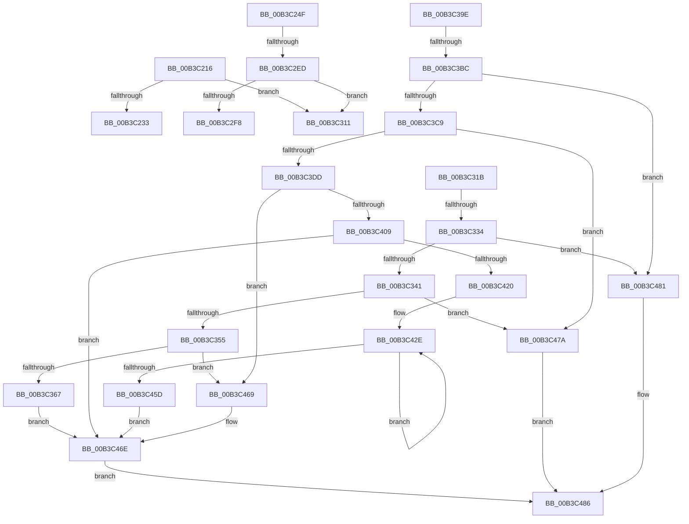

# sub_00B3C216

- RVA: `0x00B3C216`–`0x00B3C494` (길이 `638` bytes)
- VA: `0x0000000140B3C216`
- 실행 섹션: `PAGE`
- PDB 이름 있음: `아니요`; PDB Function 태그: `아니요`
- unwind 정보 RVA: `0x000B071C`
- 디코드: `157`개 명령, `638/638` bytes 표시
- 미해석 바이트: `0` (있으면 어셈블리에 `.byte`로 보존)

> 이 문서는 커널 이미지의 기계어와 PDB 기호를 분석해 생성했습니다. 4번과 5번은 함수 원형과 자료형을 바이너리 사용 방식에서 추정한 C 해석이며 원본 소스 복구 결과는 아닙니다.

## 1. Dependencies

- 직접 호출 지점: **11**; 고유 호출 대상: **7**
- 직접 호출자로 확인된 함수: **0**
- RIP 상대 이미지 참조: **4**

### Outgoing calls
- `0x00B3C243` → [memcpy](../../text/6C/memcpy_function_006C6840.md) (function, `0x006C6840`)
- `0x00B3C2E0` → [RtlpQueryRegistryValues](../8C/RtlpQueryRegistryValues_function_008C9050.md) (function, `0x008C9050`)
- `0x00B3C323` → [WmipFindRegEntryByDevice](../../text/46/WmipFindRegEntryByDevice_function_0046C22C.md) (function, `0x0046C22C`)
- `0x00B3C346` → [IoGetDeviceInstanceName](../../text/4A/IoGetDeviceInstanceName_function_004AADA4.md) (function, `0x004AADA4`)
- `0x00B3C38C` → [memcpy](../../text/6C/memcpy_function_006C6840.md) (function, `0x006C6840`)
- `0x00B3C3A6` → [WmipFindRegEntryByDevice](../../text/46/WmipFindRegEntryByDevice_function_0046C22C.md) (function, `0x0046C22C`)
- `0x00B3C3CE` → [IoGetDeviceInstanceName](../../text/4A/IoGetDeviceInstanceName_function_004AADA4.md) (function, `0x004AADA4`)
- `0x00B3C411` → [memset](../../text/6C/memset_function_006C6C40.md) (function, `0x006C6C40`)
- `0x00B3C44F` → [memcpy](../../text/6C/memcpy_function_006C6840.md) (function, `0x006C6840`)
- `0x00B3C473` → [RtlFreeAnsiString](../9C/RtlFreeAnsiString_function_009C0800.md) (function, `0x009C0800`)
- `0x00B3C489` → [WmipUnreferenceRegEntry](../../text/47/WmipUnreferenceRegEntry_function_0047B6F0.md) (function, `0x0047B6F0`)

### Direct callers
- 이 함수 시작 RVA로 연결되는 직접 call은 확인되지 않았습니다. 간접 호출은 완전히 역산할 수 없습니다.

### Static image references
- `0x00B3C260` → RVA `0x00B070B0` (` ?? ::NNGAKEGL::`string'`; read)
- `0x00B3C285` → RVA `0x00B07080` (` ?? ::NNGAKEGL::`string'`; read)
- `0x00B3C29C` → RVA `0x00AFF330` (` ?? ::NNGAKEGL::`string'`; read)
- `0x00B3C2AF` → RVA `0x00B070E0` (` ?? ::NNGAKEGL::`string'`; read)

## 2. Other-region calls and transfers

- 다른 실행 섹션으로 향하는 call: **9**
  - `0x00B3C243` → [memcpy](../../text/6C/memcpy_function_006C6840.md) (`PAGE` → `.text`)
  - `0x00B3C323` → [WmipFindRegEntryByDevice](../../text/46/WmipFindRegEntryByDevice_function_0046C22C.md) (`PAGE` → `.text`)
  - `0x00B3C346` → [IoGetDeviceInstanceName](../../text/4A/IoGetDeviceInstanceName_function_004AADA4.md) (`PAGE` → `.text`)
  - `0x00B3C38C` → [memcpy](../../text/6C/memcpy_function_006C6840.md) (`PAGE` → `.text`)
  - `0x00B3C3A6` → [WmipFindRegEntryByDevice](../../text/46/WmipFindRegEntryByDevice_function_0046C22C.md) (`PAGE` → `.text`)
  - `0x00B3C3CE` → [IoGetDeviceInstanceName](../../text/4A/IoGetDeviceInstanceName_function_004AADA4.md) (`PAGE` → `.text`)
  - `0x00B3C411` → [memset](../../text/6C/memset_function_006C6C40.md) (`PAGE` → `.text`)
  - `0x00B3C44F` → [memcpy](../../text/6C/memcpy_function_006C6840.md) (`PAGE` → `.text`)
  - `0x00B3C489` → [WmipUnreferenceRegEntry](../../text/47/WmipUnreferenceRegEntry_function_0047B6F0.md) (`PAGE` → `.text`)
- call이 아닌 외부 분기/꼬리 이동: **7**
  - `0x00B3C24A` → [WmipQueryWmiDataBlock + 0xA2](../A4/WmipQueryWmiDataBlock_function_00A4EDA0.md) (`tail-transfer`)
  - `0x00B3C2E7` → [WmipQueryWmiDataBlock + 0xF8](../A4/WmipQueryWmiDataBlock_function_00A4EDA0.md) (`tail-transfer`)
  - `0x00B3C30C` → [WmipQueryWmiDataBlock + 0x9F](../A4/WmipQueryWmiDataBlock_function_00A4EDA0.md) (`tail-transfer`)
  - `0x00B3C316` → [WmipQueryWmiDataBlock + 0xA2](../A4/WmipQueryWmiDataBlock_function_00A4EDA0.md) (`tail-transfer`)
  - `0x00B3C32E` → [WmipQueryWmiDataBlock + 0xF8](../A4/WmipQueryWmiDataBlock_function_00A4EDA0.md) (`tail-transfer`)
  - `0x00B3C3B6` → [WmipQueryWmiDataBlock + 0xF8](../A4/WmipQueryWmiDataBlock_function_00A4EDA0.md) (`tail-transfer`)
  - `0x00B3C48F` → [WmipQueryWmiDataBlock + 0xA2](../A4/WmipQueryWmiDataBlock_function_00A4EDA0.md) (`tail-transfer`)

## 3. Assembly (complete function range)

```asm
00B3C216  8B 44 24 30                     mov eax, dword ptr [rsp + 0x30]
00B3C21A  44 8B F0                        mov r14d, eax
00B3C21D  48 8B 54 24 50                  mov rdx, qword ptr [rsp + 0x50]
00B3C222  41 C1 E6 04                     shl r14d, 4
00B3C226  41 83 C6 04                     add r14d, 4
00B3C22A  41 3B DE                        cmp ebx, r14d
00B3C22D  0F 82 DE 00 00 00               jb 0x140b3c311
00B3C233  45 89 37                        mov dword ptr [r15], r14d
00B3C236  48 8D 4E 04                     lea rcx, [rsi + 4]
00B3C23A  45 8B C6                        mov r8d, r14d
00B3C23D  49 83 E8 04                     sub r8, 4
00B3C241  89 06                           mov dword ptr [rsi], eax
00B3C243  E8 F8 A5 B8 FF                  call 0x1406c6840
00B3C248  33 FF                           xor edi, edi
00B3C24A  E9 F3 2B F1 FF                  jmp 0x140a4ee42
00B3C24F  B9 00 00 00 04                  mov ecx, 0x4000000
00B3C254  89 7C 24 30                     mov dword ptr [rsp + 0x30], edi
00B3C258  BA 24 01 00 00                  mov edx, 0x124
00B3C25D  89 4D 80                        mov dword ptr [rbp - 0x80], ecx
00B3C260  48 8D 05 49 AE FC FF            lea rax, [rip - 0x351b7]
00B3C267  89 54 24 68                     mov dword ptr [rsp + 0x68], edx
00B3C26B  48 89 44 24 70                  mov qword ptr [rsp + 0x70], rax
00B3C270  4C 8D 44 24 60                  lea r8, [rsp + 0x60]
00B3C275  48 8D 44 24 30                  lea rax, [rsp + 0x30]
00B3C27A  89 55 A0                        mov dword ptr [rbp - 0x60], edx
00B3C27D  48 89 44 24 78                  mov qword ptr [rsp + 0x78], rax
00B3C282  45 33 C9                        xor r9d, r9d
00B3C285  48 8D 05 F4 AD FC FF            lea rax, [rip - 0x3520c]
00B3C28C  89 4D B8                        mov dword ptr [rbp - 0x48], ecx
00B3C28F  48 89 45 A8                     mov qword ptr [rbp - 0x58], rax
00B3C293  48 8D 44 24 34                  lea rax, [rsp + 0x34]
00B3C298  48 89 45 B0                     mov qword ptr [rbp - 0x50], rax
00B3C29C  48 8D 05 8D 30 FC FF            lea rax, [rip - 0x3cf73]
00B3C2A3  48 89 45 E0                     mov qword ptr [rbp - 0x20], rax
00B3C2A7  48 8D 44 24 38                  lea rax, [rsp + 0x38]
00B3C2AC  89 55 D8                        mov dword ptr [rbp - 0x28], edx
00B3C2AF  48 8D 15 2A AE FC FF            lea rdx, [rip - 0x351d6]
00B3C2B6  89 4D F0                        mov dword ptr [rbp - 0x10], ecx
00B3C2B9  33 C9                           xor ecx, ecx
00B3C2BB  48 89 45 E8                     mov qword ptr [rbp - 0x18], rax
00B3C2BF  89 7C 24 34                     mov dword ptr [rsp + 0x34], edi
00B3C2C3  89 7C 24 38                     mov dword ptr [rsp + 0x38], edi
00B3C2C7  48 89 7C 24 60                  mov qword ptr [rsp + 0x60], rdi
00B3C2CC  48 89 7D 98                     mov qword ptr [rbp - 0x68], rdi
00B3C2D0  48 89 7D D0                     mov qword ptr [rbp - 0x30], rdi
00B3C2D4  48 89 7D 08                     mov qword ptr [rbp + 8], rdi
00B3C2D8  89 7D 10                        mov dword ptr [rbp + 0x10], edi
00B3C2DB  C6 44 24 28 01                  mov byte ptr [rsp + 0x28], 1
00B3C2E0  E8 6B CD D8 FF                  call 0x1408c9050
00B3C2E5  85 C0                           test eax, eax
00B3C2E7  0F 88 AB 2B F1 FF               js 0x140a4ee98
00B3C2ED  41 BE 0C 00 00 00               mov r14d, 0xc
00B3C2F3  41 3B DE                        cmp ebx, r14d
00B3C2F6  72 19                           jb 0x140b3c311
00B3C2F8  8B 44 24 30                     mov eax, dword ptr [rsp + 0x30]
00B3C2FC  89 06                           mov dword ptr [rsi], eax
00B3C2FE  8B 44 24 34                     mov eax, dword ptr [rsp + 0x34]
00B3C302  89 46 04                        mov dword ptr [rsi + 4], eax
00B3C305  8B 44 24 38                     mov eax, dword ptr [rsp + 0x38]
00B3C309  89 46 08                        mov dword ptr [rsi + 8], eax
00B3C30C  E9 2E 2B F1 FF                  jmp 0x140a4ee3f
00B3C311  BF 23 00 00 C0                  mov edi, 0xc0000023
00B3C316  E9 27 2B F1 FF                  jmp 0x140a4ee42
00B3C31B  0F 57 C0                        xorps xmm0, xmm0
00B3C31E  0F 11 44 24 40                  movups xmmword ptr [rsp + 0x40], xmm0
00B3C323  E8 04 FF 92 FF                  call 0x14046c22c
00B3C328  4C 8B E8                        mov r13, rax
00B3C32B  48 85 C0                        test rax, rax
00B3C32E  0F 84 64 2B F1 FF               je 0x140a4ee98
00B3C334  48 8B 48 18                     mov rcx, qword ptr [rax + 0x18]
00B3C338  48 85 C9                        test rcx, rcx
00B3C33B  0F 84 40 01 00 00               je 0x140b3c481
00B3C341  48 8D 54 24 40                  lea rdx, [rsp + 0x40]
00B3C346  E8 59 EA 96 FF                  call 0x1404aada4
00B3C34B  8B F8                           mov edi, eax
00B3C34D  85 C0                           test eax, eax
00B3C34F  0F 88 25 01 00 00               js 0x140b3c47a
00B3C355  0F B7 4C 24 40                  movzx ecx, word ptr [rsp + 0x40]
00B3C35A  44 8D 71 0A                     lea r14d, [rcx + 0xa]
00B3C35E  44 3B F3                        cmp r14d, ebx
00B3C361  0F 87 02 01 00 00               ja 0x140b3c469
00B3C367  48 8B 54 24 48                  mov rdx, qword ptr [rsp + 0x48]
00B3C36C  BB 04 00 00 00                  mov ebx, 4
00B3C371  C7 06 01 00 00 00               mov dword ptr [rsi], 1
00B3C377  44 8B C1                        mov r8d, ecx
00B3C37A  48 03 F3                        add rsi, rbx
00B3C37D  45 89 37                        mov dword ptr [r15], r14d
00B3C380  8D 04 0B                        lea eax, [rbx + rcx]
00B3C383  8B D9                           mov ebx, ecx
00B3C385  48 8D 4E 02                     lea rcx, [rsi + 2]
00B3C389  66 89 06                        mov word ptr [rsi], ax
00B3C38C  E8 AF A4 B8 FF                  call 0x1406c6840
00B3C391  C7 44 1E 02 5F 00 30 00         mov dword ptr [rsi + rbx + 2], 0x30005f
00B3C399  E9 D0 00 00 00                  jmp 0x140b3c46e
00B3C39E  0F 57 C0                        xorps xmm0, xmm0
00B3C3A1  0F 11 44 24 40                  movups xmmword ptr [rsp + 0x40], xmm0
00B3C3A6  E8 81 FE 92 FF                  call 0x14046c22c
00B3C3AB  48 89 44 24 50                  mov qword ptr [rsp + 0x50], rax
00B3C3B0  4C 8B E8                        mov r13, rax
00B3C3B3  48 85 C0                        test rax, rax
00B3C3B6  0F 84 DC 2A F1 FF               je 0x140a4ee98
00B3C3BC  48 8B 48 18                     mov rcx, qword ptr [rax + 0x18]
00B3C3C0  48 85 C9                        test rcx, rcx
00B3C3C3  0F 84 B8 00 00 00               je 0x140b3c481
00B3C3C9  48 8D 54 24 40                  lea rdx, [rsp + 0x40]
00B3C3CE  E8 D1 E9 96 FF                  call 0x1404aada4
00B3C3D3  8B F8                           mov edi, eax
00B3C3D5  85 C0                           test eax, eax
00B3C3D7  0F 88 9D 00 00 00               js 0x140b3c47a
00B3C3DD  44 0F B7 64 24 40               movzx r12d, word ptr [rsp + 0x40]
00B3C3E3  8B 85 B0 00 00 00               mov eax, dword ptr [rbp + 0xb0]
00B3C3E9  41 83 C4 02                     add r12d, 2
00B3C3ED  45 8D 74 24 07                  lea r14d, [r12 + 7]
00B3C3F2  41 83 E6 F8                     and r14d, 0xfffffff8
00B3C3F6  FF C8                           dec eax
00B3C3F8  44 0F AF F0                     imul r14d, eax
00B3C3FC  45 03 F4                        add r14d, r12d
00B3C3FF  44 89 74 24 30                  mov dword ptr [rsp + 0x30], r14d
00B3C404  44 3B F3                        cmp r14d, ebx
00B3C407  77 60                           ja 0x140b3c469
00B3C409  45 8B C6                        mov r8d, r14d
00B3C40C  33 D2                           xor edx, edx
00B3C40E  48 8B CE                        mov rcx, rsi
00B3C411  E8 2A A8 B8 FF                  call 0x1406c6c40
00B3C416  8B 85 B0 00 00 00               mov eax, dword ptr [rbp + 0xb0]
00B3C41C  85 C0                           test eax, eax
00B3C41E  74 4E                           je 0x140b3c46e
00B3C420  44 0F B7 6C 24 40               movzx r13d, word ptr [rsp + 0x40]
00B3C426  44 8B F0                        mov r14d, eax
00B3C429  BB 04 00 00 00                  mov ebx, 4
00B3C42E  48 8B 54 24 48                  mov rdx, qword ptr [rsp + 0x48]
00B3C433  48 83 C6 07                     add rsi, 7
00B3C437  45 89 27                        mov dword ptr [r15], r12d
00B3C43A  48 83 E6 F8                     and rsi, 0xfffffffffffffff8
00B3C43E  4D 8B C5                        mov r8, r13
00B3C441  4C 03 FB                        add r15, rbx
00B3C444  66 44 89 2E                     mov word ptr [rsi], r13w
00B3C448  48 83 C6 02                     add rsi, 2
00B3C44C  48 8B CE                        mov rcx, rsi
00B3C44F  E8 EC A3 B8 FF                  call 0x1406c6840
00B3C454  49 03 F5                        add rsi, r13
00B3C457  49 83 EE 01                     sub r14, 1
00B3C45B  75 D1                           jne 0x140b3c42e
00B3C45D  44 8B 74 24 30                  mov r14d, dword ptr [rsp + 0x30]
00B3C462  4C 8B 6C 24 50                  mov r13, qword ptr [rsp + 0x50]
00B3C467  EB 05                           jmp 0x140b3c46e
00B3C469  BF 23 00 00 C0                  mov edi, 0xc0000023
00B3C46E  48 8D 4C 24 40                  lea rcx, [rsp + 0x40]
00B3C473  E8 88 43 E8 FF                  call 0x1409c0800
00B3C478  EB 0C                           jmp 0x140b3c486
00B3C47A  BF 95 02 00 C0                  mov edi, 0xc0000295
00B3C47F  EB 05                           jmp 0x140b3c486
00B3C481  BF 01 00 00 C0                  mov edi, 0xc0000001
00B3C486  49 8B CD                        mov rcx, r13
00B3C489  E8 62 F2 93 FF                  call 0x14047b6f0
00B3C48E  90                              nop
00B3C48F  E9 AE 29 F1 FF                  jmp 0x140a4ee42
```

## 4. C-style interpretation (structured pseudocode)

```c
__int64 __fastcall sub_00B3C216(__int64 a1, __int64 a2, __int64 a3, int a4, __int64 a5, unsigned int a6, __int64 a7, __int64 a8, __int64 a9, __int64 a10)
{
    __int64 result;
    __int64 v_r14;
    __int64 v_rdi;
    unsigned __int8 v_stack_p28;
    unsigned int v_stack_p30;
    unsigned __int64 v_stack_p34;
    unsigned __int64 v_stack_p38;
    unsigned __int64 v_stack_p40;
    unsigned __int64 v_stack_p48;
    unsigned __int64 v_stack_p50;
    unsigned __int64 v_stack_p60;
    unsigned int v_stack_p68;
    unsigned __int64 v_stack_p70;
    unsigned __int64 v_stack_p78;

    v_r14 = (unsigned int)(((unsigned int)((unsigned int)((unsigned int)(a6)))) << (4));
    v_r14 = (unsigned int)((v_r14) + (4));
    if (((unsigned int)(v_rbx)) < ((unsigned int)(v_r14))) goto loc_00B3C311;
    *(unsigned int *)(v_r15) = (unsigned int)(v_r14);
    a3 = ((unsigned int)((unsigned int)(v_r14))) - (4);
    *(unsigned int *)(v_rsi) = (unsigned int)((unsigned int)(a6));
    result = memcpy(v_rsi + 4, a10, a3, a4);
    v_rdi = 0;
loc_00B3C311:
}
```

## 5. (Beta) C Style

```c
int64_t sub_00B3C216(int64_t Arg1, int64_t Arg2, int64_t Arg3, int32_t Arg4, uint64_t Arg5, uint32_t Arg6, uint64_t Arg7, uint64_t Arg8, uint64_t Arg9, int64_t Arg10)
{
    int64_t result;
    int64_t local_r14;
    int64_t local_rdi;
    uint8_t v_stack_p28;
    uint32_t v_stack_p30;
    uint64_t v_stack_p34;
    uint64_t v_stack_p38;
    uint64_t v_stack_p40;
    uint64_t v_stack_p48;
    uint64_t v_stack_p50;
    uint64_t v_stack_p60;
    uint32_t v_stack_p68;
    uint64_t v_stack_p70;
    uint64_t v_stack_p78;

    local_r14 = (uint32_t)(((uint32_t)((uint32_t)((uint32_t)(Arg6)))) << (4));
    local_r14 = (uint32_t)((local_r14) + (4));
    if (((uint32_t)(local_rbx)) < ((uint32_t)(local_r14))) goto loc_00B3C311;
    *(uint32_t *)(local_r15) = (uint32_t)(local_r14);
    Arg3 = ((uint32_t)((uint32_t)(local_r14))) - (4);
    *(uint32_t *)(local_rsi) = (uint32_t)((uint32_t)(Arg6));
    result = memcpy(local_rsi + 4, Arg10, Arg3, Arg4);
    local_rdi = 0;
loc_00B3C311:
}
```

## 6. Execution-region graph

[열기: 2D/3D 그래프와 함수 탐색 컨트롤 패널](../../../control-panel.html?section=page&rva=0x00B3C216&view=graph)

- 2D 그래프는 위에서 아래로 흐르고, 3D 그래프는 빈 공간을 드래그해 회전합니다. Shift+드래그는 이동, 휠은 확대·축소, 함수 노드 선택은 대상 보고서 이동입니다.

### Static fallback


