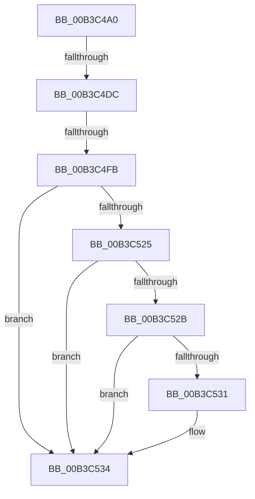

# sub_00B3C4A0

- RVA: `0x00B3C4A0`–`0x00B3C544` (길이 `164` bytes)
- VA: `0x0000000140B3C4A0`
- 실행 섹션: `PAGE`
- PDB 이름 있음: `아니요`; PDB Function 태그: `아니요`
- unwind 정보 RVA: `0x000B0764`
- 디코드: `41`개 명령, `164/164` bytes 표시
- 미해석 바이트: `0` (있으면 어셈블리에 `.byte`로 보존)

> 이 문서는 커널 이미지의 기계어와 PDB 기호를 분석해 생성했습니다. 4번과 5번은 함수 원형과 자료형을 바이너리 사용 방식에서 추정한 C 해석이며 원본 소스 복구 결과는 아닙니다.

## 1. Dependencies

- 직접 호출 지점: **5**; 고유 호출 대상: **4**
- 직접 호출자로 확인된 함수: **0**
- RIP 상대 이미지 참조: **1**

### Outgoing calls
- `0x00B3C4AB` → [RtlInitUnicodeString](../../text/42/RtlInitUnicodeString_function_0042A780.md) (function, `0x0042A780`)
- `0x00B3C4CC` → [ZwQueryValueKey](../../text/6A/ZwQueryValueKey_function_006AD3B0.md) (function, `0x006AD3B0`)
- `0x00B3C4EA` → [ExAllocatePool2](../../poolcode/B8/ExAllocatePool2_function_00B820F0.md) (function, `0x00B820F0`)
- `0x00B3C51C` → [ZwQueryValueKey](../../text/6A/ZwQueryValueKey_function_006AD3B0.md) (function, `0x006AD3B0`)
- `0x00B3C539` → [ExFreePoolWithTag](../../poolcode/B8/ExFreePoolWithTag_function_00B82870.md) (function, `0x00B82870`)

### Direct callers
- 이 함수 시작 RVA로 연결되는 직접 call은 확인되지 않았습니다. 간접 호출은 완전히 역산할 수 없습니다.

### Static image references
- `0x00B3C4A0` → RVA `0x00B06EE0` (` ?? ::NNGAKEGL::`string'`; read)

## 2. Other-region calls and transfers

- 다른 실행 섹션으로 향하는 call: **5**
  - `0x00B3C4AB` → [RtlInitUnicodeString](../../text/42/RtlInitUnicodeString_function_0042A780.md) (`PAGE` → `.text`)
  - `0x00B3C4CC` → [ZwQueryValueKey](../../text/6A/ZwQueryValueKey_function_006AD3B0.md) (`PAGE` → `.text`)
  - `0x00B3C4EA` → [ExAllocatePool2](../../poolcode/B8/ExAllocatePool2_function_00B820F0.md) (`PAGE` → `POOLCODE`)
  - `0x00B3C51C` → [ZwQueryValueKey](../../text/6A/ZwQueryValueKey_function_006AD3B0.md) (`PAGE` → `.text`)
  - `0x00B3C539` → [ExFreePoolWithTag](../../poolcode/B8/ExFreePoolWithTag_function_00B82870.md) (`PAGE` → `POOLCODE`)
- call이 아닌 외부 분기/꼬리 이동: **3**
  - `0x00B3C4D6` → [WmipGetRegistryHideMachine + 0x7F](../A4/WmipGetRegistryHideMachine_function_00A4F174.md) (`tail-transfer`)
  - `0x00B3C4F5` → [WmipGetRegistryHideMachine + 0x7F](../A4/WmipGetRegistryHideMachine_function_00A4F174.md) (`tail-transfer`)
  - `0x00B3C53F` → [WmipGetRegistryHideMachine + 0x7F](../A4/WmipGetRegistryHideMachine_function_00A4F174.md) (`tail-transfer`)

## 3. Assembly (complete function range)

```asm
00B3C4A0  48 8D 15 39 AA FC FF            lea rdx, [rip - 0x355c7]
00B3C4A7  48 8D 4D C0                     lea rcx, [rbp - 0x40]
00B3C4AB  E8 D0 E2 8E FF                  call 0x14042a780
00B3C4B0  48 8B 4D 18                     mov rcx, qword ptr [rbp + 0x18]
00B3C4B4  48 8D 45 10                     lea rax, [rbp + 0x10]
00B3C4B8  45 33 C9                        xor r9d, r9d
00B3C4BB  48 89 44 24 28                  mov qword ptr [rsp + 0x28], rax
00B3C4C0  21 7C 24 20                     and dword ptr [rsp + 0x20], edi
00B3C4C4  48 8D 55 C0                     lea rdx, [rbp - 0x40]
00B3C4C8  45 8D 41 02                     lea r8d, [r9 + 2]
00B3C4CC  E8 DF 0E B7 FF                  call 0x1406ad3b0
00B3C4D1  3D 23 00 00 C0                  cmp eax, 0xc0000023
00B3C4D6  0F 85 17 2D F1 FF               jne 0x140a4f1f3
00B3C4DC  8B 55 10                        mov edx, dword ptr [rbp + 0x10]
00B3C4DF  B9 00 01 00 00                  mov ecx, 0x100
00B3C4E4  41 B8 57 6D 69 70               mov r8d, 0x70696d57
00B3C4EA  E8 01 5C 04 00                  call 0x140b820f0
00B3C4EF  48 8B D8                        mov rbx, rax
00B3C4F2  48 85 C0                        test rax, rax
00B3C4F5  0F 84 F8 2C F1 FF               je 0x140a4f1f3
00B3C4FB  8B 4D 10                        mov ecx, dword ptr [rbp + 0x10]
00B3C4FE  48 8D 45 10                     lea rax, [rbp + 0x10]
00B3C502  48 89 44 24 28                  mov qword ptr [rsp + 0x28], rax
00B3C507  48 8D 55 C0                     lea rdx, [rbp - 0x40]
00B3C50B  89 4C 24 20                     mov dword ptr [rsp + 0x20], ecx
00B3C50F  4C 8B CB                        mov r9, rbx
00B3C512  48 8B 4D 18                     mov rcx, qword ptr [rbp + 0x18]
00B3C516  41 B8 02 00 00 00               mov r8d, 2
00B3C51C  E8 8F 0E B7 FF                  call 0x1406ad3b0
00B3C521  85 C0                           test eax, eax
00B3C523  78 0F                           js 0x140b3c534
00B3C525  83 7B 04 04                     cmp dword ptr [rbx + 4], 4
00B3C529  75 09                           jne 0x140b3c534
00B3C52B  83 7B 08 04                     cmp dword ptr [rbx + 8], 4
00B3C52F  75 03                           jne 0x140b3c534
00B3C531  8B 7B 0C                        mov edi, dword ptr [rbx + 0xc]
00B3C534  33 D2                           xor edx, edx
00B3C536  48 8B CB                        mov rcx, rbx
00B3C539  E8 32 63 04 00                  call 0x140b82870
00B3C53E  90                              nop
00B3C53F  E9 AF 2C F1 FF                  jmp 0x140a4f1f3
```

## 4. C-style interpretation (structured pseudocode)

```c
__int64 __fastcall sub_00B3C4A0(__int64 a1, __int64 a2, __int64 a3, int a4)
{
    __int64 result;
    __int64 v_rdi;
    unsigned int v_stack_p20;
    unsigned __int64 v_stack_p28;

    result = RtlInitUnicodeString(v_rbp - 64, v_rip - 218567, a3, a4);
    a4 = 0;
    v_stack_p28 = v_rbp + 16;
    result = ZwQueryValueKey(*(unsigned __int64 *)(v_rbp + 24), v_rbp - 64, a4 + 2, a4);
    result = ExAllocatePool2(256, (unsigned int)(*(unsigned int *)(v_rbp + 16)), (unsigned int)(0x70696D57ULL), a4);
    v_stack_p28 = v_rbp + 16;
    v_stack_p20 = (unsigned int)((unsigned int)(*(unsigned int *)(v_rbp + 16)));
    result = ZwQueryValueKey(*(unsigned __int64 *)(v_rbp + 24), v_rbp - 64, 2, result);
    if (sign_flag) goto loc_00B3C534;
    if ((*(unsigned int *)(result + 4)) != 4) goto loc_00B3C534;
    if ((*(unsigned int *)(result + 8)) == 4) {
        v_rdi = *(unsigned int *)(result + 12);
    }
    a2 = 0;
    result = ExFreePoolWithTag(result, a2, 2, result);
}
```

## 5. (Beta) C Style

```c
int64_t sub_00B3C4A0(int64_t Arg1, int64_t Arg2, int64_t Arg3, int32_t Arg4)
{
    int64_t result;
    int64_t local_rdi;
    uint32_t v_stack_p20;
    uint64_t v_stack_p28;

    result = RtlInitUnicodeString(local_rbp - 64, v_rip - 218567, Arg3, Arg4);
    Arg4 = 0;
    v_stack_p28 = local_rbp + 16;
    result = ZwQueryValueKey(*(uint64_t *)(local_rbp + 0x18), local_rbp - 64, Arg4 + 2, Arg4);
    result = ExAllocatePool2(256, (uint32_t)(*(uint32_t *)(local_rbp + 0x10)), (uint32_t)(0x70696D57ULL), Arg4);
    v_stack_p28 = local_rbp + 16;
    v_stack_p20 = (uint32_t)((uint32_t)(*(uint32_t *)(local_rbp + 0x10)));
    result = ZwQueryValueKey(*(uint64_t *)(local_rbp + 0x18), local_rbp - 64, 2, result);
    if (sign_flag) goto loc_00B3C534;
    if ((*(uint32_t *)(result + 0x4)) != 4) goto loc_00B3C534;
    if ((*(uint32_t *)(result + 0x8)) == 4) {
        local_rdi = *(uint32_t *)(result + 0xC);
    }
    Arg2 = 0;
    result = ExFreePoolWithTag(result, Arg2, 2, result);
}
```

## 6. Execution-region graph

[열기: 2D/3D 그래프와 함수 탐색 컨트롤 패널](../../../control-panel.html?section=page&rva=0x00B3C4A0&view=graph)

- 2D 그래프는 위에서 아래로 흐르고, 3D 그래프는 빈 공간을 드래그해 회전합니다. Shift+드래그는 이동, 휠은 확대·축소, 함수 노드 선택은 대상 보고서 이동입니다.

### Static fallback


