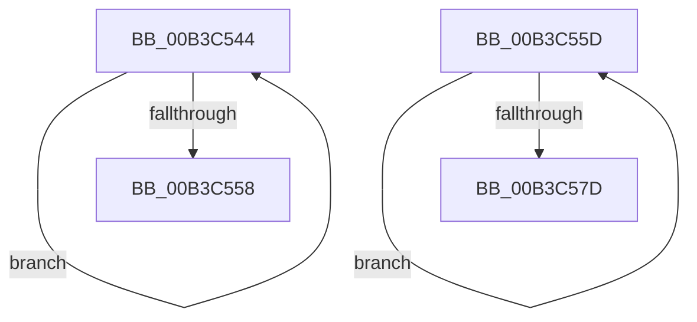

# sub_00B3C544

- RVA: `0x00B3C544`–`0x00B3C582` (길이 `62` bytes)
- VA: `0x0000000140B3C544`
- 실행 섹션: `PAGE`
- PDB 이름 있음: `아니요`; PDB Function 태그: `아니요`
- unwind 정보 RVA: `0x000B093C`
- 디코드: `15`개 명령, `62/62` bytes 표시
- 미해석 바이트: `0` (있으면 어셈블리에 `.byte`로 보존)

> 이 문서는 커널 이미지의 기계어와 PDB 기호를 분석해 생성했습니다. 4번과 5번은 함수 원형과 자료형을 바이너리 사용 방식에서 추정한 C 해석이며 원본 소스 복구 결과는 아닙니다.

## 1. Dependencies

- 직접 호출 지점: **0**; 고유 호출 대상: **0**
- 직접 호출자로 확인된 함수: **0**
- RIP 상대 이미지 참조: **0**

### Outgoing calls
- 직접 디코드된 call 명령이 없습니다.

### Direct callers
- 이 함수 시작 RVA로 연결되는 직접 call은 확인되지 않았습니다. 간접 호출은 완전히 역산할 수 없습니다.

### Static image references
- 디코드된 RIP-relative 메모리 참조가 없습니다.

## 2. Other-region calls and transfers

- 다른 실행 섹션으로 향하는 call: **0**
- call이 아닌 외부 분기/꼬리 이동: **2**
  - `0x00B3C558` → [EtwpUpdateGlobalGroupMasks + 0x107](../A4/EtwpUpdateGlobalGroupMasks_function_00A4F55C.md) (`tail-transfer`)
  - `0x00B3C57D` → [EtwpUpdateGlobalGroupMasks + 0x1BA](../A4/EtwpUpdateGlobalGroupMasks_function_00A4F55C.md) (`tail-transfer`)

## 3. Assembly (complete function range)

```asm
00B3C544  42 8B 84 02 AC 11 00 00         mov eax, dword ptr [rdx + r8 + 0x11ac]
00B3C54C  09 02                           or dword ptr [rdx], eax
00B3C54E  48 8D 52 04                     lea rdx, [rdx + 4]
00B3C552  49 83 E9 01                     sub r9, 1
00B3C556  75 EC                           jne 0x140b3c544
00B3C558  E9 06 31 F1 FF                  jmp 0x140a4f663
00B3C55D  41 8B 84 18 54 EE FF FF         mov eax, dword ptr [r8 + rbx - 0x11ac]
00B3C565  F7 D0                           not eax
00B3C567  21 03                           and dword ptr [rbx], eax
00B3C569  21 04 19                        and dword ptr [rcx + rbx], eax
00B3C56C  21 84 1A 54 EE FF FF            and dword ptr [rdx + rbx - 0x11ac], eax
00B3C573  48 8D 5B 04                     lea rbx, [rbx + 4]
00B3C577  49 83 EE 01                     sub r14, 1
00B3C57B  75 E0                           jne 0x140b3c55d
00B3C57D  E9 94 31 F1 FF                  jmp 0x140a4f716
```

## 4. C-style interpretation (structured pseudocode)

```c
__int64 __fastcall sub_00B3C544(__int64 a1, __int64 a2, __int64 a3, __int64 a4)
{
    a4 = (a4) - (1);
    if (condition_is_not_equal) goto loc_00B3C544;
}
```

## 5. (Beta) C Style

```c
int64_t sub_00B3C544(int64_t Arg1, void *Arg2, int64_t Arg3, int64_t Arg4)
{
    uint8_t *arg2 = (uint8_t *)Arg2;

    Arg4 = (Arg4) - (1);
    if (condition_is_not_equal) goto loc_00B3C544;
}
```

### 관측된 메모리 오프셋

구조체 형식이 확인되지 않은 접근은 인자 기준의 오프셋으로만 기록했습니다.

| 기준 인자 | 오프셋 표현 | 폭 (bit) | 접근 |
|---|---:|---:|---|
| `Arg2` | `+ 0x0` | `32` | `R/W` |
| `Arg2` | `+ 0x4` | `64` | `R` |
| `Arg2` | `+ 0x11AC + r8*1` | `32` | `R` |

## 6. Execution-region graph

[열기: 2D/3D 그래프와 함수 탐색 컨트롤 패널](../../../control-panel.html?section=page&rva=0x00B3C544&view=graph)

- 2D 그래프는 위에서 아래로 흐르고, 3D 그래프는 빈 공간을 드래그해 회전합니다. Shift+드래그는 이동, 휠은 확대·축소, 함수 노드 선택은 대상 보고서 이동입니다.

### Static fallback


