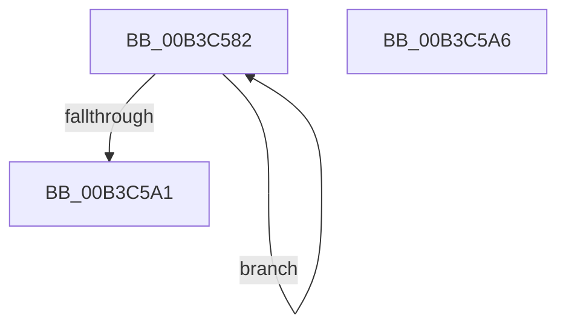

# sub_00B3C582

- RVA: `0x00B3C582`–`0x00B3C5BA` (길이 `56` bytes)
- VA: `0x0000000140B3C582`
- 실행 섹션: `PAGE`
- PDB 이름 있음: `아니요`; PDB Function 태그: `아니요`
- unwind 정보 RVA: `0x000B0968`
- 디코드: `13`개 명령, `56/56` bytes 표시
- 미해석 바이트: `0` (있으면 어셈블리에 `.byte`로 보존)

> 이 문서는 커널 이미지의 기계어와 PDB 기호를 분석해 생성했습니다. 4번과 5번은 함수 원형과 자료형을 바이너리 사용 방식에서 추정한 C 해석이며 원본 소스 복구 결과는 아닙니다.

## 1. Dependencies

- 직접 호출 지점: **2**; 고유 호출 대상: **2**
- 직접 호출자로 확인된 함수: **0**
- RIP 상대 이미지 참조: **3**

### Outgoing calls
- `0x00B3C592` → [KeStopProfile](../../text/5C/KeStopProfile_function_005C0640.md) (function, `0x005C0640`)
- `0x00B3C5AF` → [KeCancelTimer2](../../text/3A/KeCancelTimer2_function_003A01E0.md) (function, `0x003A01E0`)

### Direct callers
- 이 함수 시작 RVA로 연결되는 직접 call은 확인되지 않았습니다. 간접 호출은 완전히 역산할 수 없습니다.

### Static image references
- `0x00B3C58B` → RVA `0x00EFF298` (`.data`; read)
- `0x00B3C599` → RVA `0x00EFF290` (`.data`; read)
- `0x00B3C5A8` → RVA `0x00EFF3C0` (`.data`; read)

## 2. Other-region calls and transfers

- 다른 실행 섹션으로 향하는 call: **2**
  - `0x00B3C592` → [KeStopProfile](../../text/5C/KeStopProfile_function_005C0640.md) (`PAGE` → `.text`)
  - `0x00B3C5AF` → [KeCancelTimer2](../../text/3A/KeCancelTimer2_function_003A01E0.md) (`PAGE` → `.text`)
- call이 아닌 외부 분기/꼬리 이동: **2**
  - `0x00B3C5A1` → [EtwpDisableKernelTrace + 0x1F1](../A4/EtwpDisableKernelTrace_function_00A4F7D8.md) (`tail-transfer`)
  - `0x00B3C5B5` → [EtwpDisableKernelTrace + 0x20F](../A4/EtwpDisableKernelTrace_function_00A4F7D8.md) (`tail-transfer`)

## 3. Assembly (complete function range)

```asm
00B3C582  8B C7                           mov eax, edi
00B3C584  48 69 C8 68 02 00 00            imul rcx, rax, 0x268
00B3C58B  48 03 0D 06 2D 3C 00            add rcx, qword ptr [rip + 0x3c2d06]
00B3C592  E8 A9 40 A8 FF                  call 0x1405c0640
00B3C597  FF C7                           inc edi
00B3C599  3B 3D F1 2C 3C 00               cmp edi, dword ptr [rip + 0x3c2cf1]
00B3C59F  72 E1                           jb 0x140b3c582
00B3C5A1  E9 23 34 F1 FF                  jmp 0x140a4f9c9
00B3C5A6  33 D2                           xor edx, edx
00B3C5A8  48 8D 0D 11 2E 3C 00            lea rcx, [rip + 0x3c2e11]
00B3C5AF  E8 2C 3C 86 FF                  call 0x1403a01e0
00B3C5B4  90                              nop
00B3C5B5  E9 2D 34 F1 FF                  jmp 0x140a4f9e7
```

## 4. C-style interpretation (structured pseudocode)

```c
__int64 __fastcall sub_00B3C582(__int64 a1, int a2)
{
    __int64 result;
    __int64 v_rdi;

    a1 = (a1) * ((unsigned int)((unsigned int)(v_rdi)));
    a1 = (a1) + (*(unsigned __int64 *)(v_rip + 3943686));
    result = KeStopProfile(a1, a2, a3, a4);
    v_rdi = (unsigned int)((v_rdi) + 1);
    if (((unsigned int)(v_rdi)) < (*(unsigned int *)(v_rip + 3943665))) goto loc_00B3C582;
}
```

## 5. (Beta) C Style

```c
int64_t sub_00B3C582(int64_t Arg1, int32_t Arg2)
{
    int64_t result;
    int64_t local_rdi;

    Arg1 = (Arg1) * ((uint32_t)((uint32_t)(local_rdi)));
    Arg1 = (Arg1) + (*(uint64_t *)(v_rip + 0x3C2D06));
    result = KeStopProfile(Arg1, Arg2, a3, a4);
    local_rdi = (uint32_t)((local_rdi) + 1);
    if (((uint32_t)(local_rdi)) < (*(uint32_t *)(v_rip + 0x3C2CF1))) goto loc_00B3C582;
}
```

## 6. Execution-region graph

[열기: 2D/3D 그래프와 함수 탐색 컨트롤 패널](../../../control-panel.html?section=page&rva=0x00B3C582&view=graph)

- 2D 그래프는 위에서 아래로 흐르고, 3D 그래프는 빈 공간을 드래그해 회전합니다. Shift+드래그는 이동, 휠은 확대·축소, 함수 노드 선택은 대상 보고서 이동입니다.

### Static fallback


