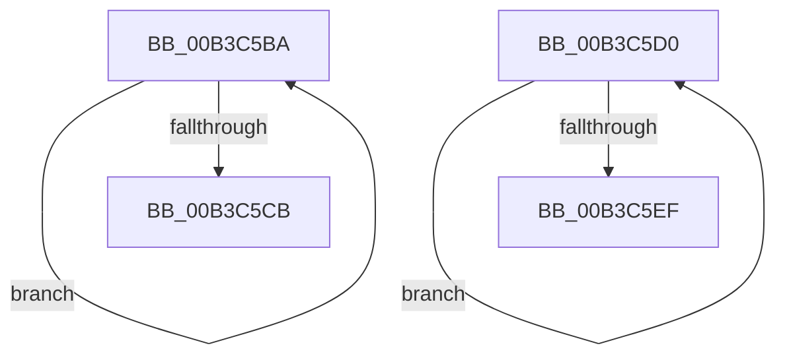

# sub_00B3C5BA

- RVA: `0x00B3C5BA`–`0x00B3C5FD` (길이 `67` bytes)
- VA: `0x0000000140B3C5BA`
- 실행 섹션: `PAGE`
- PDB 이름 있음: `아니요`; PDB Function 태그: `아니요`
- unwind 정보 RVA: `0x000B09A0`
- 디코드: `17`개 명령, `67/67` bytes 표시
- 미해석 바이트: `0` (있으면 어셈블리에 `.byte`로 보존)

> 이 문서는 커널 이미지의 기계어와 PDB 기호를 분석해 생성했습니다. 4번과 5번은 함수 원형과 자료형을 바이너리 사용 방식에서 추정한 C 해석이며 원본 소스 복구 결과는 아닙니다.

## 1. Dependencies

- 직접 호출 지점: **1**; 고유 호출 대상: **1**
- 직접 호출자로 확인된 함수: **0**
- RIP 상대 이미지 참조: **2**

### Outgoing calls
- `0x00B3C5E0` → [KeStartProfile](../../text/4E/KeStartProfile_function_004E1120.md) (function, `0x004E1120`)

### Direct callers
- 이 함수 시작 RVA로 연결되는 직접 call은 확인되지 않았습니다. 간접 호출은 완전히 역산할 수 없습니다.

### Static image references
- `0x00B3C5D9` → RVA `0x00EFF298` (`.data`; read)
- `0x00B3C5E7` → RVA `0x00EFF290` (`.data`; read)

## 2. Other-region calls and transfers

- 다른 실행 섹션으로 향하는 call: **1**
  - `0x00B3C5E0` → [KeStartProfile](../../text/4E/KeStartProfile_function_004E1120.md) (`PAGE` → `.text`)
- call이 아닌 외부 분기/꼬리 이동: **2**
  - `0x00B3C5CB` → [EtwpEnableKernelTrace + 0x5C](../A4/EtwpEnableKernelTrace_function_00A4FBCC.md) (`tail-transfer`)
  - `0x00B3C5F8` → [EtwpEnableKernelTrace + 0x2A2](../A4/EtwpEnableKernelTrace_function_00A4FBCC.md) (`tail-transfer`)

## 3. Assembly (complete function range)

```asm
00B3C5BA  8B 04 0A                        mov eax, dword ptr [rdx + rcx]
00B3C5BD  F7 D0                           not eax
00B3C5BF  21 01                           and dword ptr [rcx], eax
00B3C5C1  48 8D 49 04                     lea rcx, [rcx + 4]
00B3C5C5  49 83 E8 01                     sub r8, 1
00B3C5C9  75 EF                           jne 0x140b3c5ba
00B3C5CB  E9 58 36 F1 FF                  jmp 0x140a4fc28
00B3C5D0  8B C7                           mov eax, edi
00B3C5D2  48 69 C8 68 02 00 00            imul rcx, rax, 0x268
00B3C5D9  48 03 0D B8 2C 3C 00            add rcx, qword ptr [rip + 0x3c2cb8]
00B3C5E0  E8 3B 4B 9A FF                  call 0x1404e1120
00B3C5E5  FF C7                           inc edi
00B3C5E7  3B 3D A3 2C 3C 00               cmp edi, dword ptr [rip + 0x3c2ca3]
00B3C5ED  72 E1                           jb 0x140b3c5d0
00B3C5EF  41 0F BA EF 0A                  bts r15d, 0xa
00B3C5F4  44 89 7D E3                     mov dword ptr [rbp - 0x1d], r15d
00B3C5F8  E9 71 38 F1 FF                  jmp 0x140a4fe6e
```

## 4. C-style interpretation (structured pseudocode)

```c
__int64 __fastcall sub_00B3C5BA(__int64 a1, __int64 a2, __int64 a3)
{
    __int64 result;

    result = (unsigned int)(~((unsigned int)(*(unsigned int *)(a2 + a1 * 1))));
    a3 = (a3) - (1);
    if (condition_is_not_equal) goto loc_00B3C5BA;
}
```

## 5. (Beta) C Style

```c
int64_t sub_00B3C5BA(void *Arg1, void *Arg2, int64_t Arg3)
{
    uint8_t *arg1 = (uint8_t *)Arg1;
    uint8_t *arg2 = (uint8_t *)Arg2;

    int64_t result;

    result = (uint32_t)(~((uint32_t)(*(uint32_t *)(arg2 + arg1 * 1))));
    Arg3 = (Arg3) - (1);
    if (condition_is_not_equal) goto loc_00B3C5BA;
}
```

### 관측된 메모리 오프셋

구조체 형식이 확인되지 않은 접근은 인자 기준의 오프셋으로만 기록했습니다.

| 기준 인자 | 오프셋 표현 | 폭 (bit) | 접근 |
|---|---:|---:|---|
| `Arg1` | `+ 0x0` | `32` | `R/W` |
| `Arg1` | `+ 0x4` | `64` | `R` |
| `Arg2` | `+ 0x0 + rcx*1` | `32` | `R` |

## 6. Execution-region graph

[열기: 2D/3D 그래프와 함수 탐색 컨트롤 패널](../../../control-panel.html?section=page&rva=0x00B3C5BA&view=graph)

- 2D 그래프는 위에서 아래로 흐르고, 3D 그래프는 빈 공간을 드래그해 회전합니다. Shift+드래그는 이동, 휠은 확대·축소, 함수 노드 선택은 대상 보고서 이동입니다.

### Static fallback


