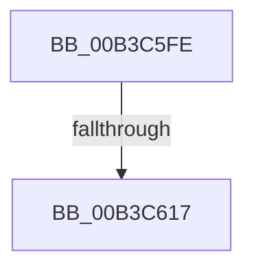

# sub_00B3C5FE

- RVA: `0x00B3C5FE`–`0x00B3C61C` (길이 `30` bytes)
- VA: `0x0000000140B3C5FE`
- 실행 섹션: `PAGE`
- PDB 이름 있음: `아니요`; PDB Function 태그: `아니요`
- unwind 정보 RVA: `0x000B09C0`
- 디코드: `8`개 명령, `30/30` bytes 표시
- 미해석 바이트: `0` (있으면 어셈블리에 `.byte`로 보존)

> 이 문서는 커널 이미지의 기계어와 PDB 기호를 분석해 생성했습니다. 4번과 5번은 함수 원형과 자료형을 바이너리 사용 방식에서 추정한 C 해석이며 원본 소스 복구 결과는 아닙니다.

## 1. Dependencies

- 직접 호출 지점: **1**; 고유 호출 대상: **1**
- 직접 호출자로 확인된 함수: **0**
- RIP 상대 이미지 참조: **1**

### Outgoing calls
- `0x00B3C608` → [EtwpUpdateFileInfoDriverRegistration](../7B/EtwpUpdateFileInfoDriverRegistration_function_007B8B1C.md) (function, `0x007B8B1C`)

### Direct callers
- 이 함수 시작 RVA로 연결되는 직접 call은 확인되지 않았습니다. 간접 호출은 완전히 역산할 수 없습니다.

### Static image references
- `0x00B3C5FE` → RVA `0x00E68488` (`.data`; write)

## 2. Other-region calls and transfers

- 다른 실행 섹션으로 향하는 call: **0**
- call이 아닌 외부 분기/꼬리 이동: **2**
  - `0x00B3C611` → [EtwpUpdateFileInfoDriverState + 0x71](../A5/EtwpUpdateFileInfoDriverState_function_00A501BC.md) (`tail-transfer`)
  - `0x00B3C617` → [EtwpUpdateFileInfoDriverState + 0x75](../A5/EtwpUpdateFileInfoDriverState_function_00A501BC.md) (`tail-transfer`)

## 3. Assembly (complete function range)

```asm
00B3C5FE  89 1D 84 BE 32 00               mov dword ptr [rip + 0x32be84], ebx
00B3C604  8B FB                           mov edi, ebx
00B3C606  8B CB                           mov ecx, ebx
00B3C608  E8 0F C5 C7 FF                  call 0x1407b8b1c
00B3C60D  8B D8                           mov ebx, eax
00B3C60F  85 C0                           test eax, eax
00B3C611  0F 89 16 3C F1 FF               jns 0x140a5022d
00B3C617  E9 15 3C F1 FF                  jmp 0x140a50231
```

## 4. C-style interpretation (structured pseudocode)

```c
__int64 __fastcall sub_00B3C5FE(void)
{
    __int64 result;

    *(unsigned int *)(v_rip + 3325572) = (unsigned int)(v_rbx);
    result = EtwpUpdateFileInfoDriverRegistration((unsigned int)((unsigned int)(v_rbx)), a2, a3, a4);
}
```

## 5. (Beta) C Style

```c
void sub_00B3C5FE(void)
{
    int64_t result;

    *(uint32_t *)(v_rip + 0x32BE84) = (uint32_t)(local_rbx);
    result = EtwpUpdateFileInfoDriverRegistration((uint32_t)((uint32_t)(local_rbx)), a2, a3, a4);
}
```

## 6. Execution-region graph

[열기: 2D/3D 그래프와 함수 탐색 컨트롤 패널](../../../control-panel.html?section=page&rva=0x00B3C5FE&view=graph)

- 2D 그래프는 위에서 아래로 흐르고, 3D 그래프는 빈 공간을 드래그해 회전합니다. Shift+드래그는 이동, 휠은 확대·축소, 함수 노드 선택은 대상 보고서 이동입니다.

### Static fallback


