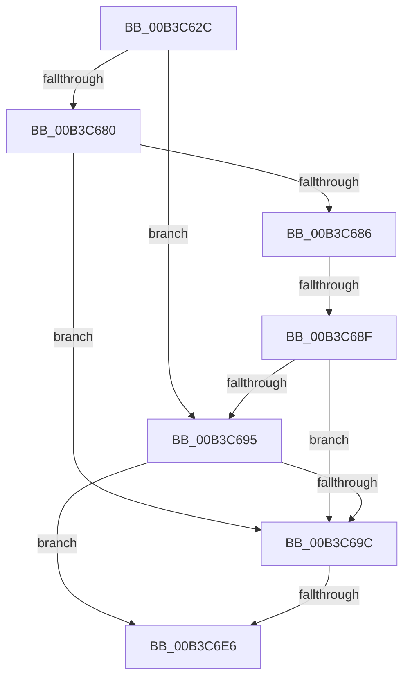

# sub_00B3C62C

- RVA: `0x00B3C62C`–`0x00B3C70D` (길이 `225` bytes)
- VA: `0x0000000140B3C62C`
- 실행 섹션: `PAGE`
- PDB 이름 있음: `아니요`; PDB Function 태그: `아니요`
- unwind 정보 RVA: `0x000B0A5C`
- 디코드: `52`개 명령, `225/225` bytes 표시
- 미해석 바이트: `0` (있으면 어셈블리에 `.byte`로 보존)

> 이 문서는 커널 이미지의 기계어와 PDB 기호를 분석해 생성했습니다. 4번과 5번은 함수 원형과 자료형을 바이너리 사용 방식에서 추정한 C 해석이며 원본 소스 복구 결과는 아닙니다.

## 1. Dependencies

- 직접 호출 지점: **3**; 고유 호출 대상: **3**
- 직접 호출자로 확인된 함수: **0**
- RIP 상대 이미지 참조: **4**

### Outgoing calls
- `0x00B3C675` → [PnpGetObjectProperty](../8E/PnpGetObjectProperty_function_008E2180.md) (function, `0x008E2180`)
- `0x00B3C6D7` → [PnpSetObjectProperty](../8F/PnpSetObjectProperty_function_008F66E8.md) (function, `0x008F66E8`)
- `0x00B3C702` → [ZwUpdateWnfStateData](../../text/6B/ZwUpdateWnfStateData_function_006B0D10.md) (function, `0x006B0D10`)

### Direct callers
- 이 함수 시작 RVA로 연결되는 직접 call은 확인되지 않았습니다. 간접 호출은 완전히 역산할 수 없습니다.

### Static image references
- `0x00B3C62C` → RVA `0x00E66398` (`.data`; read)
- `0x00B3C63B` → RVA `0x000116F8` (`.rdata`; read)
- `0x00B3C6A3` → RVA `0x00028144` (`.rdata`; read)
- `0x00B3C6EA` → RVA `0x00020B20` (`.rdata`; read)

## 2. Other-region calls and transfers

- 다른 실행 섹션으로 향하는 call: **1**
  - `0x00B3C702` → [ZwUpdateWnfStateData](../../text/6B/ZwUpdateWnfStateData_function_006B0D10.md) (`PAGE` → `.text`)
- call이 아닌 외부 분기/꼬리 이동: **3**
  - `0x00B3C689` → [PiDcGenerateConfigNotificationIfContainerRequiresConfiguration + 0x71](../A5/PiDcGenerateConfigNotificationIfContainerRequiresConfiguration_function_00A506F8.md) (`tail-transfer`)
  - `0x00B3C6E0` → [PiDcGenerateConfigNotificationIfContainerRequiresConfiguration + 0x71](../A5/PiDcGenerateConfigNotificationIfContainerRequiresConfiguration_function_00A506F8.md) (`tail-transfer`)
  - `0x00B3C708` → [PiDcGenerateConfigNotificationIfContainerRequiresConfiguration + 0x71](../A5/PiDcGenerateConfigNotificationIfContainerRequiresConfiguration_function_00A506F8.md) (`tail-transfer`)

## 3. Assembly (complete function range)

```asm
00B3C62C  48 8B 0D 65 9D 32 00            mov rcx, qword ptr [rip + 0x329d65]
00B3C633  48 8D 45 48                     lea rax, [rbp + 0x48]
00B3C637  89 74 24 50                     mov dword ptr [rsp + 0x50], esi
00B3C63B  4C 8D 25 B6 50 4D FF            lea r12, [rip - 0xb2af4a]
00B3C642  48 89 44 24 48                  mov qword ptr [rsp + 0x48], rax
00B3C647  45 33 C9                        xor r9d, r9d
00B3C64A  C7 44 24 40 04 00 00 00         mov dword ptr [rsp + 0x40], 4
00B3C652  48 8D 45 F0                     lea rax, [rbp - 0x10]
00B3C656  48 89 44 24 38                  mov qword ptr [rsp + 0x38], rax
00B3C65B  48 8B D7                        mov rdx, rdi
00B3C65E  48 8D 45 40                     lea rax, [rbp + 0x40]
00B3C662  48 89 44 24 30                  mov qword ptr [rsp + 0x30], rax
00B3C667  45 8D 41 05                     lea r8d, [r9 + 5]
00B3C66B  4C 89 64 24 28                  mov qword ptr [rsp + 0x28], r12
00B3C670  48 89 74 24 20                  mov qword ptr [rsp + 0x20], rsi
00B3C675  E8 06 5B DA FF                  call 0x1408e2180
00B3C67A  8B D8                           mov ebx, eax
00B3C67C  85 C0                           test eax, eax
00B3C67E  78 15                           js 0x140b3c695
00B3C680  83 7D 40 07                     cmp dword ptr [rbp + 0x40], 7
00B3C684  75 16                           jne 0x140b3c69c
00B3C686  39 75 F0                        cmp dword ptr [rbp - 0x10], esi
00B3C689  0F 84 DA 40 F1 FF               je 0x140a50769
00B3C68F  83 7D 40 07                     cmp dword ptr [rbp + 0x40], 7
00B3C693  75 07                           jne 0x140b3c69c
00B3C695  3D 25 02 00 C0                  cmp eax, 0xc0000225
00B3C69A  75 4A                           jne 0x140b3c6e6
00B3C69C  48 8B 0D F5 9C 32 00            mov rcx, qword ptr [rip + 0x329cf5]
00B3C6A3  48 8D 05 9A BA 4E FF            lea rax, [rip - 0xb14566]
00B3C6AA  89 74 24 48                     mov dword ptr [rsp + 0x48], esi
00B3C6AE  45 33 C9                        xor r9d, r9d
00B3C6B1  C7 44 24 40 04 00 00 00         mov dword ptr [rsp + 0x40], 4
00B3C6B9  48 8B D7                        mov rdx, rdi
00B3C6BC  48 89 44 24 38                  mov qword ptr [rsp + 0x38], rax
00B3C6C1  C7 44 24 30 07 00 00 00         mov dword ptr [rsp + 0x30], 7
00B3C6C9  45 8D 41 05                     lea r8d, [r9 + 5]
00B3C6CD  4C 89 64 24 28                  mov qword ptr [rsp + 0x28], r12
00B3C6D2  48 89 74 24 20                  mov qword ptr [rsp + 0x20], rsi
00B3C6D7  E8 0C A0 DB FF                  call 0x1408f66e8
00B3C6DC  8B D8                           mov ebx, eax
00B3C6DE  85 C0                           test eax, eax
00B3C6E0  0F 88 83 40 F1 FF               js 0x140a50769
00B3C6E6  89 74 24 30                     mov dword ptr [rsp + 0x30], esi
00B3C6EA  48 8D 0D 2F 44 4E FF            lea rcx, [rip - 0xb1bbd1]
00B3C6F1  89 74 24 28                     mov dword ptr [rsp + 0x28], esi
00B3C6F5  45 33 C9                        xor r9d, r9d
00B3C6F8  45 33 C0                        xor r8d, r8d
00B3C6FB  48 89 74 24 20                  mov qword ptr [rsp + 0x20], rsi
00B3C700  33 D2                           xor edx, edx
00B3C702  E8 09 46 B7 FF                  call 0x1406b0d10
00B3C707  90                              nop
00B3C708  E9 5C 40 F1 FF                  jmp 0x140a50769
```

## 4. C-style interpretation (structured pseudocode)

```c
__int64 __fastcall sub_00B3C62C(__int64 a1, __int64 a2, __int64 a3, int a4)
{
    __int64 result;
    unsigned __int64 v_stack_p20;
    unsigned __int64 v_stack_p28;
    unsigned __int64 v_stack_p30;
    unsigned __int64 v_stack_p38;
    unsigned int v_stack_p40;
    unsigned __int64 v_stack_p48;
    unsigned int v_stack_p50;

    v_stack_p50 = (unsigned int)(v_rsi);
    v_stack_p48 = v_rbp + 72;
    a4 = 0;
    v_stack_p40 = 4;
    v_stack_p38 = v_rbp - 16;
    v_stack_p30 = v_rbp + 64;
    v_stack_p28 = v_rip - 11710282;
    v_stack_p20 = v_rsi;
    result = PnpGetObjectProperty(*(unsigned __int64 *)(v_rip + 3317093), v_rdi, a4 + 5, a4);
    if (sign_flag) goto loc_00B3C695;
    if ((*(unsigned int *)(v_rbp + 64)) != 7) goto loc_00B3C69C;
    if ((*(unsigned int *)(v_rbp + 64)) != 7) goto loc_00B3C69C;
loc_00B3C695:
    if (((unsigned int)(result)) != 0xC0000225ULL) goto loc_00B3C6E6;
loc_00B3C69C:
    v_stack_p48 = (unsigned int)(v_rsi);
    a4 = 0;
    v_stack_p40 = 4;
    v_stack_p38 = v_rip - 11617638;
    v_stack_p30 = 7;
    v_stack_p28 = v_rip - 11710282;
    v_stack_p20 = v_rsi;
    result = PnpSetObjectProperty(*(unsigned __int64 *)(v_rip + 3316981), v_rdi, a4 + 5, a4);
loc_00B3C6E6:
    v_stack_p30 = (unsigned int)(v_rsi);
    v_stack_p28 = (unsigned int)(v_rsi);
    a4 = 0;
    a3 = 0;
    v_stack_p20 = v_rsi;
    a2 = 0;
    result = ZwUpdateWnfStateData(v_rip - 11647953, a2, a3, a4);
}
```

## 5. (Beta) C Style

```c
int64_t sub_00B3C62C(int64_t Arg1, int64_t Arg2, int64_t Arg3, int32_t Arg4)
{
    int64_t result;
    uint64_t v_stack_p20;
    uint64_t v_stack_p28;
    uint64_t v_stack_p30;
    uint64_t v_stack_p38;
    uint32_t v_stack_p40;
    uint64_t v_stack_p48;
    uint32_t v_stack_p50;

    v_stack_p50 = (uint32_t)(local_rsi);
    v_stack_p48 = local_rbp + 72;
    Arg4 = 0;
    v_stack_p40 = 4;
    v_stack_p38 = local_rbp - 16;
    v_stack_p30 = local_rbp + 64;
    v_stack_p28 = v_rip - 11710282;
    v_stack_p20 = local_rsi;
    result = PnpGetObjectProperty(*(uint64_t *)(v_rip + 0x329D65), local_rdi, Arg4 + 5, Arg4);
    if (sign_flag) goto loc_00B3C695;
    if ((*(uint32_t *)(local_rbp + 0x40)) != 7) goto loc_00B3C69C;
    if ((*(uint32_t *)(local_rbp + 0x40)) != 7) goto loc_00B3C69C;
loc_00B3C695:
    if (((uint32_t)(result)) != 0xC0000225ULL) goto loc_00B3C6E6;
loc_00B3C69C:
    v_stack_p48 = (uint32_t)(local_rsi);
    Arg4 = 0;
    v_stack_p40 = 4;
    v_stack_p38 = v_rip - 11617638;
    v_stack_p30 = 7;
    v_stack_p28 = v_rip - 11710282;
    v_stack_p20 = local_rsi;
    result = PnpSetObjectProperty(*(uint64_t *)(v_rip + 0x329CF5), local_rdi, Arg4 + 5, Arg4);
loc_00B3C6E6:
    v_stack_p30 = (uint32_t)(local_rsi);
    v_stack_p28 = (uint32_t)(local_rsi);
    Arg4 = 0;
    Arg3 = 0;
    v_stack_p20 = local_rsi;
    Arg2 = 0;
    result = ZwUpdateWnfStateData(v_rip - 11647953, Arg2, Arg3, Arg4);
}
```

## 6. Execution-region graph

[열기: 2D/3D 그래프와 함수 탐색 컨트롤 패널](../../../control-panel.html?section=page&rva=0x00B3C62C&view=graph)

- 2D 그래프는 위에서 아래로 흐르고, 3D 그래프는 빈 공간을 드래그해 회전합니다. Shift+드래그는 이동, 휠은 확대·축소, 함수 노드 선택은 대상 보고서 이동입니다.

### Static fallback


