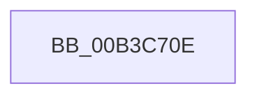

# sub_00B3C70E

- RVA: `0x00B3C70E`–`0x00B3C75F` (길이 `81` bytes)
- VA: `0x0000000140B3C70E`
- 실행 섹션: `PAGE`
- PDB 이름 있음: `아니요`; PDB Function 태그: `아니요`
- unwind 정보 RVA: `0x000B0AF0`
- 디코드: `19`개 명령, `81/81` bytes 표시
- 미해석 바이트: `0` (있으면 어셈블리에 `.byte`로 보존)

> 이 문서는 커널 이미지의 기계어와 PDB 기호를 분석해 생성했습니다. 4번과 5번은 함수 원형과 자료형을 바이너리 사용 방식에서 추정한 C 해석이며 원본 소스 복구 결과는 아닙니다.

## 1. Dependencies

- 직접 호출 지점: **1**; 고유 호출 대상: **1**
- 직접 호출자로 확인된 함수: **0**
- RIP 상대 이미지 참조: **0**

### Outgoing calls
- `0x00B3C754` → [EtwTraceKernelEvent](../../text/23/EtwTraceKernelEvent_function_00235350.md) (function, `0x00235350`)

### Direct callers
- 이 함수 시작 RVA로 연결되는 직접 call은 확인되지 않았습니다. 간접 호출은 완전히 역산할 수 없습니다.

### Static image references
- 디코드된 RIP-relative 메모리 참조가 없습니다.

## 2. Other-region calls and transfers

- 다른 실행 섹션으로 향하는 call: **1**
  - `0x00B3C754` → [EtwTraceKernelEvent](../../text/23/EtwTraceKernelEvent_function_00235350.md) (`PAGE` → `.text`)
- call이 아닌 외부 분기/꼬리 이동: **1**
  - `0x00B3C75A` → [CmpLogHiveDirtyEvent + 0x2C](../A5/CmpLogHiveDirtyEvent_function_00A50A6C.md) (`tail-transfer`)

## 3. Assembly (complete function range)

```asm
00B3C70E  8B C2                           mov eax, edx
00B3C710  48 8D 4D F7                     lea rcx, [rbp - 9]
00B3C714  48 03 C0                        add rax, rax
00B3C717  C7 44 24 20 02 19 60 00         mov dword ptr [rsp + 0x20], 0x601902
00B3C71F  FF C2                           inc edx
00B3C721  41 B9 28 09 00 00               mov r9d, 0x928
00B3C727  41 B8 00 00 00 41               mov r8d, 0x41000000
00B3C72D  48 89 4C C5 07                  mov qword ptr [rbp + rax*8 + 7], rcx
00B3C732  48 8D 4D FB                     lea rcx, [rbp - 5]
00B3C736  4C 89 54 C5 0F                  mov qword ptr [rbp + rax*8 + 0xf], r10
00B3C73B  8B C2                           mov eax, edx
00B3C73D  48 03 C0                        add rax, rax
00B3C740  FF C2                           inc edx
00B3C742  48 89 4C C5 07                  mov qword ptr [rbp + rax*8 + 7], rcx
00B3C747  48 8D 4D 07                     lea rcx, [rbp + 7]
00B3C74B  48 C7 44 C5 0F 04 00 00 00      mov qword ptr [rbp + rax*8 + 0xf], 4
00B3C754  E8 F7 8B 6F FF                  call 0x140235350
00B3C759  90                              nop
00B3C75A  E9 39 43 F1 FF                  jmp 0x140a50a98
```

## 4. C-style interpretation (structured pseudocode)

```c
__int64 __fastcall sub_00B3C70E(__int64 a1, int a2)
{
    __int64 result;
    unsigned int v_stack_p20;

    result = ((unsigned int)(a2)) + ((unsigned int)(a2));
    v_stack_p20 = 0x601902ULL;
    a2 = (unsigned int)((a2) + 1);
    *(unsigned __int64 *)(v_rbp + result * 8 + 7) = v_rbp - 9;
    *(unsigned __int64 *)(v_rbp + result * 8 + 15) = v_r10;
    result = ((unsigned int)(a2)) + ((unsigned int)(a2));
    a2 = (unsigned int)((a2) + 1);
    *(unsigned __int64 *)(v_rbp + result * 8 + 7) = v_rbp - 5;
    *(unsigned __int64 *)(v_rbp + result * 8 + 15) = 4;
    result = EtwTraceKernelEvent(v_rbp + 7, a2, (unsigned int)(0x41000000ULL), (unsigned int)(0x928ULL));
}
```

## 5. (Beta) C Style

```c
int64_t sub_00B3C70E(int64_t Arg1, int32_t Arg2)
{
    int64_t result;
    uint32_t v_stack_p20;

    result = ((uint32_t)(Arg2)) + ((uint32_t)(Arg2));
    v_stack_p20 = 0x601902ULL;
    Arg2 = (uint32_t)((Arg2) + 1);
    *(uint64_t *)(local_rbp + result * 8 + 0x7) = local_rbp - 9;
    *(uint64_t *)(local_rbp + result * 8 + 0xF) = local_r10;
    result = ((uint32_t)(Arg2)) + ((uint32_t)(Arg2));
    Arg2 = (uint32_t)((Arg2) + 1);
    *(uint64_t *)(local_rbp + result * 8 + 0x7) = local_rbp - 5;
    *(uint64_t *)(local_rbp + result * 8 + 0xF) = 4;
    result = EtwTraceKernelEvent(local_rbp + 7, Arg2, (uint32_t)(0x41000000ULL), (uint32_t)(0x928ULL));
}
```

## 6. Execution-region graph

[열기: 2D/3D 그래프와 함수 탐색 컨트롤 패널](../../../control-panel.html?section=page&rva=0x00B3C70E&view=graph)

- 2D 그래프는 위에서 아래로 흐르고, 3D 그래프는 빈 공간을 드래그해 회전합니다. Shift+드래그는 이동, 휠은 확대·축소, 함수 노드 선택은 대상 보고서 이동입니다.

### Static fallback


